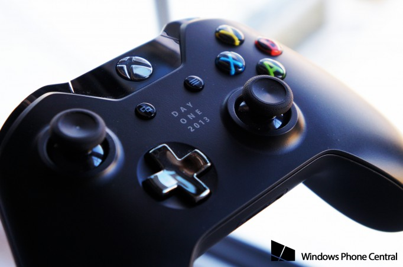
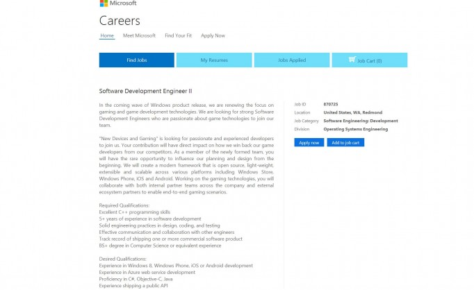

# Microsoft creating ‘open source’ framework for gaming, formed a new team for iOS, Windows Phone and Android

Microsoft may finally be hearing your complaints about the lack of Xbox Live support, though it may not be what you envisioned. While many have been calling for Microsoft to differentiate themselves by doubling down on Xbox Live exclusive games, their recent strategy of openness and cross-platform support suggests otherwise.

Now, a new job posting for a newly formed team at Microsoft, dubbed initially as "**New Devices and Gaming**", gives some clues as to where Redmond is looking next for dominance. While Xbox 360, Xbox One and Live games are exclusive to Microsoft products, there appears to be a new strategy materializing.

A key line in the description for the Software Development Engineer II level job is revealing about the emphasis of this new team.

> “We will create a modern framework that is open source, light-weight, extensible and scalable across various platforms including Windows Store, Windows Phone, iOS and Android.”

The goal of this project is even clearer:

> “…win back our game developers from our competitors”

Finally, the job description finishes with the scope of the project:

> “Working on the gaming technologies, you will collaborate with both internal partner teams across the company and external ecosystem partners to enable end-to-end gaming scenarios.”

That is a radical departure from the current locked-in mentality of Xbox and strongly suggests that Microsoft is going big in their vision. Indeed, from Office to OneDrive to Bing to [Nokia X](http://www.wpcentral.com/tag/nokia-x) and so forth, Microsoft seems eager to get their products on everything – and everywhere – without discrimination.

Seeing as new [CEO Satya Nadella](http://www.wpcentral.com/satya-nadella) is a ‘services guy’, we can see this being an extension of his vision for the company. Could we see Xbox Live going cross-platform? Where services – and not devices – are the corner stone of Microsoft’s strategy? We’ll have to wait and find out, but that’s our bet.

Source: [Microsoft Careers](https://careers.microsoft.com/jobdetails.aspx?jid=137128&pp=VR); *Thanks, Toni A., for the tip!*

### [Daniel Rubino](http://www.wpcentral.com/users/daniel-rubino-0 "View Daniel Rubino Profile") Editor-in-chief

> "When god gives you lemons...you find a new god."

More from Windows Phone Central

[Recommended by](#)

[Ads by Google](https://www.google.com/url?ct=abg&q=https://www.google.com/adsense/support/bin/request.py%3Fcontact%3Dabg_afc%26url%3Dhttp://www.wpcentral.com/microsoft-creating-open-source-framework-gaming%26gl%3DBR%26hl%3Den%26client%3Dca-pub-8460099860738313%26ai0%3DCvWvEZCsXU5WFNKiTlALCnIE4gK-jiAXAjOeJnQHAjbcBEAEggJX0ASgDUOn7jJr7_____wFgzcDngJwDoAGzk5nsA8gBAagDAaoEpgFP0BA7XDSqJ04QKb8y1yQaM98dN7SPjfG5dvYYeGCyy4fo_c8wJXzPwILufBXgREqG4LzYh1iNSpAk30LvKI0Cprs2ViMkzUsVNhjZ19aNJayT3Q3L6vONoM1XiIahr0jloi5J5yBquG0_J5pacAIrXfjwidR71wuucUT5Ji0RaYIXRQPaUP7Wc7cnsKjx2s59KWvsBmLAnFkg7UbHFaJ_YS9tYMDLiAYBgAec5uoR%26ai1%3DC5DWhZCsXU5WFNKiTlALCnIE4udSq5ATR1IHvevDG8Y8tEAIggJX0ASgDUJKm1P74_____wFgzcDngJwDoAGvuMzRA8gBAakCRVqm7NLmhT6oAwGqBKABT9BgTlY0qydOECm_MtckGjPfHTe0j43xuXb2GHhgssuH6P3PMCV8z8CC7nwV4ERKhuC82IdYjUqQJN9C7yiNAqa7NlYjJM1LFTYY2dfWjSWsk90Ny-rzjaDNV4iGoa9I5aIuSecgarhtPyeaWnACK1348InkeC9wW0xk-LcS-2KCF7_gMUyD3VW_zbM9PdrOfylpOAZiwNxbMPhDNo8kUIgGAYAHucezLg%26ai2%3DCo7WvZCsXU5WFNKiTlALCnIE41LL8qAXUmYusbcCNtwEQAyCAlfQBKANQrubfjARgzcDngJwDoAG6o9bWA8gBAakCC05y6DDdfD6oAwGqBKMBT9BQQUk0qSdOECm_MtckGjPfHTe0j43xuXb2GHhgssuH6P3PMCV8z8CC7nwV4ERKhuC82IdYjUqQJN9C7yiNAqa7NlYjJM1LFTYY2dfWjSWsk90Ny-rzjaDNV4iGoa9I5aIuSecgarhtPyeaWnACK1348ImseNdDrtwrfawS-1SCF3MD2pwdPaMpx0Y--y_Nu9xoKPNj0GlYMFhFx7Wki27YqogGAYAHvMuEJQ&usg=AFQjCNF36CF2wj_AuLeNwcHLsltqImGRPQ)

[Avast Antivirus 2014](http://www.googleadservices.com/pagead/aclk?sa=L&ai=CvWvEZCsXU5WFNKiTlALCnIE4gK-jiAXAjOeJnQHAjbcBEAEggJX0ASgDUOn7jJr7_____wFgzcDngJwDoAGzk5nsA8gBAagDAaoEpgFP0BA7XDSqJ04QKb8y1yQaM98dN7SPjfG5dvYYeGCyy4fo_c8wJXzPwILufBXgREqG4LzYh1iNSpAk30LvKI0Cprs2ViMkzUsVNhjZ19aNJayT3Q3L6vONoM1XiIahr0jloi5J5yBquG0_J5pacAIrXfjwidR71wuucUT5Ji0RaYIXRQPaUP7Wc7cnsKjx2s59KWvsBmLAnFkg7UbHFaJ_YS9tYMDLiAYBgAec5uoR&num=2&cid=5Gh6W0-RgYu54L0g8hNUOd6r&sig=AOD64_2B7CwYTovfZnb4Rql38xjCLF8dNg&client=ca-pub-8460099860738313&adurl=http://www.avast.com/pt-br/lp-ppc-win-01c%3Fcha%3Dppc%26sen%3Dgoogle%26ste%3D%26var%3D42111055152%26omcid%3DPT-BR_Content_Generic) - 100% Seguro e fácil de baixar. Última versão 2014 disponível aqui. [www.avast.com](http://www.googleadservices.com/pagead/aclk?sa=L&ai=CvWvEZCsXU5WFNKiTlALCnIE4gK-jiAXAjOeJnQHAjbcBEAEggJX0ASgDUOn7jJr7_____wFgzcDngJwDoAGzk5nsA8gBAagDAaoEpgFP0BA7XDSqJ04QKb8y1yQaM98dN7SPjfG5dvYYeGCyy4fo_c8wJXzPwILufBXgREqG4LzYh1iNSpAk30LvKI0Cprs2ViMkzUsVNhjZ19aNJayT3Q3L6vONoM1XiIahr0jloi5J5yBquG0_J5pacAIrXfjwidR71wuucUT5Ji0RaYIXRQPaUP7Wc7cnsKjx2s59KWvsBmLAnFkg7UbHFaJ_YS9tYMDLiAYBgAec5uoR&num=2&cid=5Gh6W0-RgYu54L0g8hNUOd6r&sig=AOD64_2B7CwYTovfZnb4Rql38xjCLF8dNg&client=ca-pub-8460099860738313&adurl=http://www.avast.com/pt-br/lp-ppc-win-01c%3Fcha%3Dppc%26sen%3Dgoogle%26ste%3D%26var%3D42111055152%26omcid%3DPT-BR_Content_Generic)

[Download Software](http://www.googleadservices.com/pagead/aclk?sa=L&ai=C5DWhZCsXU5WFNKiTlALCnIE4udSq5ATR1IHvevDG8Y8tEAIggJX0ASgDUJKm1P74_____wFgzcDngJwDoAGvuMzRA8gBAakCRVqm7NLmhT6oAwGqBKABT9BgTlY0qydOECm_MtckGjPfHTe0j43xuXb2GHhgssuH6P3PMCV8z8CC7nwV4ERKhuC82IdYjUqQJN9C7yiNAqa7NlYjJM1LFTYY2dfWjSWsk90Ny-rzjaDNV4iGoa9I5aIuSecgarhtPyeaWnACK1348InkeC9wW0xk-LcS-2KCF7_gMUyD3VW_zbM9PdrOfylpOAZiwNxbMPhDNo8kUIgGAYAHucezLg&num=3&cid=5Gh6W0-RgYu54L0g8hNUOd6r&sig=AOD64_3pMzVfQ6HG2XKsgGLMY5UTrtDpUQ&client=ca-pub-8460099860738313&adurl=http://www.mobogenie.com/landingpage/newgdn.html) - Download Free PC Manager Software for Android Devices, Download Now ! [www.mobogenie.com/Android-Manager](http://www.googleadservices.com/pagead/aclk?sa=L&ai=C5DWhZCsXU5WFNKiTlALCnIE4udSq5ATR1IHvevDG8Y8tEAIggJX0ASgDUJKm1P74_____wFgzcDngJwDoAGvuMzRA8gBAakCRVqm7NLmhT6oAwGqBKABT9BgTlY0qydOECm_MtckGjPfHTe0j43xuXb2GHhgssuH6P3PMCV8z8CC7nwV4ERKhuC82IdYjUqQJN9C7yiNAqa7NlYjJM1LFTYY2dfWjSWsk90Ny-rzjaDNV4iGoa9I5aIuSecgarhtPyeaWnACK1348InkeC9wW0xk-LcS-2KCF7_gMUyD3VW_zbM9PdrOfylpOAZiwNxbMPhDNo8kUIgGAYAHucezLg&num=3&cid=5Gh6W0-RgYu54L0g8hNUOd6r&sig=AOD64_3pMzVfQ6HG2XKsgGLMY5UTrtDpUQ&client=ca-pub-8460099860738313&adurl=http://www.mobogenie.com/landingpage/newgdn.html)

## Comments

There are 163 comments.
[Sign in](https://passport.mobilenations.com/?u=eNpVjksSgyAQRO9i1viLGiWHsXAYDBVxqAGLRSp3Dyyz6_m87lZykJ8gu15WjNoyQlxcLz6qZ5DzKKtXjF42TUqpTh7wjKyOGsg1zgJTIBMFMKpoz12Qx1MEuhhQGFYOE_Fb7Mrl4y0zLuPCELti3k3_gavTY9nfcxGY2-6hTQub0aBn7B79AtOwqX5bFt2q8jfIKtiIRWZcIvlcIrKlgmjpLEMuf9Bus_7-XDCEDkyT "Sign in via Mobile Nations Passport") to comment

[coip](http://www.wpcentral.com/users/coip "View user profile.") says:

I'll totally play you in Alphajax. Get you all addicted to Xbox achievements. You'll love it. Soon we'll be playing Wordament, then Uno and Friends, Carcassonne. Let's get this party started.

Don't go too far with this and I'd be happy. Just make sure WP is always ahead of the competitors .

That seems like the plan its like this its ignorant to loose out on the money cause not everybody will get windows phone but windows phone will be pushed with advantages!

I'm having a hard time deciphering this sentence, but found the irony of calling someone "ignorant" while using the word "loose" when meaning "lose", kinda funny.

Agreed.like seriously?xbl going cross-platform??we want uniqueness in windows phone.what exclusivity will we have if we even share xbl achievements??Live tiles??\*Rolls eyes\* Come on MS,we also want MS products,devices everywhere but this going just too far.instead of spreading xbl to other platforms why not improve our system?why would anyone chose WP over iOS or android if they can get xbl games on their respective phones??not everyone chooses phones based on how much they lag and specially not android users. -.-  
We need to stop with this sh\*t and that Nokia X sh\*t or else this will go too far and I fear that one day we will see WPC reporting about merging with android central because of shared news.seriously STAHP!! :'(

[coip](http://www.wpcentral.com/users/coip "View user profile.") says:

"why would anyone chose WP over iOS or android if they can get xbl games on their respective phones". You're right. They wouldn't. Putting the exclusive features of Windows Phone on competitors' platforms is essentially throwing in the towel. It negates the need for Windows Phone to even exist at all. If this is their plan they might as well kill WP, write off that $7 billion Nokia devices purchase, and focus on making software for iOS and Android.

Now, the job description above is quite vague, so it's not entirely clear what it actually means. So, we shouldn't jump to conclusions here. But if it means what you think it means, I see it as the start of Windows Phone's death, which would be tragic because it's such a great platform.

At this point I think Microsoft has come to the realization that WP and Windows are never going to be anything more than a distant third to ios and android and are plowing ahead with spreading their services everywhere. With the touch version of office strongly rumored to be coming to the ipad before Windows devices I wouldn't expect anything to be exclusive to WP or Windows 8 going forward and WP will continue to be a lesser priority in Microsoft's eyes.

@ theefman,I totally agree with you and I think that is MS's thinking as well as can be seen by the release of Nokia X and MS not having a problem about it.no matter how much Daniel seems to be optimistic about it,this is just not MS-like.previously they wouldn't have touched android with a ten-foot stick and now suddenly they have np problem with it.the blunt truth is that MS has accepted its defeat with windowsphone,no matter how you phrase it.

What about those of us who have zero interest in Xbox?

I like Steam for PC gaming, and I don't care at all about anything related to Xbox, yet I use a Windows Phone. Xbox isn't something everyone wants.

Point taken, but XBox does have a ton of fans/users that could be attracted if the brand were leveraged more...or at all.

I think more people just want to play the same games as their friends on Android/iOS. Whether a game is multiplayer and cross platform is more important. For example, the BlackBerry users complained about not having Angry Birds, when that was the most popular cross platform game.

I totally agree with you.Why not make all the top class games available on IOS AND DROID on Windows Phone rather than providing other platforms with our unique features?Already we have less apps than those tonful of droid and ios though we have major apps now.But if not then MS is digging their own grave.Still lets see what happens after wp8.1 update.

[coip](http://www.wpcentral.com/users/coip "View user profile.") says:

No one is saying that "everyone" wants Xbox. We're saying a lot of people do (81 million people bought Xbox 360s), and we're saying it's a distinguishing feature of Microsoft hardware. Giving that away undermines the need for certain hardware to exist and creates a slippery slope argument where Microsoft would seemingly be better off completely abandoning all hardware entirely. Few people will buy a Windows Phone when most of it's distinguishing features are available on competing platforms that offer even more features in addition. Game developers will stop making Xbox games if they knew Xbox games were going to be on other platforms. Why make an Xbox game for iOS when you can already make a Gamecenter game for iOS. Doesn't make sense.

Sony isn't adding PS4 games to Xperia phones, and the PS4 is incredibly popular too.

[coip](http://www.wpcentral.com/users/coip "View user profile.") says:

Yes, they are. It's called Playstation Now. It's coming soon.

Then why do you care about XBOX Live and XBOX Achievements?

I don't. I don't use anything Xbox-related.

The only achievements that matter to me are the Steam achievements.

I completely agree. I hope this isn't what the job description is leading to.  
Rather than making new services for the competition, they should be advertising what Windows Phone has to offer vs the competition.  
We're losing the tight integration with services like Facebook chat over third party apps like Messenger (which completely goes against what Windows Phone came into the market as), and almost all Microsoft services are now cross-platform (Bing, Xbox Music+Video, Skype, OneDrive), so all we really have to differentiate ourselves is Live Tiles... I don't think that's going to cut it.  
I don't see Google or Apple making their services completely cross-platform, why should we do the same? They're biting themselves in the ass, making it harder for consumers to actually switch to Windows Phone unless they rely heavily on the services within the ecosystem.

Get your services on every platform, then people are going to use those services, and use hardware and platforms (Windows) where all those services are tied together seemlessly and baked into the OS.

Only, thats not what will happen.

Yup. Losing exclusivity of xbl means we lose one of the few advantages of windows phone. Smart move in terms of getting software out there, bad move if they are trying to push the hardware.

@TonyRAnderson WHY WOULD ANYONE CHOOSE WINDOWS PLATFORM WHEN THEY CAN GET THE SAME THING ON OTHERS?? -.-  
This step will most probably increase MS shares but won't wpusers decrease as well?? :-\

That's if they do this correctly. Make sure that new games and updates arrive to WP first or at the very least at the same time. Also make sure that the service look and run better on WP devices. If people like the services, that might give them reason to switch platform to get a better experience.

Four words: "devices and services company"

Look at the bigger picture. If MS succed to steal the developers from using Google's shitty games services, all those android apps will be FINNALLY FREE of Google and could be used on any fork of android.

FREE ANDROID GAMES FTW

Why should WP have xbox live and xbox achievements in first place? It's not xbox and I don't agree for people to be able to double on achievements that they already got on xbox. I have iPhone and had xbox live since its existance as I was beta tester, got 174k gamerscore so why should you have an advantage for xbox achievements just because you own completelly different device?

[coip](http://www.wpcentral.com/users/coip "View user profile.") says:

If you own an Xbox 360 and an Xbox One you also earn achievements on both. People who care will get the extra device. That's the entire point of why Microsoft brougth Xbox gaming to Windows Phone and Windows 8/RT in the first place: to entice gamers to buy devices they otherwise would not have gotten. They are leveraging their strengths (Xbox) to prop up their weaknesses (mobile phones and tablets). It's a brilliant move, in theory, but they have badly botched its execution. They should be touting Windows Phones and Windows 8 tablets as 3DS and Vita substitutes: Xbox gaming, wherever you want it: on your Windows 8 PC at work, on your Windows Phone 8 in the car, on your Surface tablet at the coffee shop, on your Xbox One in the living room. It's awesome.

That would be nice, but microsofts other divisions don't seem to give a crap about windows phone. Just look at Skype and how much better the iOS app was for so very long!

I hope Windows Phone will be one of the most important services in Satya's vision.

well judging on the fact that Satya was very serious about the nokia aqqusition i can see WP will have the first class  MS services. similar to Google's way

I hope we get some REAL mobile games on WP, like Forza maybe?

Keep dreaming :P At least not with graphics like forza, but gameplay sure

The new one already plays like a shitphone game, so it fits.

Erm, Forza 5 plays AMAZINGLY. What you talking about man?

I'd KILL for Skyrim or TF2. even HL2.

Okay, THAT on a phone wouldn't really work.

Maybe not now, but Battle Supremacy on iOS has a HUGE map, and Skyrim with lower graphics, fewer items and render distance might actually work, although coding and the physical size of the game would be hard for our current hardware. That would be a huge selling point!

I just bought oxymoron by schoolboy q and I feel riped off every other place to get music is cheaper for the deluxe edition than Xbox music!

I've never understood MS pricing. In Australia everything is way more expensive than in the US (far beyond exchange rate difference) but also above and beyond usual retail pricing. E.g. I went to rent a movie and they want $7-8, or to buy $20-30... That's like double retail price, and you'd think digital would be less expensive. Xbox games are typically around $100 on release but $70 in the shops. It's like they don't even want to (or can't?) compete with retail, so there's almost no incentive to use any of those services unless you enjoy paying more not to go to a shop.

This kind of logic makes me wonder if MS thinks they could have saved Zune if they only had made Smart DJ iPod compatible.

I never knew a single person who owned a Zune and have no idea what Smart DJ was.

Just make sure WP games come out before or on the same day as its iOS and Android competitors. Otherwise, great idea, especially if it could enable cross platform online gaming.

Thats the idea! Microsoft wants their game devs back! Bye releasing a crossplatform Graphics framework. the only things devs are left to do then are, replacing some minor code and compiling the game for each platform new. This will greatly speed up development for every dev.

There are multiple cross-platform tools available even today. Most of them are even free, at least for the first ~$100k. Then again, it's never as simple as just re-compiling.

Yes, but when the underlying framework is open source and can be run on multiple platforms, it becomes that much closer to being "as simple as just recompiling."

Plus, no IDE can compare to Visual Studio; if that's opened up beyond the .NET Framework to include this new framework to program for other platforms...I'm happy and I'd imagine many other devs would be too.

Being open source doesn't automatically make it easier for cross platform development.

Security & WP first please Microsoft... We all know how pathetic both Android & iOS are in security.

I think it's smart. Locking services to your hardware works for Apple, in a limited fashion. Microsoft wants their services everywhere, and I can't blame them. The idea of cross-platform Xbox gaming is pretty fantastic, if that's what they're thinking,

[Rico](http://www.wpcentral.com/users/rico "View user profile.") says:

This. Microsoft everywhere.

Should wp be top priority ... With money being top dog how could we be ???

Exactly. The fact is you cant win the smartphone war, no one can, not even android with its 80% share. So the sensible thing to do is put MS services everywhere. Get money that way, grow the brand and the name and it will, slowly but surely, grow wp too.

Notice, Dan. The sentence says its goal is to make games "scalable",but it says nothing about accessing/getting achievements, having xbl, etc. for that game. I'm interpreting this differently than you are. I think that games that are XBL-compatible on WP will have a counterpart version scaled onto other mobile OSes, and vice versa. This way, people who want access to WP's awesome exclusive games will be able to play them, but they won't get the full experience, i.e. XBL achievements, unless they buy a Windows Phone.

I think it is smart also. Yet, as a WP fan and user I fear MS is going to abandon WP and support of it and the Nokia X line is just the beginning.

Cross-platform Xbox gaming would be great.  I find it ridiculous I can't play Uno and Friends with my friends on iOS and Android because the WP version is Xbox-enabled.  Due to the current locked down nature of Xbox mobile gaming, any sort of "play with your friends" game is actually signing a death wish since it locks itself to the limited WP marketshare (EA actually gets around this with some games like Tetris Blitz).  Cross-platform play can only help the WP gaming sphere.

I think you're a couple steps ahead in this thinking: this sounds only like XNA 5.0 Open source. XNA was more about content importers and math functions and not necessary Xbox Live. Developers could not even use Xbox Live unless they had a publisher.

Cross platform yes. Azure probably. ...but Xbox Live matchmaking and achievements are unlikely at this point.

Daniel are you the only one working today? You written the last four articles.

lol, evidently. Must be nice to *not* be the boss ;)

That is an interesting approach especially for developers. Remember that games, besides service app like bank and social networks, are the most popular downloaded app. If a developer can target iOS, android, windows and Xbox One, and the framework is open, this is will be the holy grail of gaming development. That actually a smart move from Microsoft and it shows their understanding of their place in the mobile market. I am actually very excited about this.

If it means more Xbox enabled games, do it.

Are they going to render Windows Phone useless?

How so? People today aren't buying Windows Phone for Xbox Live, so why would this change?

[coip](http://www.wpcentral.com/users/coip "View user profile.") says:

I know plenty of people who bough Windows Phone for Xbox Live. And it's the start of a slippery slope: if you give away Xbox as a distinguishing feature, why stop there? If you really want to be a services company you have to put all of your services on all devices, thereby rendering your own devices superflous (and a huge waste of money when you factor in all of the costs of developing, making, and distributing said devices). Case in point: Google's sell-off of Nokia. They put all their services on all Android devices, making the Motorola versions of Android glaringly not special. As a result, they failed miserably and cost Google billions of dollars. If Microsoft does the same and starts gifting away all their exclusive features, it does not make practical sense to spend the money developing, manufacturing, distributing, and advertising hardware like Windows Phone and Xbox.

Actually, Google was after the patents. First thing they did after the acusition was to sell the factories.  
After that they sold Motorola, that is the Name/Brand but they kept the pattents. It's not hard to see that Goggle never had plans to enter into the Devices market.

[coip](http://www.wpcentral.com/users/coip "View user profile.") says:

Yeah, that's not true. Google bought Motorola back in 2011 for $12.5 billion and spent more money developing and releasing several Motorolal phones since then that got destroyed in sales by Samsung and HTC, lost several patent lawsuits in the meantime, and then cut their losses and sold to Lenovo this year for a huge loss. Yes, one reason they bought Motorola was for patents (that didn't really work out for them), but saying it was the only reason and then claiming they had no plans to enter the devices market, especially considering that they did enter the devices market, is an odd claim to make. You don't hold onto a company for 2.5 years, wasting a ton of money in the meantime and releasing products, if all you wanted was patents.

@Daniel\_Rubino Google and iOS are doing non of these for their dedicated services but yet still they are successful. Will MS doing this makes a change or make them earn more money?? No Google app is on WP that made me and still makes me think about them. Forgetting about Youtube, I use Google+ a lot...like crazy and since my beloved mobile OS doesn't have it (Google not developing for us), that made me go for the HTC One.....solely for Google+ and Youtube. This as you might think makes most of us on WP still kinda have Google products.....talking of exclusivity.

Now if MS wanna be mother of all and send their dedicated services to all....I say it will render WP USELESS cuz I wouldn't see the reason to be on it. One of the main reasons I bought WP back in 2010 was for Xbox gaming, that got me into Xbox services. I'm not really a fan of holding more than One phone, don't really like it so if MS makes these services available to others, then I might just choose one and go either iOS or Andriod.

@Daniel\_Rubino have ever looked at the Google+ and youtube apps on Android? GOSH! they are just beautiful, feature rich, fluid and so responding...WHY? Because the team is dedicated and focused on making it better for the platform instead of thinking about making it for WP. MS having teams developing their services on other platforms takes away their concentration and dedication....making the apps so light and featureless (talking of Xbox app on Android and iOS....SOOO USELESS). IF MS could just concentrate on WP and make these apps soo hardcore and great, they will strongly dominate. Not forgetting why they losing billions it's cuz of of these strategies of being a mother to all, it makes them waste money on stuff that no one cares about.

I dont really even care if WP is gets a better version of things anymore. I just don't want to have worse versions!

[coip](http://www.wpcentral.com/users/coip "View user profile.") says:

The biggest mistakes Microsoft made in regards to gaming on Windows Phone is 1) to put some Xbox games on iOS and Android (e.g. Wordament, Kinectimals), and 2) the lack of effort in getting quality Xbox games to the platform. If this means they're nixing Xbox on Windows Phone and seeking to get boring hand-me-downs from iOS and Android, I'm not interested in Windows Phone anymore. If it means they're bringing Xbox games to iOS and Android, I really question the logic behind that move. What would be next? Xbox games on Playstation 4 and Wii U? It essentially destroys the purpose of your own platform (here, Windows Phone). Distinguishing features are what bring people in. Not giving those features away. #SaveXboxWP

I disagree 100%.

Services are the future, not hardware. But where hardware is important, Microsoft has proven, in my mind, that they can churn out great devices: Zune HD, Xbox One, Kinect, Surface, Windows Phone (thru Nokia HW).

You release a universal service, you showcase it on your own, top tier 'ideal' hardware. It's brilliant.

Also, if you think putting Wordament and Kinectimals on iOS and Android hurt Windows Phone, I mean....

I'd like to see more people sign into games using a Microsoft Account, regardless of whether they're on iOS or Windows.

[coip](http://www.wpcentral.com/users/coip "View user profile.") says:

By your logic, Windows Phone shouldn't exist at all. They should simply throw in the towel on Windows Phone and put all of their services on iOS and Android. There is a reason that Apple is the largest and most profitable tech company in the history of the world: he who controls the hardware also controls the software, and vice-versa. In some cases, yes, it makes sense to put your services on a plethora of platforms (Skype is one example); in other cases, it does not.

Putting Wordament and Kinectimals on iOS and Android hurt Windows Phone by declaring to everyone that you don't have to have a Microsoft product to enjoy what was once a service exclusive to Microsoft devices. People buy Xboxes because they want to play Xbox games. If Xbox games are on other devices, there is no point in spending the R&D, marketing, manufacturing, shipping, and stocking costs of making Xboxes.

> "By your logic, Windows Phone shouldn't exist at all. They should simply throw in the towel on Windows Phone and put all of their services on iOS and Android. "

This is some steamy bullshit, sorry. We use Windows Phone because of the everyday user experience, the  great Nokia hardware, the fantastic camera experience and the simplicity (and consistency across devices) of the UI.

If you're buying a phone for Kinectimals then you're an embarrassment.

Not everyone chose it because of that.I for one got it for a gift and I fell in love with it because of the things which DIFFERENCIATED it from ios and android.I know 4 people who own windows phone 7.8 who are still hanging on to it because of exclusivity(live tiles,xbl games etc).give away our features too other platforms and many people in a similar situation will make the jump to android or ios. :(

[coip](http://www.wpcentral.com/users/coip "View user profile.") says:

"If you're buying a phone for Kinectimals then you're an embarrassment".

Well aren't you being incredibly judgmental and condescending.

"We use Windows Phone because..."

Speak for yourself, not others. Perhaps you use a Windows Phone for those reasons--and that's fine--but assuming everyone else uses Windows Phone for the same reason as you, and then declaring the actual reason they use Windows Phone to be "an embarrassment" is astonishingly pompous.

"I" bought a Windows Phone because of NOKIA'S Camera.

a game not many know about, and not many play it either in their phones :) thats all I can say about.  
it was just a kinect game for 360, of course a phone wont have something like kinect, so its just taking care about "cute" unreal animals with not a real point. at least with kinect you can move and "have fun" but with a phone its really waste of time and just silly to say Microsoft is killing WP releasing those waste of time games in other platforms.

Thanks. I agree with you. Kinect doesn't apply to phones, so you're right.

[coip](http://www.wpcentral.com/users/coip "View user profile.") says:

Rumor has it that Microsoft is seeking to implement Kinect technology into phones and tablets. Could be a really cool feature and more evidence of how cross-pollination across Microsoft's departments can strengthen the whole company, assuming they don't give up their exclusivity of those products, that is.

[coip](http://www.wpcentral.com/users/coip "View user profile.") says:

Kinectimals is the most adorable game ever made.

The inherent flaw of all this debating is this: XBL on WP7/8 has been, and continues to be, a disappointment. This argument of exclusivity would be easier to believe if XBL was worth a damn.

Not a single person I know gives 2 craps that I play Halo SA on my phone. I have friends with a WP who never even tried it. We all wanted XBL to be more than what it is.

Even if some of us bought WP based on XBL integration, at this point its hard to care about it. If a person chose SOLELY based on XBL, then by now they probably have accepted it sucks and may have already moved on from WP.

And speaking of differentiation...2 of my friends and I went to a concert and all 3 of us took videos. An iPhone5, an HTC 8X and me with my 920. The iPhone friend really isn't a techie, and was going on about the quality of his videos before the concert. I held my tongue and smiled. After the show, we compared our recordings and my friends were blown away. My vids were in HD, no pixellation, amd audio was gorgeous (no distortion despite being ip front amd in front of the bass guitar amps). THATS how I differentiate. No gives a crao about Halo... They care a whole lot that mu camera is far superior.

I share the same opinion.

I didn't even know there was a Halo SA for Windows Phone, much less play it on my phone.

I was playing HALO SA the other day, and some of my friends asked what it was, because it looked cool/fun. I awnsered Halo SA, and had a fun time looking at them desperatly looking for it on the app store. They also saw the XBL achievement toast pop up and looked pretty pissed off that they couldn't get that.

Basically it does serve, and people do give a crap.

[coip](http://www.wpcentral.com/users/coip "View user profile.") says:

Absolutely. Most of my friends are unaware that Windows Phone has Xbox gaming and when they find out they are immediatley intrigued. Had Microsoft really pushed Xbox gaming on Windows Phone, and I mean really pushed it, it would've been a huge selling point to a lot of people. It's a huge missed opportunity that, according to this article, they may be exacerbating.

It also didn't help that a lot of the time some xbox games wouldn't connect to the xbox server which would either kick me out of the game without letting me play it, or ignore all the features that supposedly made it "better".

Eventually I just figured \*\*\*\* it, a game's a game. If it works, awesome, if it plays well, even better.

Daniel,Who is this "'we' use windows phone..."??you don't happen to speak for anyone and I disagree with your thesis.

For the first time in my life,Coip,I AGREE with you.Daniel,aren't you being a bit too liberal about MS services being provided to other platforms.Just tell me,why would anyone choose WP over it's competitors if we even gave away xbl.believe me,not all people chose WP because of no lag,most were absorbed by it's exclusive features.we are treading through dangerous paths here and if this continues,mark my words,windows phone shares in market will drop drastically.Daniel,you need to see things as they are,not being optimistic seeing the glass as half full,try to be realistic and think of the disadvantages also.No doubt you are a great editor,but sometimes,you become too naïve. ;)

So I guess Apple's decision on porting iTunes to Windows was bad...man, nobody ever, **EVER** bought those iPods...

You reel people into your **services**, once they see how good the service works (with OneDrive syncing, etc) they're more likely to buy something with that brand on it for the ecosystem. Mac OS X marketshare jumped slightly after iPods became a hit (and they only became a hit because they ported their services to the leading OS).

Fact of the matter is if you're using android and a Windows OS (or even Mac OS X) it's kind of a fragmented ecosystem that's only completed through third-party solutions and the use of a browser (unless you have a chromebook or manually installed chromium on your desktop...but then you're missing out on a lot of functionality that comes with Windows (which, admittedly, a lot of people don't necessarily need)).

[coip](http://www.wpcentral.com/users/coip "View user profile.") says:

iTunes and iPods are not the same thing thing as Xbox games on other platforms. Sure, you could download and use iTunes on a Windows PC but when you wanted to consume the actual content (music) on the go, you had only one option: an iPod. You couldn't play your iTunes music on a Zune.

Actually they did allow that after a little while. I was ripping music through iTunes and putting it on my Nokia devices.

With recent rumours of MS selling off Xbox and WP, so they can return to being a software company only, is this what they are doing?

If MS copy Apple, who have 17% market share on phones, they would be limited to small percentages of success. If MS sent back to being software only i.e Windows, Onedrive, Skype, Games etc, these can eeach across all platforms and OS's. Now success would be much higher this route.

I have a feeling this may be MS future plan, as sticking with the devices and services option will create competitive situations as currently experienced with Google and their services.

If i were running MS I rhink software would be my option, but I'm not so who knows.....

"Services are the future, not hardware"  
iPhone hardware revenue alone is quite bigger than all revenue from all Microsoft divisions put together. Don't try to tell that to Apple.

Apple makes money off their hardware, yes. But it is their services and integration that keep people with iPhone. Services are the future. Smartphones are reaching a plateau. They all essentially do the same thing. The things that differentiate them are the UI, user experience, and services. Services are what will keep people hooked and how companies will make money. This is why we are seeing more companies buying up all kinds of companies or making certain services cross-platform. You have people, such as myself, who use multiple platforms, and to have cross-platform capabilities across any device I use....would be awesome! And that's the company that will get my money.

Posted via the WPC App for Android!

Have you ever paid for a service on Google or IOS?  Do you know anyone who has?  The only way services are a future for Microsoft is if they can monetize them, and that will not be possible when competing against companies that use services solely to drive their real business.

This is even bigger than Xbox enabled game. It is cross-platform gaming which I thing is a bigger deal than being to score achievement.

It reminds me of when Steve Jobs was trying to get info on iTunes. Windows was dominant then, but as he opened up (slightly) the iTunes store, more and more people became amenable to Apple's products. I kind of see this as an option for Microsoft to reopen itself to other people and their choice of platform. :)

I think it is first in the update the reimaging Xbox games app for WP so it will be seperate it won't be Xbox games it will be games with Xbox like those social extensions on IOS for games but third party so like they can put Xbox games on IOS rather then only it being just an app it is an Xbox game win win for Microsoft and it is for windows phone first we already have it it just going to get better in the next update along with IOS and android cause you can ignore what innovation both is bring why not make part of your platform Xbox games extend to IOS and android and grow with it and with that they can learn from IOS and android and gain Xbox players in the long run as valued customers!

Wait... What?! Could this mean that games can work cross-platform between all of the major OSes? As in I can race against my friends with iPhones or Androids? Thats... Amazing!  
Posted via the WPC App for Android!

I think that's what the majority of users want. Most people just want to play games with their friends, without concern regarding which platform their friends use.

Could this be a new XNA? nobody seems to have brought up the possibility...

I hope so. The monogame guys are doing a great game at cross platform but its be nice to have something with the latest c# lingo.

I agree, I was using monogame for a while, but currently i've moved to haxe + openfl, due to the extra device options (flash/html)

Exactly what I was thinking.. New XNA would be awesome! Monogame is really great, but it is somewhat buggy right now, at least for wp..

I totally see it as an open source version of XNA and less about Xbox Live services. .. but its also my dream since I used to use XNA.

And I guess this news guarantee that Xbox division will not sold. They plan on keeping it.

Hope soo, this article dropped the morale here at WPcentral with this Android on Nokia and possibility of selling Xbox people here are going nuts.

So they couldn't be bothered to take gaming seriously on WP but now they will because ios and android are involved as well. Typical.

Tell that to Satya.  There's no doubt his point will be more valid than people wanting a locked in garden

If it gets more Xbox games on WP and also solves the cross platform problem on games then I'm with it :-)

[PGWP](http://www.wpcentral.com/users/pgwp "View user profile.") says:

This is pretty easy to do - buy the Unity Game Engine, it already works on xbox, windows, windows phone, mac, ios and android.  Why try to reinvent the wheel?  Take what they have and expand on it.  Its already being used by thousands of developers.  Make it free to use.  You will lock in so many developers that they will make cross platform apps for everyone.  I believe Unity uses c# already, so you will have more coming into the c# dev world.

Now there will be 'apps' (games) for WP.  People complain there arent apps for WP.  Well now there will be.  It doesnt matter if those apps are on android and ios.  You dont need exclusives - you need parity.   Once you have that people will wonder why they are putting up with trojans, malware and the slow crap that is android - just move to WP which has all the apps/games that android does without the downsides.

[coip](http://www.wpcentral.com/users/coip "View user profile.") says:

If it already works on all devices and thousands of developers already use it, what benefit would be gained by buying it?

[PGWP](http://www.wpcentral.com/users/pgwp "View user profile.") says:

Its not open source.  Being able to control the direction the engine goes; and prevent it from being bought out by the other mobile players.  Prioritizing WP & WIndows features over other mobile platforms.

This kind of reminds me of ms's old 'embrace extend extinguish' policy from the 90's. Embrace other devices, extend the product to these devices, wait until enough people start using it.... Then slowly lock them out of the full features unless they buy a ms product (wp in this case).

Its basically like giving them a bite of this amazing cake and then taking it away unless they comply.

That's what I think they're doing. I don't think it's what people are thinking.

Mantle is Glide 2.0

The serious competition will come from OpenGL.

It makes perfect sense. The tech world isn't driven by hardware. Now Apple obviously has done that to an extent. People do love their hardware, but that isn't the only business model to follow. Google gives their services out for free and has created a very big share in market space. Microsoft from the outset was always a services company. This devices side is something new. Its something I feel is in place to COMPLIMENT their services. Not become the sole arena for the services they offer. People aren't going to respond well to a forced move into hardware that isn't their first choice. If MS was too pull all services and only offer them on their own devices and ones from their close partners, it would fail. Consumers would feel that they were forced into something and to prove a point, go elsewhere. You already see it with some of the backlash regarding Windows 8 and how people feel they were forced into the Start Screen. However, better some of the new features are of Windows 8 many consumers can't see past that. So, MS has their devices now, how they should go about this is making sure that first and foremost those devices receive any updates, features, benefits, first. Push for exciting hardware. You want people in WP, continue doing what you are doing with Nokia. Hardware had to be interesting to pull in more people. The more people using their services will ask where their services are the best. What phone, computer, tablet do these services truly shine on? MS wants to match their services with devices, so having their services on multiple platforms and then truly innovating with product lines like Surface, showcasing those services at their greatest point, will bring more people over to whatever devices they are pushing. Including Windows Phone.

I love your breakdown and explanation. The only issue is MS had abandoned the products these great services work on in the recent future if they are not either core to the business or very profitable. I am starting to believe the company will be selling Xbox and will fade out WP and call it a streamlining in order to service Apple and Google products and make their own phones Android.

While the shareholders will cheer, the tech world will simply fall back to the "MS can't innovate or make great hardware" that we have been subject to the last 6 years or so.

I hope I am wrong because I don't enjoy using iOS or Android and would hate not to have WP available as an option that is equal in usability, etc....

They need to add more Moga supported games. I enjoy Asphault 7 on my Lumia 521 with my Moga Hero Power.

Curious people only 1% about operating systems. 99% of them just go and buy,,

"Today we release the newest Halo game for iOS and Android.

Coming soon to Windows Phone".

Oooh, so many good decisions by Microsoft last time. I wish our government in Ukraine do as much RIGHT decisions as Microsoft now

I think people need to look at this from a different perspective. MS wants to bring in devs from other platforms to make porting and building games easier "for" WP. All this talk about MS giving up with this is unfounded and shows the glass half empty view alot of people have nowadays when things aren't spelled out for them.

If this ends up affecting DirectX I would be actually impressed.

After dropping the 360 game support 3 years after release, creating the biggest pile of shit PC gaming has ever seen and the whole XBone joke I had 0 hopes for Microsoft in the gaming space, but this might as well change it.

If Skype is the example of how MS will treat Windows Phone with developing for all platforms WP is dead in the water. #Sadbuttrue

This is likely XNA reborn. It's a good move.

very exciting for me! I hated how their solution to the end of XNA was to use DirectX or Unity.

MS gone crazy, just like BlackBerry. Sharing their exclusive services to all platforms.

this is not a service its a framework

I guess its a good move if developers launch a xbox game on other platforms they will be forced to launch the same game with xbox on wp as well.....could turn out to be a smart move except that wp will lose another exclusive feature

Microsoft! with this, enable DRC on WP please? :)

Its totally dump.. Xbox only for Microsoft not for ios or android.  
be in class like apple inc. Not as google ..

This seems to be more connected to competing with Unity than anything else.

so now WP loses its differentiation further.

You people complaining that this move will lose differentiation for WP need to chill out. Exclusive games aren't what's going to bring more people to WP. It's the lack of games at all. Developers are ignoring WP because it's not worth the effort for the size of the user base. Microsoft is trying to build a framework where game developers would support Windows and Windows Phone by default.

Their goal is to build a cross-platform framework that runs on Windows 8 and Windows Phone in addition iOS and Android and leverage Windows Azure and Xbox Live achievements for the social component. If they can achieve this, game developers would have no excuse to not publish their games for Windows Phone AND they'll make money off the backend.

Thank you. I'm reading the comments and trying to figure out what everyone is freaking out about. It sounds to me like they're making a new XNA framework for every platform. So like MonoGame with probably different API calls. I mean, it'd probably be in their best interest to do some sort of deal with Monogame to get it up to speed of using without all the issues, but yea. I see why they're doing this. Owning a WP, I want to make games for WP8, but there aren't any good cross platform ways of writing once that support the major 3.  Heck, there's platforms that support BB still, but not WP. So I look forward to this team. I may even apply to transfer in the team when I hit my 1 year at MS.

The problem with this strategy is that Microsoft for some reason thinks that it can compete in the services market.  Microsoft, like Google, does not make money on most of its services.  Lets face it, other than Office 365 which is little more than an extension of Office, Microsoft does not make money on services.  Unlike Google, who makes their money through their huge marketing and data sale engine, Microsoft does not have another revenue stream to fall back on.

Admittedly, Microsoft does charge for XBox Live, but does anyone really see someone paying to access this service on thier IOS or Android device?  Is there any chance that PlayStation users will pay for XBox Live?  Somewhere around 60% of Xbox users use XBox live, which is actually fairly impressive, but I'm certain that there aren't any Windows Phone users that have XBox Live without already having an XBox.

Its difficult to compete with free services.  Microsoft is doing a remarkable job competing with Office 365, but that is in part because of the predominance of Office in the workplace.  I don't see that repeating with gaming services.  Contrary to what was said in an earlier post, Microsoft has never been a services company.  They are a software company that like most software companies has been crippled by open source software and now has to redefine itself as a services company in order to stay in business.  This transition is going to be painful for Microsoft.  The best outcome from this move is to increase the number of games produced for the Windows Phone platform, which in the long run will make money for Microsoft, but it is unlikley that the XBox services will ever gain traction on the other platforms and Microsoft will never make any money as a direct result of this.

[coip](http://www.wpcentral.com/users/coip "View user profile.") says:

What they need to do is offer a premium Microsoft services subscription at a reduced rate: $99 per year for

- **Office 365** (Word, Powerpoint, Excel, OneNote, Outlook on any device via Office Online)
- **Skype Premium** (group video calling, 60 minutes of free calls)
- **Xbox Live** (online gaming, messaging, OneGuide, Games with Gold, exclusive discounts)
- **Xbox Music Pass** (stream any song on any device, + exclusive discounts on buying songs)
- **Xbox Video Pass** (like a Netflix subscription, + exclusive discounts on buying movies/TV)
- **OneDrive** (50GB of yearly storage)
- **Bing Rewards Platinum** (even bigger discounts on reward redemptions than Gold)
- and a Christmas card that they send to you in the mail.

Now that would be tough to turn down.

While that would be nice for the consumer, could Microsoft actually pay to keep the services going with that as their primary revenue?  I personally don't think so.

They need a competitor to angularjs.

Microsoft under Satya Nadela, is announcing many out of league events, it seems like Nadealla wants to end Google's Android and Microsoft's [Windows Phone](http://www.windowsphonelumiaapps.com/) war and actually doing something for the company which will surely benifit the company as well as the users which is good

Almost sounds like they are developing the next DirectX, but for all major mobile platforms.  Something like the Havok or Unity engines.

if its open source and cross platform it wont be anything as low level as DirectX. Best comparison would be XNA or Monogame.

Gaming engines probably aren't the goal either they are too high level. There is definitely a gap for small development teams that don't have the staff for C++ DirectX but need something more specific that an engine like Unity can't provide

The next DirectX is being announced at GDC in a few weeks.

Why does Microsoft keep kissing Apple and Google's ass??? Make features like this exclusive to WP as a selling point for WP and product differentation from iOS and Amdroid. You'll never lure users (especially in US) from those platforms to WP if they can get all the top WP features on their phones. What's next Microsoft? Halo 5 will be going to Playstation 4 as well?
