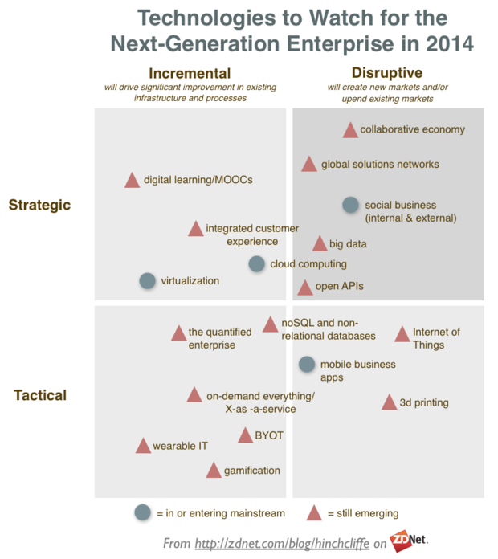

# The enterprise technologies to watch in 2014

Summary: Emerging tech often takes a while to get into the enterprise. This year's watchlist shows that there's plenty of hot new spaces to watch, while a few much older trends are just now reaching mainstream.

By [Dion Hinchcliffe](http://www.zdnet.com/meet-the-team/us/dion-hinchcliffe/) for [Enterprise Web 2.0](http://www.zdnet.com/blog/hinchcliffe/) | March 1, 2014 -- 00:48 GMT (16:48 PST)

Adopting new technology in the enterprise is often an uphill battle, as summoning the resources, building the skills, and managing the risk of the cutting-edge often takes as much art as it does science. But as the tech industry reaches all-time high pace of innovation amongst a truly vast sea of new choices, enterprises are becoming acutely aware they cannot let their digital gap grow too large.

Especially in competitive industries, there's little time to worry that it's often the pioneers that have the arrows sticking out of them. In fact, due to an array of advances from ever-more [agile processes](http://www.zdnet.com/blog/hinchcliffe/giving-enterprise-software-practices-an-angioplasty/15) to easy-to-integrate Web services, the cost of experimenting with the latest tech is at an all-time low. Never before has it been as easy or cheap to adopt new technology, other that the fact that it takes scarce resources from IT, business analysts, users, and project management resources to deliver usable business solutions, even if the tech itself is inexpensive.

This then is one of the reasons why decentralized IT that empowers users to sensibly apply the latest tech is just one of the [new techniques in the arsenal of the modern CIO](http://www.zdnet.com/the-new-cio-mandate-7000024851/).

But this doesn't answer the most important question for technology planners getting ready for 2014: What are the most promising emerging enterprise technologies that are reaching a stage of must-adopt this year?

To answer that we have to look at the needs of what I've called the [next-generation enterprise](http://www.ebizq.net/blogs/enterprise/2012/03/the_enterprise_it_landscape_in.php) (NGE):

> A next-generation enterprise describes an organization that is proactively moving into the present by changing how they assimilate, architect, apply, and maintain their technology solutions. The purpose: Updating and transforming their processes, structures, and business models to effectively align with and work natively in today’s networked, open, and participative digital economy. While that may be a mouthful, it also accurately describes what most organizations must do to ultimately avoid disruption in the marketplace as technology increasingly defines how our businesses engage with and provide value to the world.

Thus the purpose of important new enterprise technologies should be to significantly shift and transform how business gets done with enabling technologies that reinvents how work and enterprise output in general is achieved.

This year's list of such technologies has some long standing underdogs that have been with us for a while now (open APIs, cloud, non-relational DBs) as well as brand-new technologies with great potential for NGEs, such as the quantified enterprise, the collaborative economy, and the Internet of Things (IoT.)

### 14 enterprise technologies to watch for 2014

Here's how this year's crop of promising enterprise technologies breaks down:

- **3D printers:** 3D scanning and printing will fundamentally remake supply chains as creating new databases of high quality designs -- instead of actual physical products -- becomes the one of the most important elements of business. Homes and workplaces will increasingly source good suppliers of design, rather than suppliers, because they can make and customize a growing number of goods for themselves. Thus for many industries, most of the focus on the business will move from building things to designing them.
- **Internet of Things (IoT)**. Some days just about everything seems like it's getting a network connection, IP address, and an application to monitor and manage it. That will only continue as just about everything becomes network connected. Enterprises that don't have a "connected everything" strategy for their own products as well as their internal operations will be at potential risk for disruption as supply chains, workflow, and business intelligence will be revolutionized by the data streams and orchestration IoT makes possible.
- **Mobile business applications**. A new wave of business applications rethought for mobile and taking advantage of sensors like GPS and NFC is revolutionizing field support, sales teams, and other remote workers. Enterprise must buy or build these in 2014 like never before.
- **noSQL and relational databases**. New takes on processing and gaining insight into vast quantities of data, such as [Hadoop and it's increasingly large ecosystem](http://www.ebizq.net/blogs/enterprise/2009/09/10_ways_to_complement_the_ente.php) of support products, will be bigger than ever this year as it nearly crosses over into the mainstream enterprise.
- **On-demand everything, X-as-a-Service (XaaS)**. Cloud service delivery of just about everything from on-demand workforces to vertical industry data brokers is hot this year. If you can wrap an API around it, an enterprise-class service is likely to be available for it. More importantly, enterprises will be using them, even for some mission critical applications.
- **Bring-Your-Own-Technology (BYOT).** While Bring Your Own Device (BYOD) was the leading edge of [IT consumerization](http://www.zdnet.com/blog/hinchcliffe/coit-how-an-accidental-future-is-becoming-reality/1368), this year will see a significant growth policies and experiments in broadening BYOD to the entire technology portfolio, and in particular, putting IT in direct competition for a majority of tech acquisition in most companies. Unless it can increase competitiveness, this will likely put the IT department at more risk than probably any time before.
- [**Gamification**](http://www.zdnet.com/blog/hinchcliffe/enterprise-gamification-will-it-drive-better-business-performance/1998). This was a huge flash in the pan in 2012, but the platforms have 1) continued to get better and 2) become integrated into more and more line of business applications. Expect to have to understand how to tune and manage gamified business solutions in unexpectd places this year.
- **Wearable IT**. While fitness monitors, smartphone connected watches, and Google Glass are probably the best known among wearable IT, enterprise-class versions of wearable devices, like the [Hitachi Business Microscope](http://www.hitachi.com/design/field/solution/microscope/) will begin to enter the workplace. Between IOT and wearable IT, this will lead to directly to the rise of...
- **The Quantified Enterprise**. Ultimately, coupled with big data analytics and pervasive wireless micro-instrumentation, everything that can be measured will be measured, leading to a deeper understanding of just about everything in business. This will drive insights, optimization, and improvements to processes, management techniques, and even to the organization of the business.
- **Virtualization**. Just when you thought it was mainstream, important new virtualization techniques are coming to the fore in the discussion, especially software-defined IT and converged infrastructure. Both have been around for a while but will lead the discussion this year.
- **Cloud computing**. Cloud will have its best year ever, particularly as it's not had as large a penetration in the large enterprise as its mindshare in the trade press indicates, though [the adoption numbers have reached an all-time high water mark](http://www.zdnet.com/iaas-paas-to-drive-cloud-adoption-in-anz-zdnet-survey-7000026064/). Hybrid cloud will become less prominent as comfort with public cloud options grows. In particular, solutions for seamless switching of cloud workloads between provides will make enterprises much more comfortable about ramping down their private clouds.
- **Integrated customer experiences.** Companies will invest heavily in multi/omni channels customer experiences across digital channels including mobile and Web. Adoption of technologies that track and manage all the touchpoints of the [increasingly sophisticated yet nuanced digital customer journey](http://www.zdnet.com/the-new-digital-customer-journey-cross-channel-mobile-social-self-service-and-engaged-7000015570/) will be of major interest to many companies this year.
- **Digital learning and MOOCs.** While 2013 was clearly the year of the Massively Open Online Course (MOOC), one of the most technically underserved industries, education, receive a major overhaul from the crowd. Now that the hype has cooled down a bit, expect practical implications from initial lessons learned from MOOCs to flow into enterprise solutions for updating workforce skills and preparing for digital transformation.
- **[Open APIs](http://www.zdnet.com/blog/hinchcliffe/running-your-soa-like-a-web-startup/525).** Long time readers know that I've been bullish on this strategic technology for years, as a way to open supply chains, create integrated and fully composable enterprises, and to greatly scale digital partnership and ecosystems. Public APIs have exploded in the last couple of years and have [recently hit the 10,000 mark](http://blog.programmableweb.com/2013/04/30/9000-apis-mobile-gets-serious/). 2014 will be their biggest growth year yet.
- **Big data**. Even though there's a growing backlash over privacy concerns and misuse, the [big data revolution](http://www.zdnet.com/blog/hinchcliffe/the-enterprise-opportunity-of-big-data-closing-the-clue-gap/1648) has barely even started. Expect a raft of many new enterprise products to capitalize on the business intelligence and operational improvements that the technologies promise.
- **Social business (internal and external.)** After a good crop of [success stories recently](http://www.zdnet.com/blog/hinchcliffe/realizing-social-business-enterprise-2-0-success-stories/1908), I'm just now seeing large enterprise finally get serious about large-scale adoption of the tools and ideas behind enterprise social media as a standard way of working. Enterprise initiatives will continue to work through thorny issues involving in culture change and [other adoption issues](http://dachisgroup.com/the-path-to-co-creating-a-social-business-the-early-adoption-phase/) but the technologies will improve greatly this year for analytics, relationship management, engagement at scale, advocacy, and much more.
- [**Global solutions networks**](http://www.cmswire.com/cms/social-business/the-future-of-collaboration-isnt-what-it-used-to-be-024330.php?pageNum=2). Coined by Don Tapscott last year, the concept itself is the design and use of digital communities and mass collaboration platforms to solve problems that even large enterprises can't tackle alone. Platforms, communities, and tools for this will being to emerge in 2014.
- [**Collaborative economy.**](http://www.zdnet.com/while-most-companies-werent-looking-social-business-remade-the-economy-7000018691/) Perhaps the most profound technological change in this entire list, this is the process of using social business principles to reinvent the business models and use the most scalable and cost-effective motive force (crowds) to create businesses that often weren't possible before. Expect the collaborative economy to heat up in a big way this year with considerably maturity in its offerings. The enterprise impact? Organizations need to adapt their businesses to this new way of delivering value to the market using participative networks or risk major disruption. 2014 is the time to invest, perhaps before the window closes.

As you can see, there is a lot of very exciting things taking place in enterprise technology, often flowing straight from the consumer world. Most organizations will have their work cut out for them to focus on a third of these, and will need better and [more effective ways of absorbing and metabolizing technology change](http://www.zdnet.com/blog/hinchcliffe/ten-strategies-for-making-the-big-leap-to-next-gen-mobile-social-cloud-consumerization-and-big-data/1844). It's a significant challenge, but it's also a historic opportunity, as some of these emerging technologies are not just disruptive, but offer to usher entire industries into an early retirement (3D printing, where everyone becomes their own manufacturer for a growing set of goods comes to mind.)

So because of the growing disruptive potential of digital as it becomes a first class element of enterprise business strategy, organizations ignore focusing on these emerging yet often high impact technologies at their peril. It's much better, in my opinion, to to make time to focus on their promise.

**Additional Reading:**

[Why CIOs should act more like venture capitalists](http://www.zdnet.com/why-cios-should-act-more-like-venture-capitalists-7000026846/)

[The digital workplace 2014: Plight and promise of today's employees](http://www.zdnet.com/examining-the-digital-workplace-in-2014-7000026781/)
