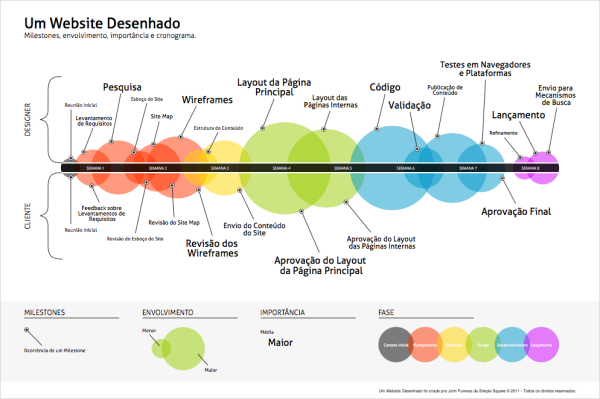

# [A timeline de criação de um website](http://arquiteturadeinformacao.com/recursos/metodologia/timeline-de-criacao-de-um-website/)

por Fabricio Teixeira

Post rápido para compartilhar um [gráfico](http://www.simplesquare.com/blog/infographics/a-web-site-designed/) feito por um amigo designer, John Funess, que ilustra as diversas etapas envolvidas na criação de um website. Apesar de considerar apenas o modelo waterfall de gestão de projetos, tem uns insights bem interessantes sobre a ordem na qual as coisas acontecem (ou deveriam acontecer nesses casos).

#### [Fabricio Teixeira](http://www.linkedin.com/in/fabricioteixeira)

Curador @ Blog de AI, Diretor de UX @ R/GA NY, Updater @ Update or Die, UX Professor @ Miami Ad School. No meio de tantas siglas, de vez em quando acha tempo para compartilhar palavras inteiras por aqui.

### Gostou?
