## [Exemplos de sketches e rabiscoframes](http://arquiteturadeinformacao.com/user-experience/exemplos-de-sketches-e-rabiscoframes/)

por Fabricio Teixeira

|  |  |
| --- | --- |
| Like | 0 |

[Tweetar](https://twitter.com/intent/tweet?original_referer=http%3A%2F%2Farquiteturadeinformacao.com%2Fuser-experience%2Fexemplos-de-sketches-e-rabiscoframes%2F&text=Exemplos%20de%20sketches%20e%20rabiscoframes&tw_p=tweetbutton&url=http%3A%2F%2Farquiteturadeinformacao.com%2Fuser-experience%2Fexemplos-de-sketches-e-rabiscoframes%2F&via=blogdeai)

[0](http://twitter.com/search?q=http%3A%2F%2Farquiteturadeinformacao.com%2Fuser-experience%2Fexemplos-de-sketches-e-rabiscoframes%2F)

1

Andei colecionando alguns exemplos de [rabiscoframes](http://arquiteturadeinformacao.com/2010/01/29/o-valor-do-rabiscoframe/ "O que é rabiscoframe?") nos últimos meses e decidi postar aqui. Uns mais detalhados, outros mais estruturais – o importante é conseguir mostrar a ideia no papel antes de avançar com o trabalho. Para saber de onde vem cada sketch abaixo, basta clicar sobre a imagem.

Se você tiver algum exemplo que possa compartilhar, mande aqui nos comentários ou pelo twitter, citando o [@blogdeai](http://twitter.com/blogdeai). Depois faço um update com as novas imagens :)

[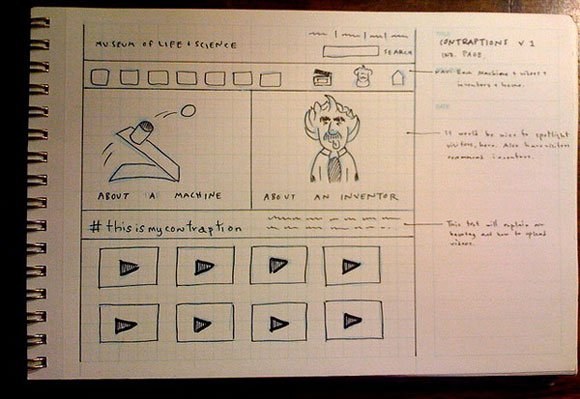](http://www.flickr.com/photos/10ch/4323450776/in/pool-1070674@N20/)

[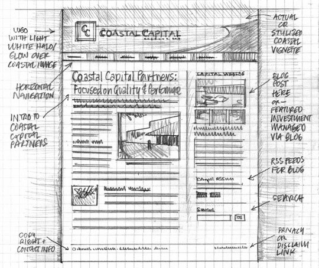](http://www.flickr.com/photos/rohdesign/3307873748/)

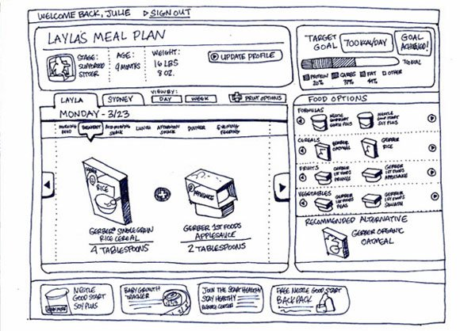

[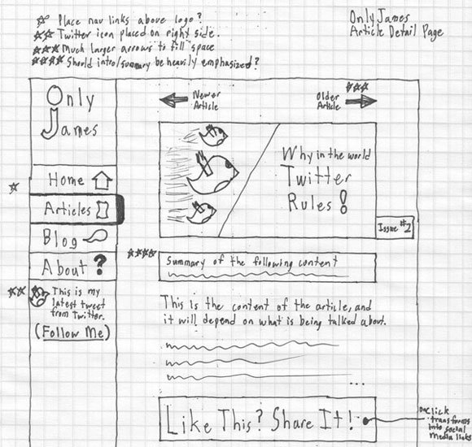](http://www.flickr.com/photos/jamesmowery/4155129641/)[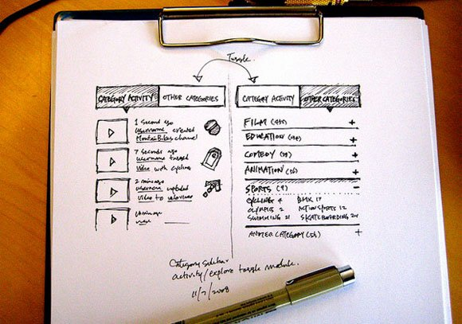](http://www.flickr.com/photos/soxiam/3009921903/in/pool-1070674@N20/)[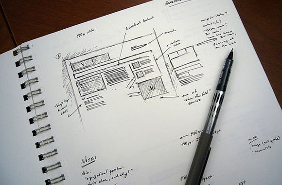](http://www.flickr.com/photos/stuntbox/198576978/in/pool-835929@N25/)[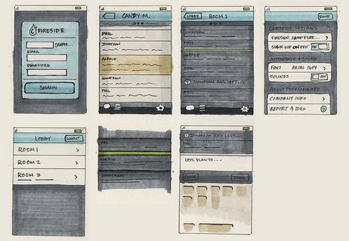](http://www.flickr.com/photos/playingwithshapes/3345425396/in/pool-1158643@N24/)[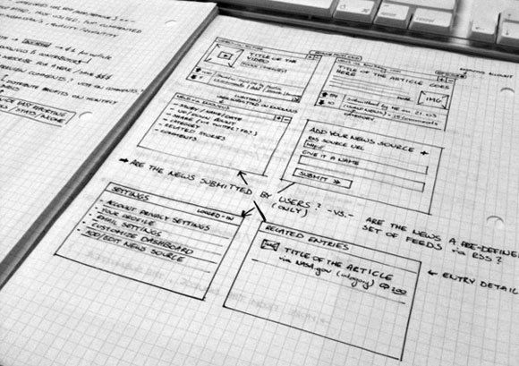](http://www.flickr.com/photos/martin-kulakowski/4347588767/in/pool-1158643@N24/)[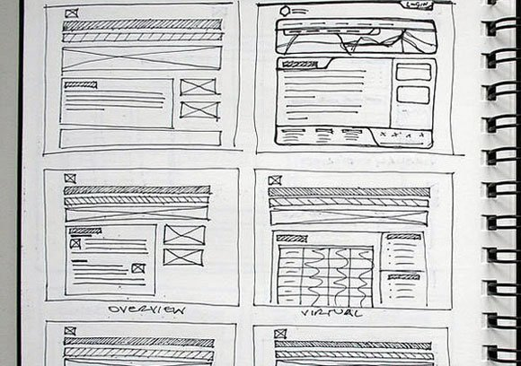](http://www.flickr.com/photos/maquinastudios/3831154796/)[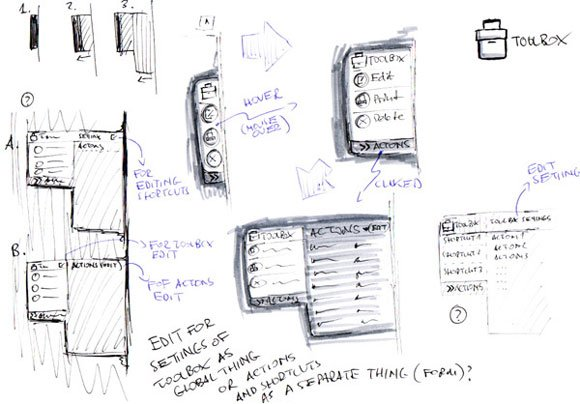](http://www.flickr.com/photos/lukasztyrala/4439328988/in/pool-95869019@N00/)[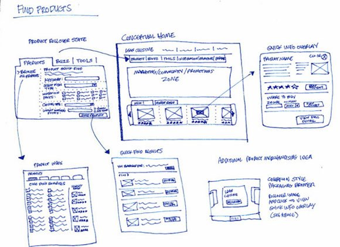](http://www.flickr.com/photos/24084766@N07/4595959073/)[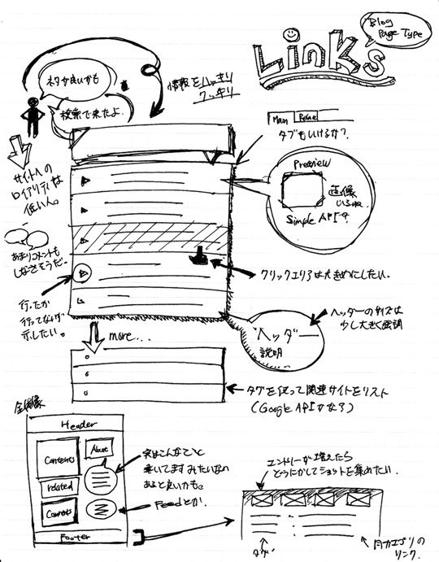](http://www.flickr.com/photos/yhassy/2397670805/)[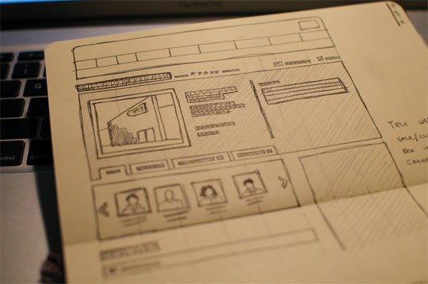](http://www.flickr.com/photos/abiv/4307576961/)[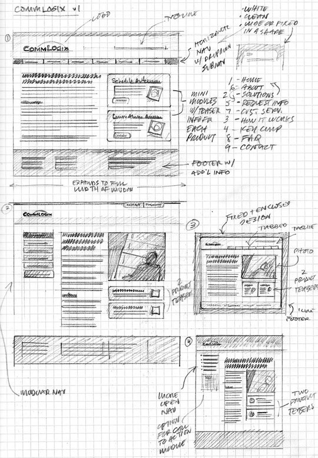](http://www.flickr.com/photos/rohdesign/3307874546/)[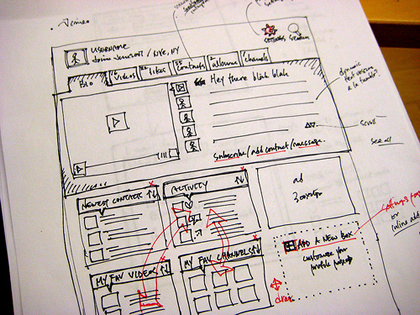](http://www.flickr.com/photos/soxiam/2182204230/)[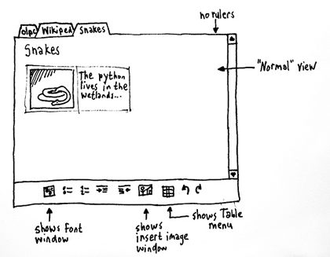](http://www.flickr.com/photos/erikpukinskis/202173957/)
