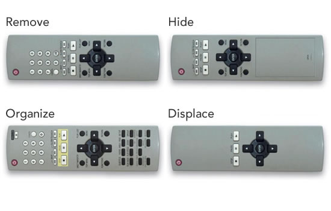

# Simplicity Isn’t Simple

 *Written by Francisco Inchauste on April 26, 2012* 
  
  

Simplicity. It’s weaved into conversations about everything from to-do list apps to DVD players. We meet confusion ([not the same as complexity](http://uxmag.com/articles/the-dirtiest-word-in-ux-complexity "The Dirtiest Word in UX: Complexity")) at the door of our design process and turn it away. Confusion isn’t welcome here — although, the sneaky bastard still finds its way into so many products.

In the battle against confusion we [wrongly quote Einstein](http://quoteinvestigator.com/2011/05/13/einstein-simple/#more-2363 "Einstein quote"), or cite [Hick’s law](http://en.wikipedia.org/wiki/Hick's_law "Hick's Law"). We rattle off abstract statements, like: “lots of choices are bad”, “users today are demanding simplification”, “less is more”. User experience folk (myself included) proselytize for simplification in tweets and blog posts, with very little additional guidance.

It’s easy to sit back in your comfy Aeron chair, swiping around on your beautiful fruit company device and tell everyone how wrong they are with their kludgy, confusing products. The talking heads of the design world are great at these blanket statements and quotable nuggets of bullshit.

A product’s design is the [culmination of many decisions](http://www.quora.com/Rebekah-Cox/Posts/Design-Quora-Web2-0-Expo-Presentation "Quora quote"), each with its own cost to the experience, as [Jason Fried explains](http://37signals.com/svn/posts/3047-the-obvious-the-easy-and-the-possible "The obvious, the easy and the possible"):

> “Making something obvious has a cost. You can’t make everything obvious because you have limited resources. I’m not talking money—although that may be part of it too. I’m primarily talking screen real estate, attention span, comprehension, etc.
>
> Making something obvious is expensive because it often means you have to make a whole bunch of other things less obvious. Obvious dominates and only one thing can truly dominate at a time. It may be worth it to make that one thing completely obvious, but it’s still expensive.”

There’s also the war that occurs outside of the interface, where you find yourself compromising with some people who probably shouldn’t be making these kinds of product design decisions — The kind of people that can seagull your beautiful app into Word ’97 within five minutes, because they just read an article about [insert hot tech startup, or buzzword, here]. It’s a tricky game.

The products that I see as perfect examples of simplicity are probably much different from those outside the design and tech industry. In fact, I think that it’s even likely they don’t have a true concept of simplicity, other than it means it’s easy to use or works how they think it should — note: people mix up usability and simplicity quite often, which are not the same end goals.

When I say “simple”, what I mean is: **A product reduced to its purest form of purpose or value.** In a comment on a [great post](https://plus.google.com/115711522874757126523/posts/6EbG2uwnE3c "Why and How Google+'s Interface is Kicking Ass") by Oliver Reichenstein, I used the example of a knife:

> “Comparing the UIs of Google+ to Facebook is like a well-balanced knife versus a cluttered kitchen full of gadgets you buy on TV to chop things up.”

Simple products can be more powerful than so called “easy to use”, shortcut, gimmicky products. Simple products are not overdesigned, and many might find them to appear limited or underdesigned. However, as in the example of the knife, a great chef can chop, dice, fillet, with a good knife. Where someone else might use it for much more rudimentary actions. Either way, it is an effective tool based on the user’s level of mastery.

For me, [IA Writer](http://www.iawriter.com/ "IA Writer") is the perfect example of a simple application. It has been peeled back to its core purpose: Writing. I use it for authoring posts like this, taking notes on client calls, jotting down thoughts to save, and even to-do’s. There are apps built just as a to-do list, yet I find it to be just as effective, even though it was designed without task list creation as primary goal. Yes, it is very limited in comparison to other writing applications: No settings, one font, one text size. However, this limitation is a feature — and a valuable one at that.

## The Four Strategies

It still amazes me how many people ask for simplicity but don’t realize this phase of the design has passed when they’ve already listed out what they want it to do, or in the case of a Website, tell you what needs to be on the homepage. Giles Colborne outlines the path to simplicity in his book, *Simple and Usable*.

It is one of the few books that I’ve found actually offers the practical advice on what it takes to simplify a product. As shown below, a remote is used in the book to illustrate some strategies to simplify.

*“Simplicity isn’t something you can stick on top of a user interface”*

There are many ways that you can simplify something, but Giles reduces (yes, simplifies) them down to four strategies, which I’ve extrapolated on to relate to interface design:

**Remove**: Get rid of anything that isn’t essential to the application. This could mean content, too; like the language you use in the navigation labels.

**Organize**: Arrange the elements of the interface so that they fit into logical chunks. This might mean based on a person’s mental model (how they think), or tie in to a more familiar interface pattern.

**Hide**: Place the most important elements within reach (make them obvious), and hide the others, making them accessible through navigation.

**Displace**: Pushing some of the functionality to another device, or feature, so that the one interface isn’t responsible for displaying every possible interaction.

Now, some of these strategies could be debated, or even stated a different way depending on what you are actually simplifying. If you were designing a car dashboard, organize would mean placing related controls in proximity to each other, or physically closer/further away from the driver based on the amount of use.

In some cases, remove could refer to [ephemeralization](http://en.wikipedia.org/wiki/Ephemeralization "Ephemeralization"). Timothy Blee [defines it as](http://timothyblee.com/2011/04/26/the-great-ephemeralization/ "Ephermeralization") “special-purpose products are replaced by software running on general-purpose computing devices”. We see this in the smartphone. In our pocket we have: a cell phone, camera, calculator, video games, movie player, and the list goes on. We’ve combined the functions of many devices and applications into one neat little package.

However, this doesn’t mean it is true simplification. There is a cost here, too. Take a look at any device and the numerous apps, and you can see it isn’t that simple to manage. Unfortunately the app model, has been infused with less purposeful creation, as seen in the so many one-off novelty apps running rampant.

## Where Simplicity Starts

Ken Segall worked with Steve Jobs on the “Think Different” ad campaign and came up with the “i” thing (he talked Jobs out of calling the iMac the “[MacMan](http://www.cultofmac.com/162479/ken-segall-on-what-made-apples-insanely-simple-approach-work-qa/ "MacMan")“). He outlines Apple’s obsession with simplicity in his book, *Insanely Simple*:

> “I met some smart people at Dell who realized things weren’t as they should be and wanted to change them, but they were incapable of changing the internal culture there. […] Some of those people end up leaving those companies because they get frustrated, others will stay as cogs in the machine. Apple survived because it embodies values that don’t seem to exist elsewhere.”

Who wouldn’t want to be a company like Apple right now? It’s one of the most popular subjects in product design and business for a reason. That reason is based on the results, not the process. Everyone wants to have a company that’s loved, has products that are [desirable](http://www.getfinch.com/2011/03/ux-is-mostly-desirability/ "UX is 90% Desirability"), and of course finds amazing success (and profits). But they copy the results, without understanding that the leaders of Apple treat simplicity as a religion. It took [time and taste](http://www.marco.org/2012/04/20/time-and-taste "Time and Taste").

True simplicity starts at conception. It’s infused into the being of the creators, and by proxy, in the soul of every product they design.

### Resources

Giles Colborne, “[Simple and Usable Web, Mobile, and Interaction Design](http://www.simpleandusable.com/ "Simple and Usable")”, New Riders, Sep 2010

Ken Segall, “[Insanely Simple: The Obsession That Drives Apple’s Success](http://kensegall.com/blog/insanely-simple-book/ "Insanely Simple")“, Portfolio Hardcover, April 2012
