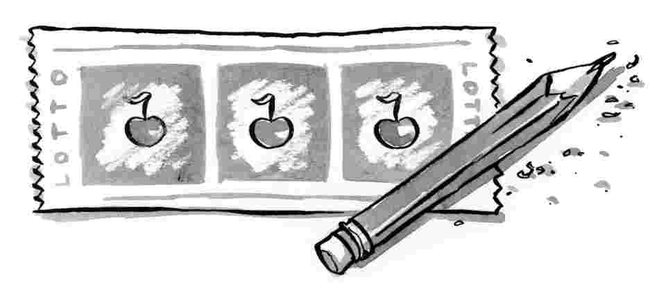
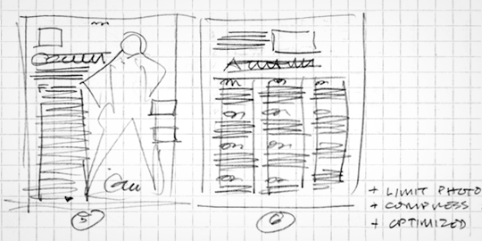

# Sketching: the Visual Thinking Power Tool

[alistapart.com](http://alistapart.com/article/sketching-the-visual-thinking-power-tool)

[Issue № 322](http://alistapart.com/issue/322)

by Published in [Mike Rohde](http://alistapart.com/author/mrohde)[Creativity](http://alistapart.com/topic/creativity) ∙

As a kid, I spent hours drawing and sketching ideas that popped into my head.

I used drawing as a primary language for capturing thoughts, exploring ideas, and then sharing those ideas. Teachers and mentors encouraged me, helping to sustain sketching as a key skill throughout school and into my professional career. Good fortune has ignited my passion to become a sketch advocate, helping others rediscover sketching as a powerful problem-solving and communication tool.

I'm excited to share why sketching can be so beneficial, show samples of sketches, and provide helpful resources. My goal is to encourage you-whether you're a designer, front-end developer, coder, writer or whatever you may be-to add sketching to your toolkit.

## But I can't sketch-I'm not an artist!

When I suggest sketching as a visual thinking tool, I often I hear "I'm not an artist" or "I can't draw." While I understand the hesitation, I'm here to tell you that the artistic quality of your sketches is not the point. The real goal of sketching is functional. It's about generating ideas, solving problems, and communicating ideas more effectively with others.

When you feel inadequate in your sketching, pause and reconsider your perspective. Don't worry how *well* you draw. Instead, think of your sketching as *visual thinking*, which works regardless of your drawing quality. Ugly gets the job done just fine.

Fig 1. Keep it loose! Ugly sketches do the trick.

## Why bother sketching?

There is no shortage of software or hardware tools for producing amazing work. It seems that whatever you can imagine, software and hardware can make it happen.

Adding sketching to the design process is a great way to amplify software and hardware tools. Sketching provides a unique space that can help you think differently, generate a variety of ideas quickly, explore alternatives with less risk, and encourage constructive discussions with colleagues and clients.

Let's explore these three benefits of sketching in more detail.

### 1. A variety of ideas, quickly

Sketching is great for rapid idea generation. A pencil or a Sharpie and a piece of paper invite loose exploration. Remember to keep on generating ideas-you'll want to push past that first bunch of surface ideas to get the deeper concepts out of your head.

For quick idea generation, I like to read notes I wrote during the kickoff phase of a project, letting those words and thoughts rumble around my head until they lead me to new ideas. Once an idea comes to mind, I capture it on paper, add notes, and number each sketch as reference for later review.

The key to generating many ideas is to withhold judgment of them as good or bad until your sketching session is complete. First capture the ideas, letting them flow without worrying if they're any good. Wait until you're finished to judge and filter.

### 2. Explore the alternatives

Sketching offers you the freedom to explore alternative ideas. Early in a project it's important to see a variety of different ideas so you can choose the best option. Sketching works well for this, as you can explore those varied ideas quickly.

When you're sketching, your mind is free to play and explore other directions that surface. Sketches help filter out "rabbit hole" ideas-concepts that are impossible to produce or impractical to deliver on. Drawing out ideas works as an early detection system-revealing potential issues before significant time is invested.

This is the time to ask "what if?" and explore the answers that pop into your head. Questions like "What if we could..." or "What if we were limited by..." can help break through the structures your mind forms around problems.

### 3. Foster better discussions

Sketches have an amazing ability to foster discussions about ideas. With colleagues and especially clients, I've found sketches give everyone involved the permission to consider, talk about, and challenge the ideas they represent. After all, it's just a sketch.

Because sketches are unfinished and loose, they invite commentary. There is a latitude inherent in a sketch that seems to magically open the door for others to offer ideas-often thoughts you couldn't come up with from your singular perspective.

When I've presented conceptual ideas in finished form, colleagues and clients often hesitate to be as honest as they are with sketches. There is something in tightly finished concept work that I think suggests significant effort was spent in production-leading colleagues and clients to hold back to avoid the additional work needed to make changes.

## Practice, practice!

Getting comfortable with sketching in your process requires repetition. Practice makes all the difference. If sketching feels unnatural to you, practice it a little bit every day.

Find opportunities to doodle in the margins or, if you have them, draw with your kids. The more you practice, the more confident you will become when deadlines roll around.

### Carry a sketchbook

Here's an idea to make practice happen: Carry a notebook and pen or pencil with you wherever you go. Check out the wide variety of [Moleskines](http://www.moleskine.com/), [Field Notes](http://fieldnotesbrand.com/) or [Scout Books](http://www.scoutbooks.com/) available and buy one. When you have downtime, take a few moments to sketch and loosen up or explore ideas you have about design challenges.

The key here is to make sketching a routine, comfortable thing in your everyday life. You might be surprised at the ideas you'll capture simply by carrying a sketchbook around.

### Give sketching a test run

Give sketching a try for the idea generation and communication phases at the beginning of your next project. Remember, it's not about the quality of the drawing, but about capturing and communicating ideas from one mind to another.

Generate as many different ideas as you can. Explore crazy, way-out-there ideas and then see how your group or even your clients react. You might be surprised at the discussion that ensues.

## Real-world sketching

Because I've integrated sketches deeply into my design practice, I use them for concepting and sharing with my clients as a rule. From logos and icons to websites, illustrations, and UI design, sketches done early in the process are a key component.

Here's a sampling of projects where I used sketches to solve problems, generate concepts, and communicate ideas.

### Heartland Funds Website Redesign

This project was a re-design of the [Heartland Funds](http://heartlandfunds.com/) website. Heartland Funds is a Milwaukee-based mutual fund firm. They wanted a site that matched their branding, was easy to manage, and felt welcoming.

I made pencil sketches on grid paper for the wireframes, to capture my ideas for the structure, with notes on the margins to provide details to the client:

The wireframes were well-received; a constructive discussion ensued about the details, which were later transferred to the visual mockups, the prototype, and finally, the redesign.

### Red Sweater Software logo design

For software developer Daniel Jalkut of [Red Sweater Software](http://www.red-sweater.com/), I was hired to create an identity that would capture the idea of his brand-simple, effective, and human software.

Using pencil sketches, I generated a variety of initial sketches to zero in on a specific sweater concept, then iterated with Daniel to get the shape and details just right before jumping into Illustrator to finalize the artwork and colors:

Daniel was pleased to see how sketching ideas helped accelerate finding the perfect sweater shape for the logo.

### Pear Note UI Design

[Pear Note](http://www.usefulfruit.com/pearnote/) is a Mac application from [Useful Fruit Software](http://www.usefulfruit.com/) that records audio and video while you type. The original application was functional but needed better flow and a design touch.

Using sketches, I was able to show developer Chad Sellers a variety of options for UI controls and structure before we moved to the visual mockup and prototyping stage.

Sketches allowed me to visually capture and share my design ideas with Chad. Chad was happy with the final results and has found the redesign of the UI very helpful in bringing new users to his refreshed application.

### Postbox Icon Design

Sherman Dickman brought me in to create an icon for the Mac and Windows e-mail application, [Postbox](http://postbox-inc.com/). Their software development team wasn't sure what kind of icon would best represent the application, so they had me explore a wide range of ideas in pencil before choosing a US Postal Service-style corner mailbox.

Creating sketches to explore many ideas (both good and bad) was very helpful to the Postbox team. If we had a crazy idea, it was relatively easy to sketch it out and see if the idea would hold up to scrutiny. Even the unusable ideas were helpful in that they helped narrow the field of winning ideas without nagging "what if" thoughts.

## A collection of tools

Whenever I talk sketching, the questions eventually turn toward tools I use and recommend. While I have my own personal favorites, I encourage you to explore and try new tools for yourself, until you find the best fit for your own needs.

**Pens**: I'm a fan of all varieties of gel pens for my work-they cover well and dry relatively quickly. I like the [Pilot G2](http://www.pilotpen.us/products/gel/), the [Uniball 207](http://www.uniball-na.com/main.taf?p=2,2,3) and most recently [Uniball Vision](http://www.uniball-na.com/main.taf?p=2,3,2) and [Pentel Energel NV](http://www.pentel.com/store/energel-nv-gel-pen). I prefer a wider 0.7mm tip for better ink flow and coverage.

**Markers**: For markers I've been most pleased with [Sharpie fine point permanent markers](http://www.sharpie.com/enUS/Products/Pages/ProductDetails.aspx?pid=SharpieFinePointPermanentMarker(Sharpie%20Catalog)) for quick concepts and have explored using [Copic](http://copicmarker.com/products/markers/) warm gray markers on wireframes-adding shading and depth to plain black lines with good results.

**Pencils**: I prefer mechanical pencils in a softer lead like HB and B, because those leads help me to stay loose when sketching. My favorite pencil is the [Faber-Castell eMotion](http://www.faber-castell.us/17315/Products/Design/E-Motion/index_ebene3.aspx) with large 1.4mm leads for nice, loose lines. A thick pencil also lets me add rich solid lead very quickly.

**Paper**: Paper can be personal and depends very much on the pen, pencil, or marker you plan to use with it. Generally I prefer smooth paper that has enough weight to keep sketches from showing through to the back of the sheet.

I also tend to like graph and dot grid paper if I'm doing web and UI work to offer subtle structure, though plain paper works well for general sketching too.

**Books**: [Moleskine](http://moleskine.com) sketchbooks and notebooks are always a great choice for pencil and pen, though thinner paper in the notebook can bleed through on markers and some pens. For that reason I prefer the [thicker sketchbook paper](http://www.moleskine.com/catalogue/classic/hard_black_cover/sketchbook__large.php).

I also like the [Miquelrius](http://www.shopmiquelrius.com/servlet/the-230/Miquelrius/Detail) graph softcover books, [Behance Dot Grid books](http://www.creativesoutfitter.com/Products/Dot-Grid-Book/9), [Rhodia graph pads](http://www.rhodiapads.com/collections_orange_19.shtml), and the more obscure [Maruman Mnemosyne Imagination notebook](http://www.jetpens.com/product_info.php/products_id/4117) from Japan, which features graph paper and a wonderfully smooth paper surface.

The advantage of a book is that your sketches all stay together in a nice package for presentations, yet can be removed if needed. Spiral bound notebooks can lay flat on a table and allow for easy page removal, while hard or soft cover books are sturdier and probably better if you don't plan to remove pages and are OK with the binding.

**Whiteboards**: This is a great sketch surface that allows for easy erasure. The challenge here is to make sure you have fresh makers-dried out dry erase markers are no fun.

**Chalkboards**: I had a recent experience with [chalk sketching at the 37signals office](http://www.flickr.com/photos/rohdesign/sets/72157625062741838/detail/). At first, the chalk and chalkboard surface felt strange, but I came to like the loose feel after working with them for a day. It's a little messier than dry erase but also more tactile.

**iPad**: I've found the iPad an interesting tool for sketching, especially with the advancement of software like [Sketchbook Pro](http://itunes.apple.com/us/app/sketchbook-pro/id364253478?mt=8), [Adobe Ideas](http://itunes.apple.com/us/app/adobe-ideas/id364617858?mt=8), [Penultimate](http://itunes.apple.com/us/app/penultimate/id354098826?mt=8) and [Draft](http://itunes.apple.com/us/app/draft/id375570329?mt=8), to name a few. I'm now using a [Griffin Stylus for iPad](http://www.griffintechnology.com/products/stylus) and have found it pretty good for sketching. My fingers seem to work reasonably well for loose sketch work too.

### Further reading on sketching

- [Why we Sketch](http://www.uie.com/articles/why_sketching/) by Jared Spool: Here's a comprehensive overview of our motivations behind sketching, including thinking, hearing, documentation, and more.
- [The Fear of Sketching](http://v1.yaronschoen.com/blog/the_fear_of_sketching) by Yaron Schoen: Yaron talks about how he fell away from sketching to the point that he felt fearful of it and how he overcame those fears to begin sketching again.
- [Pretty Sketchy](http://jasonsantamaria.com/articles/pretty-sketchy/) by Jason Santa Maria: Jason talks about the importance of sketching for thinking-not artistic beauty. Jason also established a sketch group on Flickr which you can review and join to share your own sketches.
- [To Sketch or Not to Sketch?](http://designinformer.com/sketch-question/) by Erik Ford: Erik talks about how sketching expands his creativity and efficiency and has worked when he made it part of his routine.
- [Sketch, Sketch, Sketch](http://52weeksofux.com/post/346650933/sketch-sketch-sketch) by Joshua Brewer: Joshua covers the benefits of drawing if you aren't an artist, use of sharpies to keep loose, and the advantages sketching can bring to your problem solving processes.
- [The Fine Art of Wireframes](http://404uxd.com/2008/02/28/the-fine-art-of-wireframes) by T. Scott Stromberg: A how-to for using sketches as an IA tool, leading to better final wireframes and websites.
- [Sketchboards: Discover Better + Faster UX Solutions](http://www.adaptivepath.com/ideas/essays/archives/000863.php) by Brandon Schauer: A fascinating approach to consolidating sketched ideas and other elements onto a single large sheet of paper that can be transported for discussion and client meetings.
- [Our Favorite Tools for Sketching](http://www.adaptivepath.com/ideas/essays/archives/001072.php) by Leah Buley: Tools used by the Adaptive Path team, all the way from thick and thin markers to cases and drafting dots.

Here are a variety of helpful articles on sketching to provide additional inspiration:

## Go forth and sketch!

I hope to encourage and challenge you to take at least fifteen minutes on your next project to to sketch out ideas before investing time in design, development, writing, or code. See how it feels. Keep trying it until you feel comfortable sketching.💬

Give yourself lots of grace if you haven't drawn for a long time. This is a process, not magic. Tell that mean ol' ghost of a teacher floating over your shoulder who scolds you for doodling that I gave you permission to sketch!
