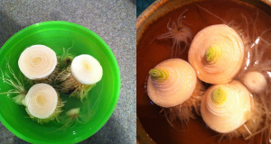
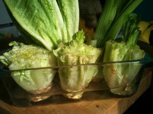
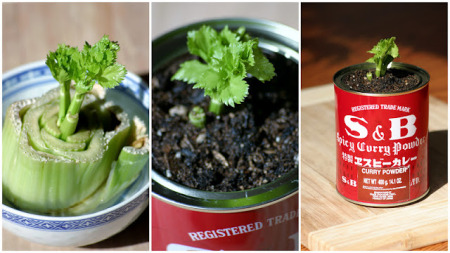
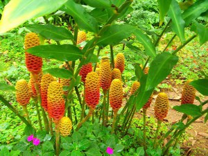
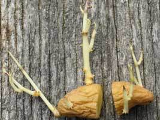
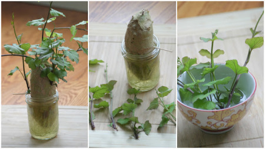
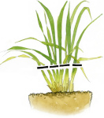
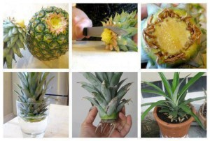

**VEGETAIS QUE PODEM VOLTAR A SER PLANTADOS DEPOIS DE USADOS:**

**Cebolinha e Alho Francês:**

Coloque a extremidade branca da raíz num copo com água e deixe-o numa zona com sol. A zona verde da planta voltará a crescer.

Quando cozinhar corte somente a parte verde deixando sempre a raíz na água para que o crescimento da planta continue.

A água deve ser mudada todas as semanas.

As cebolas são dos vegetais os mais fáceis para propagar. Basta cortar a extremidade da raiz da cebola , deixando 1,5cm de cebola sobre as raízes . Coloque-o numa zona solarenga do seu jardim e cubra a parte superior com terra.

**Alface, Repolho e Aipo:**

Da mesma forma que o alho francês estes vegetais também voltam a crescer a partir da extremidade branca da raíz.

Corte os talos de de fora do vegetal, como faria normalmente, e coloque a raíz numa tigela rasa com água. Certifique-se que as pontas das raízes ficam submersas. Coloque a tigela numa zona solarenga.

Volta e meia, caso seja necessário, pulverize o topo da planta (onde ocorreu o corte). Convém que essa zona se mantenha meia húmida.

Passados alguns dias começará a ver folhas novas a aparecerem.

Uma ou 2 semanas depois deverá transplantá-la para o solo (ou para um vaso com terra). Deixe somente as folhas novas fora da terra.

Também pode plantar directamente no solo (sem passar pelo processo da tigela) mas terá de ter o cuidado de manter a terra sempre húmida na primeira semana ou até que as folhas novas comecem a nascer.

**Gengibre:**

Também é muito fácil a replantação do gengibre. Escolha uma raíz fresca e já com algum rebento.

Embeba a raíz de gengibre em água morna durante uma noite.

Enterre a raíz logo abaixo da terra num vaso grande e profundo, deixando o rebento virado para cima. Certifique-se que o vaso escoa bem a água e que a terra é solta.

Como o vaso é grande poderá plantar até 3 raízes. Disponha-as à mesma distância umas das outras.

Coloque o vaso num local à sombra mas certifique-se que a zona não é demasiado fria. A temperatura ideal para o gengibre será à volta de 24 a 30 graus Celsius.

Volte e meia é possível que tenha de acrescentar terra para que a raíz se mantenha enterrada.

A planta do gengibre não deve estar exposta directamente ao Sol e gosta de boas regas.

Também poderá usar a planta de forma ornamental.

**Batatas e Batatas doces:**

Decerto já reparou que ao fim de algum tempo as batatas que tem guardadas na dispensa começam a grelar.

Quanto mais tempo as batatas se mantiverem numa zona à sombra e fresca, mais brotos rebentarão nas suas batatas. Uma batata poderá ser replantada várias vezes, consoante o número de rebentos.

Pois bem, corte as zonas que possuem rebentos com um pedaço de batata.

Plante os pedaços de batata a cerca de 8 centímetros de profundidade com o rebento voltado para cima, deixando-o também coberto.

O mesmo acontece com as batatas doces. Estas são extremamente fácéis. Inclusivamente poderá manter uma batata doce num vaso ornamental somente com um pouco de água. Se mantiver a batata sempre com uma zona mergulhada em água esta estará sempre a criar rebentos novos.

Proceda da mesma forma, separa os jovens rebentos e volte a plantá-los.

**Alho:**

Os alho podem propagar-se através de um único dente de alho. Basta plantar o dente com a extremidade da raíz para baixo numa zona quente e solarenga.

Caso o dente de alho já se encontre grelado, cubra somente o dente e deixe o rebento de fora da terra.

**Erva-Príncipe:**

A erva príncipe também é muito fácil de propagar. Corte as folhas e deixe a extremidade da raíz. Esta deverá ser posta, numa zona solarenga, num frasco com um pouco de água.

Ao final de uma ou 2 semanas os novos rebentos começarão a aparecer.

Só poderá voltar a colher folhas quando estas atingirem os 30cm de altura. Depois de cortadas, deixe a planta tal como está e ela irá continuar a criar novos rebentos.

**Ananás e Abacaxi:**

Corte a zona superior de um ananás ficando somente com a coroa. Retire os restos da polpa do fruto existente na coroa, caso contrário quando a voltar a plantar esta vai apodrecer.

Retire as folhas exteriores e deixe ficar as folhas do centro da coroa. Guarde a coroa durante uns 3 dias para que esta seque.

Depois coloque a coroa num jarro de vidro com água. Somente a parte inferior da coroa deve ficar submersa. As folhas não devem ficar em contacto com a água. A jarra deve ficar num local solarengo mas não deve apanhar luz directamente. Troque a água todos os dias.

Depois de 2 ou 3 semanas começarão a aparecer raízes, ou seja, a coroa está pronta para ser plantada.

Poderá plantar a coroa no seu jardim ou num vaso bem grande com boa drenagem.

A planta deve ser regada de cima (incluindo as folhas) e posta numa zona que apanhe sol durante, pelo menos, 6h por dia. Certifique-se que mantém o solo húmido mas não encharcado. Sempre que a planta tiver alguma folha velha, arranque-a de forma a que as folhas mais jovens (do centro) apanhem mais ar e luz.
