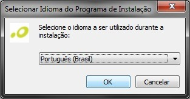
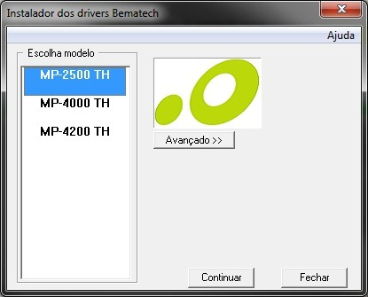
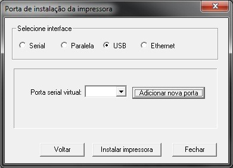
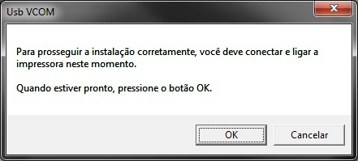
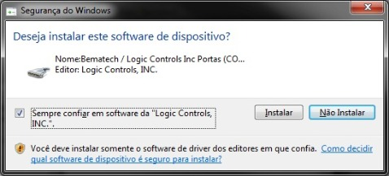
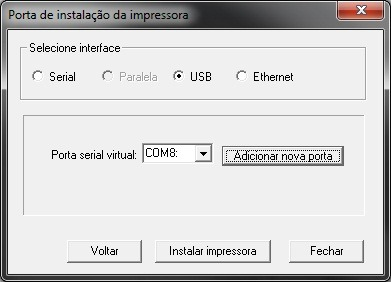
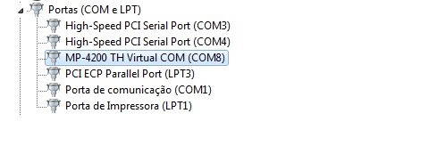

- #### dição 118 – Instalando e Configurando a Interface USB dos modelos MP-2500 TH e MP-4200 TH

  - [Flash Tip](http://partners.bematech.com.br/Canal/flash-tip/ "Ver todos os posts em Flash Tip")
  - Por
    André Schikovski

  |  |  |
  | --- | --- |
  | Gosto | 6 |
  [Tweetar](https://twitter.com/intent/tweet?original_referer=http%3A%2F%2Fpartners.bematech.com.br%2F2012%2F05%2Fedicao-118-instalando-e-configurando-a-interface-usb-dos-modelos-mp-2500-th-e-mp-4200-th%2F&text=Edi%C3%A7%C3%A3o%20118%20%E2%80%93%20Instalando%20e%20Configurando%20a%20Interface%20USB%20dos%20modelos%20MP-2500%20TH%20e%20MP-4200%20TH%20%7C%20Bematech%20Software%20Partners%3A&tw_p=tweetbutton&url=http%3A%2F%2Fpartners.bematech.com.br%2F2012%2F05%2Fedicao-118-instalando-e-configurando-a-interface-usb-dos-modelos-mp-2500-th-e-mp-4200-th%2F%23.U36UM0IGPEQ.twitter)

  [1](http://twitter.com/search?q=http%3A%2F%2Fpartners.bematech.com.br%2F2012%2F05%2Fedicao-118-instalando-e-configurando-a-interface-usb-dos-modelos-mp-2500-th-e-mp-4200-th%2F "Esta página foi compartilhada 1 vezes. Veja todos os Tweets.")

  Esta página foi compartilhada 1 vezes. Veja todos os Tweets.
  1
  [[30](http://partners.bematech.com.br/2012/05/edicao-118-instalando-e-configurando-a-interface-usb-dos-modelos-mp-2500-th-e-mp-4200-th/# "View more services")](http://partners.bematech.com.br/2012/05/edicao-118-instalando-e-configurando-a-interface-usb-dos-modelos-mp-2500-th-e-mp-4200-th/#)

  Caro Partner e Desenvolvedor Bematech,

  Há duas formas de instalar a interface USB para impressoras MP 2500 TH e MP 4200 TH, você pode utilizar os drivers Bematech Virtual Serial Driver ou o Bematech Spooler Driver, ambos possuem versões 32 e 64 bits sendo compatíveis com o Windows XP, Vista e 7.

  No [Flash Tip 94](http://partners.bematech.com.br/2011/11/edicao-94-protocolo-direto-com-a-mp-4200-th-via-usb/), abordamos a instalação da impressora via USB para comunicação através de protocolo direto, usamos a impressora MP 4200 TH como exemplo, mas o processo também é o mesmo para o modelo MP 2500 TH, sendo assim, este tutorial será focado, na instalação do driver Spooler e no uso da DLL MP2032.

  O virtual serial driver pode ser encontrado nos links abaixo: MP 4200 – [Windows 32 bits](http://partners.bematech.com.br/suporte-recursos/downloads/?did=145), [Windows 64 bits](http://partners.bematech.com.br/suporte-recursos/downloads/?did=146) MP 2500 – [Windows 32 bits](http://www.bematech.com.br/MA/arquivos/equipamentos/Drivers/BemaUni_setup_v2.0.8._x86.zip), [Windows 64 bits](http://www.bematech.com.br/MA/arquivos/equipamentos/Drivers/BemaUni_setup_v2.0.8_x64.zip)

  Para utilizar a impressora via driver ou dll (MP2032), utilizamos o Spooler, mas antes de proceder com sua instalação, é importante que você saiba que nestes dois modelos de impressoras, a conexão USB não é nativa, assim, ao instalar o driver USB será criada uma porta serial virtual, utilizada para comunicação com a impressora. Os comandos e funções de impressão podem ser enviados diretamente para a porta USB (no caso da DLL), ou para a porta serial criada automaticamente pelo driver.

  Seguindo com nosso tutorial, o primeiro passo é o download dos drivers disponíveis: Driver Spooler

  1. MP 4200 TH  – [Windows 32 Bits](http://partners.bematech.com.br/suporte-recursos/downloads/?did=128), [Windows 64 bits](http://partners.bematech.com.br/suporte-recursos/downloads/?did=129).
  2. MP 2500 TH  – [Windows 32 bits](http://www.bematech.com.br/MA/arquivos/equipamentos/Drivers/Driver_de_impressao.zip), [Windows 64 bits](http://www.bematech.com.br/MA/arquivos/equipamentos/Drivers/Bematech_User_Setup_v2.5.1_x64.zip).

  Vale ressaltar que o processo de instalação é o mesmo para as duas versões do driver spooler. Na sequência abaixo você verá o passo a passo da instalação do driver:

  Seleção de idioma:

  

  Seleção do modelo da impressora:

  

  Selecionando e instalando a porta da impressora

  

  Nesta tela, ao definir a interface USB, você terá de adicionar a porta virtual (serial) que o driver utilizará para integração com a impressora, lembre-se de utilizar um usuário com perfil Administrador no processo de instalação.

  Instalação da Serial Virtual

  

  Ao surgir essa mensagem clique no botão OK, e a instalação vai prosseguir até a tela:

  

  Nesta tela marque a checkbox de confiabilidade do driver e depois clique no botão Instalar.

  Concluindo a instalação da porta de comunicação com a impressora

  

  Após a criação da porta serial virtual, você poderá seguir com a instalação da impressora, no término da instalação a tela de impressão de página de teste seja exibida. Após este processo, feche janela de conclusão e o driver já está pronto para uso. Você pode visualizar as propriedades do driver (da mesma forma que uma interface serial), dentro do gerenciador de dispositivos do Windows conforme tela abaixo: O driver instalado está identificado como uma porta serial virtual, na seção “Portas (COM e LPT).

  

  Com o Spooler, todos os drivers de porta também estarão instalados no micro, dessa forma, quando sua aplicação utilizar a DLL MP2032, para integração com a impressora através da interface USB, você poderá seguir o exemplo em Delphi:

  // COMANDO PARA CONFIGURAR O MODELO DA IMPRESSORA

  if cbo\_modelo.Text=’MP 2500 TH’ then

      Begin

            i\_modelo:=8;

      End

  i\_retorno:= ConfiguraModeloImpressora(i\_modelo);

  // COMANDO PARA ABERTURA DA PORTA

  if cbo\_porta.Text=’USB’ then

  Begin

        edt\_ip.Enabled:=False;

        s\_porta:=cbo\_porta.text;

   End

  i\_retorno:= IniciaPorta(pchar(s\_porta));

  Com essas rotinas acima você poderá efetuar a conexão da impressora com a dll via USB,  note que não é necessário iniciar a serial virtual instalada pelo driver,  pois ao definir a interface como USB a DLL se encarrega de fazer este processo automaticamente. È importante salientar também que o driver USB pode ser instalado pelo Software de usuário, (utiliza o mesmo processo do spooler) seguindo basicamente os mesmos passos citados acima, você pode encontrar o aplicativo para download do software de usuário [aqui](http://www.bematech.com.br/MA/arquivos/equipamentos/Drivers/Software_do_usuario.zip).

  Caso tenha dúvidas, entre em contato conosco!

  André L. Schikovski

  Bematech Software Partners – BSP Tel.: 0800 644 SBSP (7277)
