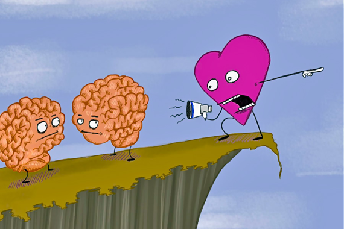
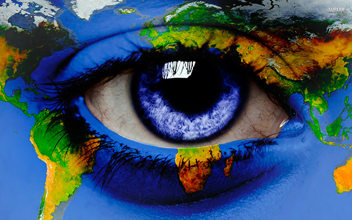
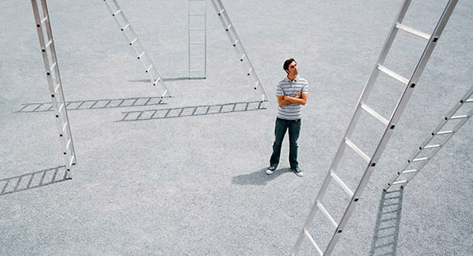
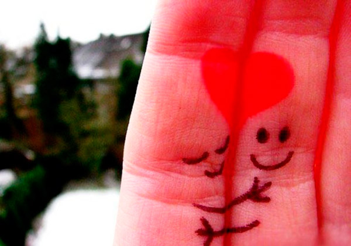

# 21 Coisas Que As Pessoas Criativas Fazem Diferente Das Outras

Pessoas criativas pensam e agem de forma diferente que qualquer outra pessoa. Possuem uma maneira própria de enxergar o mundo e de lidar com situações que ocorrem durante sua caminhada.

Acredito que todas as pessoas têm a capacidade de criar, mas algumas se destacam por possuir uma maior facilidade. A lista a seguir mostra um pouco da perspectiva das pessoas criativas e o que elas costumam fazer e como encaram a vida.

### 1 – Se inspiram nas horas menos esperadas

Eles nunca sabem quando a próxima grande ideia chegará. Ela apenas chegará, da maneira menos esperada e no momento menos esperado.

[](http://thesecret.tv.br/leidaatracao/wp-content/uploads/2014/05/pessoas-criativas-1.jpg)

### 2 – Eles sonham o tempo inteiro

Ele estão aqui, mas não estão. Eles podem viajar a qualquer momento durante uma conversa. É normal, não fique zangado com eles.

[](http://thesecret.tv.br/leidaatracao/wp-content/uploads/2014/05/pessoas-criativas-2.jpg)

### 3 – Ficam entediados facilmente

Precisam [sempre](http://thesecret.tv.br/2014/05/21-coisas-que-pessoas-criativas-fazem-diferente-das-outras/#) de um estímulo para manterem-se ativos. Eles não irão focar naquilo que não gostam, você pode chamar de TDAH ou qualquer coisa, mas isso é apenas parte de sua genialidade.

[](http://thesecret.tv.br/leidaatracao/wp-content/uploads/2014/05/pessoas-criativas-3.jpg)

### 4 – Enxergam o mundo com os olhos de uma criança

Observar o mundo como uma criança pode ser, muitas vezes, a chave do [sucesso](http://thesecret.tv.br/2014/05/21-coisas-que-pessoas-criativas-fazem-diferente-das-outras/#).

[](http://thesecret.tv.br/leidaatracao/wp-content/uploads/2014/05/menina.jpg)

### 5 – Eles falharão, mas você pode ter certeza que tentarão novamente

A vida não é fácil para ninguém, nem menos para as pessoas criativas. Falhas e quedas são inevitáveis, mas somos nós que decidimos se seremos derrotados ou se utilizaremos o obstáculo para nos fortalecermos ainda mais. As pessoas criativas também são rejeitadas por diversas vezes, mas apenas tomam isso como lição.

[](http://thesecret.tv.br/leidaatracao/wp-content/uploads/2014/05/pessoas-criativas-5.jpg)

### 6 – Vão seguir seu coração, mesmo que, muitas vezes, sua mente diga o contrário

Dizem que as pessoas criativas são menos propensas a se preocuparem com as coisas e mais propensas a assumirem riscos. Isso pode trazer mil falhas, mas um milhão de satisfações.

[](http://thesecret.tv.br/leidaatracao/wp-content/uploads/2014/05/pessoas-criativas-6.png)

### 7 – Eles se perdem no tempo

Quando estão criando, se perdem totalmente, podendo esquecer de comer, de beber e até de dormir. Quanto as ideias estão fluindo em sua mente, nada mais importa para eles.

[](http://thesecret.tv.br/leidaatracao/wp-content/uploads/2014/05/pessoas-criativas-7.jpg)

### 8 – Eles trabalham enquanto você dorme, e dormem enquanto você trabalha

A inspiração vem nos momentos mais inesperados, como foi dito no número 1.

[](http://thesecret.tv.br/leidaatracao/wp-content/uploads/2014/05/pessoas-criativas-8.jpg)

### 9 – Onde a maioria das pessoas vê dificuldade, eles veem oportunidade

Sempre procuram ver o lado bom das coisas e se livram de problemas de maneiras incomuns

[](http://thesecret.tv.br/leidaatracao/wp-content/uploads/2014/05/pessoas-criativas-9.jpg)

### 10 – Eles se apaixonam por suas obras e as odeiam no dia seguinte (e vice-versa)

Às vezes, esse tipo de inconstância acontece sem um motivo realmente definido

[](http://thesecret.tv.br/leidaatracao/wp-content/uploads/2014/05/pessoas-criativas-10.jpg)

### 11 – São humildes e orgulhosos ao mesmo tempo

Apesar de sempre estarem dispostos a aprender, são extremamente orgulhosos e confiantes quando se trata de suas ideias e criações.

[](http://thesecret.tv.br/leidaatracao/wp-content/uploads/2014/05/pessoas-criativas-11.jpg)

### 12 – Estão sempre à procura de novas formas de se expressar

A busca por novidades e ideias é constante. Seja um fotógrafo, pintor, escritor, eles sempre desejarão fazer as outras de outras maneiras.

[](http://thesecret.tv.br/leidaatracao/wp-content/uploads/2014/05/pessoas-criativas-12.jpg)

Conhece pessoas criativas? Compartilhe com eles! [anexo ausente]

### 13 – Eles procrastinam

Sim, eles cumprirão os prazos na maioria das vezes, mas boa parte do trabalho será realizada na noite anterior a este prazo.

[](http://thesecret.tv.br/leidaatracao/wp-content/uploads/2014/05/pessoas-criativas-13.jpg)

### 14 – Eles veem o outro lado da moeda

Sempre conseguem enxergar as coisas através de um ponto de vista diferente

[](http://thesecret.tv.br/leidaatracao/wp-content/uploads/2014/05/pessoas-criativas-14.jpg)

### 15 – Não gostam de limites

Regras e limites não são feitos para eles. Muitas das vezes são vistos como rebeldes, e temos exemplos históricos disso.

[](http://thesecret.tv.br/leidaatracao/wp-content/uploads/2014/05/pessoas-criativas-15.jpg)

### 16 – Não gostam de números

São brilhantes, mas se você pedir para que façam as contas, verá o quanto não gostam dos números

[](http://thesecret.tv.br/leidaatracao/wp-content/uploads/2014/05/pessoas-criativas-16.jpg)

### 17 – São grandes observadores

Observam pessoas e estão atentos até aos mínimos detalhes. Qualquer coisa pode servir de inspiração para eles.

[](http://thesecret.tv.br/leidaatracao/wp-content/uploads/2014/05/pessoas-criativas-17.jpg)

### 18 – Estão sempre fazendo novas experiências

Como foi dito no item 3, precisam sempre ser estimulados. E fugir da rotina é uma excelente escolha para isso.

[](http://thesecret.tv.br/leidaatracao/wp-content/uploads/2014/05/pessoas-criativas-18.jpg)

### 19 – Eles recomeçam tudo de novo

Não importa o quão avançados estão com uma criação, mas se sentirem que não está bom o suficiente, não pensarão duas vezes antes de descartar e começar novamente.

[](http://thesecret.tv.br/leidaatracao/wp-content/uploads/2014/05/pessoas-criativas-19.jpg)

### 20 - Mandam eles arrumarem um emprego “de verdade”

Os familiares e amigos dessas pessoas muitas vezes vão enxergar tudo como uma brincadeira e desejarão que elas desistam dessa “brincadeira”. Mas os criativos sempre seguirão e acreditarão em seus sonhos. (Nossa, eu já ouvi muito isso!)

[](http://thesecret.tv.br/leidaatracao/wp-content/uploads/2014/05/pessoas-criativas-20.jpg)

### 21 – Eles amam

Amam a vida, amam as pessoas, amam os animais, amam a beleza. O seu amor pela vida é contagiante, e se você tem alguns amigos assim, fique com eles. Eles vão fazer sua vida um pouco mais bonita

[](http://thesecret.tv.br/leidaatracao/wp-content/uploads/2014/05/pessoas-criativas-21.jpg)

Se você é criativo, com certeza irá se identificar com vários desses itens.

```
Via: Justsomething
```

[amor](http://thesecret.tv.br/tag/amor-2/)[criatividade](http://thesecret.tv.br/tag/criatividade/)[felicidade](http://thesecret.tv.br/tag/felicidade/)
