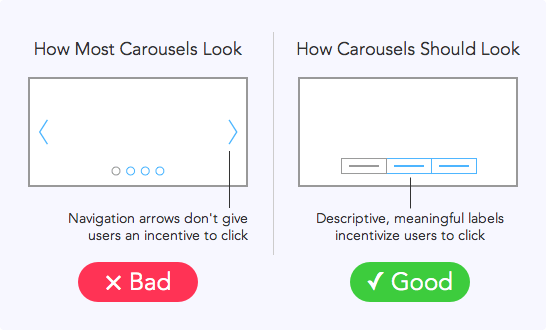

# [Why Users Aren’t Clicking Your Home Page Carousel](http://uxmovement.com/navigation/why-users-arent-clicking-your-home-page-carousel/ "Why Users Aren’t Clicking Your Home Page Carousel")

by [anthony](http://uxmovement.com/author/anthony/ "Posts by anthony") on 04/29/14 at 10:19 am

A [website study](http://weedygarden.net/2013/07/carousel-interaction-stats/) found that out of 3 million home page visits only about 1% clicked a carousel slide. How could a large, graphical element on the home page get such few clicks? The reason most carousels do poorly might surprise you.

Most carousels have multiple slides that rotate when users click the navigation arrow. The first slide always gets the most clicks. But the click-through rate for every slide after that will suffer a steep drop. The problem with the low click-through rate is not the carousel pattern itself, but the carousel navigation.

The navigation arrows on a carousel don’t give users an incentive to click. It fails because an arrow affordance **doesn’t describe the information users get if they click it**. They end up ignoring it and putting their attention on something else more informative. An arrow affordance only tells them that there are more slides left, which isn’t important enough to click. As a result, they never see the other slides in the carousel. Not only that, but users often miss navigation arrows because they’re so small and placed near the edges of a carousel. With this design, it’s no wonder the other slides never get clicked.

Instead, what’s needed on a carousel is a clear, visible label navigation. Labels are **informative, meaningful and describe what users want**. Labeling each slide incentivizes them to click because the labels tell them what they’ll get. Users are more likely to click on something that looks informative to them. A label navigation is also larger and placed in a more visible location than navigation arrows. It’s not only easier to see, but users know what to expect when they see it.

Most people would look at the results of that website study and think that all carousels are bad, and that you should never use them. But the truth is that most carousels are bad because they use an arrow navigation. Arrow affordances aren’t information dense, text labels are. If you want more users to click your carousel slides, use a label navigation. Make your labels descriptive and meaningful and you’ll get more users clicking your other slides.

---

### [anthony](http://uxmovement.com/author/anthony/ "All posts by anthony")

Author and editor-in-chief of UX Movement. Loves great web experiences and fights for the user.

### 38 Responses to “Why Users Aren’t Clicking Your Home Page Carousel”

1. Is this based on evidence or intuition? A 99% failure rate seems to be a pretty strong indicator that the failure is in the model, not the execution. This article seems to offer some misguided advice.

   - I read lots of research on carousels and noticed a pattern in what was wrong with all of them. That helped me find this solution which doesn’t follow that pattern.
   - I don’t think the advice is misguided at all. The point is, users can see (scan) what they are looking for if they have labels ( or thumbnail images!) to identify their objective.

     Dots, or any other ‘slide indicator’ does not.

     Michael
2. This is a great tip. Not something I had thought of. However, what kind of description would you suggest a simple call to action perhaps? And how long should each of them be?

   Also, how many slides do you think is suitable?
3. I would argue a couple of points.

   1) Assuming the good example of carousels is not rotating a timer (because that is a terrible practice), the example is not really a carousel at all, its an example of tabs.

   2) You post is refuting a study. This is fine, but before you go and endorse that this method of carousel works, you should back it up with user research. Otherwise it is simply anecdotal or a hunch.
4. This is insightful and a good way to do Carousels.

   Have seen very few sites, where the Label in Navigation of the Carousel is marked.

   More often than not, instead of arrow they have these Circles which show how many links are there in the Carousel and you can click on each Circle to Navigate.
5. Do you have any statistical data to back this claim up? I find it hard to believe one will make much of a difference changing their sliders when only 1% was engaging with it before. Maybe you triple engagement… and you’re still better off changing it to better cater to the other 97%.
6. It could also be that the carousel is overused, or not used in a meaningful context. I think perhaps people are tired of the page-view generation slideshow scheme. Does the information in the carousel make sense in a carousel/slideshow, or should it just be presented on the page? Or is it even worthwhile information in the first place? Lipstick on a pig does not change the fact that it’s still a pig.
7. This article brings up some good points, though since it’s arguing against interpretations of data I wish it had data to present itself.

   Converting well or poorly is all relative, and begs the question “compared to what?” You are probably right that using descriptive labels is better than arrows, so within the realm of using carousels they convert well. But this says nothing of those carousels compared to a page without a standard banner altogether.

   The data interpretation that you’re arguing against is that carousels in general don’t convert well, and you’ve described a carousel that converts better than other carousels(supposedly – there’s no data but I’ll allow it sounds likely). Do you have any data to show that these carousels can compete with pages that don’t have them at all?
8. Great post. Mike at Velir has also identified the four main reasons why carousels fail to engage site visitors here <http://blog.velir.com/index.php/2014/04/18/why-you-shouldnt-use-a-carousel-to-feature-content/>  
    Is anybody using alternatives to carousels on their site that they have found more effective at delivering engaging content?

   - Segmentation and personalization is useful. Paid search or natural search links, actually any external links, can be directed to target landing pages. Same would go for for email marketing. Rotations and carousels generally are there to serve the arm wrestling of the business implement them rather than them truly serving the viewer.
9. And here all this time I thought users weren’t clicking them because they scrolled passed them quickly in order to get to the actual content they were interested in instead of huge space wasting banners… [anexo ausente]

   - I thought users dont scroll – thats what we get told all the time!
10. Knowing this now, I feel like sometimes it would make sense to purposely leave arrows and dots so that people don’t focus too much on carousels and keep exploring the site. Just my first thought but could be the case.
11. If the information isn’t important enough to be visible on the home page without having to click for it, then the user probably expects to have to click to a real page to find it. It’s much easier and potentially quicker to skim the navigation to find a link than click through a carousel and hope the information you want is on there somewhere.

    Carousels are good for saving space for images IF the images are secondary to the content. A real estate site for example could use a carousel to display multiple large images without creating a long page to scroll through. I use a carousel on my site to display my portfolio images. All thumbnail images are displayed upfront and the view can start the image slider on the project they actually want to see, not just cycle through it in hopes of finding it.

    - I agree with you. A carousel is great for a cinematic (display) area.
12. I think carousels should be avoided altogether. All a carousel does is hide important content elements in favour of eye-candy.
13. Carousels suck.

    You can improve the interface, but it won’t solve the problem. Users have a task in mind and 99.9% of carousels (even the well designed ones) are completely unrelated to those top tasks. Thus user have learnt to skip over carousels to find the link that will help them accomplish their tasks.

    Every web site has User Needs and Business Needs. The trick is trying to align the two. Political needs are the things that get in the way of that alignment. Carousels are the product of political needs.

    Stakeholders want their content on the home page even if their content is not a priority for either users or the business. Carousels are an easy way to give in to the stakeholders, even though they suck, and they reduce the effectiveness of your site.

    A better solution, prioritize your content effectively, eliminate the carousel, and put an effective and useful call to action where the carousel was. You’ll get better conversions and happier visitors.

    - Aha! someone making some sense!

      Whether or not someone clicks has more to do with what he or she wants to do rather than the representation. If they only click the first one, they either aren’t seeing the others (don’t recognize that it even IS a carousel, and there are other options or they don’t need more information on those other topics! It has more to do with bad design that the fault of the carousel proper.

      The question is… is this carousel a method of navigation? or just some pretty pictures to introduce some concepts. If it is the former, he’s right a tabs based interface might work better. If the latter, or just plain unclear what the heck it is, you’re likely to get the click dropoff he mentioned. These are two very different things in my view.
14. On the surface, it looks like people would be clicking on buttons and not the rotating banners in this example. Every banner after the 1st has less value because people don’t usually go to a site seeking out carousels. More times than not, visitors to a page have a more focused reason to be there. Check out the article on usefulusability about conversion killing carousels (<http://www.usefulusability.com/kill-conversion-killing-carousels-now/>). It has some good statistics on the amount of time people generally spend on home pages. Other content and links on a homepage could potentially skew the results of even this example. If anything, the most important thing to do is A/B test with different styles of rotation ui and also test with and without rotations.
15. Why would you even use carousels in the first place when you can simply display the most relevant hero image, depending on the visitor? Personalization is key, not guesswork.

    - but then aren’t you often limiting the user to what you “think” they are going to do rather than letting them choose?
16. Here’s more information about why not use carousels: <http://shouldiuseacarousel.com/>

    This article solidifies even more how carousels aren’t that effective anymore, and that’s great.

    However, I have to STRONGLY disagree with this recommendation:

    “Instead, what’s needed on a carousel is a clear, visible label navigation. Labels are informative, meaningful and describe what users want.”

    The reason I strongly disagree is because of experience with this exact type of solution.

    The carousel I built had 4 labeled links/tabs at the bottom, 99% exactly like your graphic titled “Good ✓” above.

    We tracked the clicks of each label/tab and although some visitors were clicking them, there weren’t as many clicks as we were expecting. Merely in the two digits and nothing above 50 clicks.

    Truth be told, what we saw was exactly what you mentioned above: “The first slide always gets the most clicks. But the click-through rate for every slide after that will suffer a steep drop.”

    The fourth slide sometimes didn’t even get a click during our testing periods.

    We were naively wasting ours and our user’s time, hurting the message and slapping the user experience every time the carousel switched slides.

    You can actually still see a version of this carousel here: <http://www.lexisnexis.pl/>

    Here’s a screenshot of the carousel as well: <http://img836.imageshack.us/img836/6085/jio3.png>

    It didn’t get any better in the redesign. Here’s that same idea port over to the new design: <http://img834.imageshack.us/img834/9804/co5x.png>

    Carousels could be Ok as long as they are not part of the core message or content.

    - Thanks for sharing. I studied your carousel and I’ll tell you why it performed poorly.

      1. It looks like an advertisement ([users are banner blind](http://www.nngroup.com/articles/fancy-formatting-looks-like-an-ad/))

      2. It auto-slides ([very bad visibility](http://www.nngroup.com/articles/auto-forwarding/))

      3. It uses stock images

      4. It’s not full-width (harder for users to see)

      5. Label font is very small

      6. Translucent striped bar makes labels unclear

      7. Thumbnails add extra noise to labels

      8. Clutter around carousel adds extra noise

      The labels are hard to see, get lost in the image and are drowned out by extra visual noise. It looks and feels more like an ad than anything. Overall, your carousel is not clear or incentivizing to click despite having a label navigation. You can’t throw any old label navigation on it and expect great results. Carousels have to be CLEAR and should NOT look like an ad or auto-slide.

      I’ve scoured the web for a good carousel and only found one example. Behold, a well-designed carousel.

      [Image of carousel with clear, visible label navigation](http://imgur.com/gpbsBXC)

      [Link to carousel site](http://www.samsung.com/us/showcase/apps/)

      - Hey Anthony, thanks for your input.

        Here’s my take on your points.

        1. Indeed. Truth be told, I did not design the carousel, an ad agency did, I implemented it.

        2. That was the idea. Not that it makes things THAT much better, but the carousel stops moving when you hover over it. At least there’s an intention of helping with readability.

        3. Yep, nothing I could do about that, although a big company they never consider any custom photography.

        Nonetheless, I don’t agree that the use of stock images “automatically” makes a carousel bad. In the redesigned carousel I showed, they are still using stock images and they certainly look WAY better. But still, stock images.

        4. Don’t agree. Similar to point 3. above, I don’t think a full width carousel would “automatically” make it good, or better. A carousel is a carousel no matter its size.

        5. Circumstantial case. That carousel was designed in the days RWD was in no one’s radar or even taken main stream. That was the width we had to work with, plus we had to include a thumbnail. But yes, font is small by today’s (5/6/14) standards.

        Have to say, I don’t think that the width really was something made the user think “It’s not wide enough. I won’t click on that carousel.”

        6. A bit subjective if you ask me. I can read them and everyone in the team back then could read them as well. Who’s right? Truth be told, tabs could’ve been simpler.

        7. Maybe. They certainly took space forcing us to make the font that smaller than it needed to be.

        8. Not sure what you mean with “Clutter around carousel”. If it’s the design of the page then that’s a personal preference, maybe the judgement is based on the design styles we use today (5/6/14). That design is 6+ years old. But yes, I think that the overall design of a page certainly affects the perception and will to click on a carousel.

        Now, regarding “ads”, show us a carousel with slides that don’t look like ads :), even Samsung’s carousel’s slides, albeit some custom photography, look like ads.

        Thanks again!
17. I may have misinterpreted. But click-through failure suggests people aren’t clicking through from the carousel promotion to the full article that it links to. That’s not the same as clicking between items on the carousel.

    The Good/Bad examples above seem to be focusing on how to navigate between carousel items which is a different interaction and outcome. Unless you think that if people just found it easier to scroll through the full range of items in the carousel they’d be more likely to click something along the way? I doubt that. Carousels aren’t useful for most visitors to web sites. 1% click-through sounds about right. They make for nice decoration on the home page. Beats just a search box or text-overload.

    It’s no different to physical UI. How many people enter a shop because of the content in its window display? At a guess, not many. Doesn’t mean it’s not worth having a nice window display and no window display at all may put people off who otherwise would entered for a different reason. Same applies to web home pages. The carousel itself may not receive a lot of clicks, but it may contribute to a more aesthetically pleasing site that encourages people to stick around long enough for what they do want to click on.
18. This isn’t great advice. I’ve had the luxury of extensive user testing on different interaction patterns for carousels, and while what you’ve done does improve them (there are other ways to improve them too, such as strength relationship between thumb / item), it DOES NOT fix the problem.

    It improves them from disastrous to bad. They’re still bad. The best solution is to remove the carousel completely, and replace with a single clear call to action.

    Homepage carousels are a fundamentally flawed mechanism. They are a mechanism for hiding content when you have too much, but they are perceived as having the opposite function, ie. showcasing more content. This is not the case. Kill them.
19. For anyone looking for a way to implement this idea, you can see my answer on this stack overflow question:

    <http://stackoverflow.com/a/23517530/1366033>

    Basically, you want to style the carousel-indicator list items with a height and width, and remove the border-radius and text-indent properties by resetting them to zero.
20. Looks like second menu. I’m using mostly arrows, sometimes hidden arrows, maybe it’s time for some changes.
21. An Arrow isn’t an affordance its a target!  
     I like the idea of named links for slides – I would also have the option of navigating with arrows.
22. I think if we have 100 items in the carousel the second approach would not make sense any longer.  
     Would arrows with labels also be an option?
23. I agree that labels \*might\* improve the conversion of carousels but to what extent and at the cost of what other point of conversion is the big question. A question that goes unanswered.

    I hope that anyone that reads this article recognizes it for what it is, an unproven concept with potential and not a guarantee of success.
24. I like this one from Queensland (Australia) <http://www.sunshinecoast.qld.gov.au/> where the carousel labels are placed at the right side in a menu-like list. The label wording could be a little more exciting to work better as an incentive but it’s better than alot of other government sites i’ve seen recently. Council websites are always a particular challenge, juggling political wishes & priorities for home-page real estate with presenting the information users really want & need.
25. It was my understanding that carousels aren’t great in usability, are difficult to measure for analytics and A-B testing and generally users can’t understand them.

### Leave a Comment

[Click here to cancel reply.](http://uxmovement.com/navigation/why-users-arent-clicking-your-home-page-carousel/#respond)

Email Website

I am NOT a spambot
