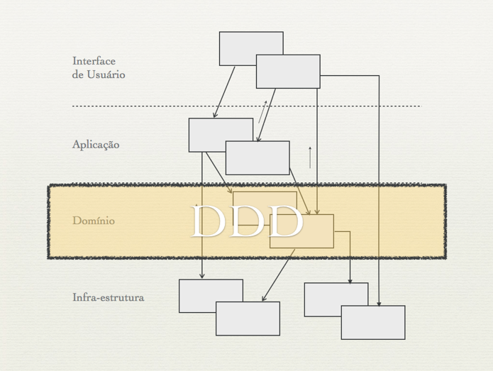
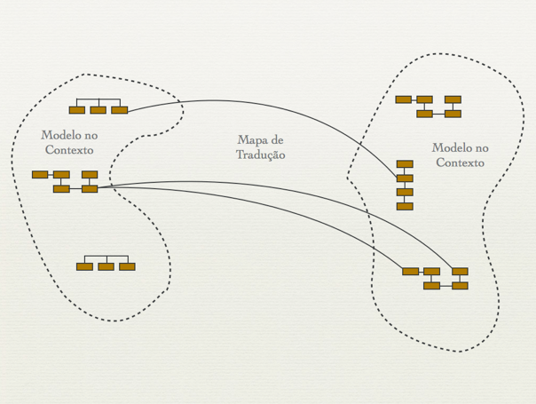
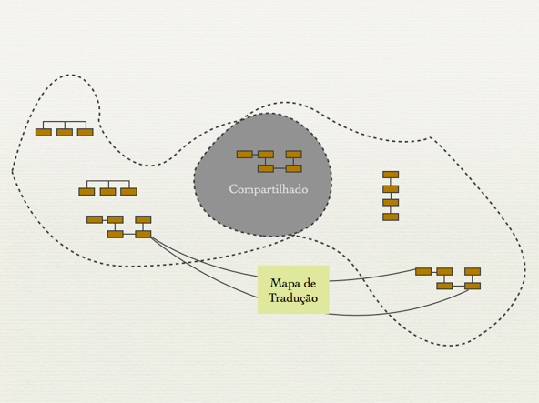
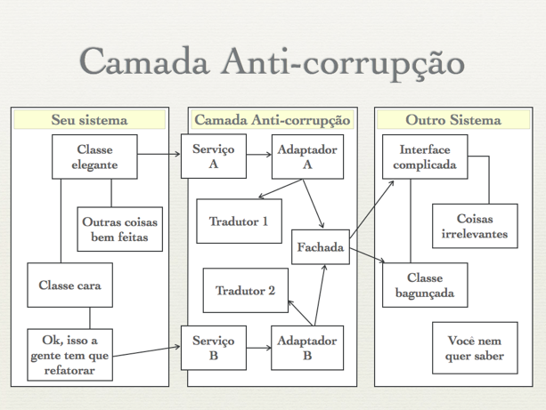
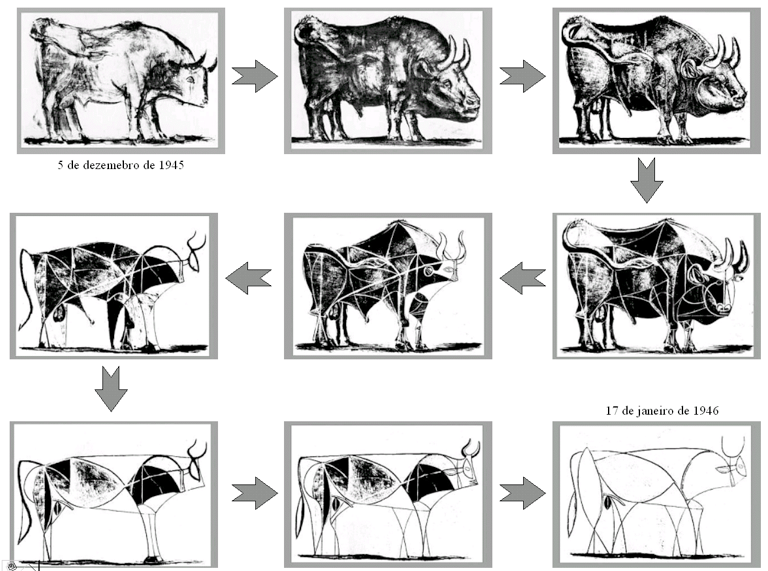

# DDD – Introdução a Domain Driven Design

Domain Driven Design significa Projeto Orientado a Domínio. Ele veio do título do livro escrito por Eric Evans, dono da DomainLanguage,  uma empresa especializada em treinamento e consultoria para desenvolvimento de software. O livro de Evans é um grande catálogo de Padrões, baseados em experiências do autor ao longo de mais de 20 anos desenvolvendo software utilizando técnicas de Orientação a Objetos. O que seria um Padrão?

Um padrão é uma regra de três partes que expressa a relação entre um contexto (1), um problema (2) e uma solução (3).

DDD pode ser visto por alguns como a volta da orientação a objetos. É verdade que o livro é um chamado às boas práticas de programação que já existem desde a época remota do SmallTalk. Quando se fala em Orientação a Objetos pensa-se logo em classes, heranças, polimorfismo, encapsulamento. Mas a essência da Orientação a Objetos também tem coisas como:

- **Alinhamento do código com o negócio:** o contato dos desenvolvedores com os especialistas do domínio é algo essencial quando se faz DDD (o pessoal de métodos ágeis já sabe disso faz tempo);
- **Favorecer reutilização:** os blocos de construção, que veremos adiante, facilitam aproveitar um mesmo conceito de domínio ou um mesmo código em vários lugares;
- **Mínimo de acoplamento:** Com um modelo bem feito, organizado, as várias partes de um sistema interagem sem que haja muita dependência entre módulos ou classes de objetos de conceitos distintos;
- **Independência da Tecnologia:** DDD não foca em tecnologia, mas sim em entender as regras de negócio e como elas devem estar refletidas no código e no modelo de domínio. Não que a tecnologia usada não seja importante, mas essa não é uma preocupação de DDD.

Todas essas coisas são bem exemplificadas e mostradas na forma de vários padrões em DDD. Mas o livro também mostra muitos padrões que não dizem respeito a código ou modelagem. Aparecem coisas que estão mais ligadas a processos (como Integração Contínua) ou a formas de relacionamento entre times que fazem parte do desenvolvimento de um sistema complexo. Eric Evans dividiu o livro em quatro partes, que apresentaremos a seguir.

## Colocando o modelo de domínio para funcionar

Para ter um software que atenda perfeitamente a um determinado domínio, é necessário que se estabeleça, em primeiro lugar, uma Linguagem Ubíqua (devman: Linguagem comum, com termos bem definidos, que fazem parte do domínio do negócio e que são usados por todas as pessoas que fazem parte do processo de desenvolvimento de software). Nessa linguagem estão termos que fazem parte das conversas diárias entre especialistas de negócio e times de desenvolvimento. Todos devem usar os mesmos termos tanto na linguagem falada quanto no código. Isso significa que, se durante uma conversa com um cliente do sistema de cobrança, por exemplo, ele disser: “Temos que emitir a **fatura** para o **cliente** antes da **data limite**”, vamos ter no nosso código alguma coisa do tipo:

- Uma classe para a entidade **Cliente**;
- Uma classe para a entidade **Fatura**;
- Algum serviço que tenha um método **emitir**;
- Algum atributo com o nome de **data limite**.

Essa linguagem ubíqua deve ser compreendida por todos e não pode haver ambiguidades. Toda vez que alguém perceber que um determinado conceito do domínio possui várias palavras que o represente, essa pessoa deve tentar re-adequar tanto a linguagem falada e escrita, quanto o código.

Utilizando a **Linguagem Ubíqua** criamos um modelo de domínio através do **Projeto Dirigido pelo Modelo** (Model Driven Design – MDD). A idéia por trás de MDD é a de que o seu modelo abstrato deve ser uma representação perfeita do seu domínio. Tudo que existe no seu negócio deve aparecer no modelo. Só aparece no modelo aquilo que está no negócio.

Em um time que cria software temos de um lado os especialistas de negócio e de outro os desenvolvedores e arquitetos. Num processo ágil defendido pelo MDD a criação do modelo abstrato deve ser feita em grupo, com todas as pessoas juntas. Se arquitetos e analistas de negócio criarem o modelo sem a participação dos programadores, corre-se o risco de criar um modelo que não é implementável ou que usará uma tecnologia inadequada. Da mesma forma, se os programadores codificarem sem se basear num modelo consistente, provavelmente desenvolverão um software que simplesmente não serve para o domínio. Em DDD, parte das pessoas que modelam o domínio são necessariamente pessoas que colocam a mão em código (Hands-on Modelers). Se os programadores não se sentirem responsáveis pelo modelo ou não entenderem como o modelo funciona, então o modelo não terá relação alguma com o software produzido por essas pessoas.

O processo de maturação de um sistema desenvolvido usando MDD deve ser contínuo. O modelo servirá de guia para a criação do código e, ao mesmo tempo, o código ajuda a aperfeiçoar o modelo. O contato contínuo com o código trará *insights* aos programadores, que irão refatorar o código. Essa refatoração deverá ser feita não só no código, mas também no próprio modelo.

## Blocos de construção do Model Driven Design (MDD)

Uma vez que decidimos criar um modelo usando MDD, precisamos, inicialmente, isolar o modelo de domínio das demais partes que compõem o sistema. Essa separação pode ser feita utilizando-se uma arquitetura em camadas (Figura 1), que dividirá nossa aplicação em quatro partes:

- **Interface de Usuário** – parte responsável pela exibição de informações do sistema ao usuário e também por interpretar comandos do usuário;
- **Aplicação** – essa camada não possui lógica de negócio. Ela é apenas uma camada fina, responsável por conectar a Interface de Usuário às camadas inferiores;
- **Domínio** – representa os conceitos, regras e lógicas de negócio. Todo o foco de DDD está nessa camada. Nosso trabalho, daqui para frente, será aperfeiçoar e compreender profundamente essa parte;
- **Infra-estrutura** – fornece recursos técnicos que darão suporte às camadas superiores. São normalmente as partes de um sistema responsáveis por persistência de dados, conexões com bancos de dados, envio de mensagens por redes, gravação e leitura de discos, etc.

**[](http://www.agileandart.com/wp-content/uploads/2010/07/Screen-shot-2010-07-16-at-09.50.18.png)**

**Figura 1.** Arquitetura em camadas, utilizada para separar o domínio do resto da aplicação.

Depois de dividirmos o sistema em camadas, nos preocuparemos apenas com a camada de domínio. Para modelar essa parte, utilizamos alguns Padrões propostos em DDD. Esses padrões são chamados de blocos de construção e serão utilizados para representar nosso modelo abstrato. Esses blocos podem ser:

- **Entidades** – classes de objetos que necessitam de uma identidade. Normalmente são elementos do domínio que possuem ciclo de vida dentro de nossa aplicação: um Cliente, por exemplo, se cadastra no sistema, faz compras, se torna inativo, é excluído, etc.;
- **Objetos de Valores** – objetos que só carregam valores, mas que não possuem distinção de identidade. Bons exemplos de objetos de valores seriam: strings, números ou cores. Por exemplo: se o lápis de cor da criança acabar e você der um novo lápis a ela, da mesma cor, só que de outra caixa, ela não vai se importar. Para a criança, o lápis vermelho de uma caixa é igual ao lápis vermelho de outra caixa. As instâncias de Objetos de Valores são imutáveis, isto é, uma vez criados, seus atributos internos não poderão mais ser modificados. Em Java, temos, por exemplo, a classe BigDecimal, muito utilizada para fazer cálculos com valores grandes. Na **Listagem 1** observamos que, para multiplicar dois valores representados pela classe BigDecimal, não alteramos os objetos com os valores dos fatores da multiplicação. Para calcular 5 milhões vezes 30 milhões construímos cada um dos fatores e então obtemos o resultado, que será armazenado numa terceira variável. Após o cálculo, cada um dos fatores continuará armazenando o valor original. A saída do código será:

`5000000  
30000000  
150000000000000`

- **Agregados** – compostos de Entidades ou Objetos de Valores que são encapsulados numa única classe. O Agregado serve para manter a integridade do modelo. Elegemos uma classe para servir de **raiz** do Agregado. Quando algum cliente quiser manipular dados de uma das classes que compõem o Agregado, essa manipulação só poderá ser feita através da **raiz**;
- **Fábricas** – classes responsáveis pelo processo de criação dos Agregados ou dos Objetos de Valores. Algumas vezes, Agregados são relativamente complexos e não queremos manter a lógica de criação desses Agregados nas classes que o compõem. Extraímos então as regras de criação para uma classe externa: a fábrica;
- **Serviços** – classes que contém lógica de negócio, mas que não pertence a nenhuma Entidade ou Objetos de Valores. É importante ressaltar que Serviços não guardam estado, ou seja, toda chamada a um mesmo serviço, dada uma mesma pré-condição, deve retornar sempre o mesmo resultado;
- **Repositórios** – classes responsáveis por administrar o ciclo de vida dos outros objetos, normalmente Entidades, Objetos de Valor e Agregados. Os repositórios são classes que centralizam operações de criação, alteração e remoção de objetos. Em linguagens como Java e .NET, repositórios são comumente implementados usando-se frameworks como Hibernate ou Nhibernate. Já em RubyOnRails, o ActiveRecord faz o papel de repositório;
- **Módulos** – abstrações que têm por objetivos agrupar classes por um determinado conceito do domínio. A maioria das linguagens de programação oferecem suporte a módulos (pacotes em Java, namespaces em .NET ou módulos em Ruby). Um anti-padrão comum é a criação de módulos que agrupam as classes segundo conceitos de infra-estrutura. Um exemplo seria, ao se trabalhar com Struts, em Java, criar um pacote que conterá todas as Actions do sistema. Ao usar DDD devemos agrupar classes se esse agrupamento faz sentido do ponto de vista do domínio, ou seja, do negócio. Se tivermos, por exemplo, várias classes que compõem informações de Paciente num sistema médico, podemos criar um módulo chamado **paciente** e colocar classes como Ficha, PrescricaoMedica, RegistroDeConsulta e HistoricoDeCirurgias num mesmo pacote.

|  |
| --- |
| ``` BigDecimal fiveM  BigDecimal.valueOf5000000 BigDecimal thirtyM  BigDecimal.valueOf30000000 BigDecimal result  fiveM.multiplythirtyM System..printlnfiveM System..printlnthirtyM System..printlnresult ``` |

## Refatorando para compreender profundamente o modelo

Depois de elaborar um modelo de dados que reflete o seu domínio, usando os blocos de construção do MDD, o processo de aperfeiçoamento do modelo continua. O modelo deve ser refatorado e melhorado na medida em que se obtém maior compreensão de conceitos importantes do domínio. Muitas vezes alguns conceitos do domínio estão implícitos no código. O trabalho do desenvolvedor é tentar identificar esses conceitos implícitos e torná-los explícitos. Alguns padrões podem ajudar a compreender mais profundamente o modelo:

- **Interface de Intenção Revelada** – usar nomes em métodos ou classes que dizem exatamente “o que” essas classes ou métodos fazem, mas não “como” elas fazem. Dizer “como” no nome do método quebra o encapsulamento, uma vez que quem chama o código saberá detalhes de implementação;
- **Funções sem Efeitos-Colaterais** – tentar deixar o código com o maior número possível de métodos que não alterem o estado dos objetos, concentrando esse tipo de operação (alteração de estado) em Comandos;
- **Asserções** – para os Comandos que alteram estados, criar testes de unidade que rodem automaticamente, ou colocar asserções no código que validem, após a chamada dos comandos, as alterações de estado esperadas.

Por exemplo, o dono de uma loja de tintas pode querer um programa que mostre para seus clientes o resultado da mistura de cores padrões. Inicialmente temos um código como no código abaixo. Não é possível, apenas olhando o nome do método (pinta), saber o que esse método faz. O que ele pinta? Um quadro? Um desenho? Uma parede? O que ele faz com a Tinta que ele recebe como parâmetro? Temos que olhar a implementação para saber o que está acontecendo de fato neste método.

|  |
| --- |
| ``` public class Tinta 	private  r 	private  g 	private  b   	public  pintaTinta p 		v  v  pinta. //volume é somado 		//várias linhas de código complexo 		//para misturar tintas 		//no final, r, g e b têm seus valores alterados 	 ``` |

Um possível teste para esse código seria assim:

|  |
| --- |
| ``` public  testPinta 	//cria amarelo com volume 100 	Tinta amarelo   Tinta, , ,  	//cria azul com volume 100 	Tinta azul   Tinta, , ,    	//mistura azul com amarelo 	amarelo.pintaazul   	//verifica o resultado. O volume deve ser 200 	assertEquals, amarelo. 	assertEquals, amarelo. 	assertEquals, amarelo. 	assertEquals, amarelo. ``` |

Nós queremos tornar esse código mais claro, e para isso usaremos uma interface de intenção revelada. Mudaremos o código da classe Tinta e o nosso teste:

|  |
| --- |
| ``` public  testMisturaDeTintas 	//cria amarelo com volume 100 	Tinta amarelo   Tinta, , ,  	//cria azul com volume 100 	Tinta azul   Tinta, , ,    	//mistura azul com amarelo 	amarelo.misturadoComazul   	//verifica o resultado. O volume deve ser 200 	assertEquals, amarelo.getVolume 	assertEquals, amarelo.getAzul 	assertEquals, amarelo.getAmarelo 	assertEquals, amarelo.getVermelho    public class Tinta   private  vermelho   private  amarelo   private  azul     public  misturadoComTinta p 	volume  volume  pinta.getVolume //volume é somado 	//várias linhas de código complexo 	//para misturar tintas ``` |

O código resultante já torna muito mais claro o que o método faz. O próprio nome do método (misturaCom) já diz: mistura uma tinta com outra. O antigo nome (pinta) não fazia sentido do ponto de vista do domínio, já que o cliente da loja de tintas quer saber: “que cor fica quando eu misturo essa tinta com outra?”

## Projeto estratégico

As técnicas de criação e refinamento do modelo (como o uso da Linguagem Ubíqua e MDD) são importantes para começarmos a entender como desenvolver um sistema dirigido pelas regras de negócio do domínio, ou seja, como aplicar DDD. Mas a parte mais importante (e difícil) de Domain Driven Design é quando começamos a lidar com sistemas complexos. Como deve ser a interação entre sistemas que interagem entre si? Como dividir nosso trabalho, de maneira que foquemos nossos esforços naquilo que tem maior valor para o negócio? Como fazer a comunicação entre os times que desenvolvem esses sistemas?

Temos alguns padrões que nos ajudam a dividir nosso software em várias partes, que chamamos de contextos. Cada **Contexto Delimitado** deve estar bem claro para todos que estão envolvidos no processo de desenvolvimento. A fronteira entre contextos deve ser clara para todos, ou seja, todo mundo deve saber a qual contexto um determinado pedaço de código pertence.

Os padrões que nos ajudarão a estabelecer qual é a relação existente entre os vários times são:

- **Mapa de Contextos** – uma forma pragmática de documentar claramente os vários **Contextos Delimitados** que fazem parte de um sistema complexo (**Figura 2**). No mapa de contextos ressaltaremos os vários componentes do software e como as equipes que cuidam desse sistema interagem. Além disso, criaremos um mapa de tradução que servirá para facilitar a comunicação. Muitas vezes, existem termos usados para um mesmo conceito em vários contextos (por exemplo, no contexto do sistema de cobrança usamos o termo “Fatura”, que significa a mesma coisa que o termo “Nota Fiscal” no contexto do sistema de faturamento). Toda vez que o time do sistema de cobrança for conversar com o time de faturamento, ele terá que usar adequadamente o termo “Nota Fiscal” para que o outro time entenda o que está sendo dito;

**[](http://www.agileandart.com/wp-content/uploads/2010/07/Screen-shot-2010-07-16-at-09.50.35.png)**

**Figura 2.** Mapa de Contextos

- **Produtor-Consumidor** – Quando os times possuem uma relação bem clara de Consumidor-Produtor. Produtor é o time que fornece software para o time Consumidor. Nesse tipo de relação, o Produtor assumirá compromissos de entregas para seu Consumidor, que por sua vez, tomará decisões esperando que esse compromisso seja cumprido. O time Produtor deverá rodar testes automatizados feitos pelo Consumidor (ou por ele mesmo) toda vez que fizer alguma alteração na interface que o cliente usa. Isso garantirá que nada irá quebrar do lado do Consumidor;
- **Conformista** – Algumas vezes não é possível que dois times de desenvolvimento se relacionem como Produtor-Consumidor. Mesmo que o Produtor tenha muito boa vontade, ele pode ter outras prioridades. Caso não seja possível alterar ou pedir alterações de uma parte do sistema mantida por outro time, deve-se adotar uma postura conformista e assumir que a única forma de caminhar é ter que aguardar o outro grupo e se adaptar a sua realidade. Quando a relação de conformista é estabelecida, não solicitamos mais funcionalidades ao outro time. Alteramos nossos sistemas para se adequar ao que já é oferecido pelo outro sistema;

- **Núcleo Compartilhado** – Quando dois times alteram uma mesma base de código comum (**Figura 3**). É importante que esse pedaço de código esteja bem definido e que possua muitos testes automatizados, que devem ser rodados por qualquer um dos grupos que desejar fazer alguma alteração. Todas as alterações devem ser comunicadas ao outro time e os testes precisam fazer parte de um processo de **Integração Contínua**. Quando se usa um núcleo compartilhado, esse pedaço de código tende a ser mais difícil de mudar, já que precisa da aceitação de várias equipes. Por outro lado, evita-se algumas duplicações, já que conceitos comuns são codificados uma única vez e utilizados por vários sistemas;

**[](http://www.agileandart.com/wp-content/uploads/2010/07/Screen-shot-2010-07-16-at-09.50.47.png)**

**Figura 3.** Núcleo Compartilhado

- **Camada Anti-corrupção** – Quando temos um sistema legado, com código muito bagunçado e uma interface complexa, e estamos escrevendo um sistema novo com o código razoavelmente bem feito, criamos uma camada entre esses dois sistemas (**Figura 4**). O nosso sistema novo e bem feito falará com essa camada, que possui uma interface bem feita. E a camada anti-corrupção é responsável por traduzir e adaptar as chamadas para o sistema legado, usando uma fachada interna;

**[](http://www.agileandart.com/wp-content/uploads/2010/07/Screen-shot-2010-07-16-at-09.51.00.png)**

**Figura 4.** Camada Anti-corrupção

- **Caminhos Separados** – Quando o custo de integração é muito grande e os benefícios pequenos, times podem decidir seguir caminhos em que dois sistemas não dependam um do outro. Esse padrão é muito usado principalmente em partes pequenas e periféricas do domínio. Um exemplo seria optar por ter um cadastro de CEP local num sistema de vendas online, ao invés de integrar com o sistema dos correios;
- **Serviço Aberto de Funcionalidades** e **Linguagem Publicada** – Quando temos vários clientes que interagem com uma mesma parte do nosso sistema, não é conveniente que criemos adaptações para cada um desses clientes. A solução para essa situação é criar um **Serviço Aberto de Funcionalidades** e criar uma **Linguagem Publicada**. Essa linguagem é a documentação de uma API que poderá ser usada pelos vários clientes. Hoje em dia, vários serviços de internet utilizam esse tipo de abordagem: Google, Flickr, Twitter, Amazon, etc. Todos esses serviços possuem API pública, que pode ser usada por programadores que queiram criar sistemas que interajam com esses serviços.

## Em busca do Núcleo

A parte mais importante e que, de fato, torna o uso de DDD interessante, é o processo chamado de Destilação do Domínio. A perfeição é atingida quando não temos mais nada para tirar daquilo que chamamos **Núcleo do Domínio** (Core Domain). Inicialmente, o nosso sistema é um bloco monolítico, que mistura código de várias camadas, classes com especialidades bem diversas. Nosso trabalho é ir separando em módulos, refatorando, extraindo métodos, classes, conceitos. É preciso organizar tudo, de forma que tenhamos bem claro quais são os conceitos centrais do nosso negócio. Esses conceitos, centrais, são nosso núcleo.

Tudo que não fizer parte do núcleo deve ser extraído e separado em sub-domínios genéricos. Apesar de serem elementos que fazem parte do nosso domínio, não são centrais. Uma vez que conceitos secundários são identificados, deve-se dar menor prioridade para eles do que para aqueles elementos que estão no **Núcleo do Domínio**. Eventualmente, vale a pena considerar adotar soluções prontas (de prateleira) para esses casos, ao invés de manter a implementação sob responsabilidade do time de desenvolvimento. Um exemplo: imagine que estamos desenvolvendo um sistema para uma empresa de entregas internacionais. Nesse sistema temos que tratar com seriedade a questão de fuso-horários, já que esse assunto pode ser crucial para o agendamento e pontualidade nas entregas. Apesar disso, “fuso-horário” não é, provavelmente, um conceito que faz parte do núcleo do nosso negócio. Podemos desenvolver nosso próprio código de conversão de horários entre vários fusos, mas a melhor alternativa seria usar alguma biblioteca pronta. Provavelmente existe uma que irá atender às nossas necessidades.

Para tornar claro para todos o que é exatamente o Núcleo do Domínio, convêm escrever um documento pequeno, de no máximo uma página, com uma Sentença da Visão do Domínio.

Um exemplo de **Sentença da Visão do Domínio** seria:

*“O modelo representa compras feitas por clientes numa loja. O cliente pode passear pela loja e visualizar produtos, que estão divididos em categorias. O cliente coloca os produtos que deseja num carrinho de compras e depois passa no caixa para efetuar o pagamento, que pode ser feito em dinheiro ou cartão. Após o pagamento, os produtos são oficialmente retirados do estoque da loja.”*

Apesar de serem importantes, as especificações abaixo não fazem parte da visão de domínio:

*“Todos os produtos são identificados por códigos de barra. Os códigos são lidos no caixa por um terminal e os preços são mostrados na tela, para o cliente, quando o código é lido. Os dados de compra são enviados através da rede sem fio e cadastrados num banco de dados, que deve ter 99,9% de disponibilidade.”*

Algumas vezes, essa visão resumida não é suficiente para documentar todo o Núcleo. Outra forma de ressaltar as partes que fazem parte do coração do domínio é usar o padrão **Núcleo Destacado**. Para isso, criamos um documento mais extenso, mas que não passe de sete páginas, explicando todos os elementos do núcleo e a forma como esses elementos interagem. Também podemos definir um formato especial, destacado, para representar elementos do núcleo no modelo de domínio. Assim, qualquer pessoa que estiver olhando a documentação geral do modelo, saberá claramente quais elementos são fundamentais e quais não são.

## Conclusões

Extrair a essência do domínio, dentre milhares de linhas de código de um sistema complexo nem sempre é fácil. O trabalho de refinamento e busca de uma visão clara é contínuo. A refatoração é um processo incessante de busca por melhorias de projeto. Observe a sequência de imagens da **Figura 5**. Essas imagens fazem parte um estudo feito por Pablo Picasso, que durou cerca de dois meses. Durante esse tempo, o pintor refez várias vezes o mesmo desenho do touro. A cada passo ele identificava partes do desenho anterior que poderiam ser removidas, sem que a essência da idéia fosse perdida. Aplicar DDD é utilizar Padrões com o objetivo de extrair e reconhecer a essência de um sistema.

**[](http://www.agileandart.com/wp-content/uploads/2010/07/Screen-shot-2010-07-16-at-09.51.19.png)**

**Figura 5.** Refatorando para compreender a essência

Os padrões citados nesse artigo são apenas alguns dos descritos em Domain Driven Design. DDD é uma forma de desenvolver software que, por estar ligado a boas práticas de Orientação a Objetos, tem muito a ver com desenvolvimento ágil. Além disso, a própria idéia de Padrões, que promove eficácia na comunicação, é um dos valores pregados pelos agilistas. Obviamente não é possível entender DDD lendo poucas páginas. O conselho que damos é ler o livro do Eric Evans e começar a aplicar esses padrões no seu próprio negócio. Certamente são técnicas que levarão ao desenvolvimento de serviços de qualidade, sistemas seguros e fáceis de dar manutenção, levando, consequentemente, à satisfação dos seus clientes com a rapidez que o mercado de hoje exige.

.***De que se trata o artigo:***

Neste artigo veremos os principais padrões de Domain Driven Design e alguns exemplos de como esses padrões podem ser aplicados.

***Para que serve:***

DDD induz a implantação de um cenário de melhoria contínua, podendo ser uma ferramenta extremamente útil para se desenvolver software de qualidade e que atenda bem as necessidades do cliente.

***Em que situação o tema útil:***

Tanto programadores quanto arquitetos e especialistas de negócio podem se beneficiar das técnicas de DDD, que ensinam justamente boas práticas de como modelar seu domínio, além de tornar eficiente a interação entre os vários papéis de pessoas que fazem parte do processo de desenvolvimento de software. DDD pode ser muito útil quando vários times desenvolvem um mesmo sistema complexo.

Links

**Mini-book de DDD**

<http://www.infoq.com/minibooks/domain-driven-design-quickly>

**Domain Driven Design**

<http://domaindrivendesign.org/>

**Vídeo de Introdução a DDD**

<http://vimeo.com/3545313>

**Vídeos sobre Projeto Estratégio**

<http://vimeo.com/3972348>

<http://www.infoq.com/presentations/strategic-design-evans>

**Vídeo Colocando o Modelo para Funcionar**

<http://www.infoq.com/presentations/model-to-work-evans>

Eric Evans, **Domain Driven Design – Tackling Complexity in the Heart of Software,** 2004.
