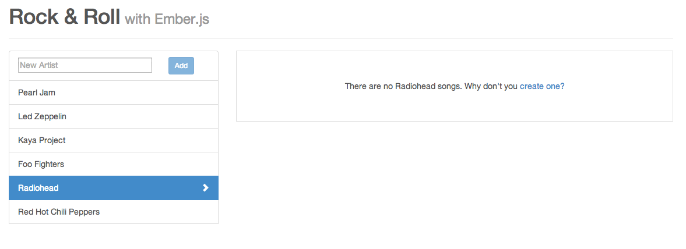
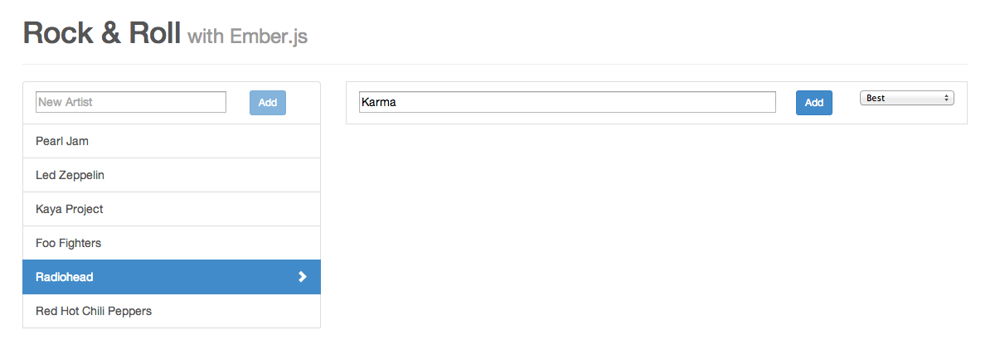
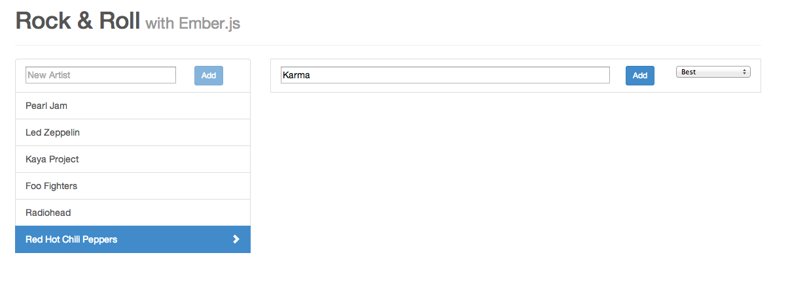
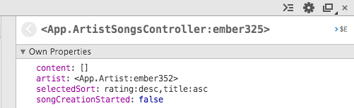
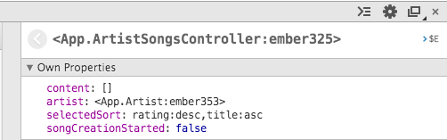

# Ember Gotcha: Controllers Are Singletons

Jun 26, 2014

There is a somewhat subtle bug in the current version of the Rock & Roll with
Ember app. If you start to create a song for an artist that does not have one
and then switch to another one, the song creation process does not need to be
restarted by clicking on the “Why don’t you create one?” link. Also, if you’ve
already partially inputted the name of the song for the first one, it stays
there for the second artist:







The above behavior was brought to my attention by [David](https://twitter.com/davidlormor)
[Lormor](http://davidlormor.com), an astute reader and watcher of my screencasts.

In some circumstances it is desirable for the result of some user interaction to
linger between route transitions but in other cases it is not. I put the
current example firmly in the latter camp and thus consider the above a bug.

Let me explain what causes this behavior and then provide a simple solution to fix it.

### Repeat after me: controllers are singletons

Controllers in Ember are singletons. Controllers in Ember are singletons.
Controllers in Ember are singletons.

When the user leaves a page and goes to another one, the controller is not
torn down. It lives on, keeping its properties.

This makes total sense for a framework that aims to be a tool for creating
long-lived, rich-client side applications but is something to watch out for
when you develop Ember applications.

If you have a long background in back-end development, like yours truly,
it is especially easy to fall prey to this, as you could see.

### Same controller, different model

Initially, when the applicaiton is loaded, the `songCreationStarted` property
of the controller is set to false. When the user clicks the “create one” in the
“Why don’t you create one?” blurb, it is set to true and thus the text input
field appears to allow adding a new song.

Now comes the tricky part. If the user then decides to go to a different artist,
she clicks the name of another artist in the sidebar. What happens? A transition
is made from one `ArtistSongsRoute` to another `ArtistSongsRoute`. The artist
is going to be different but the same `ArtistSongsController` is used.

To prove my point, here are two screenshots of the Ember Inspector’s sidebar.
The first one is before, the second one is after the transition between
`/artists/radiohead/songs` and `/artists/red-hot-chili-peppers/songs`:





You can see that the controller is the same Ember object but the value of the `artist` property changes.

### Understanding the problem

When the transition is made between the two artists, the artist object is
changed and consequently any data bound to the artist (and the `artist` property
of the `ArtistSongs` controller) is going to be rerendered but, since the
controller instance is not changed, unrelated data will stay unchanged on
screen.

What happens in the code? If you take a look at the template, you see that the
text input field is shown if `canCreateSong` is true:

```
<script type="text/x-handlebars" data-template-name="artist/songs">
  {{#if canCreateSong}}
    <div class="list-group-item">
      {{input type="text" class="new-artist" placeholder=newSongPlaceholder value=newTitle insert-newline="createSong" }}
      <button class="btn btn-primary btn-sm new-song-button" {{action "createSong"}}>Add</button>
      (...)
    </div>
  {{/if}}
</script>
```

`canCreateSong` is defined in the controller and is true if either
`songCreationStarted` is true or if there are already songs. Since
`songCreationStarted` has just been set to true by the `enabledSongCreation`
action (and the controller instance is not changed) when the user clicked the
“create one” link for the first artist, `canCreateSong` stays true and the
text field stays visible:

|  |  |
| --- | --- |
|  | ``` ArtistSongsController  EmberArrayControllerextend   (...)   songCreationStarted false   canCreateSong function      return 'songCreationStarted'  'length'   property'songCreationStarted' 'length'   actions      enableSongCreation function        'songCreationStarted'    (...) ``` |

### A simple fix

To fix this, the simplest solution is to manually reset the properties that we
do not want to persist.

One solution is to do this in the `setupController` of the route since that
always gets called when transitioning to a new route:

|  |  |
| --- | --- |
|  | ``` ArtistSongsRoute  EmberRouteextend   (...)   setupController functioncontroller model      _supercontroller model     controller'artist' modelFor'artist'     controller'newTitle'      controller'songCreationStarted' false   (...) ``` |

And that totally works. However, I prefer placing this “resetting” code to the
controller, probably because it is strictly controller-related and also because
I can make the code really telling there:

|  |  |
| --- | --- |
|  | ``` ArtistSongsController  EmberArrayControllerextend   (...)   songCreationStarted false   canCreateSong function      return 'songCreationStarted'  'length'   property'songCreationStarted' 'length'   artistDidChange function      'newTitle'      'songCreationStarted' false   observes'artist'   (...) ``` |

The `observes` function property extension will run the `artistDidChange` code
every time the `artist` property of the controller changes and that is exactly
when we need to clear the title and allow the song creation process to be
restarted. Nice, clean and does exactly one thing.

*Note: The latest version of the code that contains these changes is [available on Github](https://github.com/balinterdi/rock-and-roll/releases/tag/fix-start-song-creation-bug).*

Liked this post? [Sign up here](https://my.leadpages.net/leadbox/147fb3573f72a2%3A12ccd2806b46dc/5733935958982656/)
to receive articles, screencasts and other Ember goodies regularly to your inbox.

[« Indicating Progress - Loading Routes in Ember.js](http://balinterdi.com/2014/06/18/indicating-progress-loading-routes-in-ember-dot-js.html "Previous Post: Indicating Progress - Loading Routes in Ember.js")
