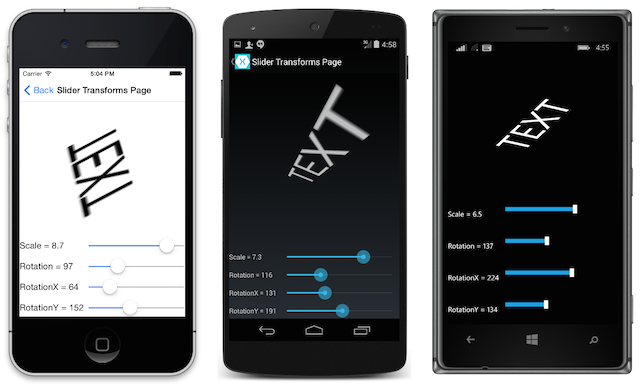

# [Show Me the XAML](http://blog.xamarin.com/show-me-the-xaml/ "Permalink to Show Me the XAML")

By [Mike Bluestein](http://blog.xamarin.com/ "Posts by Mike Bluestein")

Xamarin.Forms brings the eXtensible Application Markup Language, or XAML as it’s so lovingly known, to cross-platform mobile development. With XAML, application user interfaces can be created declaratively and succinctly.

To help Xamarin.Forms developers get up to speed, our good friend [Charles Petzold](http://www.amazon.com/Charles-Petzold/e/B000APETXO/ref=dp_byline_cont_pop_book_1 "Charles Petzold's Amazon Author Page") took a brief pause from writing his book on Xamarin.Forms to bring you this wonderful guide:

[XAML for Xamarin.Forms – Getting Started with Cross-Platform Markup for Mobile Devices](http://developer.xamarin.com/guides/cross-platform/xamarin-forms/xaml-for-xamarin-forms/ "XAML for Xamarin.Forms").

In it, you’ll find everything you need to work effectively with XAML in Xamarin.Forms. The guide includes 5 action packed parts:

Along with our other great education resources for learning Xamarin.Forms, you now have a wealth of information to help create great cross-platform apps.

### Subscribe

Enter your email address below to receive Xamarin blog posts in your inbox.

Your email:

[RSS](http://blog.xamarin.com/feed/)
