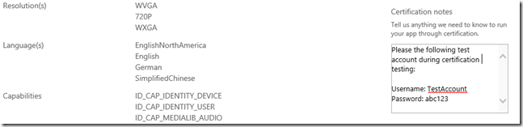
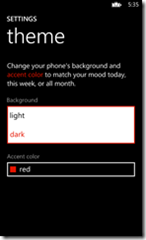
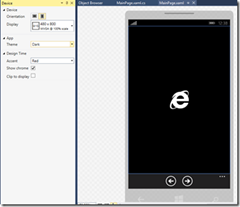

# Top Windows Phone app certification failures and how to avoid them

*Thanks to Mike Francis of the Windows Phone Store certification and policy team, who provided much of the content for this blog. -- Bernardo*

I work very hard to develop, test, and market my Windows Phone apps. Failing certification testing requires me to correct and resubmit my app, which can delay the app release and require additional time to fix the problems.

In this post, the Windows Phone Store certification and policy teams share the most common certification failures we see as apps go through the certification process. This post also covers steps you can take to avoid these failures. Armed with this knowledge, you can increase your chances of passing certification the first time and publishing your app to the Store on schedule.

These are the top [Windows Phone App Submission requirements](http://msdn.microsoft.com/en-us/library/windowsphone/develop/hh184843(v=vs.105).aspx) failures, from most common to least common.

#### **Incorrect app screenshots**

**Requirement** [4.6 - App screenshots](http://msdn.microsoft.com/en-us/library/windowsphone/develop/hh184844(v=vs.105).aspx)**.** Your app screenshots should not include any emulator chrome, frame rate counters, or debug information. They should not be altered or be transparent. Also, photos of your app running on a device or the emulator are not substitutes for a screenshot taken with the emulator.

- Tip: Use the built-in emulator screenshot tool to take the screenshots. The Windows Phone 8 SDK ships with emulators for WVGA, XVGA, and 720p resolutions.
- Tip: Don’t take WVGA (480 x 800) screenshots for Windows Phone 8 XAPs. Instead, use the Dev Center feature that automatically scales the XVGA screenshots down to the WVGA resolution.
- Tip: Screenshots are not required to be localized, however, you do need to provide at least one screenshot for each language supported.

Here are a couple of examples of bad screenshots:

|  |  |
| --- | --- |
| **Bad screenshot 1 – Note emulator chrome** | **Bad screenshot 2 - Note frame rate counter in upper right** |
| [3222af8829f37455e4e8952a4e9bc67b.png](file:///C:\Users\mikefra\AppData\Local\Temp\WindowsLiveWriter1286139640\supfiles7BB32C\clip_image0033.png) | [0d3e1dad4e756d66ab5b0a2f1517a98d.png](file:///C:\Users\mikefra\AppData\Local\Temp\WindowsLiveWriter1286139640\supfiles7BB32C\clip_image0053.png) |

And here are the correct screenshots:

|  |  |
| --- | --- |
| **Good screenshot 1 - No emulator chrome** | **Good screenshot 2 - No debug information** |
| [b2c3bd12b56b4c86d4f341a73bcd4ef0.png](file:///C:\Users\mikefra\AppData\Local\Temp\WindowsLiveWriter1286139640\supfiles7BB32C\clip_image0083.png) | [ba0dbcad34ce513d3bd33c1dccf4ab2d.png](file:///C:\Users\mikefra\AppData\Local\Temp\WindowsLiveWriter1286139640\supfiles7BB32C\clip_image0103.png) |

#### Missing information to test the app

**Requirement** [5.1.4 - App Testability](http://msdn.microsoft.com/en-us/library/windowsphone/develop/hh184840(v=vs.105).aspx)**.** Many apps require login credentials to run. If your app requires an existing account, make sure you create a test account that can be used by the certification team during testing. Don’t forget to include the account credentials in the **Certification notes** in your Dev Center submission. Click **More XAP Options** on the **Upload and describe your XAP** page.

Include test account credentials in **Certification notes** field.

#### App crashes

**Requirement [5.1.2 - App closure](http://msdn.microsoft.com/en-us/library/windowsphone/develop/hh184840(v=vs.105).aspx)**. This requirement is simply to verify that your app doesn’t crash during certification testing. As you know, if your app crashes in release mode, it just goes away without any user prompt. Certification will reject your app if it “unexpectedly terminates” during testing.

[BugSense](https://www.bugsense.com/) and [Little Watson](http://blogs.msdn.com/b/andypennell/archive/2010/11/01/error-reporting-on-windows-phone-7.aspx) can help you collect unhandled exception telemetry data. See this KB article for more info on how to avoid crashes: [Troubleshooting Windows Phone App Problems that occur after Submitting](http://support.microsoft.com/kb/2859130/en-us).

#### Incorrect icons and tile images

**Requirement** [4.7 – Required app images](http://msdn.microsoft.com/en-us/library/windowsphone/develop/hh184844(v=vs.105).aspx). Developers sometimes forget to replace default icons and tile images in an app created from a Visual Studio template. Other tools such as [App Studio](http://apps.windowsstore.com/) and [Apache Cordova](http://msdn.microsoft.com/en-us/magazine/hh975345.aspx) provide default images that are to be replaced with unique icons and tiles that reflect your app. The default images are useful in letting you know the required size for these assets.

Default tile provided by App Studio - replace before submitting

Default tile provided by Visual Studio – replace before submitting

- Tip: Visual Studio creates a default large tile when using the Project New template -FlipCycleTileLarge.png. This tile (691 x 336) is required only if your app supports large tiles. By default, this option is disabled in the WMAppManifest.xml settings. If your app doesn’t support large tiles, you can delete the tile from the project. This will save space and installation time for this unused asset.

#### Incorrect use of the Back button

**Requirement [5.2.4 - Use of Back button](http://msdn.microsoft.com/en-us/library/windowsphone/develop/hh184840(v=vs.105).aspx).** The Back button behavior is narrowly defined. The Back button should:

- Close the app only if the app is on the main page
- Go to the previous page only if not on the main page
- Close an open dialog
- Close the soft keyboard

There are two exceptions to this:

1) If the app is a game, and if during game play the Back button is pressed, game play can be paused and present a pause prompt. Pressing the Back button again should dismiss the pause prompt and restart game play.

2) If you need to confirm with the user that they really intend to close the app when the Back button is pressed, you can display a confirmation prompt (for example, “Are you sure you want to quit?”). This should only be done when the Back button is pressed and the user is on the main page. An affirmative response should exit the app. A negative response should return the user to the main page. You can do this by overriding [OnBackKeyPressed](http://msdn.microsoft.com/en-us/library/windowsphone/develop/microsoft.phone.controls.phoneapplicationpage.onbackkeypress(v=vs.105).aspx).

- Tip: If you are writing a C++ app or game, see the Marble Maze sample for sample code on implementing the Back button behavior in a native app or game.

#### Insufficient localization information

**Requirement [5.5.1 – Language validation](http://msdn.microsoft.com/en-us/library/windowsphone/develop/hh184840(v=vs.105).aspx)**. For each of the languages your app supports, you must provide a localized app description. This is the description entered as part of your Dev Center submission. Certification testing also verifies that your app displays properly for each of the languages your app supports.

- Tip: Use the emulator to quickly switch between phone languages. To do this, press **Settings**, and then press **language + regions.** Then change the **language** setting to one that your app supports. Don’t forget to tap **restart phone** – otherwise the language change will not persist. When the emulator reboots, deploy, start your app and verify the correct language is displayed. Note that the emulator supports all of the [display languages supported by Windows Phone](http://msdn.microsoft.com/en-us/library/windowsphone/develop/hh202918), whereas your development phone likely doesn’t.

#### Lack of support for both light and dark phone themes

**Requirement** [5.5.2 – Content and themes](http://msdn.microsoft.com/en-us/library/windowsphone/develop/hh184840(v=vs.105).aspx)**.** This requirement ensures your app displays properly in both light and dark themes. You can switch between themes on your phone. To do this, press **Settings**, and then press **theme**.

- Tip: Use Blend and Visual Studio during layout to easily switch between themes.

In Visual Studio the Device Window (Design | Device Window) allows you to toggle between the dark and light themes giving you feedback on the visibility of your UI items during layout.

- Tip: To determine the current theme your app is running in, use the following code:

var v = (Visibility)Resources["PhoneLightThemeVisibility"]==Visibility.Visible; // true==light theme, false== dark theme

- Tip: There are some app scenarios where you want to force the app to display the same regardless of the theme. A library that helps you do this is [Jeff Wilcox’s PhoneThemeManager](http://www.jeff.wilcox.name/2012/01/phonethememanager/). With one line of code in your app’s constructor, you can force your app to display in the Dark or Light theme, regardless of the current phone theme setting.

These are the most common certification failures, though not a comprehensive list of all types of errors. You can review the entire list of requirements in the [Windows Phone Dev Center](http://msdn.microsoft.com/en-us/library/windowsphone/develop/hh184843(v=vs.105).aspx).

I hope this helps you build apps that pass certification faster and with fewer rejections. Let us know what other issues you are encountering, so we can help you get your apps into the Store as quickly as possible.
