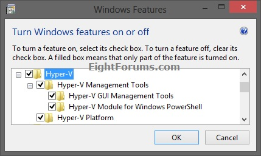
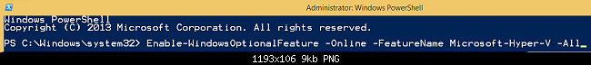
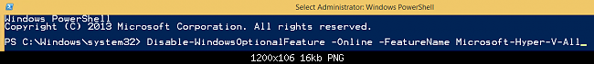
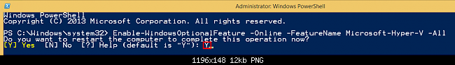
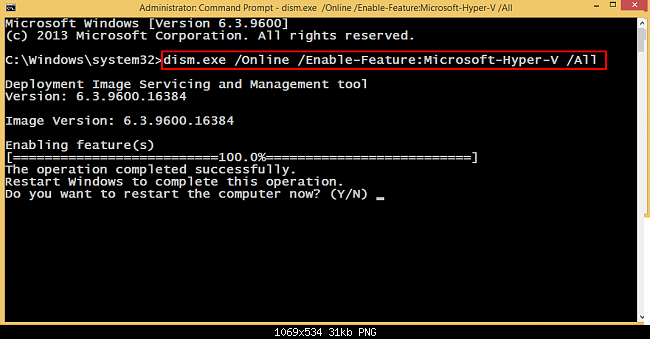
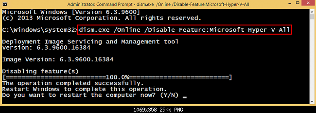

# Enable and Disable in Windows 8

**Hyper-V - Enable and Disable in Windows 8**

---

> **How to Enable and Disable Hyper-V in Windows 8 and 8.1**
>
> [anexo ausente]   Information
>
> This tutorial will show you how to enable and disable the built-in **Hyper Virtualisation (Hyper-V)** feature in **Windows 8 Pro** or **Windows 8 Enterprise**.   
>   
> You must be signed in as an **administrator** to be able to do the steps in this tutorial.
>
> [anexo ausente]   Note
>
> To support Hyper-V client, you must have a **64-bit** version of **Windows 8 Pro** or **Windows 8 Enterprise** with a [**64-bit CPU**](http://social.technet.microsoft.com/wiki/contents/articles/1401.hyper-v-list-of-slat-capable-cpus-for-hosts.aspx) that supports **[SLAT](http://en.wikipedia.org/wiki/SLAT)** (Second Level Address Translation). You’ll also need at least **4GB of RAM**. Hyper-V does support creation of both 32-bit and 64-bit operating systems in the VMs.  
>   
> **For more info, see also:** [Bringing Hyper-V to "Windows 8"](http://blogs.msdn.com/b/b8/archive/2011/09/07/bringing-hyper-v-to-windows-8.aspx)
>
> [anexo ausente] OPTION ONE [anexo ausente]
>
> To Enable and Disable Hyper-V in Windows Features
>
> **1.** Open **[Windows Features](http://www.eightforums.com/tutorials/6632-windows-features-turn-off-windows-8-a.html)**.  
>   
> **2.** Expand the **Hyper-V** sub-section, and do **step 3 or 4** below for what you want to do.
>
> 
>
> **3. To Enable Hyper-V**
>
> A) Ensure that all **Hyper-V** options are checked as shown above, click/tap on **OK**, and go to **step 5** below.
>
> **4. To Disable Hyper-V**
>
> A) Uncheck **Hyper-V**, click/tap on **OK**, and go to **step 5** below.
>
> **5.** **Restart the computer** when prompted.
>
> [anexo ausente] OPTION TWO [anexo ausente]
>
> To Enable and Disable Hyper-V in PowerShell
>
> **1.** Open an **[elevated PowerShell](http://www.eightforums.com/tutorials/12626-windows-powershell-open-elevated-windows-8-a.html)**, and do **step 2 or 3** below for what you want to do.  
>   
> **2. To Enable Hyper-V**
>
> A) In the elevated PowerShell window, copy and paste the command below, press Enter, and go to **step 4** below.
>
> [anexo ausente]   Note
>
> If you do not use the **-All** switch, then you will not install the **Hyper-V GUI Management Tools** and **Hyper-V Module for Windows PowerShell** features.
>
> **Enable-WindowsOptionalFeature -Online -FeatureName Microsoft-Hyper-V –All**  
>   
>   
>  
>
> **3. To Disable Hyper-V**
>
> A) In the elevated PowerShell window, copy and paste the command below, press Enter, and go to **step 4** below.  
>   
> **Disable-WindowsOptionalFeature -Online -FeatureName Microsoft-Hyper-V-All**  
>   
>   
>  
>
> **4.** Type **Y** and press Enter when prompted to restart the computer.
>
> 
>
> [anexo ausente] OPTION THREE [anexo ausente]
>
> To Enable and Disable Hyper-V using DISM Command
>
> **1.** Open an **[elevated command prompt](http://www.eightforums.com/tutorials/2754-elevated-command-prompt-open-windows-8-a.html)**.  
>   
> **2. To Enable Hyper-V**
>
> A) In the elevated Command Prompt, copy and paste the command below, press Enter, and go to **step 4** below.  
>   
> **dism.exe /Online /Enable-Feature:Microsoft-Hyper-V /All**  
>   
>
> 
>
> **3. To Disable Hyper-V**
>
> A) In the elevated Command Prompt, copy and paste the command below, press Enter, and go to **step 4** below.  
>   
> **dism.exe /Online /Disable-Feature:Microsoft-Hyper-V-All**  
>   
>
> 
>
> **4.** Type **Y** and press Enter when prompted to restart the computer.
