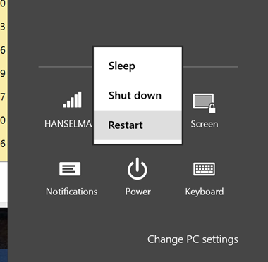
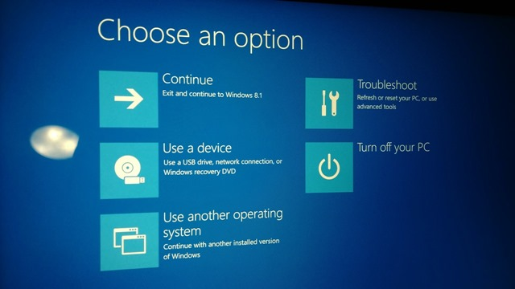
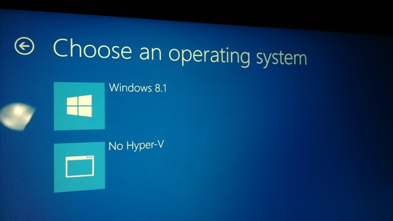
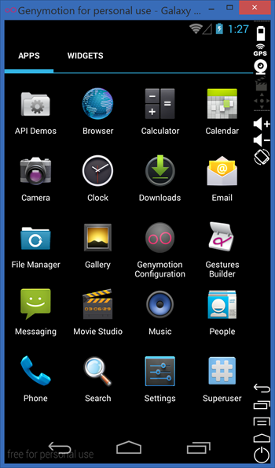

# [Switch easily between VirtualBox and Hyper-V with a BCDEdit boot Entry in Windows 8.1](http://www.hanselman.com/blog/SwitchEasilyBetweenVirtualBoxAndHyperVWithABCDEditBootEntryInWindows81.aspx)

January 8, '14
[Comments [19]](http://www.hanselman.com/blog/CommentView.aspx?guid=7c4bb51b-0f42-46a6-b6ec-976e37db8b40#commentstart)
Posted in [Tools](http://www.hanselman.com/blog/CategoryView.aspx?category=Tools)

Sponsored By

I've been using [GenyMotion for a FAST Android Emulator](http://www.GenyMotion.com) when developing with Visual Studio and Xamarin. However, I also use Hyper-V when developing for Windows Phone. GenyMotion use VirtualBox, which has it's own Hypervisor and you can't have two.

Some sites say to use Add/Remove Features to turn the Hyper-V support off, but that seems like a big deal to do what should be a small thing.

Instead, from an administrative command prompt I made a copy of my boot menu with a "No Hyper-V" entry:

Note the first command gives you a GUID and you then copy it and use it with the second command.

```
C:\>bcdedit /copy {current} /d "No Hyper-V"   
The entry was successfully copied to {ff-23-113-824e-5c5144ea}.   
  
C:\>bcdedit /set {ff-23-113-824e-5c5144ea} hypervisorlaunchtype off   
The operation completed successfully.
```

Now, this is important. In Windows 8.x, Windows is optimized to startup FAST. And it does. On my Lenovo it starts in about 3 seconds, faster than I can press any buttons to interrupt it. But when I want to dual boot, I need it to really shut down and give me an option to chose this new boot menu.

*In order to access the new boot menu, I select Settings (Windows Key + C) then Power, and Restart **but hold down shift on the keyboard while clicking Restart with the mouse.***



You will get this scary looking Blue Screen. Select "Other Operating Systems" and your "No Hyper-V" option is in there.





Now, you can run Virtual Box nicely but still choose Hyper-V when you want. You can confirm VirtualBox works by noting that the Acceleration tab will not be grayed out under System Settings for your VMs. Reboot normally and Hyper-V will be back and ready to go. Here's Android running in VirtualBox via GenyMotion.



There's touch support too! If you're not doing Android development like this with Visual Studio and Xamarin, frankly, you're missing out.

#### About Scott

Scott Hanselman is a former professor, former Chief Architect in finance, now speaker, consultant, father, diabetic, and Microsoft employee. He is a failed stand-up comic, a cornrower, and a book author.

[About](http://hanselman.com/about)   [Newsletter](http://www.hanselman.com/newsletter)
