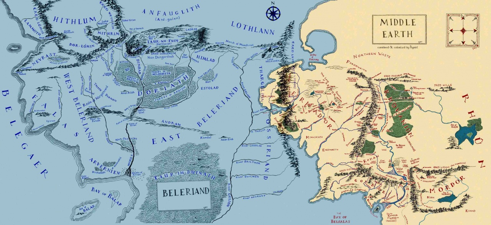
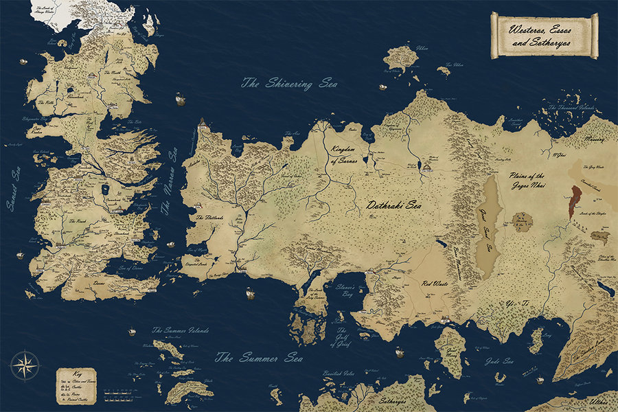
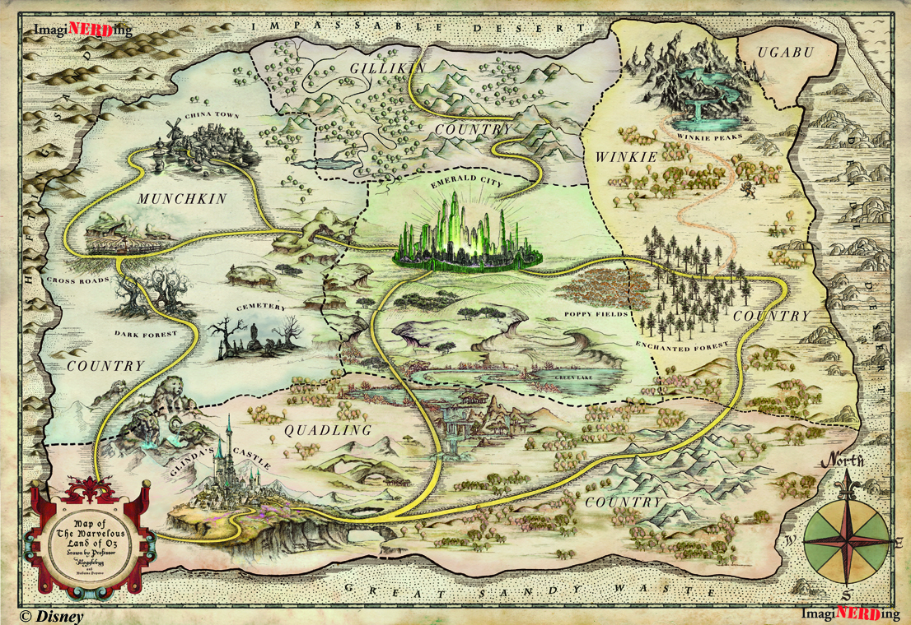
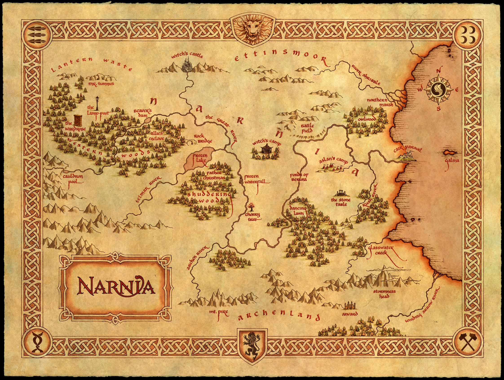
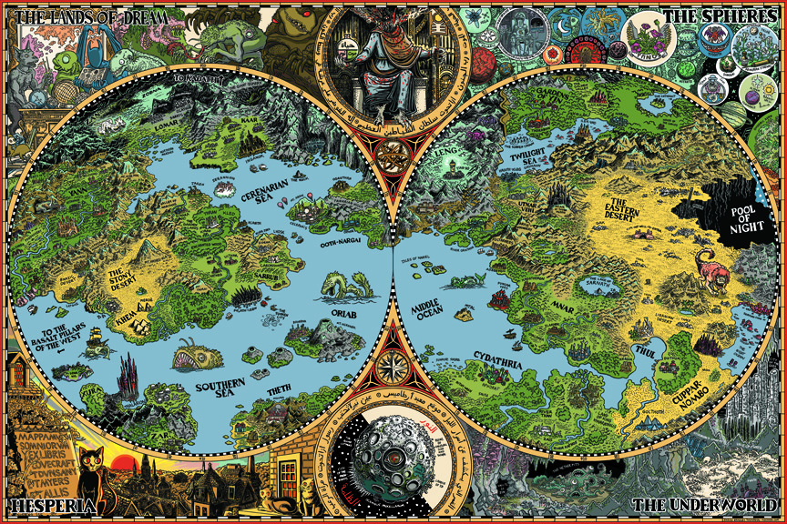
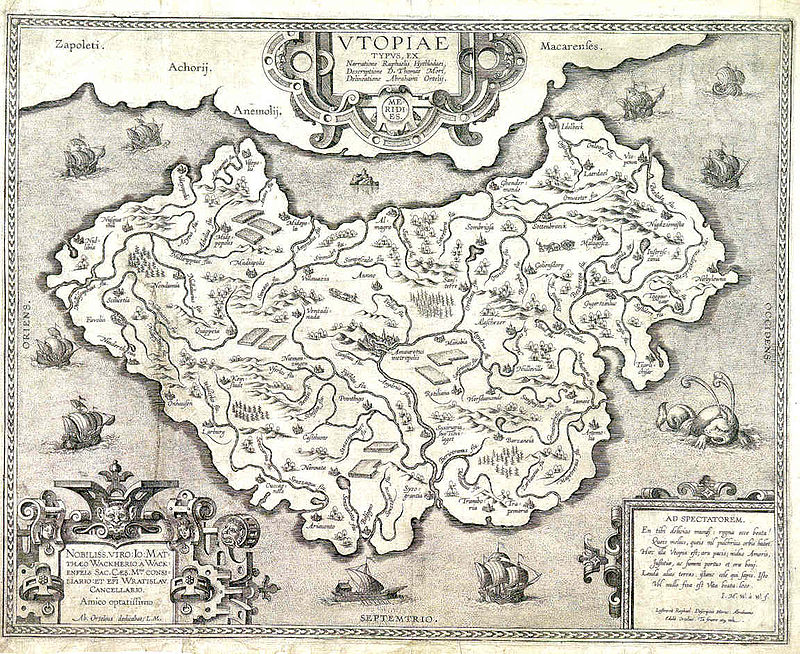
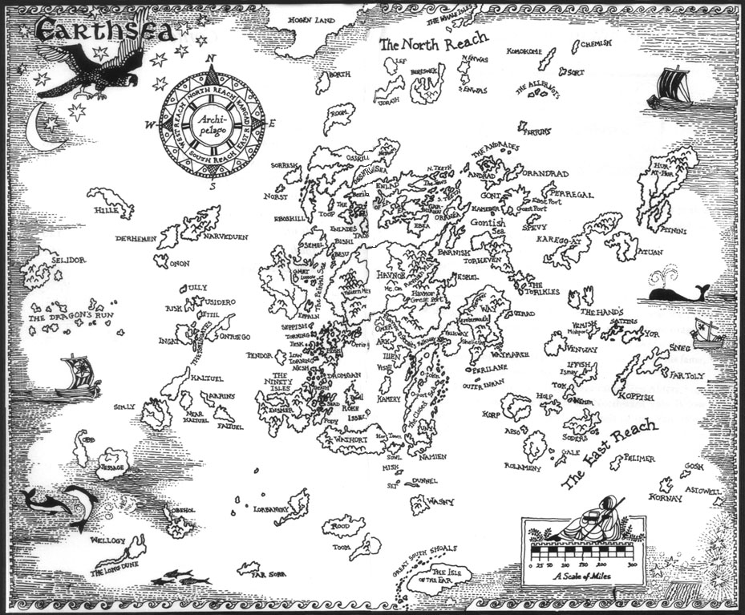
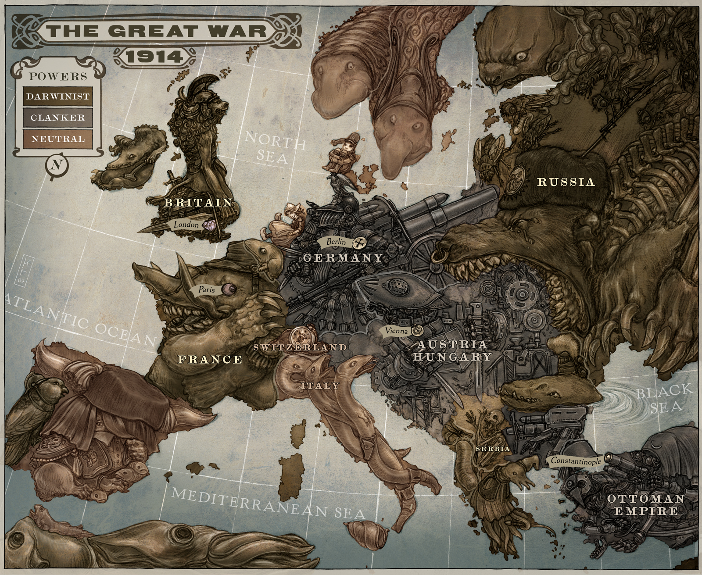

# Os 12 mapas mais incríveis da literatura

Posted by: [Victor Hugo](http://homoliteratus.com/author/victor/) , junho 23, 2014

## **O mapa torna o mundo fantástico mais palpável, e quando bem apresentado, só tem a acrescentar a uma história e à imaginação do leitor**

Um dos elementos mais importantes de uma história em gêneros como a literatura fantástica ou a ficção científica é o mapa. Com ele, o leitor sente uma facilidade de imersão maior no mundo pelo qual está viajando sem precisar se preocupar em lembrar constantemente de sua da geografia ou até mesmo geopolítica. Via de regra, quanto mais complexo um mundo, maior a necessidade de um mapa. Há exemplos clássicos como a Terra-Média, de Tolkien, um dos maiores e mais detalhados mundos já feitos, ou até mesmo livros como *Mistborn – O Império Final,* de Brandon Sanderson, onde a história inteira é contada praticamente dentro de uma única cidade, mas explorada de forma tão complexa que um mapa torna-se indispensável.

Abaixo segue uma pequena lista com alguns dos mapas mais completos já feitos em obras de fantasia, e por quê ler os livros passados nesses universos.

---

## **Arda - J.R.R. Tolkien**

Como não começar uma lista dessas com o que talvez seja o mais complexo mundo de fantasia já criado? O mundo de Tolkien é trabalhado minunciosamente a cada detalhe em todos os seus livros através de suas descrições e ainda mais com a legião de fãs por trás produzindo material próprio e de extrema qualidade. Bons exemplos disso são o [Atlas da Terra-Média](http://www.wmfmartinsfontes.com.br/produto/1271-atlas-da-terra-media-o), talvez um dos mais completos compêndios da geografia do mundo de Tolkien, e projetos como o [Lord of the Rings Interactive Map](http://lotrproject.com/map), um verdadeiro Google Maps da Terra-Média.

---

## **Westeros, Essos e Sothoryos – G.R.R. Martin**

O mundo das Crônicas de Fogo e Gelo talvez seja um dos maiores já inventados e encontra-se em expansão, com os livros finais da série ainda a ser lançados. O engajamento dos fãs também é gigantesco, e nos traz produtos como um atlas, o [Lands of Ice and Fire](http://www.amazon.com/The-Lands-Fire-Game-Thrones/dp/0345538544), um mapa interativo chamado [Quartermaester](http://quartermaester.info/) e até um [mapa geológico de Westeros](http://web.stanford.edu/group/anthropocene/cgi-bin/wordpress/game-of-thrones-geology/).

---

## **Oz – L. Frank Baum**

O mundo de Oz, apesar de não ser o único criado pelo autor, foi o de maior sucesso e a história do Mago de Oz é conhecida mundialmente. Nota-se também por ser um dos mais antigos, com o livro publicado em 1900 e serviu de inspiração para muitos autores depois dele.

---

## **Narnia – C.S. Lewis**

Lewis foi um grande amigo de Tolkien e, por vezes, eles trocavam opiniões sobre o mundo um do outro. Narnia pode não ter a complexidade da Terra-Média, nem metade da história, mas é um dos mundos mais bem construídos na literatura fantástica e a viagem feita nos contos de Crônicas de Nárnia explora muito bem cada localidade.

---

## **O País das Maravilhas – Lewis Carrol**

O mundo de Alice no País das Maravilhas é bastante complexo e estruturado, apesar da aparente simplicidade inicial da história. É uma das mais antigas, sendo lançado em 1865, e originalmente não vinha com um mapa, sendo desenvolvido posteriormente.

---

## **Terra dos Sonhos – H.P. Lovecraft**

Considerado por muitos o mestre do horror, Lovecraft desenvolveu muitas de suas histórias na Terra dos Sonhos, um plano de existência alternativo que poderia ser acessado pelos sonhos, como uma viagem astral ou projeção.

---

## **Utopia – Thomas More**

Utopia é um mundo criado por Thomas More onde se passa a história do livro de mesmo nome, lançado em 1595. É um trabalho de ficção, mas difere dos exemplos anteriores pois trata-se de uma ilha localizada no meio do Atlântico, na Terra, e não num mundo completamente fantasioso. É um dos trabalhos precursores da ficção científica, muito antes de Verne e Stevenson.

---

## **Terra do Nunca – J.M. Barrie**

Talvez um dos mundos de fantasia mais simples já elaborados, mas muito importante devido ao peso da obra de Barrie, principalmente com Peter Pan.

---

## **Terramar – Ursula K. Le Guin**

A saga de Earthsea da escritora Ursula Le Guin  tem um dos mapas mais simples em termos de arte, mas apresenta uma complexidade grande devido ao tamanho da obra, passando-se em muitas localizações diferentes.

---

## **Terras do Oeste – Robert Jordan**

O mundo de Robert Jordan apresentado em sua série A Roda do Tempo é um dos mais complexos feitos na literatura fantástica, pareando-o com autores como Tolkien e Martin. Além disso, também conta com uma grande participação de fãs, fazendo bases de dados como a [Wheel of Time Wiki](http://wot.wikia.com/wiki/Category:Maps).

---

## **Europa Alternativa – Scott Westerfeld**

Um dos mapas mais bonitos já feitos pertence ao universo steampunk Leviatã, de Scott Westerfeld, com uma Europa Alternativa. A principal diferença está na geopolítica do mapa, com diferenças significativas entre os poderes e as alianças para a realidade.

---

## **Cidade de Luthadel - Brandon Sanderson**

A cidade de Luthadel é o cenário principal do livro *Nascidos da Bruma: O Império Final*, de Brandon Sanderson. O interessante deste livro é que o autor dá uma complexidade à cidade, onde se passa a história, em detrimento do mundo que a cerca. Conforme a série avança nossa visão do mundo expande, mas inicialmente o autor nos mostra apenas a cidade dos personagens principais.

---

Há muito mais mundos complexos sendo feitos e explorados, e trabalhos de fãs apaixonados que não os deixam morrer. A lista feita aqui mostra apenas alguns dos mais famosos. O mapa torna o mundo fantástico mais palpável, e quando bem apresentado, só tem a acrescentar a uma história e à imaginação do leitor.

Deixe nos comentários abaixo o seu favorito ou algum que você sentiu falta.
