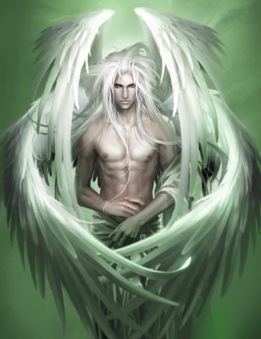

> *Quem sou eu? Eu sou o olho da tempestade, eu sou o mestre da espada. Saque sua arma, patife, ou morra ai mesmo onde está.*

**Pronúncia:** Chí

Como nobreza exilada, os **Sidhe** se lembram de um tempo em que reinaram orgulhosamente em um sonho vivo. Conhecidos e temidos como o Bom Povo, seus caprichos encantaram e aterrorizaram os mortais durante milênios. Agora a lenda acabou. Os portões de **Arcádia** se fecharam, a canção acabou, e seu novo reino congela. Para os Sidhe, a era da maravilha morreu, e eles lamentam sua passagem.

Este lamentar, entretanto, não acabou com suas vidas. Embora eles temam a morte como os novos feéricos jamais poderiam fazer, eles encaram seu destino com porte régio. Enquanto os outros os consideram frios e arrogantes, os Sidhe se recusam a deitar e morrer. Para eles, o sonho ainda está vivo, e eles lutam para despertar o mundo de seu torpor. A simples presença de um Sidhe inspira um temor sobrenatural. A visão de um Sidhe em sua forma verdadeira captura os corações dos mortais e a essência do Sonhar.

As paixões feéricas são profundas – amor ou vingança nunca são esquecidos. Os ideais dos Sidhe são sempre ferozes e lhe são caros. Entretanto, tais paixões têm seu preço. Mesmo os heróis [**Seelie**](http://livrodosespelhos.com/a-corte-seelie-das-fadas/ "A Corte Seelie das Fadas") preferem destruir a si mesmos em uma chama de glória a desvanecer. Seus irmãos menos cheios de energia perdem a esperança e se tornam autoindulgentes, deixando suas propriedades livres \* caírem em desespero tão facilmente quanto eles mesmos recaem em melancolia. Outros se tornam tiranos [**Unseelie**](http://livrodosespelhos.com/a-corte-unseelie-das-fadas/ "A Corte Unseelie das Fadas"), dominando através da crueldade e da intriga. Apesar do exotismo de sua beleza e a perda de seus ideais, muitos poucos viajem com os plebeus. Não importa qual caminho eles escolham, os Sidhe estão distante dos humanos e sempre destacam-se entre aqueles a quem se associam.

A benção e a maldição dos Sidhe é viver profundamente no mundo do Sonhar mais do que qualquer fada jamais irá. Este estado de andar sonhando dá à maior parte dos Sidhe um olhar vítreo e um ar desfocado. Canções dos bardos dizem que os Sidhe mais velhos vivem no passado, no presente e no futuro, tudo ao mesmo tempo. Os Sidhe também são notáveis por trocar de Corte sem aviso. Considerando seus caprichos, não é nenhuma surpresa que poucas fadas confiem neles.

A Banalidade é uma maldição mortal e os Sidhe sofrem disso mais do que qualquer outro Kithain. A morte é um medo ainda maior, pois os Sidhe não acreditam que renascerão como acontece com os outros changelings. Nestes tempos sombrios, muitos nunca retornam da morte, e se especula que os poucos que o fazem reencarnam como plebeus – para eles um destino pior que a morte. Confrontados por este destino terrível, eles se ressente dos Sidhe Arcadianos por exilá-los do paraíso. Os Sidhe mundanos mais desesperados buscam em vão por Arcádia ou lançam-se em orgias de coleta de Glamour para sustentar a si mesmos. O pensamento de simplesmente desaparecer é demais para eles, e eles farão qualquer coisa para continuarem vivos. Atormentados por seus sonhos, os belos Sidhe são forasteiros em um mundo humano.

**Aparência:** Os Sidhe se assemelham a humanos de uma beleza celestial; seus corpos são perfeitos, seus traços agradáveis e seus cabelos ricamente coloridos. Eles são etéreos e carregam uma alusão à tristeza mesmo quando eles riem. Altos e magros, eles são ferozes e majestosos, com orelhas afiladas e pontudas, traços angulares e um olhar imponente. Seus olhos são de cores estranhas, mas marcantes, como violeta ou prateado. Eles raramente vestem algo que não sejam as mais finas roupas.

**Estilo de Vida:** Da mesma maneira que assumem posições de respeito nas cortes dos kithain, os Sidhe tendem a ocupar posições de valor também no mundo mortal. É comum terem dinheiro e privilégios e espera-se que levem vidas opulentas. Aqueles que não as conseguem costumam se ressentir do fato e sucumbem a um estado de espírito bastante Unseelie.

- Os **Infantes** conhecem os privilégios de sua herança desde uma tenra idade. Os melhores dentre eles agem como perfeitos cavaleiros e damas, mas os piores são mimados e têm acessos de cólera quando as coisas não estão a seu jeito.
- Os **Bravios\*\*** sabem que têm a oportunidade de satisfazer todos os seus caprichos fora da corte. Apesar de altivos e presunçosos ocasionalmente, eles são observados de perto quando as reuniões formais têm início. Os bravios Seelie confiam excessivamente na supremacia do cavalheirismo e da nobreza; os Unseelie são rebeldes e conspiram para tomar o poder.
- Os **Casmurros\*\*\*** têm plena consciência do peso de suas posições elevadas. Muitos carregam o fardo das lembranças de antigamente. Eles lamentam por seus dias de glória e choram pelos erros que cometeram. O maior alívio para essa introspecção exaustiva é a intriga da corte.

**Afinidade:** Os Sidhe não passaram tempo suficiente na Terra para adquirir uma Afinidade.

## Direitos de Nascença

**• Respeito e Beleza:** Os Sidhe ganham dois pontos adicionais de Aparência durante a criação do personagem, mesmo se isso elevar a pontuação acima de 5. Não há como evitar que eles se sobressaiam em meio à multidão.  
A fúria de um Sidhe desprezado é uma visão majestosa e horripilante. Quando exaltados, todos os seus testes Sociais (principalmente os de Empatia ou Intimidação) são realizados contra uma dificuldade reduzida em dois pontos. Quem tentar atacar de frente um Sidhe enfurecido precisará passar num teste de Força de Vontade; a dificuldade varia de 6 (para o Sidhe típico) a 8 ou 9 (para um nobre de posição elevada).  
Essas habilidades afetam somente outros kithain e os encantados, a não ser que o Sidhe apele ao Fado\*\*\*\*.

**• Porte Aristocrático:** Sejam heróis ou violões, todos os Sidhe são majestosos. Qualquer truque que possa fazê-los parecer ridículos falhará imediatamente.  
Os Sidhe nunca sofrem falhas críticas nos testes de Etiqueta.

## Fragilidades

**• A Maldição da Banalidade:** Os Sidhe não são mesmo deste mundo. A corrupção da Banalidade os afeta com mais intensidade do que no caso de outras fadas. Cada ponto temporário de Banalidade adquirido por um fidalgo se transforma em dois. Se o personagem Sidhe tiver de fazer um teste contra uma dificuldade igual à sua Banalidade (ou um teste resistido pela Banalidade), contabilize essa Característica um nível acima.  
Os Sidhe também são propensos a crises de depressão. Os mais fracos conseguem superar essas crises alternando-se entre os Legados. Quando isso acontece, o feitiço tem de durar pelo menos de um nascer da lua a outro ou de um pôr do sol a outro. Os Sidhe obstinados se livram dessa mania refugiando-se ainda mais em seus Legados; os Seelie se tornam idealistas radicais e os Unseelie mergulham nas profundezas da vilania. Esses extremos de comportamento podem torná-los quase insuportáveis.

---

Como anunciado anteriormente, graças ao Heder, passamos a ter acesso à tradução oficial da Devir. Portanto, este é o primeiro artigo tirado do módulo básico que se vale de termos da tradução oficial da Devir, ainda que dois terços do artigo ainda seja uma tradução minha. O próximo artigo será 100% retirado da tradução, apesar de optarmos por escolhas nossas em alguns termos. Quando isto ocorrer, colocaremos notas, como foi o caso neste artigo. Aos poucos, os artigos já publicados também receberão o mesmo tipo de legenda.

Esperamos que o próximo artigo seja sobre Lobisomem: O Apocalipse, e também esperamos que não demore tanto quanto este demorou a sair. Entretanto, estávamos trabalhando numa ficha nova, de 4 páginas, para Changeling. [Confira a nossa versão da ficha aqui](http://livrodosespelhos.com/fichas-para-changeling-o-sonhar/ "Fichas para Changeling: O Sonhar").

Abraços, e até a próxima!

---

**\* Propriedade livre:** freehold no original.  
**\*\* Bravios:** Estouvados na tradução oficial da **Devir**; Bravios na tradução do **Livro dos Espelhos.****\*\*\* Casmurros:** Rezingões na tradução oficial da **Devir**; Casmurros na tradução do **Livro dos Espelhos**.  
**\*\*\*\* Fado:** Chamado do Fado na tradução da Devir, Call Upon the Wyrd no original. No futuro, possivelmente escreveremos um artigo discutindo as opções de tradução oficial no que se refere a Changeling: O Sonhar.

**Fonte:** Changeling: the Dreaming páginas 100 e 101 e Changeling: O Sonhar páginas 100 e 101.  
**Imagem:** *origem desconhecida*  
**Tradução:** Eva e Devir

[[anexo ausente]](http://feeds.feedburner.com/~ff/livrodosespelhos?a=wtc0IUztp1Q:iuzjUewFJGU:yIl2AUoC8zA)  [[anexo ausente]](http://feeds.feedburner.com/~ff/livrodosespelhos?a=wtc0IUztp1Q:iuzjUewFJGU:F7zBnMyn0Lo) [[anexo ausente]](http://feeds.feedburner.com/~ff/livrodosespelhos?a=wtc0IUztp1Q:iuzjUewFJGU:V_sGLiPBpWU) [[anexo ausente]](http://feeds.feedburner.com/~ff/livrodosespelhos?a=wtc0IUztp1Q:iuzjUewFJGU:qj6IDK7rITs)

[anexo ausente]
