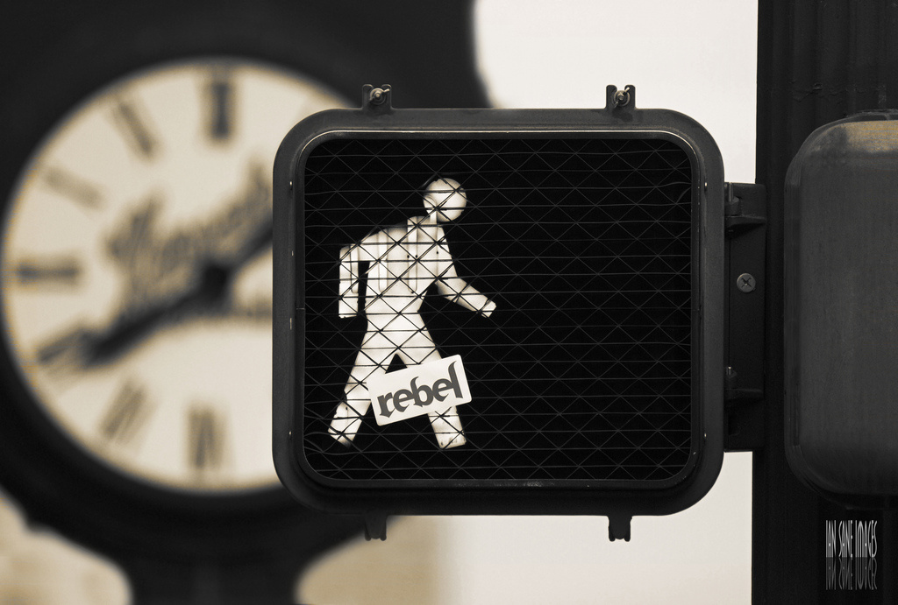

Pesquisadores da Universidade de Stanford demonstraram que caminhar aumenta a capacidade criativa em até 60% em comparação com quem está sentado. O mais impressionante é que tanto faz caminhar ao ar livre ou na esteira olhando para uma parede branca: o próprio exercício parece ter capacidade de elevar a criatividade independente do contexto.

Os estudos fizeram testes com pessoas sentadas e caminhando em que voluntários deveriam encontrar soluções novas para um problema e descobriram que as pessoas que estavam caminhando apresentavam maior índice de respostas criativas. O efeito da caminhada  sobre a criatividade durava por algum tempo depois que a pessoa sentasse novamente.

Ou seja: se você estiver com dificuldades para criar, escrever, achar a solução para um problema ou ter alguma ideia nova saia um pouco da frente do computador e vá dar uma volta para aguçar a criatividade. Não esqueça de levar um bloco de notas junto de você.

Esta pesquisa me lembrou de uma citação da Cecilia Meireles sobre a arte de andar na rua:

> “Ainda escreverei um livro sobre “Arte de andar na rua” – para ser distribuído grátis, com retrato e dedicatória, na Semana do Transito. Só depois de ler um livro de duzentas páginas, o pedestre carioca será capaz de começar a suspeitar que não se deve insistir em caminhar por baixo dos automóveis”.
>
> Cecilia Meireles, no livro Crônicas de viagens (Crônica publicada originalmente em 1944)

Fonte: [Stanford study finds walking improves creativity](http://www.richarddawkins.net/news_articles/2014/4/30/stanford-study-finds-walking-improves-creativity "Estudo sobre caminhada e criatividade")  
photo credit: [Ian Sane](http://www.flickr.com/photos/31246066@N04/6592174435/) [cc](http://creativecommons.org/licenses/by/2.0/)

[[anexo ausente]](http://feeds.feedburner.com/~ff/alessandromartins?a=UM0p5DuJdc4:hJFEZsBbKv0:yIl2AUoC8zA) [[anexo ausente]](http://feeds.feedburner.com/~ff/alessandromartins?a=UM0p5DuJdc4:hJFEZsBbKv0:qj6IDK7rITs)

[anexo ausente]
