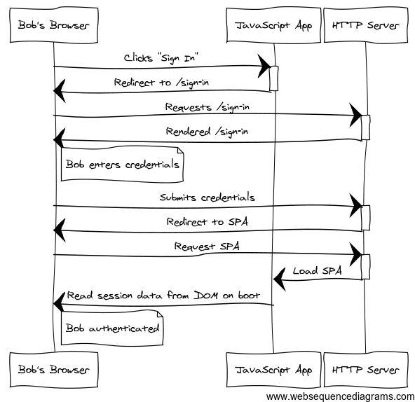
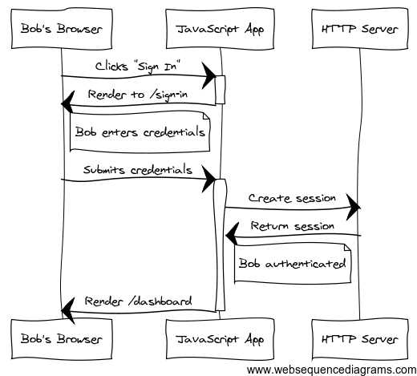
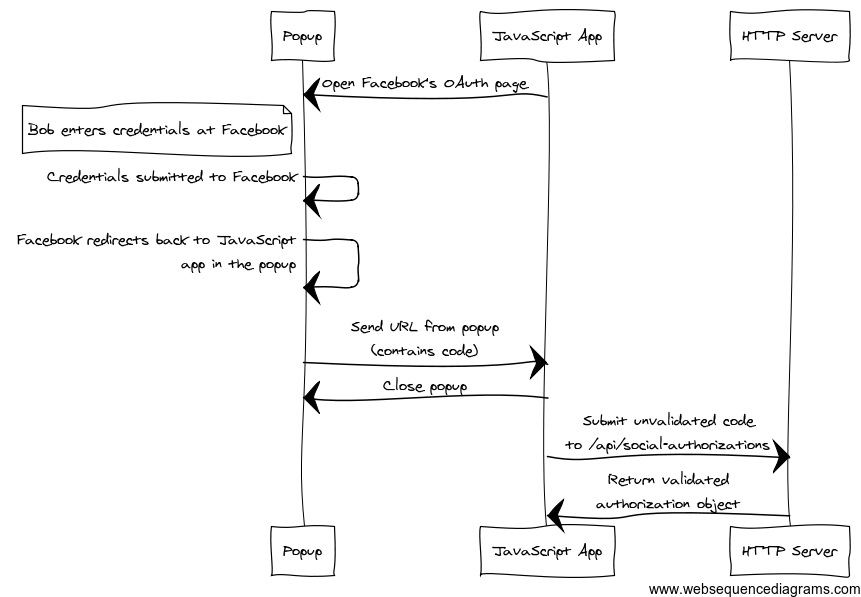

# [Authentication for Single Page Apps](http://madhatted.com/2014/6/17/authentication-for-single-page-apps "Authentication for Single Page Apps")

#### June 17th, 2014

This week [Vestorly](http://www.vestorly.com), a client of my consulting partnership [201 Created](http://www.201-created.com), is sharing [Torii](http://vestorly.github.io/torii/).

Torii is a set of abstractions for handling authentication and session management in Ember.js applications. The name comes from a [traditional Japanese gate](http://en.wikipedia.org/wiki/Torii) whose design you likely recognize:

Let’s discuss how we build authentication for single page applications, and how we can build it better.

## API based Authentication

People prefer the tools they know. Authentication can be a non-trivial challenge for any app, so most developers have tools and techniques they trust for building traditional (page-by-page) auth flows. When building a single page app, it is not surprising that they reach for those same server-side authentication solutions.

But those solutions fit poorly.

We want to see more applications expose authorization and authentication as first-class concepts via the API. In the case of authentication, especially when a user could sign in via any of several services, we’ve found “authorization objects” useful. These provide a first-class model that can be passed to other APIs, and simplify the client-side logic and error handling requirements.

Javascript applications can implement a clean, simple user experience for OAuth2 in the browser, one without user redirects or acrobatics to keep track of state.

Raise your hand if you’ve worked on a single page application (whatever the framework or anti-framework) that had an authentication flow like this:

This authentication system lives outside the JavaScript application entirely. The user-experience is choppy and slow, and the code difficult to maintain.

To improve this, make authentication a first-class part of your API and JavaScript application:

Pushing authorization and authentication concerns into the JavaScript app makes managing errors and state simpler. It makes refactoring code easier, results in a better user experience, and creates opportunities for composition.

When your application needs to authenticate against 3rd party services (Facebook, LinkedIn, Salesforce.com, Twitter etc.), splitting authorization and authentication into distinct API concerns becomes the best next step.

## An RPC auth API

“Its OK @mixonic,” you may tweet, “we have a /session endpoint that accepts POST to create a session. We’re way ahead of you!”

Let’s take a look:

| Auth API v1 | |
| --- | --- |
| **POST /api/session** | This API endpoint is responsible for creating a session. It accepts a username/password combination, and returns either a session object with an access token or an error that the credentials are incorrect. |

Simple. If your application only supports username/password access, this may be sufficient. Let’s add support for social login:

| Auth API v2 | |
| --- | --- |
| **POST /api/session** | This API endpoint is responsible for creating a session. It accepts a username/password combination, and attempts to authenticate that user. It returns either a session object and a `Set-Cookie` header, or returns an error that the credentials are incorrect. |
| **GET /oauth2/facebookHandler** | This endpoint accepts the redirect from Facebook as completion of an OAuth2 exchange. It validates the authorization code from Facebook, then authenticates that account as a user. It either redirects back to the application with a `Set-Cookie` header or renders an error into the page for the JavaScript application to read. The error might be regarding the invalidity of the OAuth2 exchange, or the invalidity of these credentials for signing in a user. |

Uh oh. This has gotten messy.

There is one endpoint, `/oauth2/facebookHandler`, that is not part of the API proper. It is not in the `/api` namespace, and it doesn’t response like an API endpoint. Instead it uses redirects and rendering data into the page to push state into the browser.

The session logic has changed in two ways: First, we’re forced to use cookies for authentication, which adds overhead to all requests and is a less portable way to authorize requests. Second, the logic for creating a session is in two places.

These complications are why authentication and session management are often implemented as middleware. Middleware are filters for an HTTP stack. They get to handle all requests made to an application. Rack is an example of a middleware stack in Ruby, and Devise is an example of an authentication implementation using middleware.

The crafty developer might say “Ahha! I can create an API endpoint for handling the Facebook OAuth2 code, and signing in! It could be the same endpoint even! Thus I can avoid the overhead and complexity of middleware!”

Most OAuth2 flows are flexible enough to have all their user-interactive portions implemented in JavaScript. Facebook Connect is a good example of this. The crafty developer is crafty indeed.

Let’s see what she came up with:

| Auth API v3 | |
| --- | --- |
| **POST /api/session** | This API endpoint is responsible for creating a session. It accepts a username/password combination, or an OAuth2 code and service name. If a username/password combination is submitted, it attempts to authenticat a user to match that account. If a code/service combination is submitted, it attempts to validate the code, then attempts to authenticate a user to match that account. It returns either a session object with an access token, or an error that the OAuth2 code is invalid, or an error that the user could not be authenticated. |

This is where most apps end up. They meander into building a session API that is more like an RPC request than RESTful action. The inputs are inconsistent, the endpoint has the responsibility to do a large number of things (OAuth2 verification, username/password verification), and the possible error states are numerous.

But there is a way out.

## A RESTful auth API

When an API endpoint becomes cluttered with too many responsibilities, it stops being expressive of a domain object. The URLs of an API (e.g., `/api/session`) should be expressive of a domain object (e.g., the “session”). RESTful API design allows domain objects to be *composable*. Composable objects can be combined to achieve the same ends as procedural API calls, and are flexible enough to meet other goals as well.

If the concept of “session” is cluttered, then the API is lacking. It fails to express “session” in a composable manner. By extracting a new domain object from the API, “session” can be repaired.

Let’s try an approach that separates authorization from session creation:

| Auth API v4 | |
| --- | --- |
| **POST /api/socialAuthorization** | This API endpoint is responsible for creating a social authorization. It accepts an OAuth2 code and service name. It validates the code, and either returns a social authorization object or returns an error. |
| **POST /api/session** | This endpoint is responsible for creating a session. It accepts a username/password combination, **or a social authorization object**. It returns a session object, or an error that the credentials are incorrect. |

The concerns of OAuth2 authorization and session creation are isolated. As a bonus, we have a social authorization object that can be passed not only to the session API, but also to other APIs. Consider the common scenario where an existing user wants to link his or her account to social accounts in order to make logins easier, or to enable some integration with their social networks:

| Auth API v5 | |
| --- | --- |
| **POST /api/socialAuthorization** | This API endpoint is responsible for creating a social authorization. It accepts an OAuth2 code and service name. It validates the code, and either returns a social authorization object or returns an error. |
| **POST /api/session** | This endpoint is responsible for creating a session. It accepts a username/password combination or a social authorization object. It returns either a session object, or an error that the credentials are incorrect. |
| **POST /api/me/connectedAccounts** | This endpoint is responsible for connecting social accounts to an existing user account. It accepts a social authorization object, and returns either a connected account object or an error. |

Note that the new endpoint accepts the social authorization object. The JavaScript client can take advantage of composability to combine these endpoints in novel ways. Handling errors at any single step of a complex interaction is trivial.

“But the crafty developer!” I hear you cry, “How was she handling OAuth2 without server-side redirects?!”

## OAuth2 Without Redirects

A redirect endpoint (as in v2 of the API above) is not the ideal way to handle authorization for a couple of reasons:

- JavaScript applications need to restore a special state when loading after the redirect.
- A redirection-based interface isn’t portable to other API consumers.
- It is slow and provides poor UX.

Thankfully, a popup can encapsulate OAuth exchanges without reloading the JavaScript application. OAuth2 can be consumed without a server-side redirect handler, and though OAuth 1.0 would requires a handler we can slim down its responsiblities and complexity.

Let’s re-imagine how to create authorization from Facebook’s OAuth2 API, using the “code” flow”:

After submitting credentials to Facebook, the browser is redirected to a page that loads the JavaScript application. The application stalls while loading, and submits the URL containing the authorization code back to the parent window.

This is where Torii comes in. For Ember.js applications, we’ve given you a way to build and consume these flows easily.

## Authorization Objects and Torii

Torii encourages you to work with composable, RESTful APIs by isolating authorization (through providers) from authentication (through adapters).

Torii is composed of just three primitives, and just three possible actions.

|  |  |
| --- | --- |
| **Providers** | In Torii, a provider is anything that can return authorization. For example, all of Facebook, Twitter, and my own API can be providers returning authorization. Furthermore, we talk about providers as specific authorization implementations. Both “Auth via Facebook Connect SDK” and “Auth via Facebook’s OAuth2 Authorization Code flow” are providers.  An idiomatic provider can execute only a single action:   - **open** – create a new authorization   We’ve provided several ready-to-go providers, but writing your own should be easy. Additionally, though I don’t believe there are idiomatic usages for `fetch` and `close` on a provider, those actions are also supported. |
| **Sessions** | A session manager is responsible for maintaining the authentication state of a user. A session tracks if a user is authenticated or un-authenticated, and who the currently authenticated user is. The session knows nothing about how a user became authenticated, just whether or not they are currently authenticated.  The session manager can execute the following actions:   - **open** – create a new session - **fetch** – retrieve and validate an existing session - **close** - destroy an existing session |
| **Adapters** | A Torii adapter maps the interface expected by the session manager onto your specific API.  We’ve chosen to leave the implementation of this to developers. Often Ember applications are built on existing APIs, and we believe the client-side code should be flexible enough to adapt to what exists.  Adapters can execute the following actions:   - **open** – create a new session using an authorization - **fetch** – retrieve and validate an existing session - **close** – destroy an existing session |

Providers in Torii are composable. They return authorization objects (often OAuth2 codes). Those objects could be passed to a connected account creation API, or to a session creation API. If you use the Torii session manager, they are passed to the adapter for your app, which can manage the exchange of authorization for a session object and/or current user.

Torii powers your JavaScript application’s session so that you only need to implement the exchange of an authorization object for a session object and current user. All the social authorization concerns stay out of your way.

## Wrap up

Let me know how your API has solved the authentication challenge, and give [Torii](http://github.com/vestorly/torii) a look if your next project will be written in Ember.js.

Much thanks to [@solirvine](https://twitter.com/solirvine), [@joeyAghion](https://twitter.com/joeyAghion), [@denik](https://twitter.com/denik), and [@fancyremarker](https://twitter.com/fancyremarker) for their time reviewing this post.

*Update: Some [discussion at Hacker News](https://news.ycombinator.com/item?id=7905848)*

By Matthew Beale
