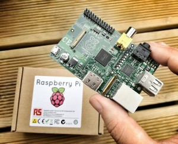
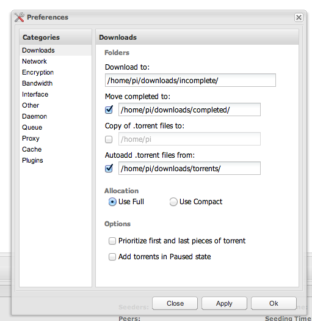
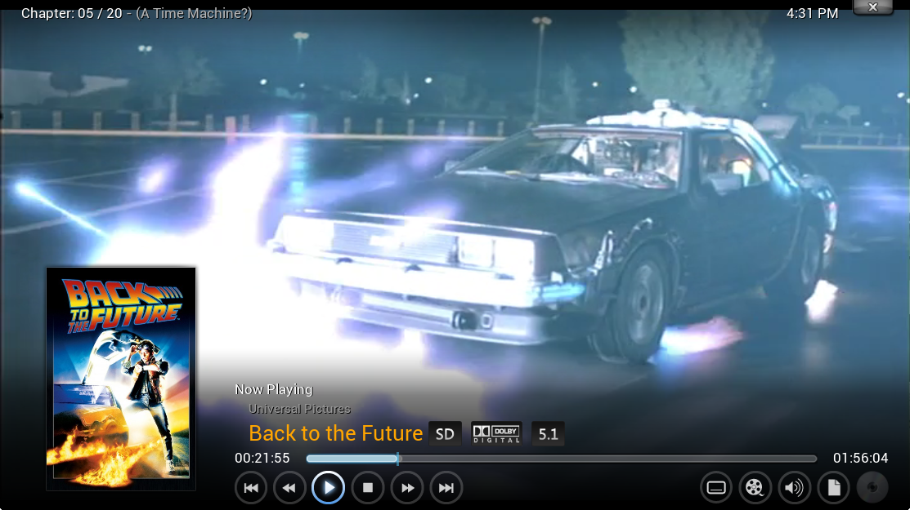

Neste tutorial ensino como criar um media center residencial com Raspberry Pi (US$ 60) que pode ser controlado pelo controle remoto da sua Smart TV. O media center é silencioso, exibe filmes e séries de TV em Full HD, baixa lançamentos assim que disponíveis com legendas em Português do Brasil, organiza os arquivos automaticamente e pode até avisar no seu smartphone quando lançamentos estiverem disponíveis para você ver em casa. É o open source a serviço da vida no futuro :)

[Click to view slideshow.](http://marcogomes.com/blog/2014/como-usar-o-raspberry-pi-para-ver-filmes-e-series-em-pt-br-na-sua-tv-com-download-automatico-de-lancamentos-em-full-hd/#gallery-4516-1-slideshow)

Nas últimas 3 semanas me dediquei a criar um setup robusto e estável de media center residencial com Raspberry Pi. Após muito estudo e tentativa-e-erro, consegui criar um ambiente que:

- Apresenta toda a minha coleção de filmes e séries de TV em interfaces lindas, mostrando pôster e imagens ilustrativas, além de informações complementares como ficha técnica e sinopse em português;
- apresenta os filmes e séries de TV organizados por nome, ano de lançamento, diretor, atores, etc;
- é controlado pelo controle remoto da minha TV, sem necessidade de ligar mouse/teclado ou sequer abrir o app de controle remoto no smartphone a cada vez que vou assistir um filme;
- controla episódios vistos/não vistos em séries de TV;
- faz download automático de filmes assim que disponíveis em HD ou Full HD (nada de filmagem de tela de cinema);
- faz download automático de episódios de séries de TV em alta qualidade (720p ou 1080p) assim que disponíveis em torrent;
- organiza os arquivos baixados respeitando a estrutura de pastas que eu já uso há anos;
- faz download de legendas em Português do Brasil ;
- pode me avisar no smartphone quando novos lançamentos estão disponíveis para eu assistir;
- se ficar ligado o tempo inteiro usando o máximo possível de energia, o RPi vai consumir apenas R$: 10,54 POR ANO!\*

### O Raspberry Pi

[Raspberry Pi](http://www.raspberrypi.org/) é um computador do tamanho de um cartão de crédito desenvolvido no Reino Unido pela Fundação Raspberry Pi. [Custa menos de US$60 e pode ser comprado pela internet](http://www.dx.com/s/raspberrypi), mas não sei se vai chegar no Brasil com impostos ou taxas.

Todo o hardware é integrado em uma única placa. O computador é baseado em um system on a chip (SoC) Broadcom BCM2835,7 que inclui um processador ARM1176JZF-S de 700 MHz, GPU VideoCore IV,8 e 512 MB de memória RAM em sua última revisão. O projeto não inclui armazenamento para seus arquivos – como HD ou SSD - mas possui uma entrada de cartão SD. É no cartão SD que vamos instalar o sistema operacional de nosso media center residencial.

### O XBMC

XBMC Media Center é uma das centrais de mídia mais famosas. O software é permite reproduzir os seus arquivos de vídeo, áudio e imagens em um ambiente gráfico propício, mostrando pôsteres, sinopses, organização por diretor, gênero, controle de episódios assistidos (no caso de séries de TV) e muito mais. O software também vai além dos recursos considerados normais, pois dispõe de suporte para previsões do tempo e o uso de aplicativos como YouTube e Flick, dentre outros.

### Comparação RPi+XBMC versus Chromecast versus Apple TV

O RPi+XBMC é o setup perfeito para quem costuma baixar vídeos por torrent e tem uma coleção de mídia sendo construída há anos. O XBMC executa praticamente qualquer formato de vídeo, como MP4, MKV, AVI e outros, e suporta legendas em formato .srt. Antes de falarmos em download ilegal, lembremos que existe muito conteúdo que você pode baixar legalmente via Torrent.

Agora, se você quiser correr os riscos legais de baixar conteúdo protegido por direitos autorais, via Torrent você sempre terá acesso aos filmes mais recentes e em alta qualidade assim que são lançados em DVD/Bluray nos EUA, e aos episódios de séries poucos minutos após sua veiculação na emissora de TV americana. É conteúdo em alta qualidade em primeira mão sempre. Mas lembre-se, eu não me responsabilizo pelas eventuais consequências legais que você pode sofrer por baixar conteúdo com copyright alheio, recomendo que veja apenas conteúdo baixado legalmente ;)

Com as configurações que faremos no sistema você nem vai precisar se proteger de vírus ou se preocupar em ficar testando sincronização da legenda com o vídeo, o setup RPi+XBMC+CouchPotato+SickBeard+Deluge (ufa!) vai trabalhar em seu favor e automatizar tudo para você :)

Uma das maiores desvantagens em relação a outros media centers, como Chromecast e Apple TV, é que o conjunto RPi+XBMC não roda Netflix. E se você baixar conteúdo pirata, o problema é seu. Além disso, os demais media centers funcionam assim que saem da caixa, já o RPi+XBMC precisa praticamente ser construído passo a passo por você, é um processo educativo e muito divertido inclusive.

### Hardware necessário

- Raspberry Pi modelo B (512MB ou 256MB), de preferência com um case para protegê-lo da poeira e demais imprevistos;
- SD Card 4 GB ou maior (recomendo 8 GB no mínimo);
- adaptador de energia para seu Raspbery Pi (recomenda-se 1 ampere ou mais);
- alguma coisa para armazenar seus vídeos (HD USB, compartilhamento via rede ou até uma USB drive [pen drive] com bastante espaço);
- computador com leitor de cartão SD ou adaptador USB para ler o cartão SD;
- cabo de rede ou adaptador wifi para o RPi;
- cabo HDMI para ligar o RPi na TV;
- controle Remoto da sua TV (se ela tiver tecnologia CEC), ou smartphone (com o app XBMC Remote [[iOS](https://itunes.apple.com/us/app/official-xbmc-remote/id520480364?mt=8)/[Android](https://play.google.com/store/apps/details?id=org.xbmc.android.remote)]), ou teclado/mouse USB plugados no seu RPi. Se sua TV for smart ela provavelmente tem CEC e vai conseguir controlar o RPi pelo HDMI, então você nem precisa conectar teclado/mouse nele :)

#### Sobre o HD

Se for usar um HD plugado na USB do RPi, use um disco com alimentação externa (ligado na tomada), não use um desses HDs de laptop (2,5”) que se alimentam apenas pela USB, o RPi não tem potência para isso em setups normais. Ficou confuso? É simples: Seu HD precisa ser plugado na tomada pra funcionar? Se sim, ótimo! Já se ele não precisa ser plugado na tomada, temos um problema, que tem solução :)

Se você só tem um HD de 2,5” que não exige alimentação externa, usá-lo plugado direto no RPi vai tornar o dispositivo instável, com pouca energia, eventualmente travando e reiniciando. Para resolver isso você pode comprar um HUB USB Energizado (de novo, que seja plugado na tomada). Custa aproximadamente R$ 100 e [pode ser encontrado no Brasil](http://www.buscape.com.br/procura?id=70&kw=hub+usb+energizado). Pluque o hub USB no RPi e o HD USB no HUB, com isso você vai ter o HB sendo alimentado pelo HUB e não pelo RPi.

#### Sobre os periféricos e energia

Algo importante no RPi que normalmente ignoramos nos outros dispositivos: a qualidade dos cabos USB, adaptador de energia e do cartão SD impactam diretamente na performance do sistema. Escolha os melhores componentes disponíveis. Um adaptador de energia confiável e um cartão SD de Classe 10 vão fazer muita diferença na sua experiência.

Cartão SD usado no meu setup: [SanDisk 16GB SDHC Extreme Class 10 UHS-1 Memory Card](http://www.bhphotovideo.com/c/product/828325-REG/SanDisk_SDSDRX3_016G_A21_16GB_SDHC_Memory_Card.html).

### Instalando Sistema Operacional Raspbmc

Usando seu computador, [clique aqui e baixe a img do Raspbmc](http://www.raspberrypi.org/downloads/). O Raspbmc é o que tem um ícone com um “R” vermelho. Assim que terminar o download, descompacte o arquivo.

#### Usando o OS X para gravar o Raspbmc no SD card

Insira o cartão SD no computador.

Abra o Terminal e digite  
`diskutil list`

Anote qual o número do seu SD card, vai aparecer como:  
`/dev/disk#`  
[onde # é um número]

Muito cuidado, anotar o número errado pode fazer você apagar o sistema operacional do seu computador por engano nos passos abaixo :)

Digite no terminal  
`diskutil unmountDisk /dev/disk#`[substituindo # pelo numero do seu sd card que vimos acima]

Agora navegue no terminal até a pasta onde está a imagem do Raspbmc que você baixou e descompactou. Você vai precisar usar o comando “cd” igual fazíamos no DOS. Se nunca fez isso, boa sorte, pede ajuda aí nos comentários que a galera te ajuda :)

Digite:

`sudo dd bs=1m if=imagem_do_raspbmc.img of=/dev/disk#`[substituindo # pelo numero do seu sd card que vimos acima]

Isso vai transferir o img para o SD card, criando as partições etc. Aguarde pois pode demorar uns 10 minutos, são 1,3 GB de dados.

Se tiver dúvida, [veja esta página no site do Raspberry Pi](http://www.raspberrypi.org/documentation/installation/installing-images/mac.md).

Quando acabar a transferência, ejete seu SD, insira no RPi e ligue-o.

#### Usando o Windows para gravar o Raspbmc no SD card

No campo de busca do menu Iniciar digite diskmgmt.msc, ache seu SD Card na lista. Clique com botão direito no seu SD Card, apague todas as partições que ele tiver e formate em qualquer sistema de arquivos. O sistema de arquivos da formatação não importa pois o passo abaixo vai sobrescrever essa sua escolha.

[Clique aqui e baixe o Win32 Disk Imager.](http://sourceforge.net/projects/win32diskimager/)

No campo Image File selecione o arquivo do Raspbmc que você baixou.

No campo “Device” selecione seu cartão SD.

Clique no Write (não clique no Read!) e o sistema será transferido do arquivo para o SD Card, tenha paciência, são alguns GB de transferência. Quando estiver concluído você pode ejetar seu SD Card, plugar de volta no RPi e ligá-lo novamente.

Se tiver dúvidas, [veja este artigo do Lifehacker](http://lifehacker.com/how-to-clone-your-raspberry-pi-sd-card-for-super-easy-r-1261113524).

#### Usando o Linux para gravar o Raspbmc no SD card

[No Linux, siga as instruções nos links desta página no site do Raspberry Pi.](http://www.raspberrypi.org/documentation/installation/installing-images/linux.md)

### Contectando no seu RPi remotamente

Com o RPi desplugado da tomada, insira o cartão SD e ligue-o, aguarde iniciar o XBMC, passe pelo Wizard de bem-vindo seguindo as instruções na tela. No menu principal, vá em Informações do Sistema que fica abaixo do item Sistema, desça até a opção Network ou Rede e veja o Endereço IP do seu RPi.

Para conectar no RPi via SSH no OS X ou Linux, basta abrir o terminal e digitar:  
`ssh pi@[ipdoseupi]`

No caso, “pi” é o nome de usuário que você está usando para se conectar, aperte enter, ele vai pedir a senha, digite: raspberry

Se você usa Windows, pode usar o [Putty (baixe clicando aqui)](http://www.putty.org/). Coloque o IP do seu RPi, usuário “pi” e senha “raspberry”.

Ao se conectar pela primeira vez no Raspbmc via SSH ele vai te perguntar quais “locales” deve carregar, eu selecionei “en\_US UTF8”; no fuso horário, selecione seu fuso. Dica: nas listas muito longas, digite a primeira letra para saltar diretamente para a palavra desejada, com “e” para “en\_” e “s” para “Sao Paulo”. Se ele não te perguntar pelo Locales, ótimo, continue seguindo este tutorial normalmente.

Após finalizar este setup, o terminal vai te colocar no `/home/pi/`, diretório padrão em que vamos trabalhar nos próximos passos de instalação do CouchPotato e Sick Beard. Se essa for sua primeira vez com Linux, parabéns! Digite `top` aperte [enter] e se sinta o hacker :) Depois aperte [control+C] para sair.

Vamos criar as pastas necessárias para seu ambiente de download:  
`mkdir ~/downloads`  
`mkdir ~/downloads/torrents`  
`mkdir ~/downloads/incomplete`  
`mkdir ~/downloads/completed`

Como é de se esperar, na pasta /incomplete vão ficar os arquivos que ainda estão sendo baixados, no /completed os arquivos que foram completamente baixados, no /torrents vamos colocar os .torrent que o Deluged vai baixar automaticamente.

Desplugue o cabo HDMI do seu RPi, você não vai precisar da TV agora e vê-la reiniciando só vai te atrapalhar.

### Instalando o Deluged

Deluged é o software que vai baixar os arquivos via BitTorrent. Ele vai monitorar a pasta /download/torrents/ e começar a baixar quaisquer arquivos .torrent que sejam colocados lá.

Conectado via SSH no seu RPi, digite:  
`sudo apt-get update`  
(responda Y a qualquer pergunta que seja feita)  
`sudo apt-get upgrade`  
(responda Y a qualquer pergunta que seja feita)  
`sudo apt-get install deluged`  
(responda Y a qualquer pergunta que seja feita)

Se der erro:  
`sudo apt-get -f install`  
E novamente:  
`sudo apt-get update`

Se não der erro, continue normalmente:  
`sudo apt-get install deluge`  
`sudo apt-get install deluge-console`  
Perceba que nas duas linhas acima nós escrevemos “deluge”, e não “deluged”.

Seguindo, vamos iniciar o Deluge para que crie o arquivo de configuração, em seguida vamos matá-lo:  
`deluged`  
`sudo pkill deluged`

Agora vamos fazer backup do arquivo de configuração original e depois editá-lo

`cp ~/.config/deluge/auth ~/.config/deluge/auth.old`  
`nano ~/.config/deluge/auth`

O arquivo deve ter apenas uma linha com uma sequencia enorme de letras e números, na linha de baixo, coloque:  
`pi:raspberry:10`

Vamos iniciar o Deluge novamente, com console de configuração:

`deluged`  
`deluge-console`

Dentro do console, vamos mudar umas coisas:  
`config -s allow_remote True`  
`config allow_remote`  
`exit`

Vamos reiniciar o deluged:  
`sudo pkill deluged`  
`deluged`

Configurando para acesso via Web, para você controlá-lo no seu computador:  
`sudo apt-get install python-mako`  
`sudo apt-get install deluge-web`  
`deluge-web`

Abra o navegador do seu computador e navegue para:  
`http://[ip do seu rpi]:8112`  
Atenção: A senha padrão é “deluge”. Recomendo inclusive que você aceite a recomendação do deluge e mude a senha neste primeiro acesso para *raspberry*, assim o sistema fica padronizado com uma senha apenas.

Agora vá nas preferências (barra superior) e altere as pastas no item Downloads para as pastas que criamos no início:  
Download to: `/home/pi/downloads/incomplete/`  
Move completed to: `/home/pi/downloads/completed/`  
Autoadd from: `/home/pi/downloads/torrents/`

No item Queue, recomendo reduzir o número de downloads ativos (simultâneos) para 1 ou 2, faço isso pois como o espaço no SD Card é limitado, baixar muitos itens ao mesmo tempo pode lotar o cartão rapidamente e aí o sistema operacional vai parar.

Coloque a URI do Deluged nos favoritos, é nela que você vai gerenciar os downloads quando precisar. Existem também versões do Deluged como sofware desktop, você pode adicionar o IP do seu RPi e conectar remotamente, mas eu prefiro usar via Web e ter menos um software na minha máquina.

#### Fazendo o Deluged iniciar juntamente com o sistema

`sudo nano /etc/rc.local`

Antes da linha `exit 0, coloque`

`su pi -c "/usr/bin/python /usr/bin/deluged &"`  
`su pi -c "/usr/bin/python /usr/bin/deluge-web &"`

Essas linhas vão iniciar o deluged e o deluge-web como o usuário pi quando o sistema iniciar.

Aperte [control+o] para salvar e [control+x] para sair. Depois reinicie o sistema para ver se funcionou:  
`sudo reboot`

Aguarde o sistema reiniciar e ativar o Deluged, deve levar uns 5 minutos. No seu computador, acesse a URI do Deluged que está salva nos favoritos, tudo deve estar funcionando.

### Instalando o CouchPotato

O CouchPotato monitora os principais servers de download de torrent e usenet para baixar filmes na melhor qualidade possível. Quando um filme é lançado no cinema você pode adiciona-lo à lista de monitoramento, assim que o filme estiver disponível em boa qualidade, o programa vai iniciar o download, quando o download acabar o filme será adicionado à pasta de filmes do seu HD e adicionado à biblioteca do XBMC automaticamente. É do futuro.

Logado via SSH no seu RPi, digite:  
`cd ~  
sudo apt-get install git-core  
git clone https://github.com/RuudBurger/CouchPotatoServer.git  
python CouchPotatoServer/CouchPotato.py`

Aguarde aprox 1 min e, no navegador do seu computador, abra: `http://[ipdoseupi]:5050`, adicione nos favoritos.

Você vai ver a interface inicial do CouchPotato.

Neste primeiro acesso, o CouchPotato pede as configurações iniciais.

Em General, desmarque o “Launch Browser”.

Em What Download Apps, no campo Directory de Black Hole ache a pasta `/home/pi/downloads/torrents/` que criamos lá o início.

Na seção de providers, habilite o The Pirate Bay e desabilite os da Usenet.

Habilite o Rename Downloaded Movies e configure os campos. No campo “From”, coloque `/home/pi/downloads/completed/`; no campo “To”, coloque a pasta do seu HD onde você guarda seus filmes, para isso, suba alguns níveis na árvore de arquivos até ver a pasta /media, abra ela (que vai estar vazia) e aperte o Save; abra o campo novamente e você vai ver seu HD, abra seu HD e selecione a pasta onde você guarda seus filmes.

No campo Folder Naming deixe como está, provavelmente `<namethe> (<year>)`  
No campo File Naming, recomendo que coloque `<original>.<ext>`

Clique no enorme botão verde.

Clique na engrenagem e vá em Notifications; habilite o XBMC. No Host coloque `localhost:80`, no Username deixe vazio. Aperte o botão “Test”, deve funcionar, aperte o Save. Nesta área você também pode configurar para ser avisado no smartphone através de notificações ou e-mail assim que um novo conteúdo estiver pronto para ser assistido :)

#### Testando a lista de espera

Vá para a tela inical do CouchPotato e adicione um dos filmes na lista de espera, veja se ele aparece na tela Wanted. Isso significa que, assim que o filme estiver disponível em boa qualidade, será baixado automaticamente, como expliquei acima.

#### Testando o download imediato

Usando o campo de busca na barra superior, adicione um filme já lançado em Blu-ray, como Lion King ou Godfather. Aguarde uns minutos, o CouchPotato deve baixar o .torrent e o Deluge vai iniciar o download automaticamente dentro de alguns minutos.

#### Iniciando o CouchPotato automaticamente na inicialização

`sudo nano /etc/rc.local`

antes da linha `exit 0`, coloque (tudo numa única linha):  
`su pi -c "/usr/bin/python /home/pi/CouchPotatoServer/CouchPotato.py &"`

Essas linhas vão iniciar o CouchPotato como o usuário pi quando o sistema iniciar.

Aperte [control+o] e [control+x] para salvar e sair. Depois reinicie o sistema para ver se funcionou:  
`sudo reboot`

Aguarde o sistema reiniciar, deve levar uns 5 minutos. No seu computador, acesse a URI do CouchPotato que está salva nos favoritos, tudo deve estar funcionando.

### Instalando o Sick Beard

O Sick Beard monitora torrent e usenet pelas séries que você assiste, quando um novo episódio está disponível em boa qualidade, ele baixa o torrent e o Deluge inicia o download automaticamente; quando o download é concluído o Sick Beard organiza o arquivo na pasta correta do seu HD e atualiza seu XBMC. Também é do futuro :)

Logado no seu RPi via SSH e na pasta ~/pi/, digite:  
`git clone https://github.com/midgetspy/Sick-Beard.git sickbeard`

Aguarde o download.

Para rodar o Sick Beard, digite:  
`python sickbeard/SickBeard.py &`

Acessando `http://[ip do rpi]:8081` você vai ver o SickBeard, adicione nos favoritos.

No menu, vá em Config > General.

Desmarque a opção Launch Browser; desmarque Check For Update; clique em Save.

Em Seach Settings > Torrent Settings, marque a opção Search Torrents. No campo Torrent Black Hole, coloque a pasta `/home/pi/downloads/torrents/`. Clique em Save.

Em Search Providers, habilite TV Torrents e EZRSS. Clique em Save.

No campo TV Download Dir, coloque `/home/pi/downloads/completed`. Desmarque Keep Original Files; marque Move Associated Files; desmarque Rename Episodes; marque Scan and Process.

Em Notifications, habilite XBMC, no IP:Port coloque `localhost:80`, no Username deixe vazio. Aperte o botão Test, deve funcionar, aperte o Save. Nesta área você também pode configurar para ser avisado no smartphone através de notificações ou e-mail assim que um novo conteúdo estiver pronto para ser assistido :)

No menu superior, vá em Show List > Add Shows > Add Existing Shows.

Em Manage Directories remova a linha de torrents que deve estar preenchida e adicione sua pasta de séries de TV, o seu HD externo vai aparecer dentro de /media. As pastas com suas séries devem ter aparecido na parte de baixo da tela, aperte o botão Submit.

Vá adicionando cada série de acordo com seu nome correto, perceba os botões Add Show ou Skip Show no fim da tela, cuidado para não clicar em Skip Show por engano. Clicando em “Next” você vai mudando a tela dentro de cada série, no Step 3 da série você pode definir qual a qualidade do download (recomendo 720p), clique em save defaults para usar essas configs com todas as séries.

Algumas séries que foram refeitas ou têm várias versões, como Battlestar Galactica, Top Gear, Star Trek, House of Cards, Cosmos etc podem exigir sua atenção no nome correto, veja pelo ano de lançamento. Se você errar alguma, não se preocupe, depois você pode apagar o cadastro dela no Sick Beard e adicionar novamente do jeito certo.

Para editar uma série que tenha sido cadastrada incorretamente, vá até a tela inicial do Sick Beard, clique no nome da série, aguarde até a lista de episódios aparecer. Na parte superior da tela há um menu onde você pode corrigir informações ou até apagar este cadastro da série do Sick Beard.

#### Iniciando o Sick Beard automaticamente na inicialização

Conectado no seu RPi via SSH, digite:  
`sudo nano /etc/rc.local`  
antes da linha `exit 0`, coloque

`su pi -c "/usr/bin/python /home/pi/sickbeard/SickBeard.py &"`

Essa linha vai iniciar o Sick Beard como o usuário pi quando o sistema iniciar.

Aperte [control+o] e [control+x] para salvar e sair. Depois reinicie o sistema para ver se funcionou:  
`sudo reboot`

Aguarde o sistema reiniciar, deve levar uns 5 minutos. No seu computador, acesse a URI do Sick Beard que está salva nos favoritos, tudo deve estar funcionando.

### Rodando e configurando o XBMC

#### Resolvendo o loop de tela azul do XBMC

Plugue novamente o cabo HDMI do seu RPi. Se o seu XBMC estiver num loop de tela azul, vá no SSH e digite:

`sudo rm -R ~/.xbmc`  
`sudo reboot`

O loop acontece provavelmente por causa do apt-get update / upgrade que fizemos lá em cima na instalação do Deluged. Apagar esta pasta .xbmc faz o sistema reconstruir a estrutura padrão do XBMC ao iniciar. Fica a dica, se em algum momento seu XBMC der pau, logue via SSH, apague a pasta ~/pi/.xbmc e reinicie, deve resolver :)

#### Configurando o XBMC

Assim que reiniciar, deve aparecer uma tela com bolhas azuis, é o XBMC iniciando perfeitamente. Se sua TV tiver tecnologia CEC (basicamente toda Smart TV tem), você poderá controlar o RPi pelo controle remoto da TV mesmo, é muito prático. Do contrário você pode usar o XBMC Remote disponível na app store do seu smartphone, também é bastante prático.

Lembre-se que toda vez que você reiniciar o RPi, vai sentir o XBMC lento nos menus, execução de vídeos, mudança de telas etc, isso acontece porque o RPi precisa de alguns minutos para iniciar todos os sistemas: XBMC, CouchPotato, Deluge, Sick Beard etc. Tenha paciência.

Ao iniciar o XBMC pela primeira vez após a restauração ele vai pedir o idioma, coloque português (vai ficar com o português de Portugal, mas vamos mudar isso no próximo passo).

No menu principal, vá em Sistema > Aparência > Internacional. No campo Idioma selecione Português (Brazil). Veja também se o Fuso Horário está correto.

Em Sistema > Sistema, eu defini a resolução da tela para 1280x720p. É uma preferência pessoal para a interface ficar mais rápida, se você quiser, pode deixar em 1080p, que é a resolução FullHD padrão. Eu prefiro deixar em HD 720p pois a maior parte dos meus vídeos é nesta resolução, deixar em 1080p seria desperdiçar recursos.

Em Sistema > Aparência > Skin, você pode instalar seus skins preferidos, eu gosto e uso o skin Amber. Ative o skin Amber para continuar seguindo os passos deste tutorial.

Em Sistema > Vídeos > Listas de arquivos, mude “Selecionar Ação Padrão” para Mostrar Informações.

Em Sistema > Vídeos > Legendas, mude o idioma para download das legendas, desmarque o Inglês e marque o Portuguese (Brazil).

Em Configurações > Sistema > Saída de Vídeo > Calibração de Vídeo você pode ajustar para que a imagem caiba na tela. A configuração padrão do meu RPi fazia a imagem ficar maior que o espaço da TV, então nesta tela eu consigo configurar e ajustar para fazer tudo caber, basta ir usanod as setas do teclado ou do controle remoto/mobile app. Aperte [enter] para sair do canto superior e configurar o canto inferior. Aperte o botão Exit no seu controle remoto (ou ESC no teclado) para voltar à tela anterior.

#### Adicionando filmes na biblioteca

Os passos abaixo foram feitos com o skin Amber, outros skins não vão ter o mesmo passo-a-passo, portanto, recomendo usar Amber pelo menos até configurarmos tudo :)

No menu abaixo de Videos, vá em Arquivos, abra Arquivos e depois seu HD. Agora, selecione a pasta onde estão seus Filmes (mas não abra ela, apenas selecione) e aperte por 1 segundo o botão de Return do seu controle remoto, no app mobile você precisa segurar por 1 segundo o botão do canto inferior direito que tem várias linhas na horizontal (vide imagem). Este botão vai fazer abrir um menu sobre a tela.

Vá em Defina Conteúdo. No campo Este Diretório Contém, coloque Filmes, deixe marcada a opção Examinar Recursivamente. Na área à direita, vá em Configurações, você pode alterar as opções para como preferir, eu deixo o idioma em inglês e a classificação do IMDB, você pode querer o idioma em português. Este “idioma preferido” não é o áudio do filme ou as legendas, é apenas o idioma do poster e das sinopses que o XBMC apresenta. Pode ser legal deixar em português se alguém na sua casa não entende inglês. Após configurar, vá no OK e OK novamente na tela anterior, quando o XBMC perguntar se você quer “recarregar as informações para todos os itens incluídos”, diga NÃO, vamos fazer isso em breve.

Agora vamos configurar as Séries de TV, selecione a pasta onde ficam suas séries de TV e aperte o botão de menu novamente, vá em Defina Conteúdo. No campo Este Diretório Contém, coloque Séries de TV, nas Configurações você pode alterar o idioma das informações (Posters e Sinopses). Quando ele perguntar se você deseja recarregar as informações, diga NÃO novamente.

Volte para a tela inicial apertando o Exit ou ESC algumas vezes.

Abra o item Vídeos, aperte a seta do seu controle ou teclado para o lado esquerdo e vai aparecer um Menu com algumas opções, vá em Atualizar Coleção. Recomendo deixar o RPi fazendo isso durante a noite, não mexa em mais nada nele durante este processo ou você pode travá-lo.

Assim que o primeiro vídeo for analisado, vai aparecer no menu principal do XBMC o item Filmes, você pode abri-lo para ver se está tudo OK. Lembre-se que leva algumas horas para carregar todas as infos de uma biblioteca com alguns terabytes de vídeos.

Dentro da área Filmes você pode apertar para a esquerda e verá o menu de opções, neste menu você pode alterar o modo de apresentação de filmes.

#### Baixando Legendas no XBMC do Raspberry Pi

As legendas serão baixadas pelo próprio XBMC. No menu principal, vá nas Configurações > Add-Ons > Obter Add-Ons > XBMC.ORG Add-ons. Abra Legendas e instale os Add-Ons do Legendas.tv e OpenSubtitles.

Abra um vídeo (filme ou série) que não tenha legendas e clique no botão do meio do seu controle remoto, vão aparecer os controles de play/pause avançar etc. Um dos ícones é o de legendas, aperte-o e a interface de download de legendas será exibida.

Aguarde aparecer a lista de legendas disponíveis, selecione a que tiver o nome mais parecido com o nome do arquivo que está no topo da janela. O XBMC vai fazer o download e colocar o arquivo na mesma pasta do vídeo, tudo deve funcionar sem você precisar baixar nada no seu computador. Se a legenda estiver fora de sincronica, repita o processo e selecione outra legenda.

#### Transferindo arquivos do computador para seu RPi e copiando arquivos do RPi para seu computador

Eventualmente você pode precisar inserir arquivos no seu RPi (ou no HD espetado nele); ou copiar arquivos dele (ou do HD espetado nele) para seu computador. O Raspbmc já vem com Samba instalado, que deve funcionar perfeitamente em redes com computadores rodando Windows, mas a integração com meu OS X não funcionou, a conexão falha. Eu faço transferência de arquivos usando FTP.

Baixe um programa de FTP, como o [Cyberduck](http://cyberduck.io/) (OS X e Windows) e conecte-se usando os dados abaixo:

Servidor: [ip do seu pi]  
Nome de usuário: pi  
Senha: raspberry

Agora você pode navegar no sistema de arquivos do seu Raspbmc e transferir arquivos livremente.

### Fazendo backup do seu RPi

Eventualmente você vai querer alterar configurações, atualizar pacotes etc, como o Raspbmc é um sistema jovem ainda em desenvolvimento, alguma dessas alterações pode arruinar seu Sistema Operacional. Caso isso aconteça você pode precisar reinstalar tudo do zero, o que não seria nada agradável, acredite em mim, fiz isso umas 10 vezes nas últimas 3 semanas. Para evitar reinstalar tudo do zero, vamos fazer uma imagem (tipo um clone) do seu SD card no estado atual. Se algo der errado no futuro você recupera seu sistema para um estado idêntico ao do momento do backup.

#### Como clonar seu SD Card no OS X

Desligue seu RPi acessando o desligar no menu principal, aguarde uns 20 seg e desplugue o cabo de energia. Retire o cartão SD.

Insira o cartão SD no computador.

Abra o Terminal e digite:  
`diskutil list`

Anote qual o número do seu SD card, vai aparecer como:  
`/dev/disk#` [onde # é um número]  
Muito cuidado, anotar o número errado pode fazer você clonar o sistema operacional do seu computador por engano nos passos abaixo :)

Digite no Terminal:

`sudo dd if=/dev/disk# of=~/Desktop/raspberrypi.dmg`[substituindo # pelo numero do seu sd card que vimos acima]

Isso vai criar um arquivo no seu Desktop com o tamanho em GB do seu cartão SD, contendo um clone do estado atual do seu sistema, aguarde pois deve demorar uns 30 minutos. Quando estiver concluído, você pode ejetar seu SD Card, plugar de volta no RPi e ligá-lo novamente. Após a finalização do backup você pode compactar o arquivo para economizar espaço, recomendo também movê-lo para um HD de backup para não mantê-lo no seu Desktop.

Faça esse tipo de clone do seu SD Card periodicamente, recomendo 1 vez por bimestre, assim você poderá recuperar seu RPi para um estado mais atual caso algo dê errado no futuro. Recomendo também manter pelo menos uns 3 backups de períodos diferentes, para ter opções caso algo dê errado com o backup mais recente.

#### Como recuperar o backup do Raspberry Pi no OS X

Se algo der errado no futuro e você quiser colocar o backup de volta no seu RPi

Insira o cartão SD no computador.

Abra o Terminal e digite:  
`diskutil list`

Anote qual o número do seu SD card, vai aparecer como:  
`/dev/disk#`[onde # é um número]  
Muito cuidado, anotar o número errado pode fazer você apagar o sistema operacional do seu computador por engano nos passos abaixo :)

Digite no terminal  
`diskutil unmountDisk /dev/disk#` [substituindo # pelo numero do seu SD Card que vimos acima]

Agora navegue no terminal até a pasta onde está a imagem do Raspbmc que você baixou e descompactou. Você vai precisar usar o comando “cd” igual fazíamos no DOS. Se nunca fez isso, boa sorte, pede ajuda aí nos comentários que a galera te ajuda :)

Digite:  
`sudo dd bs=1m if=seu_arquivo_de_backup.img of=/dev/disk#`[substituindo # pelo numero do seu sd card que vimos acima]

Isso vai transferir o backup para o SD Card, criando as partições etc. Aguarde pois pode demorar uns 10 minutos, são 1,3 GB de dados.

[Se tiver dúvidas, veja mais informações neste artigo no blog Computer Skills.](http://computers.tutsplus.com/articles/how-to-clone-raspberry-pi-sd-cards-using-the-command-line-in-os-x--mac-59911)

#### Como clonar seu SD Card no Windows

Desligue seu RPi acessando o desligar no menu principal, aguarde uns 20 seg e desplugue o cabo de energia. Retire o cartão SD.

Insira o cartão SD no computador.

No campo de busca do menu Iniciar digite *diskmgmt.msc*, ache seu SD Card na lista. Clique com botão direito no seu SD Card, apague todas as partições que ele tiver e formate em qualquer sistema de arquivos. O sistema de arquivos da formatação não importa pois o passo abaixo vai sobrescrever essa sua escolha.

[Clique aqui e baixe o Win32 Disk Imager.](http://sourceforge.net/projects/win32diskimager/)

No campo Image File coloque a pasta onde seu backup será criado, por exemplo `C:\`.

No campo Device selecione seu cartão SD.

Clique no Read (não clique no Write!) e o arquivo será criado, tenha paciência, são muitos GB de backup. Quando estiver concluído você pode ejetar seu SD Card, plugar de volta no RPi e ligá-lo novamente. Após a finalização do backup você pode compactar o arquivo para economizar espaço, recomendo também movê-lo para um HD de backup para não mantê-lo no seu Desktop.

#### Como recuperar o backup do Raspberry Pi no Windows

Se algo der errado no futuro e você quiser colocar o backup de volta no seu RPi, faça o mesmo processo acima mas clique no Write em vez do Read. Isso vai gravar o arquivo do backup no cartão SD. Read lê o cartão SD e grava no seu computador; Write escreve no seu cartão SD o conteúdo da imagem que está no seu computador.

Se tiver dúvidas, [veja este tutorial do Lifehacker](http://lifehacker.com/how-to-clone-your-raspberry-pi-sd-card-for-super-easy-r-1261113524).

### Comparação do Raspbmc versus OpenELEC versus XBian

Como você fez backup do sistema, pode até brincar com outros sistemas de XBMC para o RPi, voltando para o backup deste sistema estável após o teste.

#### Raspbmc

Após 3 semanas de testes, considero o [Raspbmc](http://www.raspbmc.com/) o melhor sistema XBMC para meu uso. É robusto, poderoso e, o mais importante: estável. Suporta instalação de outros serviços junto do XBMC, como fizemos neste tutorial com o CouchPotato, Sick Beard e Deluge.

#### XBian

O [Xbian](http://www.xbian.org/) está sempre na crista da onda da tecnologia, a maior vantagem é que ele tem excelentes integrações do XBMC com CouchPotato, Sick Beard e Transmission, além de ter os recursos mais recentes. A maior desvantagem é que exatamente por ter sempre as integrações e pacotes mais recentes e cheios de novidades, os bugs são constantes. O meu XBian corrompeu núcleo do sistema operacional (kernel panic) após uma atualização (apt-get upgrade).

#### OpenELEC

O [OpenELEC](http://openelec.tv/) é um sistema XBMC baseado em GNU/Linux, o sistema todo tem apenas 100 MB, contra os 1,5 GB dos concorrentes. A maior vantagem é a velocidade e robustez do sistema, por ter pouca coisa, os bugs são poucos e a velocidade é excelente. A maior desvantagem é que um SD Card rodando OpenELEC só roda ele e mais nada, não tem como rodar CouchPotato, SickBeard ou um cliente de download de torrent. Com isso você tem um excelente media center, mas sem automatização de downloads.

Se você tiver dois RPis pode usar 1 com OpenELEC e 1 com Raspian (o GNU/Linux Debian para Raspberry Pi). O RPi com OpenELEC você liga na TV e o RPi com Raspian você deixa controlando os serviços de download. Me parece ser o setup mais robusto para um media center residencial. Mas deixar 2 RPi ligados vai dobrar seu (baixo) custo de energia elétrica e ocupar 2 portas de rede no seu roteador.

### Conclusão

Conseguiu seguir todos os passos tranquilamente? Encontrou algum problema imprevisto ou dificuldade? **Me ajude a melhorar este tutorial deixando seu feedback na caixa de comentários abaixo!** Sua opinião é muito importante para ajudar os próximos usuários que vão seguir este passo-a-passo :)

*\* O RPi consome 43,94 kWh por ano ([fonte](http://www.raspberrypi.org/forums/viewtopic.php?t=18043&p=182118)) e o custo da energia elétrica residencial fornecida pela Eletropaulo é de R$ 0,24 kWh ([fonte](https://www.aeseletropaulo.com.br/para-sua-casa/prazos-e-tarifas/conteudo/tarifa-de-energia-eletrica)). Não considerei o custo de energia do HD que armazena os vídeos, do roteador de rede e do modem, que provavelmente não passam de R$15 por ano para cada dispositivo e já ficariam ligados o tempo inteiro de qualquer maneira.*

The post [Como usar o Raspberry Pi para ver filmes e séries em pt-BR na sua TV, com download automático de lançamentos em Full HD!](http://marcogomes.com/blog/2014/como-usar-o-raspberry-pi-para-ver-filmes-e-series-em-pt-br-na-sua-tv-com-download-automatico-de-lancamentos-em-full-hd/) appeared first on [Marco Gomes](http://marcogomes.com/blog).

[[anexo ausente]](http://feeds.feedburner.com/~ff/marcogomes?a=axJeYgOTYNM:G7HZQsapTwI:D7DqB2pKExk) [[anexo ausente]](http://feeds.feedburner.com/~ff/marcogomes?a=axJeYgOTYNM:G7HZQsapTwI:yIl2AUoC8zA) [[anexo ausente]](http://feeds.feedburner.com/~ff/marcogomes?a=axJeYgOTYNM:G7HZQsapTwI:F7zBnMyn0Lo)

[anexo ausente]
