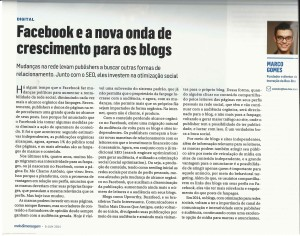

# Mudanças no Facebook trazem onda de crescimento para os blogs

Publicado em 2014-06-16

|  |
| --- |
| [Share](#) |

*Por Marco Gomes*  
*Artigo publicado no Meio&Mensagem de 2014-06-09.*

Há algum tempo que o Facebook faz mudanças políticas para aumentar a rentabilidade da rede social, diminuindo cada vez mais o alcance orgânico das Fanpages. Nas últimas semanas, publishers e donos de páginas na rede perceberam uma grande queda no alcance de seus posts. Isso porque foi anunciado que o Facebook iria tomar algumas medidas para diminuir a ação de spammers de conteúdo. E foi o que aconteceu: segundo estimativas independentes, as publicações orgânicas alcançam, agora, apenas 1% do público total das páginas, e as mais afetadas são as fanpages de marcas e conteúdo.

Nos últimos três ou quatro anos, muitos blogs migraram sua interatividade para as Fanpages, ou já nasceram no Facebook, como a página Eu Me Chamo Antônio, que virou livro. Isso porque a plataforma, com a promessa de vantagem em relação aos perfis, anunciou que as marcas deveriam criar suas próprias Fanpages, que possuíam a mesma relevância que os perfis. Mas hoje isso mudou.

As marcas podem investir em suas páginas, como sempre fizeram, mas os criadores de conteúdo e formadores de opinião desde sempre ganham com a audiência gerada. Hoje é visível uma subversão do sistema padrão, que já não permitia que o proprietário da Fanpage lucrasse com a audiência, e agora, com as mudanças, não permite mais que os próprios fãs sejam impactados de forma orgânica. Na internet, quem não é cliente, é produto.

Com o conteúdo perdendo alcance orgânico no Facebook, existe uma migração natural da audiência de volta para os blogs e sites independentes. Os publishers começam a buscar novas maneiras de relacionamento com os leitores em que o investimento financeiro não é necessário. Agora, em conjunto com o já tradicional SEO (search engine optimization) para gerar audiência, é utilizado a otimização social (social optimization), ou seja, a produção de conteúdo, tendo como seeding inicial as redes sociais através de perfis pessoais, menos afetados pela mudança de alcance orgânico no Facebook, que auxiliam a disseminação da publicação, aumentando ainda mais o número de leitores e a audiência em seus blogs.

Blogs como [Upworthy](http://www.upworthy.com/), [Buzzfeed](http://www.buzzfeed.com/), e os brasileiros [Tudo Interessante](http://www.tudointeressante.com.br/), [Comunicadores](http://comunicadores.info/) e [Tenho Mais Discos Que Amigos](http://tenhomaisdiscosqueamigos.com/), estão voltando ao início, divulgando suas publicações através de sua audiência e atraindo mais visitantes para o próprio blog. Desta forma, quando alguém clicar no conteúdo compartilhado pelos leitores das páginas em seus perfis pessoais na rede social, que tem e vão continuar com a audiência orgânica, será direcionado para o blog, e não mais para a Fanpage, voltando a gerar maior tráfego ao site, onde o publisher tem a possibilidade de ter publicidade, e lucrar com isso. É um verdadeiro boca a boca social.

Através de blogs e sites independentes, além de informação relevante para os leitores, as marcas podem também atingir seu público alvo por meio de veiculação de mídia em sites de conteúdo independente, e a grande vantagem para o anunciante é a possibilidade de atingir apenas quem é importante para aquele anúncio, através do behavioral targeting. Além do que, se usuários compartilharem os links dos blogs em seus perfis no Facebook, estes vão ter mais relevância e engajamento do que posts de Fanpages.

**Em 2014 os blogs, com otimização para redes sociais, voltam a ter a importância de canal de comunicação e interatividade entre Publisher e audiência, continuando como uma excelente opção de mídia para marcas e anunciantes.**

### Divulgue este post para seus amigos!

### Textos relacionados:

### Deixe sua opinião

[Cancelar a resposta](http://marcogomes.com/blog/2014/mudancas-no-facebook-trazem-onda-de-crescimento-para-os-blogs/#respond)

Seu nome

Seu e-mail (não será publicado)

Seu website (não obrigatório)

Me avise de novos comentários por e-mail.

Notify me of new posts by email.
