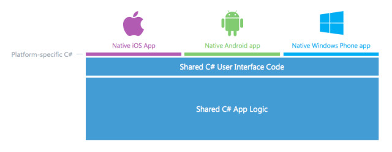
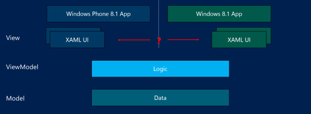
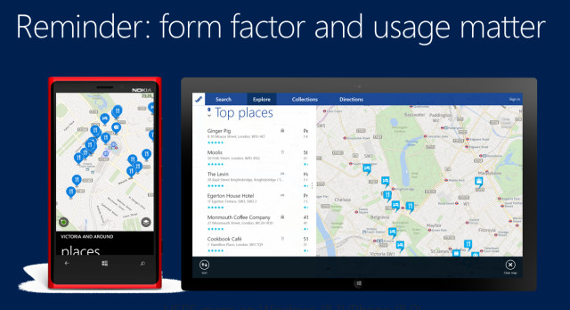

# [Universal Apps: What are they and how are they good for developers?](http://www.neowin.net/news/universal-apps-what-are-they-and-how-are-they-good-for-developers "Permalink to Universal Apps: What are they and how are they good for developers?")

*[This article was written by Andy Wigley, a Technical Evangelist that works in the Microsoft Developer Experience (DX) group in the UK. If you have any questions feel free to follow him on Twitter [@andy\_wigley](https://twitter.com/andy_wigley), or view similar content on [our developer site](http://www.microsoft.com/en-gb/developers).]*

In the world of mobile computing devices, no one [operating system](#) or development language enjoys complete dominance. iOS, Android (and its offshoots), and Windows 8/Windows Phone are the big three, but app [developers](#) also build for Blackberry, Tizen, and others - all of these have their place and their supporters. For a company looking to build a smartphone or tablet app, this fragmented landscape adds up to a headache: how do they build a mobile app running across more than one of these without incurring significant development costs associated with building the app individually for each target platform?

**Universal apps**, that holy grail of ‘build once, run anywhere’! Business has been looking for such a solution for a long, long time and they’re still looking. The problem is that each mobile device platform – quite rightly – offers a differentiated user experience to users. Nobody wants a world where every device sold is identical in every respect. Users want a device that allows them to express their individuality and is a tool for them to pursue their own interests, and the industry satisfies that demand by offering different devices that interact with the users in unique ways. Users get choice and can select the device and operating system that appeals to them.

For developers of course, this device diversity is a problem. Since each device operating system is different, each has its own development tools that allow the creation of apps that shine on their platform. There are a number of tools that offer cross-platform solutions, such as [Apache Cordova](http://cordova.apache.org/) which is a set of device APIs that allow a [mobile app](#) developer to access native device function such as the camera or accelerometer from JavaScript. Coupled with a UI framework such as jQuery Mobile or Dojo Mobile or Sencha Touch, this allows a smartphone app to be developed with just HTML, CSS, and JavaScript. Visual Studio tooling for this, which was announced recently at TechEd 2014, called the **Multi-Device Hybrid Apps for Visual Studio CTP** which you can download from the [Microsoft Download Center](http://www.microsoft.com/en-us/download/), or you can watch the [session on this on Channel9](http://channel9.msdn.com/Events/TechEd/NorthAmerica/2014/DEV-B323) from the recent TechEd 2014 conference.

Even though solutions such as Cordova are good, by using them you are inevitably accepting some trade-offs that come with developing for multiple platforms. You are targeting a breadth of devices, rather than creating tailored, optimized experiences for each device. Facebook famously tried to develop a family of new apps using HTML5 but dropped the development and went back to developing fully native apps for each platform, as that offered them the best way of creating optimized experiences for each platform.

Another popular cross-platform development solution is [Xamarin](http://xamarin.com/), which allows you to use your .NET C# development skills to build apps for iOS, Mac, Android and Windows. This toolset takes the approach of allowing you to write all your business logic just once using your favorite development language and libraries, C# and .NET, and then to write the UI layer individually for each platform. Here, at least in the UI, you are creating an optimized experience using the native UI technologies of each platform, albeit at the additional cost of having to build each UI.

Xamarin recently announced V3 of their product which includes a new cross-platform GUI development technology called Xamarin Forms. It remains to be seen how effective this is in providing a great user experience on each platform, and at what point the inevitable compromises of a cross-platform solution would lead you back to choosing to create a pure native UI.

# Windows 8.1/Windows Phone 8.1 Universal Apps

In March at the //build/ 2014 conference in San Francisco, Microsoft unveiled Windows Phone 8.1 to the world. The big deliverable of this major update is convergence of the developer platforms for Windows 8.1 and Windows Phone 8.1. Common APIs in the Windows Runtime went from around 5% in Windows Phone 8.0 to over 90% in Windows Phone 8.1. The SDK is released as a part of Visual Studio 2013 Update 2 and adds in new tooling for the creation of **Universal apps targeting Windows 8.1 and Windows Phone 8.1**. If you want to watch an overview of the main features of this release and a demo of creating a universal app, see the first video of my [Building Apps for Windows Phone 8.1](http://aka.ms/wp81js) video series on Channel9.

A few commentators mistakenly reported these new Universal apps as being cross-platform, allowing apps to run on Windows, iOS and Android. They’re not – these are Windows 8.1 and Windows Phone 8.1 only, but they do allow you to create rich, tailored, optimized experiences for both Windows Phone and Windows Tablet/PC. When you create a Universal app solution in Visual Studio, you have a Windows 8.1 project which outputs an app package for Windows, a Windows Phone 8.1 project that outputs an app package for Windows Phone, and a Shared project which is where you put all items that are common to both platforms, which should amount to a very high percentage of your code and assets. You can create Universal apps using HTML with JavaScript, XAML with C++, or XAML with C# or Visual Basic.

The question of whether to develop a single UI layer that runs or both, or whether to build platform-specific UI is an interesting one. It is certainly possible to build a single UI from a technical standpoint because the XAML and the UI controls are (on the whole) the same, but we would advise that this is rarely a great idea. A tablet is not a phone; each provides a different user experience. You usually use a phone in portrait orientation, but a tablet in landscape (at least those that are 9” or above) and a tablet screen offers much more display space that you can use to communicate more information than a phone screen. Phones are often used for quick information snacking, while tablets may be used for more leisurely information consumption.

So form factor and usage does matter, and you should think carefully before offering the exact same display on phone and tablet. You should build a great UI optimised to each platform, though that doesn’t mean that you have to build your UI from scratch. You can still share lots of UI code, by creating user controls, and sharing data templates (layouts) and assets.

## Benefits of Universal Apps for the developer

Well, this is a no-brainer really. Build your app out once, run it on both phone and tablet – what’s not to like? You do have to craft your UI for each platform, but most of your code and logic is common. And by doing this, you are extending your potential user base from not just phone or tablet/PC owners, but to phone \*and\* tablet/PC owners – a potentially massive user base of many millions.

There are a number of other advantages as well that are not quite so obvious:

- **Shared State**  
  If you write your app to store settings into RoamingSettings or files into the RoamingFolder and you keep the volume of that data below 100KB, these items are automatically synced across all the users devices. This means that details of their last items, last searches, most recently used ‘things’ – whatever makes sense in your app – is flowed across the users’ devices. So your user can start a task on their phone using the [phone app](#), then shortly after, pick up their tablet and using the tablet version of your app, pick up right where they left off. This is a great feature that users will just expect, so make sure you plan on roaming appropriate data in your universal apps.
- **Shared entitlement**  
  When a user purchases your app on one platform, they can download the corresponding app on the other platform for free. The Store apps will detect that the user is purchasing an app that they have already purchased for the other platform, and no charge will be levied.  
  A developer can choose to opt out of this when submitting apps to the store, but I would suggest that you should not do this unless the phone app offers substantially different capabilities to the tablet/PC app or vice-versa. To insist on a charge on both platforms for what the end-user will perceive to be essentially the ‘same app’ will probably just engender bad reviews and user resentment. If you \*do\* offer substantially different capabilities between the two versions, it is probably a better idea to charge for those features through in app purchase.
- **In app purchase shared**  
  Speaking of which – in-app purchase durables (i.e. items the user purchases and owns forever, such as levels in a game) are shared across phone and tablet/PC so the user only has to purchase once to get usage across all devices. Consumable in-app purchase items (such as usage tokens) remain associated with the device where they were purchased.

## To learn more

If you want to find out more about how to build a universal app using XAML and C#, and learn strategies for sharing code and XAML, please take a look at my session from TechEd 2014: [Build for Both: Building Shared Apps for Windows Phone and Windows 8.1](http://channel9.msdn.com/Events/TechEd/NorthAmerica/2014/WIN-B363#fbid=)
