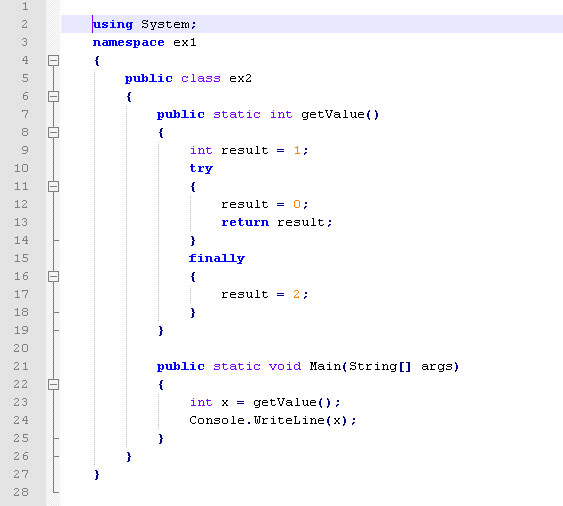
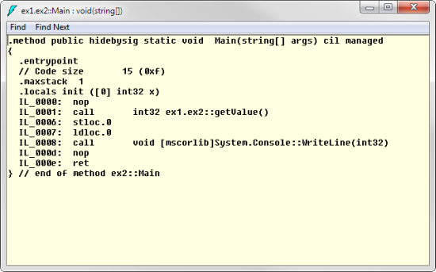
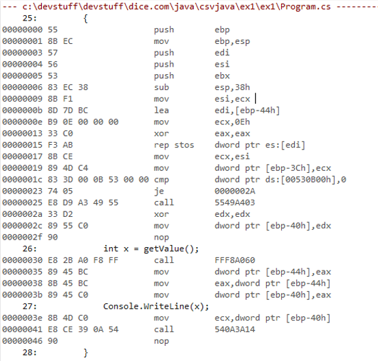

# Why Managed Code Is Safer

One of the biggest sea changes in computing took place in the late 1990s, with the switch over to running managed code, first with [Java](http://www.dice.com/job/results?caller=searchagain&j=true&q=Java&src=19&x=all&p=/?icid=dicenews) and then a couple of years later with [.NET](http://www.dice.com/job/results?caller=searchagain&j=true&q=.NET&src=19&x=all&p=/?icid=dicenews). Prior to this, compiled code (typically written in [C](http://www.dice.com/job/results?caller=searchagain&j=true&q=C&src=19&x=all&p=/?icid=dicenews), [C++](http://www.dice.com/job/results?caller=searchagain&j=true&q=C%2B%2B&src=19&x=all&p=/?icid=dicenews), [Visual Basic](http://www.dice.com/job/results?caller=searchagain&j=true&q=Visual+Basic&src=19&x=all&p=/?icid=dicenews) or [Delphi/Pascal](http://www.dice.com/job/results?caller=searchagain&j=true&q=Delphi&src=19&x=all&p=/?icid=dicenews)) produced unmanaged code. Yes, both of these run machine code. So what’s the difference?

### Unmanaged Code

Unmanaged code is just low level code (machine code) that the CPU (Central Processing Unit) executes directly. It can come from any language before being compiled to machine code and the resulting binary files can range from very small programs under a hundred bytes to large applications hundreds of megabytes in size.

Languages that produce unmanaged code must provide library routines through operating system calls statically linked into the executable or in [dynamically linked libraries](http://en.wikipedia.org/wiki/Dynamic-link_library) — called dlls on Windows, or .so on Linux.

The big advantage of unmanaged code is that it’s “closer to the metal.” It’s used in time critical situations in operating system drivers for peripherals, or embedded code. It doesn’t require a full framework to support it, so it can have a very small footprint. Games in particular run fastest if they run as unmanaged code.

Unmanaged code typically doesn’t have full control of the computer except for the programs that are part of the operating system that run in [kernel mode](http://en.wikipedia.org/wiki/Kernel_mode#Supervisor_mode). This provides hardware level protection but means programs that run in kernel mode need to be well-written, as they can crash the PC. User programs, however, almost always run in user mode. They can crash or run out of memory, but they won’t affect the rest of the system and, more importantly, won’t affect the operating system code and data.

### Managed Code

Managed code means that the compiler produces intermediate code targeted at a virtual machine (VM) instead of native machine code. In Java, programs are compiled to bytecode and output to Java classes and jars (archive files). In .NET languages, code is compiled to .il (Intermediate language), and stored in assemblies. Both Java bytecode and .NET assemblies are highly portable: Any machine that has a compatible VM can run that code, regardless of whether its CPU is 32 bit or 64 bit. In .NET, the VM is called CLR, short for Common Language Runtime (in Java, it’s the JVM).

The intermediate code can’t be run directly by the CPU like unmanaged code is. When the VM (a program in its own right) “loads” an application, it converts the intermediate code into the native code of the real CPU and either runs it or translates it into calls to the underlying platform’s functions (known as interpretation) and then runs it. Translation to native code can incur slight delays in start-up.

Programs that compile to managed code are not quite as “near the metal.” For the very fastest programs, you’ll want to run your program in an unmanaged environment. So, programs written in C++ [will be quicker than Java or C# programs](http://news.dice.com/2013/11/26/factorial-fluency-challenge-results/), though the difference is small these days. Much of the difference depends on the optimizing ability of the compiler and the virtual machine that underpins the managed environment.

However, managed code has lots of advantages. Running in a managed environment, the code is checked to be safe and can’t crash the machine. The VM can also provide garbage collection, so you never have to write memory management code to free up allocated blocks. Virtual machines like [‘HotSpot’](http://openjdk.java.net/groups/hotspot/), the most popular JVM, monitor performance and use optimizations to improve the execution speed while a program is running.

Possibly the biggest advantage of managed code is the supporting code provided in the frameworks, which can keep down the size of managed code. In .NET, for instance, there’s a massive number of classes, [somewhere in excess of 12,000](http://stackoverflow.com/questions/1406996/number-of-classes-in-net) for .NET 3.5. Having them all in one place (the framework) is a lot easier than having to juggle dependencies between different libraries, which is how it works in C++ (and to a lesser extent, Java).

So while you pay a little price in performance, you gain extra safety by moving from unmanaged to managed code.

### Multiple Languages

Because managed code compilers target a specific platform (.NET or Java), the languages that they compile share the libraries built into that platform. There are [nearly 30 different programming languages](http://en.wikipedia.org/wiki/List_of_JVM_languages) that compile for the JVM, and [a similar number](http://en.wikipedia.org/wiki/List_of_.net_programming_languages) for the CLR. That means that in both cases, there has been much less reinvention of the wheel for common features like string manipulation and networking.

### Example

Here’s an example of [C#](http://www.dice.com/job/results?caller=searchagain&j=true&q=C%23&src=19&x=all&p=/?icid=dicenews) code in each of the three stages.

As C# code:

As .Il code:

In machine code:

