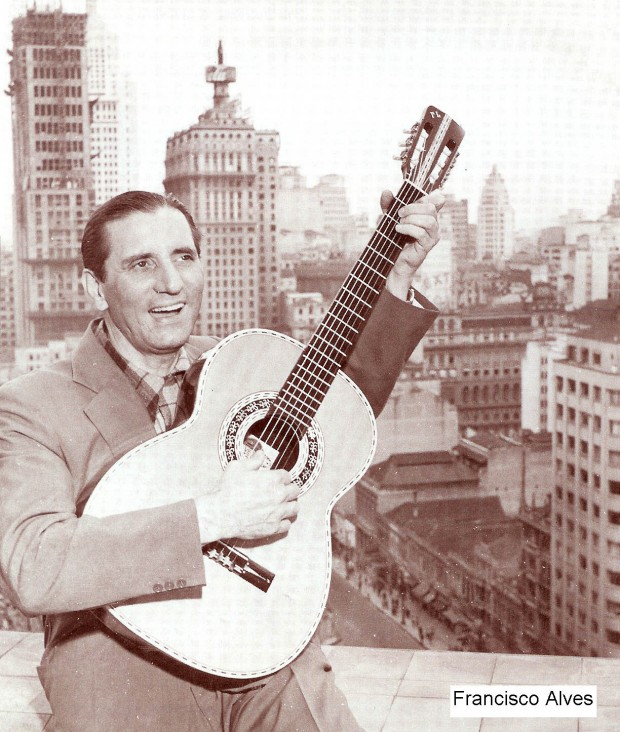

# Storytelling é coisa da vovó

Foi em um pequeno apartamento, com taquinhos de madeira no chão, no bairro de Perdizes, em São Paulo, onde eu aprendi mais sobre *storytelling* do que em qualquer aula de propaganda e marketing que já tive na faculdade. É nesse apartamento que vive uma simpática velhinho de 91 anos. Dona Helena, a minha avó.

Quando mudei de emprego, saí do Morumbi para a Vila Madalena, mais perto da casa dela. Desde então, passei a ir almoçar com ela às segundas-feiras. Não só era uma boa ficar mais perto da minha avó e ainda aproveitar as maravilhosas comidas que ela faz. Parece que para cozinhar bem não basta ler livros de culinária e fazer cursos,o segredo é ter netos e virar avó.

A mãe da minha avó veio da Itália para trabalhar e, em pouco tempo, se estabeleceu com o marido em uma fazendo em Aceburgo-MG. Minha avó foi criada lá.

Ela fez um pouco de tudo. Desde molecagens de uma época anterior à minha – como roubar fruta do vizinho – até coisas mais radicais – como sair de casa aos 14 anos em direção ao Rio de Janeiro, para trabalhar como criada e babá. A vida dela deu muitas voltas. Isso, junto com o passado mais simples, dão histórias e opiniões muito divertidas, tão saborosas quanto o arroz, feijão e bife que ela costuma fazer.

Acho que é algo que perdemos com o tempo. Parece que não sabemos mais contar histórias.

Isso minha vó saber fazer. No começo, só jogamos conversa fora. Ela conta do final de semana e, antes de nos sentarmos à mesa, faz alguma observação, como *“carioca corre na praia, paulista come pizza”*, por isso no Rio o pessoal tá mais em forma. Outro dia, comentou a reportagem do Rock In Rio na televisão: *“é bom todo mundo pulando assim, hoje em dia está todo mundo gordinho”*.

Mas isso é só o aperitivo. Logo depois começam as histórias. E que histórias! Elas podem durar o dia inteiro, a semana inteira. Tem de tudo, todo os gêneros, todos os temas. É como navegar na home do Netflix.

Comédia? Tem o louro que aprendeu a gritar o nome do cachorro da casa. Toda vez que o louro gritava, lá vinha o cachorro correndo que nem doido. E o que louro fazia? Ficava rindo até cair do poleiro.

Drama? O fazendeiro que esqueceu a arma do lado de fora da casa e, quando o filho foi brincar com o vizinho, acabou acertando um tiro no segundo. O fazendeiro deu sua fazenda e sua próspera plantação como indenização e passou o resto da vida na tristeza e no arrependimento, morando numa pequena casa, com uma plantação que não dava nada. E o seu filho? Suicidou-se alguns anos depois do acidente.

Biografia? Conheci o [Chico Alves](http://pt.wikipedia.org/wiki/Francisco_Alves_(cantor)), cantor que era chamado de Rei da Voz. Segundo minha vó, ele tinha um [Buick](http://pt.wikipedia.org/wiki/Buick). Quando casou, disse do carro *“se for para dividir, prefiro jogar ele da ribanceira”*. Buick este onde o cantor morreu, após ser atingido por um caminhão.

O cantor das histórias da minha vó

Romance? O dia em que meus avôs se conheceram. Foi em uma festa junina. Meu vô conversou com a minha vó e se ofereceu para caminhar com ela. No caminho, fogos de artificio da festa explodiram no ar. Ao ver o olhar de indagação da minha vó, meu vô já soltou um *“esses fogos são para comemorar que eu encontrei você”*.

Posso passar dias contando as histórias da minha vó, do jeito que ela faz comigo. Mas não é a mesma coisa. Eu não sei contar as histórias como ela, de um jeito apaixonado e comovente. Ora chorando, ora rindo, como se a história tivesse acontecido ontem, e não há 30 anos atrás.

Esses dias ela me mostrou uma prece que fez na década de 60. O ano eu não lembro (não puxei nem o talento culinário, de trovador ou de memória dela). Nessa prece, ela pede algumas coisas para Deus, quando ficar mais velha. Uma delas é que Deus não permita que ela fique tagarela. Pra minha sorte, Deus pulou essa parte.

Ou, talvez, ele também goste de aparecer em Perdizes nas segundas-feiras e ficar escutando.
