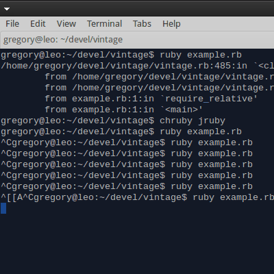

# Issue 7.5: Exploring low-level computing concepts with Ruby

> This issue of Practicing Ruby was directly inspired by Nick Morgan's
> [Easy 6502](http://skilldrick.github.io/easy6502/) tutorial. While
> the Ruby code in this article is my own, the bytecode for the
> Snake6502 game was shamelessly stolen from Nick. Be sure to check
> out [Easy 6502](http://skilldrick.github.io/easy6502/) if this topic
> interests you; it's one of the best programming tutorials I've ever seen.

The sea of numbers you see below is about as close to the metal as programming gets:

```
0600: 20 06 06 20 38 06 20 0d 06 20 2a 06 60 a9 02 85 
0610: 02 a9 04 85 03 a9 11 85 10 a9 10 85 12 a9 0f 85 
0620: 14 a9 04 85 11 85 13 85 15 60 a5 fe 85 00 a5 fe 
0630: 29 03 18 69 02 85 01 60 20 4d 06 20 8d 06 20 c3 
0640: 06 20 19 07 20 20 07 20 2d 07 4c 38 06 a5 ff c9 
0650: 77 f0 0d c9 64 f0 14 c9 73 f0 1b c9 61 f0 22 60 
0660: a9 04 24 02 d0 26 a9 01 85 02 60 a9 08 24 02 d0 
0670: 1b a9 02 85 02 60 a9 01 24 02 d0 10 a9 04 85 02 
0680: 60 a9 02 24 02 d0 05 a9 08 85 02 60 60 20 94 06 
0690: 20 a8 06 60 a5 00 c5 10 d0 0d a5 01 c5 11 d0 07 
06a0: e6 03 e6 03 20 2a 06 60 a2 02 b5 10 c5 10 d0 06 
06b0: b5 11 c5 11 f0 09 e8 e8 e4 03 f0 06 4c aa 06 4c 
06c0: 35 07 60 a6 03 ca 8a b5 10 95 12 ca 10 f9 a5 02 
06d0: 4a b0 09 4a b0 19 4a b0 1f 4a b0 2f a5 10 38 e9 
06e0: 20 85 10 90 01 60 c6 11 a9 01 c5 11 f0 28 60 e6 
06f0: 10 a9 1f 24 10 f0 1f 60 a5 10 18 69 20 85 10 b0 
0700: 01 60 e6 11 a9 06 c5 11 f0 0c 60 c6 10 a5 10 29 
0710: 1f c9 1f f0 01 60 4c 35 07 a0 00 a5 fe 91 00 60 
0720: a2 00 a9 01 81 10 a6 03 a9 00 81 10 60 a2 00 ea 
0730: ea ca d0 fb 60
```

Although you probably can't tell by looking at it, what you see here
is assembled machine code for the venerable 6502 processor that powered
many of the classic video games of the 1980s. When executed in simulated
environment, this small set of cryptic instructions produces a minimal
version of the Snake arcade game, as shown below:



In this article, we will build a stripped down 6502 simulator
in JRuby that is complete enough to run this game. If you haven't done much
low-level programming before, don't worry! Most of what follows is
just ordinary Ruby code. I will also be showing you a ton of examples
along the way, and those should help keep you on track. You might also
want to grab [full source code](https://github.com/sandal/vintage) for
the simulator, so that you can experiment with it while
reading through this article.

## Warmup exercise: Reverse engineering Snake6502

An interesting property of machine code is that if you know its structure,
you can convert it back into assembly language. Among other things,
the ability to disassemble machine code is useful for debugging and
exploration purposes. Let's try this out on Snake6502!

The output below shows memory locations, machine code, and assembly code for the
first 28 instructions of the game. These instructions are responsible for
initializing the state of the snake and the apple before the main event
loop kicks off. You don't need to understand exactly how they work right
now, just try to get a feel for how the code in the `hexdump` column corresponds
to the code in the `assembly` column:

```
address  hexdump     assembly
------------------------------
$0600    20 06 06    JSR $0606
$0603    20 38 06    JSR $0638
$0606    20 0d 06    JSR $060d
$0609    20 2a 06    JSR $062a
$060c    60          RTS
$060d    a9 02       LDA #$02
$060f    85 02       STA $02
$0611    a9 04       LDA #$04
$0613    85 03       STA $03
$0615    a9 11       LDA #$11
$0617    85 10       STA $10
$0619    a9 10       LDA #$10
$061b    85 12       STA $12
$061d    a9 0f       LDA #$0f
$061f    85 14       STA $14
$0621    a9 04       LDA #$04
$0623    85 11       STA $11
$0625    85 13       STA $13
$0627    85 15       STA $15
$0629    60          RTS
$062a    a5 fe       LDA $fe
$062c    85 00       STA $00
$062e    a5 fe       LDA $fe
$0630    29 03       AND #$03
$0632    18          CLC
$0633    69 02       ADC #$02
$0635    85 01       STA $01
$0637    60          RTS
```

If you look at the output carefully, you'll be able to notice some patterns even
if you don't understand what the instructions themselves are meant to do. For
example, each instruction is made up of between 1-3 bytes of machine code. The
first byte in each instruction tells us what operation it is, and the remaining
bytes (if any) form its operand.

If you take a look at the first four instructions, it is easy to see that the
opcode `20` corresponds to the `JSR` instruction. Forming its operand is
similarly straightforward, because it's the same number in both places,
just with opposite byte order:

```
20 06 06 -> JSR $0606  
20 38 06 -> JSR $0638
20 0d 06 -> JSR $060d
20 2a 06 -> JSR $062a
```

If you ignore the symbols in front of the numbers for the moment, mapping single
byte operands is even easier, because they're represented the same way in both
the machine code and the assembly code. Knowing that the `85` opcode maps
to the `STA` operation, it should be easy to see how `11, 13, 15` map to
`$11, $13, $15` in the following example:

```
85 11  -> STA $11
85 13  -> STA $13
85 15  -> STA $15
```

But the symbols in front of the numbers in assembly language obviously mean
something. If you carefully look at the machine code, you'll be able to find
that the same operation can have multiple different opcodes, each of which
identify a particular kind of operand:

```
a9 0f -> LDA #$0f
a5 fe -> LDA $fe
```

Without getting into too much detail here, the example above shows us that both
`a9` and `a5` correspond to the `LDA` instruction. The difference between the
two opcodes is that `a9` treats its operand as an immediate value, and `a5`
interprets it as a memory address. In assembly code, this difference is
represented syntactically (`#$xx` vs. `$xx`), but in the machine code we must
rely on numbers alone.

The various ways of interpreting operands (called "addressing modes") are
probably the most confusing part of working with 6502 code. There are
about a dozen of them, and to get Snake6502 running, we need to implement
most of them. The good news is that every addressing mode is just a
roundabout way of converting an operand into a particular address in memory, and once you have that
address, the operations themselves do not care about how you computed it.
Once you sweep all that stuff under the rug, you can end up with clean
operation definitions like this:

```
# NOTE: 'e' refers to the address that was computed from the instruction's
# operand and addressing mode.
```

This realization also tells us that the memory module will not need to take
addressing modes into account as long as they're precomputed elsewhere. With
that in mind, let's get started building a storage model for our simulator.
We'll deal with the hairy problem of addressing modes later.

## Memory

Except for a few registers that are used to store intermediate
computations, the 6502 processor relies on its memory for pretty much
everything. Program code, data, and the system stack all reside in
the same 16-bit addressing space. Even flow control is entirely
dependent on memory: the program counter itself is nothing more
than an address that is used to look up the next instruction to run.

This "all in one bucket" approach is a double-edged sword. It makes it harder to
write safe programs, but the tradeoff is that the storage model itself is very
simple. Conceptually, the memory module is nothing more than a mapping
between 16-bit addresses and 8-bit values:

```
describe "Storage" 
    Vintage:Storage 

   "can get and set values" 
    0x1337  

    0x1337must_equal
```

But because the program counter keeps track of a 'current location'
in memory at any point in time, there is a lot more we can do with
this simple structure. Let's walk through the remaining tests
for `Vintage::Storage` to see what else it implements.

**Program loading**

When a program is loaded into memory, there is nothing special about the
way it is stored, it's just like any other data. In a real 6502 processer,
a register is used to store the address of the
next instruction to be run, and that address is used to read an opcode
from memory. In our simulator, we can let the `Storage` class keep track
of this number for us, incrementing it whenever we call
the `Storage#next` method.

The following test shows how to load a program and then walk its code one byte at a time:

```
 "can load a bytecode sequence into memory and traverse it" 
  bytes    

  bytes
  must_equalprogram_offset # load() does not increment counter

  bytes   must_equal 

  must_equalprogram_offset
```

The starting position of the program can be an arbitrary location, but
to maintain compatibility with the simulator from the Easy6502 tutorial, we
initialize the program counter to `0x600`:

```
:program_offset  Vintage:StoragePROGRAM_OFFSET 

 "sets an initial position of $0600" 
  program_offsetmust_equal0x0600

  must_equalprogram_offset
```

**Flow control + branching**

Very rudimentary flow control is supported by setting the
program counter to a particular address, which causes the
processor to `jump` to the instruction at that address:

```
 "implements jump" 
  program_offset  

  must_equalprogram_offset
```

Branching can be implemented by only calling `jump` when a
condition is met:

```
 "implements conditional branching" 
      
  small  

  # a false condition does not affect mem.pc
  branchsmall   program_offset  
  must_equalprogram_offset

  # true condition jumps to the provided address
  branch  small program_offset  
  must_equalprogram_offset
```

This test case is a bit contrived, so let's take a look at
some real Snake6502 code that illustrates how branching meant to be used:

```
$064d    a5 ff     LDA $ff      # read the last key pressed on the keyboard
$064f    c9 77     CMP #$77     # check if the key was "w" (ASCII code 0x77)
$0651    f0 0d     BEQ $0660    # if so, jump forward to $0660 
$0653    c9 64     CMP #$64     # check if the key was "d" (ASCII code 0x64)
$0655    f0 14     BEQ $066b    # if so, jump forward to $066b
$0657    c9 73     CMP #$73     # check if the key was "s" (ASCII code 0x73)
$0659    f0 1b     BEQ $0676    # if so, jump forward to $0676
$065b    c9 61     CMP #$61     # check if the key was "a" (ASCII code 0x61)
$065d    f0 22     BEQ $0681    # if so, jump forward to $0681
```

Presumably, the code at `$0660` starts a procedure that moves the snake's
head up, the code at `$066b` moves it to the right, and so on. In other words,
if one of these `BEQ` instructions finds a match, it will jump to the right place
in the code to handle the relevant condition. But if no match is found, the
processor will happily continue on to whatever code comes after this set of
instructions in the program.

The tricky thing about using instructions that rely on `jump` (and consequently,
`branch`) is that they are essentially GOTO statements. When you see one of
these statements in the code, you know exactly what instruction will be executed
next, but there's no way of telling if it will ever return to the location
it was called from. To get around this problem, we need support for subroutines
that know how to return to where they've been called from. And to implement
*those*, we need a system stack.

**Stack operations**

Here are the tests for how we'd like our stack to behave:

```
:stack_origin  Vintage:StorageSTACK_ORIGIN 
:stack_offset  Vintage:StorageSTACK_OFFSET 

 "has a 256 element stack between 0x0100-0x01ff" 
  stack_offsetmust_equal0x0100
  stack_originmust_equal # this value gets added to the offset

 "implements stack-like behavior" 
  must_equalstack_origin

  
  
  

  must_equalstack_origin  

  must_equal
  must_equal
  must_equal

  must_equalstack_origin
```

As the tests indirectly suggest, the stack is a region in memory
between`$0100` and `$01ff`, indexed by a stack pointer (`sp`).
Each time a value is pushed onto the stack, the value of the
stack pointer is decremented, and each time a value is pulled,
the pointer is incremented. This makes it so that the stack
pointer always tells you where the "top of the stack" is.

**Subroutines**

With a stack in place, we'll have most of what we need to implement
"Jump to subroutine" (`jsr`) and "Return from subroutine" (`rts`)
functionality. The behavior of these features will end up
looking something like this:

```
 "implements jsr/rts" 
  0x0606
  0x060d

  must_equal0x060d

  
  must_equal0x0606

  
  must_equalprogram_offset
```

To make the above test pass, `jsr` needs to `push` the current
program counter onto the stack before executing a `jump` to the
specified address. Later when `rts` is called, the address is
pulled out of the stack, and then another `jump` is executed
to bring you back to where the last `jsr` command was executed.
This works fine even in nested subroutine calls, due to the
nature of how stacks work.

The only tricky part is that addresses are 16-bit values, but
stack entries are limited to single byte values. To get around
this problem, we need a couple helper functions to convert
a 16-bit number into two bytes, and vice-versa:

```
 "can convert two bytes into a 16 bit integer" 
  int16 must_equal0x1337

 "can convert a 16 bit integer into two bytes" 
  bytes0x1337must_equal
```

These helpers will also come in handy later, when we need to deal with
addressing modes.

**Implementation**

Behavior-wise, there is a lot of functionality here. In a high level
environment it would feel a lot like we were mixing distinct concerns,
but at the low level we're working at it's understandable that nearly
infinite flexibility is desireable.

Despite the conceptual complexity, the `Storage` class is extremely easy to
implement. In fact, it takes less than 80 lines of code if you don't
worry about validations and robustness:

```
module Vintage
  class Storage
    PROGRAM_OFFSET  0x0600
    STACK_OFFSET    0x0100
    STACK_ORIGIN    

     initialize
      @memory  
            PROGRAM_OFFSET
            STACK_ORIGIN
    

    attr_reader  

     bytes
      index  PROGRAM_OFFSET

      byteseach_with_index   @memoryindex   
    

     address
      @memoryaddress
    

     address value
      @memoryaddress  value  
    

     
      @memory     
    

     address
        address
    

     branch address
      return unless 

        address
    

     address
         bytes

      
      

      address
    

     
        
        

        int16 
    

     value
      @memorySTACK_OFFSET    value
        
    

     
        

      @memorySTACK_OFFSET  
    

     int16bytes
      bytesunpackfirst
    

     bytes
      unpack
```

For such boring code, its a bit surprising to think that it can be a fundamental
building block for generic computing. Keep in mind of course that we're building
a simulation and not a real piece of hardware, and we're doing it in one of the
highest level languages you can use.

If it already feels like we're cheating, just wait until you see the next trick!

## Memory-mapped I/O

To implement Snake6502, our simulator needs to be able to generate random
numbers, read keyboard input, and also display graphics on the screen. None of
these features are directly supported by the 6502 instruction set, so that means
that every individual system had to come up with its own way of doing things.
This is one of many things that causes machine code (especially old-school
machine code) to not be directly portable from one system to another.

Because we're trying to get Snake6502 to run in our simulator without modifying
its bytecode, we're more-or-less constrained to following the approach used by
the Easy6502 simulator: memory-mapped I/O.

This approach is actually very easy to implement in a simulated environment: you
add hooks around certain memory addresses so that when they are accessed, they
execute some custom code rather than directly reading or writing a
value to memory. In the case of Snake6502, we expect the following behaviors:

- Reading from `$fe` returns a random 8-bit integer.
- Reading from `$ff` retrieves the ASCII code of the last key
  pressed on the keyboard.
- Writing to addresses between `$0200` to `$05ff` will render
  pixels to the screen. (`$0200` is the top-left corner
  of the 32x32 display, and `$05ff` is the bottom-right corner.)

These features could be added directly to the `Storage` class, but it would
feel a bit awkward to clutter up a generic module with some very specific edge
cases. For that reason, it is probably better to implement them as a module
mixin:

```
module Vintage
  module MemoryMap
    RANDOMIZER   
    KEY_PRESS    
    PIXEL_ARRAY  0x02000x05ff

    attr_accessor 

     address
       address
       RANDOMIZER
        
       KEY_PRESS
        last_keypress
      
        super
      
    

      
      super

       PIXEL_ARRAYinclude?
        update     0x0200
```

You probably already have a good idea of how `MemoryMap` works from seeing
its implementation, but it wouldn't hurt to see an example of how it is
used before we move on. Here's how to display a single pixel on the
screen, randomly varying its color until the spacebar (ASCII code 0x20)
is pressed:

```
  Vintage:Storage
extendVintage:MemoryMap

  Vintage:Display 

0x0410   until
```

It's worth noting that this is the only code in the entire simulator that
directly depends on a connection to some sort of user interface, and the
protocol consists of just two methods: `ui.update(x, y, color)` and
`ui.last_keypress`. In our case, we use a JRuby-based GUI, but anything
else could be substituted as long as it implemented these two methods.

At this point, our storage model is pretty much complete. We now can
turn our attention to various number crunching features.

## Registers and Flags

In order to get Snake6502 to run, we need all six of
the programmable registers that the processor provides. We've handled two of
them already (the stack pointer and the program counter), so we just have four
more to implement: A, X, Y, and P. A few design constraints will help make this
work go a whole lot faster:

- Most of the operations that can be done on A are done the same way on X and Y,
  so we can implement some generic functions that operate on all three of them.
- We can implement the status register (P) as a collection of individual
  attributes, rather than seven 1-bit flags packs into a single byte.
- Because Snake6502 only relies on the (c)arry, (n)egative, and (z)ero flags
  from the status register, we can skip implementing the other four status flags
  and still have a playable game.

With those limitations in mind, let's work through some specs to understand
how this model ought to behave. For starters, we'll be building a `Vintage::CPU`
that implements three registers and three flags, initializing them all to
zero by default:

```
describe "CPU" 
    Vintage 

  :registers     
  :flags         

   "initializes registers and flags to zero" 
    registers  flags   must_equal
```

It will be possible to directly set registers via the `#[]=` method, because
the behavior will be the same for all three registers:

```
 "allows directly setting registers" 
  registers  
    value   

      value
    must_equalvalue
```

However, because flags don't have the same update semantics as registers, we
will not allow directly setting them via `#[]=`:

```
 "does not allow directly setting flags" 
  flags  
    value   

      ->    value must_raiseArgumentError
    messagemust_equal inspect is not a register"
```

The carry flag (c) can toggled via the `set_carry` and `clear_carry`
methods. We'll need this later for getting the `CPU` into
a clean state whenever we do addition and subtraction
operations:

```
 "allows setting the c flag via set_carry and clear_carry" 
  set_carry
  expect_flags => 

  clear_carry
  expect_flags =>
```

Some other instructions will require us to set the carry flag
based on arbitrary conditions, so we'll need support for that as well:

```
 "allows conditionally setting the c flag via carry_if" 
  # true condition
    
  carry_if  

  expect_flags => 

  # false condition
    
  carry_if  

  expect_flags =>
```

The N and Z flags are set based on whatever result the `CPU` last processed:

```
 "sets z=1 when a result is zero, sets z=0 otherwise" 
  result
  expect_flags => 

  result
  expect_flags => 

 "sets n=1 when result is 0x80 or higher, n=0 otherwise" 
  result
  expect_flags => 

  result
  expect_flags =>
```

The `result` method also returns a number truncated to fit in a single byte,
because pretty much every place we could store a number in this system
expects 8-bit integers:

```
 "truncates results to fit in a single byte" 
  result0x1337must_equal
```

To help keep the `CPU` in a consistent state and to simplify the work
involved in many of the 6502 instructions, we automatically call `cpu.result`
whenever a register is set via `CPU#[]=`. The tests below show the
the effects of that behavior:

```
   "implicitly calls result() when registers are set" 
    registers  
        0x100

      must_equal
      expect_flags =>   => 

        

      must_equal
      expect_flags =>   =>
```

Here's an implementation that satisfies all of the tests we've seen so far:

```
module Vintage
  class 
     initialize
      @registers    =>   =>   =>  
      @flags        =>   =>   =>  
    

     
      @registers  @flagsfetch
    

      value
      unless @registers
        raise ArgumentError inspect is not a register" 
      

      @registers  resultvalue
    

     set_carry
      @flags  
    

     clear_carry
      @flags  
    

     carry_if
        set_carry  clear_carry
    

     resultnumber
      number  

      @flags  number      
      @flags  number

      number
```

Putting it all together, the role of the `CPU` class is mostly just to do some
basic numerical housekeeping that will make implementing 6502 instructions
easier. Consider for example, the `CMP` and `BEQ` operations, which can
be used together to form a primitive sort of `if` statement. We saw these two
operations used together in the earlier example of keyboard input handling:

```
$064f    c9 77     CMP #$77     # check if the key was "w" (ASCII code 0x77)
$0651    f0 0d     BEQ $0660    # if so, jump forward to $0660
```

Using a combination of the `CPU` and `Storage` objects we've already built, we'd
be able to define the `CMP` and `BEQ` operations as shown below:

```
  carry_if >= 

  result    

  branch
```

Even if we ignore the `cpu.carry_if` call, we know from what we've seen
already that if `CPU#result` is called with a zero value, it will set the Z flag
to 1. We also know that when `Storage#branch` is called with a true value, it
will jump to the specified address, otherwise it will do nothing at all. Putting
those two facts together with the Snake6502 shown above tells us that if the
value in the A register is `0x77`, execution will jump to `$0600`.

At this point, we're starting to see how 6502 instructions can be
mapped onto the objects we've already built, and that means we're
close to the finish line. Before we get there, we only have two obstacles
to clear: implementing addressing modes to handle operands, and building
a program runner that knows how to map raw 6502 code to the operation
definitions shown above.

## Addressing Modes

> **NOTE:** The explanation that follows barely scrapes the surface of
> this topic. If you want to really understand 6502 addressing modes, you should check
> out the [relevant section](http://skilldrick.github.io/easy6502/#addressing)
> in the Easy6502 tutorial.

In the very first exercise where we disassembled the first few instructions
of Snake6502, we discovered the presence of several addressing modes
that cause operands to be interpreted in various different ways. To get
the game running, we will need to handle a total of eight different
addressing modes.

This is a lot of different ways to generate an address, and its intimidating
to realize we're only implementing an incomplete subset of what the 6502 processor
provides. However, its important to keep in mind that the only data structure
we have to work with is a simple mapping from 16-bit integers to 8-bit
integers. Among other things, clever indexing can give us the functionality we'd
expect from variables, references, and arrays -- all the stuff that doesn't have
a direct representation in machine code.

I'm going to show the definitions for all of the addressing modes used by
Snake6502 below, which probably won't make much sense at first glance. But try
to see if you can figure out what some of this code doing:

```
module Vintage
  module Operand
        
       
        # Implicit 
        
        # Relative
        offset  

          offset <=   offset    offset   
        # Immediate
           
        # Zero Page
        
        # Zero Page, X
          
         # Absolute
        int16 
        # Indexed Indirect
          

        int16       
        # Indirect Indexed
          

        int16   
      
        raise NotImplementedError inspect
```

Now let's walk through them one-by-one. You can refer to the source code above as needed
to make sense of the following examples.

1) The implicit addressing mode is meant for instructions that either don't operate
on a memory address at all, or can infer the address internally. An example
we've already seen is the `RTS` operations that is used to return from a subroutine --
it gets its data from the stack rather than from an operand, making it a single
byte instruction.

2) The relative addressing mode is used by branches only. Consider
the following example:

```
$0651    f0 0d     BEQ $0660    # if Z=1, jump to $0660
```

By the time the `$0d` operand is read, the program counter will be set to
`$0653`. If you add these two numbers together, you get the address to jump to
if Z=1: `$0660`.

3) Immediate addressing is used when you want to have an instruction work on the
operand itself. To do so, we return the operand's address, then increment the
program counter as normal. In the example below, the computed address (`e`)
is `0x0650`, and `mem[e] == 0x77`:

```
$064f    c9 77     CMP #$77
```

4) Zero page addressing is straightforward, it is simply refers to any address
between `$00` and `$ff`. These are convenient for storing program data in, and
are faster to access because they do not require combining two bytes into a 16
bit integer. We've already seen copious use of this address mode throughout
the examples in this article, particularly when working with keyboard input
(`$ff`) and random number generation (`$fe`).

5) Zero page, X indexing is used for iterating over some simple sequences in
memory. For example, Snake6502 stores the position of each part of the snakes
body in byte pairs starting at memory location `$10`. Using this addressing
mode, it is possible to walk over the array by simply incrementing the X
register as you go.

6) We've also seen plenty of examples of absolute addressing, especially when
looking at `JSR` operations. The only complication involved in processing
these addresses is that two bytes need to be read and then assembled into
a 16bit integer. But since we've had to do that in several places already,
it should be easy enough to understand.

7) Indexed indirect addressing gives us a way to dynamically compute an address
from other addresses that we've stored in memory. That sounds really confusing,
but the following example should help clear it up. The code below is responsible
for moving the snake by painting a white pixel at its updated head position, and
painting a black pixel at its old tail position:

```
$0720    a2 00       LDX #$00
$0722    a9 01       LDA #$01
$0724    81 10       STA ($10,X) 
$0726    a6 03       LDX $03
$0728    a9 00       LDA #$00
$072a    81 10       STA ($10,X)
```

The first three lines are hardcoded to look at memory locations `$10` and `$11`
to form an address in the pixel array that refers to the new head of the
snake. The next three lines do something similar for the tail of the snake,
but with a twist: because the length of the snake is dynamic, it needs to
be looked up from memory. This value is stored in memory location `$03`.
So to unpack the whole thing, `STA ($10, X)` will take the address `$10`, add to
it the number of bytes in the whole snake array, and then look up the address
stored in the last position of that array. That address points to the snake's
tail in the pixel array, which ends up getting set to black by this instruction.

8) Indirect indexed addressing gives us yet another way to walk over multibyte
structures. In nake6502, this addressing mode is only used for drawing the
apple on the screen. Its position is stored in a 16-bit value stored
in `$00` and `$01`, and the following code is used to set its color to a
random value:

```
$0719    a0 00       LDY #$00
$071b    a5 fe       LDA $fe
$071d    91 00       STA ($00),Y
```

There are bound to be more interesting uses of these addressing modes, but we
we've certainly covered enough ground for now! Don't worry if you didn't
understand this section that well, it took me many times reading the Easy6502
tutorial and the source code for Snake6502 before I figured these out myself.

## 6502 Simulator (finally!)

We are now finally at the point where all the hard stuff is done, and all that
remains is to wire up the simulator itself. In other words, it's time for
the fun part of the project.

The input for the simulator will be a binary file containing the
assembled program code for Snake6502. The bytes in that file not meant to
be read as printable characters, but they can be inspected using a hex editor:

```
$ hexdump examples/snake.rom
0000000 20 06 06 20 38 06 20 0d 06 20 2a 06 60 a9 02 85
0000010 02 a9 04 85 03 a9 11 85 10 a9 10 85 12 a9 0f 85
0000020 14 a9 04 85 11 85 13 85 15 60 a5 fe 85 00 a5 fe
0000030 29 03 18 69 02 85 01 60 20 4d 06 20 8d 06 20 c3
0000040 06 20 19 07 20 20 07 20 2d 07 4c 38 06 a5 ff c9
0000050 77 f0 0d c9 64 f0 14 c9 73 f0 1b c9 61 f0 22 60
0000060 a9 04 24 02 d0 26 a9 01 85 02 60 a9 08 24 02 d0
0000070 1b a9 02 85 02 60 a9 01 24 02 d0 10 a9 04 85 02
0000080 60 a9 02 24 02 d0 05 a9 08 85 02 60 60 20 94 06
0000090 20 a8 06 60 a5 00 c5 10 d0 0d a5 01 c5 11 d0 07
00000a0 e6 03 e6 03 20 2a 06 60 a2 02 b5 10 c5 10 d0 06
00000b0 b5 11 c5 11 f0 09 e8 e8 e4 03 f0 06 4c aa 06 4c
00000c0 35 07 60 a6 03 ca 8a b5 10 95 12 ca 10 f9 a5 02
00000d0 4a b0 09 4a b0 19 4a b0 1f 4a b0 2f a5 10 38 e9
00000e0 20 85 10 90 01 60 c6 11 a9 01 c5 11 f0 28 60 e6
00000f0 10 a9 1f 24 10 f0 1f 60 a5 10 18 69 20 85 10 b0
0000100 01 60 e6 11 a9 06 c5 11 f0 0c 60 c6 10 a5 10 29
0000110 1f c9 1f f0 01 60 4c 35 07 a0 00 a5 fe 91 00 60
0000120 a2 00 a9 01 81 10 a6 03 a9 00 81 10 60 a2 00 ea
0000130 ea ca d0 fb 60
0000135
```

The challenge that is left to be completed is to process
the opcodes and operands in this file and turn them into
a running program. To do that, we will make use of a CSV file
that lists the operation name and addressing mode for each opcode
found in file:

```
00,BRK,#
10,BPL,@
18,CLC,#
20,JSR,AB
# ... rest of instructions go here ...
E6,INC,ZP
E8,INX,#
E9,SBC,IM
F0,BEQ,@
```

Once we know the addressing mode for a given operation, we can read its
operand and turn it into an address (denoted by `e`). And once we have *that*,
we can execute the commands that are defined in following DSL:

```
# NOTE: This file contains definitions for every instruction used 
# by Snake6502. Most of the functionality here is a direct result
# of simple calls to Vintage::Storage and Vintage::CPU instances.

  
  raise StopIteration 

     
     
     

     

     

## Counters

     
     

    result   
    result    

## Flow control

   

   
   

  branch    
  branch    
  branch    
  branch    
  branch    

## Comparisons

  
  carry_if >= 

  result   

  
  carry_if >= 

  result   

## Bitwise operations

     
  result   

 
     >>   

  carry_if  
    

## Arithmetic

  set_carry   
  clear_carry 

  
        

  carry_if  
    

 
               

  carry_if >=
```

We can treat both the opcode lookup CSV and the instructions definitions DSL
as configuration files, to be loaded into the configuration object
shown below:

```
require "csv"

module Vintage
  class Config
    CONFIG_DIR  dirname__FILE__/../../config"

     initialize
      load_codes
      load_definitions
    

    attr_reader :definitions :codes

    private

     load_codes
      csv_data  CONFIG_DIR.csv"
                        to_sym  

      @codes  csv_data
    

     load_definitions
      @definitions  

      instance_evalCONFIG_DIR
    

     method_missing  
      return super unless   upcase

      @definitions
```

Then finally, we can tie everything together with a `Simulator` object that
instantiates all the objects we need, and kicks off a program execution loop:

```
module Vintage
  class Simulator
    EvaluationContext  Struct  

      
      config  Vintage:Config
           Vintage
           Vintage:Storage

      extendMemoryMap
        

      binreadbytes

       
          

           configcodes
         
            Operand   

          EvaluationContext  
                           instance_execconfigdefinitions
        
          raise LoadError "No operation matches code: '%.2x'
```

At this point, you're ready to play Snake! Or if you've been following closely
along with this article all the way to the end, you're probably more likely to
have a cup of coffee or take a nap from information overload. Either way,
congratulations for making it all the way through this long and winding
issue of Practicing Ruby!

## Further Reading

This article and the [Vintage simulator](http://github.com/sandal/vintage) is built on top of a ton of other
people's ideas and learning resources. Here are some of the works I referred to
while researching this topic:
