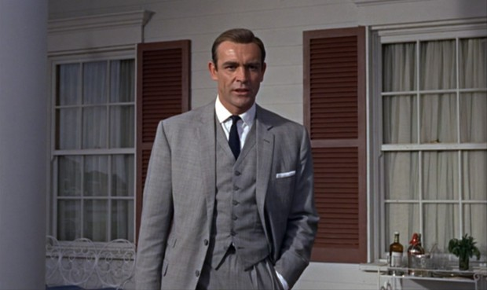
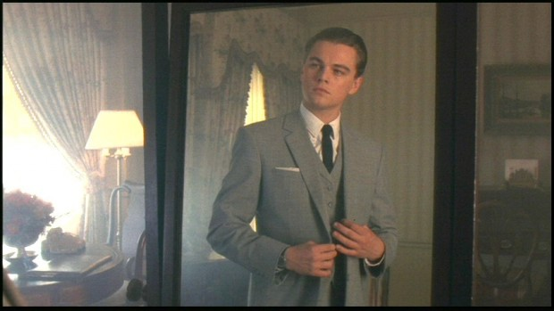
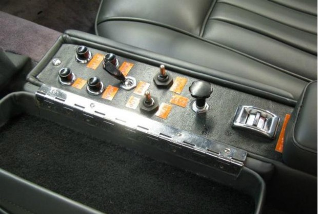
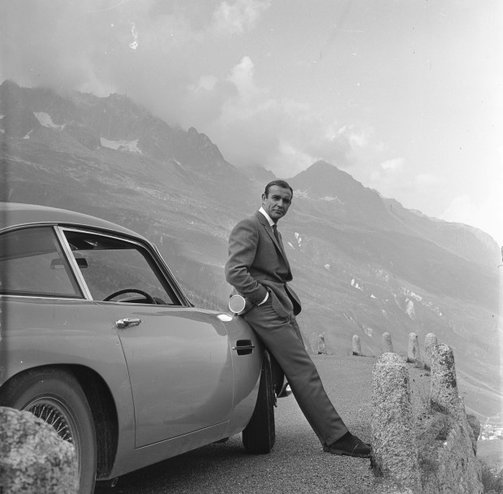

Não precisamos ir muito longe para perceber que filmes são os mitos da modernidade. Algumas histórias são criadas para nos passar um objetivo, um exemplo ou mais ainda, uma esperança.

Não é à toa que vemos citações de filmes aos montes por aí. “*[Clube da Luta](http://papodehomem.com.br/o-clube-da-luta-nao-e-sobre-homens-mas-sobre-meninos/)*” nos conta sobre os dilemas do universo masculino, “*[Ela](http://www.imdb.com/title/tt1798709/)*”  nos fala sobre como nos relacionamos, “*[Na Natureza Selvagem](http://www.imdb.com/title/tt0758758/)*” fala sobre liberdade, relacionamentos e sonhos. Todo bom filme pode apontar alguma direção para refletir e destacar um aprendizado.

Passei minhas ultimas semanas assistindo os clássicos filmes do James Bond, o mais famoso agente secreto da história, buscando algumas lições para aplicar na minha vida.

A escolha pode parecer estranha, mas se observar, ele é o melhor exemplo de homem elegante, confiante e com um conjunto de habilidades boas o suficiente para solucionar a maioria dos problemas que aparecem.

O 007 é um personagem que merece ser observado e copiado por muitos motivos. Ao longo do texto você entenderá por quê.

### 1. Tenha um conjunto afiado de habilidades

Seja lá o que se propor a fazer, pratique e faça direito. Todo mundo deve fazer o exercício de observar quais habilidades são necessárias para a execução de suas atividades e buscar uma forma de aperfeiçoá-las. Não quero dizer que você precisa ser o melhor em absolutamente tudo, mas tentar navegar acima da média no que está disposto a aprender.

Quando 007 dirige, ele faz isso com perícia e propriedade. Ele não está jogando ao acaso, ele sabe exatamente como guiar o carro para fugir de um perseguidor, ou chegar em algum lugar com maior velocidade. James Bond luta muito bem, escala, joga poker, nada, corre e a lista pode ir crescendo.

*[Link Youtube](https://www.youtube.com/watch?v=H9fyOFefirQ)*

Nem todos precisam de tantas qualidades para viver bem, o que torna ainda mais simples identificar o que precisa para deslizar pela vida com a eficácia de um agente secreto. Podemos dividir nosso conjunto de habilidades em dois grupos: Trabalho e Cotidiano.

Observe tudo o que precisa fazer na sua rotina de trabalho, todas as atividades que faz rotineiramente. Existe algo que poderia aprender para melhorar o andamento das cosias? Você é um professor mas não sabe construir uma boa apresentação? Advogado mas não se sente confortável em debates? Programador mas possui problemas em se relacionar com colegas de trabalho?

Crie uma lista com tudo o que pode melhorar para transformar sua profissão. Na maioria das vezes, nossa capacidade em executar o que realmente temos que fazer conta muito pouco para o nosso sucesso. O segredo, em muitos casos, está no que fazemos além da tarefa padrão.

Para o cotidiano, é importante observar elementos que promovam tanto bem estar e habilidades pessoais, ajudando na economia de recursos, economizando dinheiro ou poupando a ajuda de outras pessoas.

A exemplo disso, aprender a cozinhar é uma das melhores formas de desenvolver um conjunto incrível de aptidões. Você precisa observar a organização dos ingredientes, ter noção de timing, coordenar várias tarefas simultaneamente, entender a importância da tentativa e erro, e até ter compaixão com quem vai provar o que fizer. Raramente cozinhamos para o nosso gosto, o fazemos para as pessoas que vamos servir. Poucas coisas nos ensinam tanto sobre produção e vida quanto preparar uma boa refeição conscientemente.

Este é um exemplo simples de algo que pode ser dominado e ter reflexos muito além de sua aplicação direta.

Tente observar o que poderia ajudar você a ser uma pessoa mais completa. Seja construindo um novo móvel para guardar suas ferramentas, plantando uma pequena horta de temperos na varanda de casa, se defender de agressores através das artes marciais ou organizando seus pensamentos e ideias através da escrita.

Liste o que pode torná-lo uma pessoa melhor e fazer o seu caminho mais fluido.

### 2. Vista-se apropriadamente

Moda é um assunto um tanto polêmico, principalmente quando estamos falando com pessoas que se consideram mais inteligentes. Para estes, é comum taxar tudo o que não é voltado para o desenvolvimento do intelecto como futilidade, um esforço desnecessário.

Muita gente comete esse erro, ao ignorar que o papel das nossas roupas é transmitir uma mensagem, uma intenção. Mesmo quando vestimos algo sem nos preocupar, de qualquer jeito, é este o recado que estamos passando adiante: sou desleixado e não me preocupo com minha aparência.

Não é o caso de se tornar um fanático pelo assunto, mas saber exatamente como se vestir em cada situação é criar uma bela embalagem para um excelente conteúdo.

[Somos marcados pelas roupas que vestimos](http://papodehomem.com.br/como-saber-se-estou-bem-vestido/). Camisas, calças e sapatos são ilustrações que complementam a história que contamos sobre nós mesmos. James Bond dificilmente seria tão marcante em seus filmes se estivesse vestindo camiseta e bermuda. Seus ternos, sempre bem alinhados, confirmam o que suas atitudes demonstram: organizado, preciso e confiante.

Uma sinal claro disso é o marcante terno utilizado em “*[007 contra Goldfinger](http://www.imdb.com/title/tt0058150/)*” que, por muitos anos, ilustrou a forma com que lembramos do James Bond e suas qualidades.

Vemos este reflexo em  “*[Prenda-me se for capaz](http://www.imdb.com/title/tt0264464/)*”, quando o protagonista Frank William Abagnale Jr. encomenda um terno idêntico, tentando representar através de suas roupas os traços particulares do espião.

[O Bruno Passos escreve textos incríveis sobre moda](http://papodehomem.com.br/author/bruno-passos/), caso queira se aprofundar e aprender como se vestir para cada ocasião.

### 3. Não existe espião solitário

O tempo todo somos enganados por histórias de grandes heróis solitários. Gente incrível que faz tudo sozinho, vence todos os obstáculos e supera seus medos. Nos filmes do 007 e na vida real, essa é só a impressão que temos por observar apenas um lado da história.

James Bond é frequentemente visto como alguém que trabalha sozinho e resolve todos os problemas que aparecem, mas este é um engano comum quando só enxergamos a atitude das pessoas e não os recursos utilizados para chegar ao resultado.

Enquanto Bond está em cena, existe um grande time de especialistas criando soluções para os problemas que podem aparecer pelo caminho. Carros equipados, armas secretas e os dispositivos de alta tecnologia são elementos indispensáveis para o sucesso do agente, tudo apoiado por sua equipe.

Outras peças também colaboram para o sucesso do protagonista, como seu melhor amigo, o agente da Cia, [Felix Leiter](http://thesuitsofjamesbond.com/wp-content/uploads/2014/01/Jeffrey-Wright-Casino-Royale.jpg), até [Eve](http://i1.cdnds.net/12/43/618x481/movies_skyfall_still_5.jpg), em “*[Skyfall](http://www.imdb.com/title/tt1074638/)“*, mesmo cometendo alguns deslizes, está lá para apoiar nosso herói. Devemos incluir também as várias moças recrutadas de acordo com a necessidade do momento, como Jill Masterson em Goldfinger, que [termina pintada de dourado](http://www4.pictures.zimbio.com/mp/TGzBEElmwpcl.jpg).

Saber o a hora certa de utilizar o apoio e pedir ajuda é uma das lições mais importantes que podemos aprender através dos filmes do James Bond.

### 4. Tenha um olhar amplo

Em “*[Casino Royale](http://www.imdb.com/title/tt0381061/)*”, Daniel Craig persegue [Sebastien Foucan](http://en.wikipedia.org/wiki/S%C3%A9bastien_Foucan), um dos criadores do Parkour, numa das cenas de perseguição a pé mais emocionantes da história do cinema. No filme, Mollaka é rápido e habilidoso, mas Bond é determinado e persistente. O especialista faz tudo com perfeição. Os movimentos rápidos, sem nenhum desperdício de energia. Tem habilidade de sobra. O espião vai atrás como pode. Escorrega, cai e se rala em suas tentativas.

*[Link Youtube](https://www.youtube.com/watch?v=iZxNbAwY_rk) | Que cena!*

O que Bond faz muito bem em todos os seus filmes, é utilizar recursos do ambiente para suprir a diferença de capacidade entre ele e os vilões que encontra. Na cena da perseguição, ele utiliza atalhos, elevadores, um carro e cordas para chegar onde Mollaka chegou sem artifícios, e ao fim consegue alcançar e eliminar o seu alvo.

Sempre vamos encontrar pessoas melhores que a gente, capazes de sobrepor nossa capacidade de atuar em algum campo. O que os filmes nos mostram é que com um pouco de conhecimento e, acima  disso, calma, conseguimos observar formas de contornar este desequilíbrio. Na maioria das situações, ser o melhor não se compara ao desenvolvimento de um olhar amplo em relação às possibilidades.

Como Harvey Specter, da série “*[Suits](http://www.imdb.com/title/tt1632701/)*” diz:

> “Quais são as escolhas quando alguém aponta uma arma para sua cabeça? Você pode tomar a arma, ou sacar uma maior. Ou pode falar que está blefando, ou fazer cento e quarenta e seis outras coisas.”

### 5. Conheça bem suas ferramentas

A modernidade nos cercou de instrumentos fantásticos. Qualquer pessoa atualmente possui mais tecnologia em mãos do que James Bond um dia sonhou em seus filmes mais antigos. Todos temos aparelhos de GPS no bolso, capacidade de fazer anotações, gravações de voz, tirar fotos e fazer filmagens.

Os modelos mais modernos de celular ainda permitem assistentes virtuais que dispensam uma interação mais profunda com o aparelho, fazendo consultas e ações apenas com o comando de voz. Sem falar no mundo de aplicações construídas por terceiros, abrindo um gigantesco espectro de possibilidades.

James Bond, sempre que recebe um novo gadget, gasta algum tempo entendendo como funciona e pensando qual a melhor forma de utilizá-lo. Isso é o que todos deveriam fazer ao comprar um smartphone, por exemplo – caso contrário, usaríamos um celular convencional, que ainda estão disponíveis no mercado aos montes.

O carro de Bond: sempre cheio de truques

Criei uma lista com 3 dicas bem simples para você amplificar a utilidade de seu aparelho:

**5.1.** Tenha informações importantes sempre em mãos: O [Evernote](https://www.evernote.com) é um dos aplicativos gratuitos (para iOS e Android) mais incríveis que existem. Com uma simplicidade assustadora, você pode trocar informações entre seu computador e seu smartphone, deixando tudo na mão quando precisar. Tenho em meu evernote cópias de documentos, informações sobre voos, todas as minhas anotações de aulas e ideias. Tudo o que é importante e preciso acessar com alguma frequência está lá.

**5.2.** Sua câmera é mais útil do que você imagina: Sua câmera tem uma aplicação bem útil, mas que pouca gente acaba utilizando. Com alguma frequência precisamos armazenar informações visuais por um curto espaço de tempo, e é ai que entra o papel da câmera. Está fazendo pesquisa de preços? Tire foto das etiquetas. Nunca lembra onde estacionou o carro? Tire uma foto da placa de indicação estacionamento. Vai pagar os boletos que chegam no correio de casa pelo computador do trabalho? Tire fotos dos códigos de barra (isso se não usar o app do banco) para não precisar carregar aquele monte de papel. Crie uma pasta de fotos apenas para estas informações rápidas que podem ser fotografadas.

**5.3.** Automatize ações importantes: Uma das formas mais interessantes de utilizar a tecnologia móvel é automatizando algumas ações, simplificando tarefas chatas. Existem alguns aplicativos interessantes para isso, o que indico aqui é o [IFTTT](https://ifttt.com).

Costuma sair bem tarde da faculdade e precisa avisar alguém que saiu, para poder procurar por você caso demore? Crie uma mensagem automática pra quando seu GPS apontar que saiu daquele ponto. Precisa acompanhar algum assunto importante em algum site? Automatize para que chegue em seu email toda vez que um item novo for adicionado ao site. Os gatilhos disponíveis somam centenas e as possibilidades de mesclar serviços e funcionalidades são inúmeras.

O importante aqui é abrir seus olhos para as possibilidades que a tecnologia que você carrega o dia todo com você tornam possíveis.

Ter a tecnologia não basta, temos que saber exatamente como usá-la para facilitar nosso cotidiano.

### 6. Você sempre está vendendo alguma coisa

Bond, James bond.

*[Link Youtube](https://www.youtube.com/watch?v=TXxKZkE2MGo) | A famosa introdução*

Talvez esta seja a introdução mais conhecida do cinema. O agente secreto, ao se apresentar, utiliza da repetição e da pausa estratégica, para causar o devido impacto. Quem ouve entende imediatamente que existe alguma importância naquela pessoa.

Dizer que estamos sempre nos vendendo causa polêmica. Muita gente interpreta errado o que é uma venda. Quando conversamos com alguém, existe sempre uma relação de troca, a pessoa fornece ou pede informação. Mesmo que essa relação seja incrivelmente passiva, ela está acontecendo.

Quando Bond entra na suite de Goldfinger e encontra Jill Masterson observando o jogo de cartas, o agente secreto sem muitas dificuldades vende seu propósito para a funcionária do vilão, que pouco esforço faz para impedi-lo.

Uma das características que mais marca o sucesso do nosso herói é ser um excelente vendedor. Bond é capaz de transmitir o valor das ações mais simples e vender seu objetivo até mesmo para seus inimigos. Quando está encurralado, a primeira coisa que o agente faz é vender o valor de sua vida.

*[Link Youtube](https://www.youtube.com/watch?v=DoQwKe0lggw)*

Ter consciência de como esta troca funciona pode ser crucial para negociações, mesmo para pessoas comuns. Quer um desconto? Crie bons argumentos, apresente exemplos e venda motivos. Vai a uma entrevista de emprego? Tem uma reunião difícil com um chefe carrasco? Funciona do mesmo jeito.

Não é como se sua vida dependesse disso, mas poderia ser.

### 7. Saiba enfrentar riscos

Na vida, assim como nos filmes, grandes conquistas não caem no colo de graça. Precisamos estar cientes que os resultados de grandes eventos estão comumente ligados ao risco de sua contrapartida. A exemplo de um empreendedor que assume o risco de sair do mercado de trabalho tradicional e criar seu próprio negócio.

As chances de dar errado são altíssimas, mas o lado positivo, caso dê certo, é muito maior do que seria se continuasse na trilha tradicional, e é assim que identificamos um bom risco.

Mas se engana quem acha que assumir riscos é pular cego num abismo sem nenhum conhecimento do que pode acontecer.

O que o espião faz muito bem é assumir riscos muito altos, mas com uma pequena saída de segurança preparada para quando a situação sair do controle. Nem sempre a segurança funciona, mas é imprescindível criar este mecanismo de suporte.

“Se eu não voltar em 15 minutos, suba os Alpes atirando.”

No caso dos filmes, podemos observar que, quando nosso protagonista entra numa situação complicada, existe uma alternativa bem pequena, mas bem segura acontecendo em paralelo. Seja um parceiro que sabe onde ele está e vai atrás para ajudar, um dispositivo de localizador que é inserido no sapato e aponta sua localização para seus comparsas, um horário de encontro que deve ser respeitado, caso contrário alguém deve ir atrás.

Não importa a situação, Bond sempre tem uma carta na manga.

É como o exemplo de investidores que arriscam altíssimas quantias de dinheiro em negócios super perigosos, mas que separam uma fatia aplicada na poupança ou em imóveis, para criar um equilíbrio caso o investimento não se concretize positivamente.

Quando pensar em se aventurar em algo, procure iniciar um processo em paralelo que exija pouca ou quase nenhuma interação, mas que seja capaz de se tornar o plano principal caso as coisas fujam dos trilhos.

\* \* \*

Podemos extrair aprendizado de todos os lados. Peças de entretenimento, por mais que não sejam desenvolvidas com este propósito, possuem elementos que, se observados com cuidado, apresentam ideias positivas para aplicarmos em nossas vidas.

E você? Já observou algo nos filmes do 007 que não listamos por aqui?

### Mecenas: [Confraria Malbec](http://pdh.co/malbec)

Malbec está compilando o [Guia por Homens marcantes](http://pdh.co/malbec), criado pela Equipe Malbec em parceria com o PapodeHomem e o site Moda para Homens.

Para ver mais conversas como esta, dicas e perfis de homens marcantes, [acesse o site da Confraria Malbec](http://pdh.co/malbec).

[anexo ausente]  
  
  
  
[[anexo ausente]](http://da.feedsportal.com/r/195506566487/u/49/f/530922/c/32911/s/3af41c9a/sc/19/rc/2/rc.htm)  
[[anexo ausente]](http://da.feedsportal.com/r/195506566487/u/49/f/530922/c/32911/s/3af41c9a/sc/19/rc/3/rc.htm)  
  
[[anexo ausente]](http://da.feedsportal.com/r/195506566487/u/49/f/530922/c/32911/s/3af41c9a/sc/19/a2.htm)[anexo ausente]

[[anexo ausente]](http://feeds.feedburner.com/~ff/PapodehomemLifestyleMagazine?a=Tz0ZEzwelug:YcuLj5kEzJM:yIl2AUoC8zA)  [[anexo ausente]](http://feeds.feedburner.com/~ff/PapodehomemLifestyleMagazine?a=Tz0ZEzwelug:YcuLj5kEzJM:qj6IDK7rITs) [[anexo ausente]](http://feeds.feedburner.com/~ff/PapodehomemLifestyleMagazine?a=Tz0ZEzwelug:YcuLj5kEzJM:-BTjWOF_DHI)

[anexo ausente]
