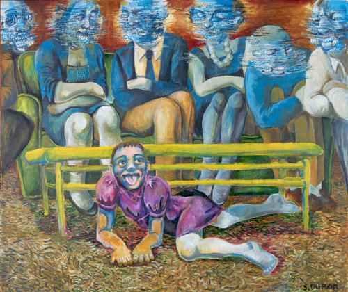
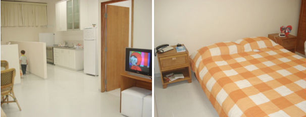

Como é se relacionar com uma pessoa surda? Não importa se você é um familiar próximo ou distante, se é amigo ou colega, entender o universo da surdez traz benefícios tanto para pessoas ouvintes quanto surdas.

Para ouvintes, porque ampliam seu entendimento sobre as possibilidades e capacidades humanas, que além de diversas, apresentam potenciais incríveis. E para pessoas surdas, porque assim é possível contribuir para uma melhor comunicação com ouvintes, ampliando principalmente o acesso a informação e a igualdade de direitos.

Um amigo meu, alguns meses depois de terminar o curso intermediário de Libras, teve a oportunidade de ajudar um casal de surdos que tentava com dificuldade comprar um lanche na rodoviária de Curitiba.

A pessoa que os atendia havia simplesmente desistido de compreendê-los, mas meu amigo que já tinha um nível de comunicação básico acabou intervindo e conseguiu mediar a situação, o casal conseguiu o que queria e ficaram muito agradecidos e meu amigo por sua vez foi pegar o ônibus feliz da vida, achando que o curso de Libras não poderia ter valido mais a pena!

Já escrevi [aqui sobre a Libras](http://papodehomem.com.br/pequeno-guia-para-entender-as-linguas-de-sinais/), a Língua de Sinais Brasileira, que é um dos pontos fundamentais ao se tratar da comunicação com pessoas surdas.

[Eu tenho um irmão surdo](http://blog.anafranca.com.br/meu-irmao-o-mar-e-eu/) e posso dizer que, além da Libras, aprendi muito nesta experiência. O Dudu se comunica exclusivamente pela língua de sinais, ou seja, não faz leitura labial ou oralização do português. O fato do Dudu ser surdo influenciou muito na maneira como eu percebo a vida, tenho a impressão que me tornei, pela nossa relação, mais sensível a diversidade de experiências humanas.

No caso das pessoas surdas, as barreiras de comunicação ainda são inúmeras. Em grande parte devido a aspectos sociais e culturais, mas há muita beleza e potencialidade na diferença. E acredito que com educação e políticas públicas adequadas, as possibilidades de igualdade na diversidade se ampliam consideravelmente.

Bem, ter uma pessoa surda na família pode ser difícil. Mas acredite, bem mais difícil é para ela ter somente ouvintes na sua família. O curta animado “*La Familia Silencio*“, feita por jovens surdos da Colonia Guerrero na Cidade do México, representa algumas situações cotidianas de um garoto surdo que convive com pai, mãe e irmã ouvintes:

[Link Youtube](http://www.youtube.com/watch?v=GaeBdx4rdnI)

A história de isolamento retratada em “*La Familia Silencio*” é mais recorrente na vida real do que se pode imaginar. Já pensou quanto conteúdo uma pessoa surda perde somente durante uma refeição em família? E isso se multiplica nas mais diversas ocasiões: encontros, comemorações e eventos cotidianos.

As informações passadas para a criança surda acabam sendo superficiais e resumidas, não cobrindo sua necessidade de compreensão e expressão. Não é à toa que se considera que as dificuldades enfrentadas por pessoas surdas adultas resultam em grande parte de um déficit enorme de conhecimento e comunicação que acontece desde sua infância.

Quando a família não propicia o aprendizado da língua de sinais, as consequências podem ser ainda mais complicadas e, às vezes, difíceis de reverter. Uma pessoa sem uma língua não tem meios de aprender, compreender e se expressar no mundo.

Sobre o tema, são famosas histórias como a de Kasper Hauser, que passou os primeiros anos de sua vida em uma cela, isolado do contato com outras pessoas. Assim, não aprendeu um idioma e teve grandes dificuldades de comunicação. Em 1828, supostamente aos 15 anos, Kasper Hauser foi abandonado em uma praça pública de Nuremberg com um carta que contava sobre sua história, juntamente com alguns objetos que indicavam ser procedente de uma família nobre. Inicialmente, Kasper Hauser não sabe nem mesmo como reagir a chama quente de uma vela, afinal nossas emoções e reações também são parte de aprendizado e repertório cultural. Sua história foi representada no filme “*[O Enigma de Kasper Hauser](http://www.imdb.com/title/tt0071691/)*“, de 1974 e pode dar uma boa ideia das dificuldades que a privação de comunicação traz.

Não raro, a experiência da surdez é retratada pelas artes visuais como forma de expressar, dentre diversas temáticas, conflitos em relação ao mundo predominantemente ouvinte. [Susan Dupor](http://www.duporart.com), artista norte-americana, faz uso da pintura para expressar suas vivências como surda.

A obra intitulada “*Family Dog*” de Dupor representa uma sala, em que um garoto com o corpo recostado ao chão se encontra embaixo da mesa de centro e seis figuras de pessoas adultas estão sentadas em um sofá e no entorno com seus rostos desfigurados.

Quadro intitulado “Family Dog”, da artista surda Susan Dupor

Esta composição sugere o isolamento da criança surda em sua própria família e a falta de comunicação e compreensão tanto da criança em relação aos ouvintes, como vice-versa.

Quando a surdez é compreendida por familiares ouvintes como deficiência, dificilmente há busca pelo contato com outras pessoas surdas. Quando o aprendizado da leitura labial e oralização não é bem-sucedido, a carência de comunicação e privação de conhecimento e informação pode trazer sérias consequências ao desenvolvimento intelectual, emocional e cognitivo. Assim, Family Dog representa em partes, a muitas vezes complicada relação entre surdos e ouvintes.

Susan Gregory, em uma pesquisa sobre a relação de crianças surdas com a família publicada no seu livro “*[Deaf Children and their families](http://www.amazon.com/Children-their-Families-Susan-Gregory/dp/0521438470)*” em 1995, constatou que o número de acessos de raiva de uma criança surda pode ser o dobro em relação a crianças ouvintes, isto em decorrência da frustração da criança em não conseguir se comunicar, o que a autora considera inevitável perante a política educacional que, na ocasião da pesquisa, focalizava somente a comunicação oral e nenhuma outra além desta. Afinal, qualquer pessoa como dificuldades em se expressar e ser compreendida pode ficar irritada.

Uma criança em um ambiente de familiares ouvintes, por exemplo, ao ver a mãe atender a campainha, não entende o motivo pelo qual esta abriu a porta e, ao abrir a porta em outro momento, provavelmente não irá encontrar uma pessoa como aconteceu no caso de sua mãe. Se o telefone toca, algum familiar ouvinte atende e mexe os lábios, e para a criança surda esta é uma ação sem significado, já que, ao segurar o telefone ao ouvido, não irá escutar nada. Tais situações podem gerar frustração e falta de compreensão em relação aos acontecimentos ao seu redor, além do sentimento de possuir uma diferença negativa em relação à própria família.

Pensando nessas questões, a [Escola para Crianças Surdas de Rio Branco](http://www.ecs.org.br) apresentou, em 2009, o que seria um “Ambiente de Estimulação do Desenvolvimento para Surdos”, espaço que simula uma casa e é destinado aos alunos e familiares atendidos pela escola. O ambiente inclui relógio despertador vibratório, babá eletrônica, telefone para surdos no quarto dos pais e vídeos de desenhos infantis em línguas de sinais. Foram incluídas também paredes internas baixas, possibilitando e facilitando a comunicação entre pessoas em cômodos diferentes.

Casa adaptada para o bebê surdo da Escola para Crianças Surdas de Rio Branco | Fonte: http://www.ecs.org.br

Em 2011, conclui minha pesquisa de mestrado sobre surdez e comunicação. E dentre tantas histórias incríveis que tive a oportunidade de conhecer, uma delas foi a de Rosani. Além dela, acabei entrevistando parte da família, o que resultou em um vídeo, o curta “[*Família Suzin Santos*](https://www.youtube.com/watch?v=2kX_BfNzSio)“.

[Link Youtube](https://www.youtube.com/watch?v=IP9P69UawDc)

Rosani é surda e tem a [síndrome de Usher](http://pt.wikipedia.org/wiki/S%C3%ADndrome_de_Usher), responsável pela diminuição progressiva de seu campo de visão. A mãe de Rosani, Iraci, é ouvinte e junto com Maurício e Emanuell, marido e filho de Rosani, me contaram um pouco das experiências da família que incluem: a descoberta da língua materna de Rosani; o aprendizado da língua de sinais e a interessante invenção de Maurício, uma babá eletrônica vibratória feita a partir de um aparelho massageador.

### E você, como pode ajudar a mudar este contexto?

As sugestões a seguir dependem muito da sua proximidade (amigo, familiar ou colega de trabalho) e da idade em que a pessoa surda se encontra. Mas todas servem para qualquer relação entre pessoas surdas e ouvintes.

**1. Aprenda Libras!** Saber se comunicar (mesmo que em um nível básico) pela língua materna da comunidade surda é muito importante. Se a pessoa surda for um familiar, torna-se ainda mais fundamental conhecer a Libras para estreitar os laços, trocar ideias, aprender e ensinar, compartilhar a vida.

**2. Procure instituições especializadas.** No caso de crianças, escolas que considerem o uso e o ensino tanto da Libras quanto do Português. Recursos didáticos, ambientes de aprendizado, dentre tantos outros aspectos da educação, precisam estar em conformidade com as especificidades da surdez. Nestas instituições é importante observar se pessoas surdas ocupam os mais variados cargos como professores, gestores ou servidores. Se quase todos forem ouvintes, a falta de referência de um adulto surdo pode levar a criança surda a se considerar menos capaz.

**3. Em escolas, universidades, palestras e eventos, solicite sempre a presença de um Tradutor e Intérprete da Língua de Sinais.** É um direito garantido por lei.

**4. Estimule a participação da pessoa surda em grupos de surdos.** Existem grupos esportivos, religiosos, dentre tantos outros, aonde a Libras é a primeira língua falada e a maioria dos integrantes é surdo. Nestes grupos é possível que a pessoa surda consiga aperfeiçoar sua comunicação em sinais, troque conhecimento e conheça outras pessoas que são surdas como ela! Esta convivência entre falantes da mesma língua faz toda diferença para o desenvolvimento, autoestima e integração social da pessoa surda.

**5. Informe-se sobre os direitos garantidos por lei à pessoas surdas.** Embora os efeitos na prática ainda não aconteçam de maneira efetiva, o Brasil, nos últimos anos, teve avanços significativos no campo das políticas públicas voltadas à inclusão social. Destacam-se a [Lei n. 10.436 de 2002](http://www.planalto.gov.br/ccivil_03/leis/2002/l10436.htm), que reconhece a Língua Brasileira de Sinais como meio oficial e legal de comunicação e expressão; o [Decreto Federal 5626/2005](http://www.planalto.gov.br/ccivil_03/_ato2004-2006/2005/decreto/d5626.htm), que regulamenta a lei 10.436 e a [Lei n. 12.319 de 2010](http://www.planalto.gov.br/ccivil_03/_Ato2007-2010/2010/Lei/L12319.htm), que trouxe a regulamentação da profissão de tradutores e intérpretes da língua brasileira de sinais. A [Lei n. 10.098 de 2000](http://www.planalto.gov.br/ccivil_03/leis/l10098.htm), embora utilize o termo “deficiente auditivo” e seja mais abrangente, também estabelece normas gerais e critérios básicos para a promoção da acessibilidade.

**6. Procure materiais e recursos que tenham incorporados a língua de sinais.** Embora não tanto quanto é necessário, existem atualmente livros, jogos, filmes e recursos didáticos que incluem a Libras. Estes materiais são muito importantes e benéficos porque frequentemente apresentam representações positivas acerca da surdez, associam Libras e Português e podem ainda aproximar surdos e ouvintes.

**7. Considere sempre a experiência da pessoa surda.** Se for desenvolver qualquer projeto que tenha como pressupostos acessibilidade e inclusão, procure saber como uma pessoa surda se sente em relação a sua proposta, quais são as possíveis barreiras e sugestões. Sendo ouvintes, nunca saberemos realmente como é ser surdo.

### Aonde aprender Libras?

- No Brasil a [Federação Nacional de Integração e Educação de Surdos](http://www.feneis.org.br/) (FENEIS) está presente em diversas cidades e oferece cursos de Libras em níveis variados.
- No Rio de Janeiro, o [Instituto Nacional de Educação de Surdos](http://portalines.ines.gov.br/) (INES) também oferece cursos de Libras.
- Outras possibilidades são cursos oferecidos por Igrejas e Escolas locais, certamente deve existir algum acontecendo na sua cidade.

E você, tem alguma experiência ou sugestão sobre a convivência entre pessoas surdas e ouvintes pra contar? Compartilhe nos comentários :)

[anexo ausente]  
  
  
  
[[anexo ausente]](http://da.feedsportal.com/r/199119314726/u/49/f/530922/c/32911/s/3b546c1a/sc/19/rc/2/rc.htm)  
[[anexo ausente]](http://da.feedsportal.com/r/199119314726/u/49/f/530922/c/32911/s/3b546c1a/sc/19/rc/3/rc.htm)  
  
[[anexo ausente]](http://da.feedsportal.com/r/199119314726/u/49/f/530922/c/32911/s/3b546c1a/sc/19/a2.htm)[anexo ausente]

[[anexo ausente]](http://feeds.feedburner.com/~ff/PapodehomemLifestyleMagazine?a=EvJ-XJJXWns:i-DRdn5hBCk:yIl2AUoC8zA)  [[anexo ausente]](http://feeds.feedburner.com/~ff/PapodehomemLifestyleMagazine?a=EvJ-XJJXWns:i-DRdn5hBCk:qj6IDK7rITs) [[anexo ausente]](http://feeds.feedburner.com/~ff/PapodehomemLifestyleMagazine?a=EvJ-XJJXWns:i-DRdn5hBCk:-BTjWOF_DHI)

[anexo ausente]
