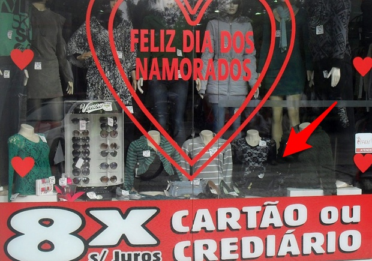

É imoral comemorar o dia dos namorados do jeito que temos feito — presentes, jantares, flores, motel… Tudo embrulhado com romantismo.

Ora, ao fazê-lo, reificamos pelo menos duas das mentalidades mais danosas desse tempo: o consumismo (atrelamos também a relação a um padrão de consumo e de mercado) e a glamourização e idealização romântica dos relacionamentos amorosos.

Claro, *celebrar* não é o problema, de forma alguma. E boto fé que celebrar de um jeito esperto pode ser bem mais benéfico pra cultura (e para as relações) do que simplesmente negar e xingar o dia dos namorados, as datas comerciais e o consumismo, o mito do amor romântico, os processos de glamourização…

Agora, note que curioso: já não é fácil imaginar como seria uma celebração do dia dos namorados que não envolvesse algum tipo de consumo especial e romantismo. Essa dificuldade para visualizar alternativas é a própria evidência do quanto estamos bem encaixotados.

### Mais:

- [Sobre consumo consciente →](http://www.portalhomem.com.br/especialistas/eduardo-pinheiro/artigos/consumo-consciente)
- [Sobre namoro →](http://olugar.org/o-namorado-so-sabe-namorar/)
- [Sobre romantismo (em inglês) →](http://www.brainpickings.org/index.php/2013/12/02/how-should-we-live-roman-krznaric/)

**E uma proposta de ativismo:** que tal usarmos os comentários para compartilhar boas ideias de celebração das relacões?

\* \* \*

*Nota dos editores: esse é um post despretensioso, um formato rápido com o qual pretendemos experimentar para compartilhar com vocês ideias e recomendações que valem sua atenção.*

[anexo ausente]  
  
  
  
[[anexo ausente]](http://da.feedsportal.com/r/199108358447/u/49/f/530922/c/32911/s/3b6ed238/sc/19/rc/2/rc.htm)  
[[anexo ausente]](http://da.feedsportal.com/r/199108358447/u/49/f/530922/c/32911/s/3b6ed238/sc/19/rc/3/rc.htm)  
  
[[anexo ausente]](http://da.feedsportal.com/r/199108358447/u/49/f/530922/c/32911/s/3b6ed238/sc/19/a2.htm)[anexo ausente]

[[anexo ausente]](http://feeds.feedburner.com/~ff/PapodehomemLifestyleMagazine?a=YzddHZC7LII:F0LyVeWpmlQ:yIl2AUoC8zA)  [[anexo ausente]](http://feeds.feedburner.com/~ff/PapodehomemLifestyleMagazine?a=YzddHZC7LII:F0LyVeWpmlQ:qj6IDK7rITs) [[anexo ausente]](http://feeds.feedburner.com/~ff/PapodehomemLifestyleMagazine?a=YzddHZC7LII:F0LyVeWpmlQ:-BTjWOF_DHI)

[anexo ausente]
