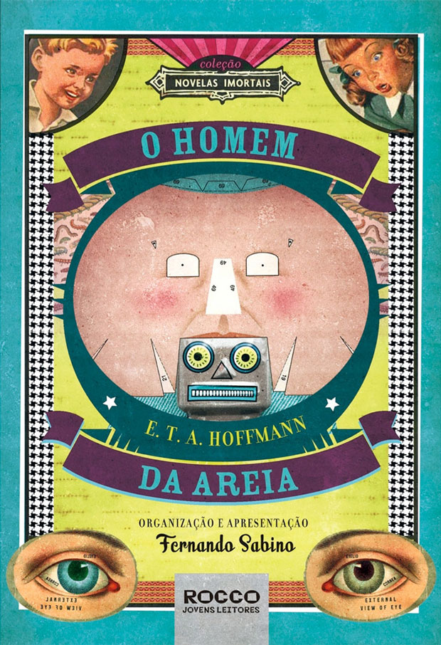
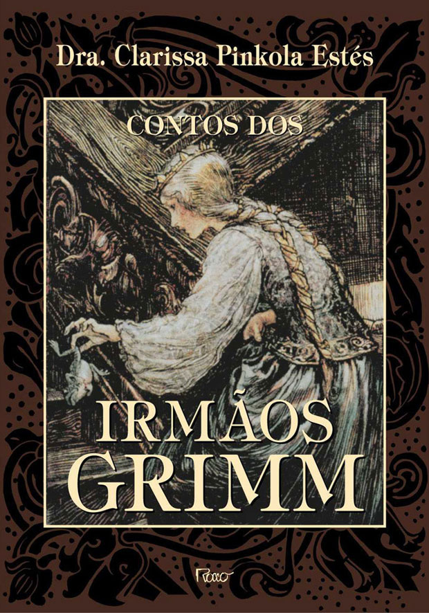
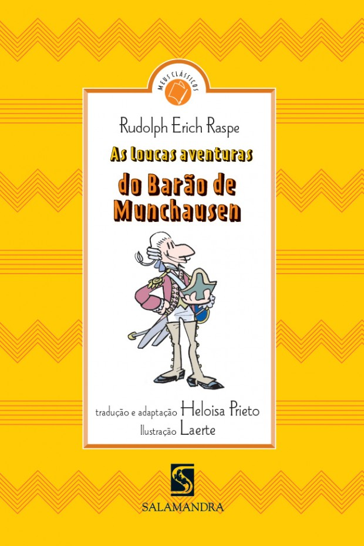
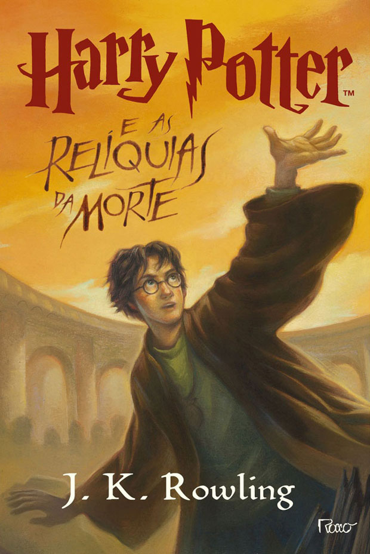
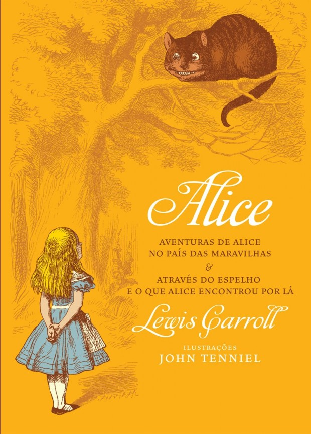

Para uma boa parte dos amantes dos livros, uma prática bastante comum ainda é visitar livrarias e passear dentro delas, conhecendo obras das mais variadas fontes e origens.  Num rápido pulo a uma livraria próxima de sua casa, é possível perceber a divisão por seções adotada pela maioria delas.

Em algumas, essa divisão é mais clara e em outras, menos, de modo que os frequentadores conseguem facilmente identificar onde podem estar os livros de suas preferências.

Com essa organização, as livrarias podem direcionar os compradores de acordo com seus campos de interesse e assim aumentar seu poder. Claro que essa não é uma prática exclusiva das livrarias, uma vez que as bibliotecas a fazem para proporcionar uma melhor identificação da posição das obras que, de outro modo, se tornariam praticamente impossíveis de serem encontradas.

De toda maneira, esse texto não é sobre organização de bibliotecas ou posição de livros nas estantes das livrarias. Hoje vamos falar sobre **livros que nos últimos anos foram rotulados de “infantis” mas que podem ser prazerosamente lidos por adultos**.

Mas por que então comecei falando sobre a divisão adotada nas livrarias?

Eu explico.

As livrarias e as editoras tentam ajustar seus catálogos para estimular os compradores de diversas formas possíveis, sendo uma delas a prática de categorizar estilos de livros diferentes. Dessa forma, as livrarias normalmente dividem seu acervo em literatura estrangeira e nacional, biografias, literatura fantástica, filosofia, sociologia e, o assunto de hoje, literatura infantojuvenil.

Acontece que essa prática ajuda bastante o lado dos vendedores e compradores, **mas cria estigmas que afastam leitores de determinados tipos de livro** por conta dos mais diversos preconceitos. É o que ocorre com a literatura infantojuvenil, que até um tempo atrás não era rotulada de tal forma e que poderia ser lido por adultos, assim como o contrário, livros de “adultos” poderiam ser lidos por adolescentes e crianças, sem nenhuma restrição.

Livros como [*Dom Quixote*](http://pt.wikipedia.org/wiki/Dom_Quixote) e [*Ilíada*](http://pt.wikipedia.org/wiki/Il%C3%ADada), apesar de seus aspectos mais densos, eram acessíveis a crianças nos séculos anteriores ao nosso e não necessitavam de adaptações, muitas vezes medíocres, para serem consumidos por pessoas mais novas.

Sendo assim, o desafio de hoje é indicar alguns livros considerados “infantis”, mas que podem ser lidos sem nenhum problema por adultos.

Separei cinco deles. Vamos lá?

### [*O homem da areia*](http://pt.wikipedia.org/wiki/O_Homem_de_Areia) (E. T. A. Hoffmann)

Típica literatura fantástica do séxulo XIX, na qual personagens e situações cotidianas da burguesia são representadas por manifestações assustadoras e diabólicas que se contrapõem ao ideal racionalista de então, propondo questionamentos sobre acreditar ou não nessas aparições.

Nesse conto de Ernst Theodor Amadeus Hoffmann, Natanael conta, por meio de cartas, ao seu amigo e cunhado Lotário uma experiência que passou na noite anterior, quando escutou uma batida na porta de seu quarto e assutou-se com a imagem de um homem idêntico a um vendedor de barômetros que conheceu quando ainda era criança.

Por conta do susto, expulsa o homem rispidamente, que sai rolando pelas escadas. Mas o problema para Natanael está no passado, ao lembrar de sua casa e de seus pais e irmãos. A figura de seu pai era bastante forte para ele, principalmente por causa do cachimbo que costumava fumar e da ordem que recebiam de vez em quando para ir dormir mais cedo, pois, caso contrário, seriam pegos pelo Homem da Areia.

Os passos pesados do visitante que o pai recebia eram causadores dos piores pesadelos da criança, que pioravam depois que a babá falava sobre a crueldade do homem da areia ao colocar as crianças dentro de sacos para leva-las como alimento para seus filhos na lua.

Esses pesadelos e medos surtiram efeitos devastadores na psique da criança e seguiram ao seu lado até a fase adulta, gerando resultados catastróficos.

Toda essa estrutura assustadora guarda um aspecto infantil, mas no fundo estimula uma reflexão bem complexa sobre as crenças que são estimuladas dentro das cabeças das crianças e que são levadas para suas fases adultas.

### [*Contos dos irmãos Grimm*](http://pt.wikipedia.org/wiki/Contos_de_Grimm) (Irmãos Grimm)

Quando pensamos em *Branca de Neve*, *Chapeuzinho Vermelho* e *Rapunzel,* a primeira coisa que vem à mente são as adaptações  animadas feitas pela Disney. Como o público-alvo dela são as crianças, os desenhos foram feitos de modo leve e singelo, guardando aquele preconceito que falamos no começo do texto e fazendo com que as pessoas não buscassem conhecer a fonte original, que são os Irmãos Grimm, já que rapidamente associavam suas histórias com uma temática infantil.

Mas engana-se aquele que considera os contos dos Irmãos Grimm infantis. Suas histórias são fortes e carregadas de simbologias herdadas do folclore alemão. Os “contos de fadas” que eles aplicaram entre os séculos XVII e XIX foram tirados de  uma identidade nacional e de uma cultura popular típicas de sua região, principalmente abastecidas pelas canções de [Brentano](http://pt.wikipedia.org/wiki/Clemens_Brentano) e de [von Arnim](http://pt.wikipedia.org/wiki/Achim_von_Arnim).

O objetivo dos irmãos era transportar a cultura oral para a escrita, de modo a transformar seus textos em uma espécie de tratado acadêmico.

Agora recomendo a leitura dos contos, principalmente aqueles que foram adaptados pelos estúdios Disney. Tenho certeza que a surpresa dos leitores será grande ao constatar a carga de suspense e mistério – e muitas vezes de horror – que os contos escritos têm.

### [*As loucas aventuras do Barão Munchhausen*](http://www.livrariasaraiva.com.br/produto/186614/as-loucas-aventuras-do-barao-de-munchausem-col-meus-classicos) (Rudolph Erich Raspe)

[Karl Freidrich Hieronyus von Münchhausen](http://pt.wikipedia.org/wiki/Bar%C3%A3o_de_M%C3%BCnchhausen) foi um militar alemão que serviu de base para uma série de histórias escritas e compiladas por Rudolph Erich Raspe em 1785. Inicialmente publicadas na Inglaterra, rapidamente ganharam o mundo. E o que tornou um militar tão interessante? Suas histórias exageradas e “mentirosas” sobre os perigos que passou durante as guerras que participou, que ele mesmo contava quando voltava, tornando-se um personagem engraçado e folclórico de sua região.

Dos relatos absurdos, os mais famosos eram a fuga de um pântano puxando os próprios cabelos, voos de canhão e uma viagem à lua.

Essas histórias foram se espalhando pela Europa, até que o bibliotecário Rudolf Raspe decidiu escrever um livro com esses e muitos outros relatos exagerados sobre o Barão Munchhhausen. E parece que foi uma boa decisão, pois o livro ainda é um clássico e chegou pela primeira vez aos cinemas em 1943 pelas mãos dos nazistas, em plena guerra, e depois recebeu uma nova adaptação em 1989 por Terry Gilliam, ex-integrante do grupo de comédia Monty Phyton.

### [Série Harry Potter](http://pt.wikipedia.org/wiki/Harry_Potter) (J. K. Rowling)

Realmente os dois primeiros livros da série não são muito desafiadores para os amantes de leituras mais complexas. Entretanto, conforme a série vai se desenvolvendo – ao todo são sete livros – a história vai se tornando mais complexa e nada infantil.

Harry Potter é uma criança no primeiro livro e ainda está se acostumando com seus novos poderes. Mas desde o princípio, ele já tem que se acostumar a lidar com magias negras e maléficas combinadas com demônios e monstros. No segundo livro e nos livros subsequentes, a trama se complica e ele vai ganhando maturidade, assim como problemas bem maiores, os quais prendem o leitor pelo drama que impõem, especialmente quando personagens importantes morrem, fazendo com que crianças e adultos se emocionem.

A série de livros Harry Potter pode até ter começado um pouco infantilizada, mas amadurece junto com o avanço de idade do personagem principal. Por conta disso, o final da série, no sétimo livro, é forte e surpreendente, levando o leitor a uma experiência fascinante.

### [Aventuras de Alice no País das Maravilhas e Através do espelho e o que Alice encontrou por lá](http://www.livrariasaraiva.com.br/produto/2868599/alice-aventuras-de-alice-no-pais-das-maravilhas-atraves-espelho-e-o-que-alice-encontrou-por-la) (Lewis Carroll)

Mais uma vez a Disney foi responsável por afastar os adultos de uma obra fenomenal. A adaptação animada feita pelo estúdio não chega nem perto da profundidade dramática que os originais têm.

O primeiro,  Alice no país das maravilhas, foi escrito em 1865, e sua continuação, em 1872. As duas obras são consideradas por alguns especialistas como representantes do gênero literário nonsense, onde a história começa quando uma menina chamada Alice cai num buraco de coelho e entra num mundo maravilhoso cheio de criaturas fantásticas.

Lá ela passa a viajar e conhece uma realidade bastante absurda para os conceitos que até então está acostumada a aceitar, como gatos que falam e chapeleiros malucos.  Essa carga de nonsense é uma característica associada aos sonhos, mas também se mistura a sátiras e paródias de poemas populares ingleses.

Agora você já sabe que muitos livros considerados infantojuvenis por bastante tempo, na verdade, podem ser facilmente lidos por adultos, já que esse rótulo é bastante recente e muitas vezes não é muito verdadeiro, o desafio é começar a lê-los.

Além desses que indiquei, podemos citar diversos outros como O pequeno príncipe, As reinações de Narizinho e Capitães de areia, que se encaixariam muito bem nessa lista.

E você? Já leu algum desses? Quer indicar outro livro “infantil” para ser lido por adultos?

[anexo ausente]  
  
  
  
[[anexo ausente]](http://da.feedsportal.com/r/195505528728/u/49/f/530922/c/32911/s/3a02cf69/sc/28/rc/2/rc.htm)  
[[anexo ausente]](http://da.feedsportal.com/r/195505528728/u/49/f/530922/c/32911/s/3a02cf69/sc/28/rc/3/rc.htm)  
  
[[anexo ausente]](http://da.feedsportal.com/r/195505528728/u/49/f/530922/c/32911/s/3a02cf69/sc/28/a2.htm)[anexo ausente]

[[anexo ausente]](http://feeds.feedburner.com/~ff/PapodehomemLifestyleMagazine?a=9R76KS5848k:dt3J2s1y4D8:yIl2AUoC8zA)  [[anexo ausente]](http://feeds.feedburner.com/~ff/PapodehomemLifestyleMagazine?a=9R76KS5848k:dt3J2s1y4D8:qj6IDK7rITs) [[anexo ausente]](http://feeds.feedburner.com/~ff/PapodehomemLifestyleMagazine?a=9R76KS5848k:dt3J2s1y4D8:-BTjWOF_DHI)

[anexo ausente]
