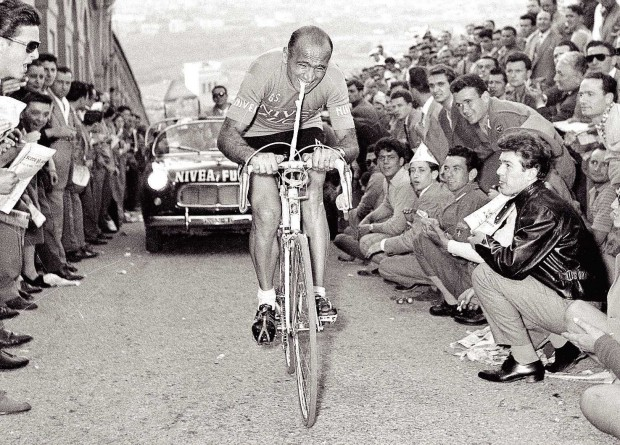
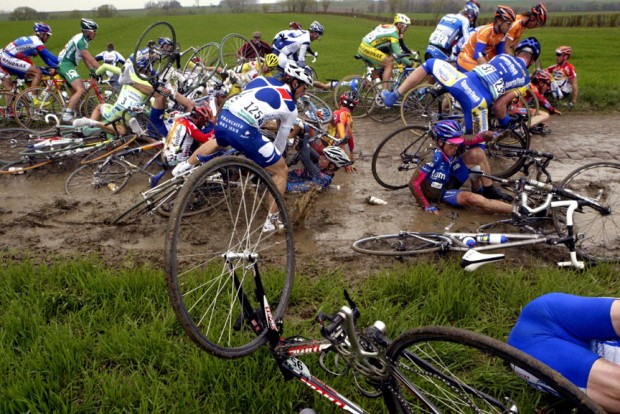
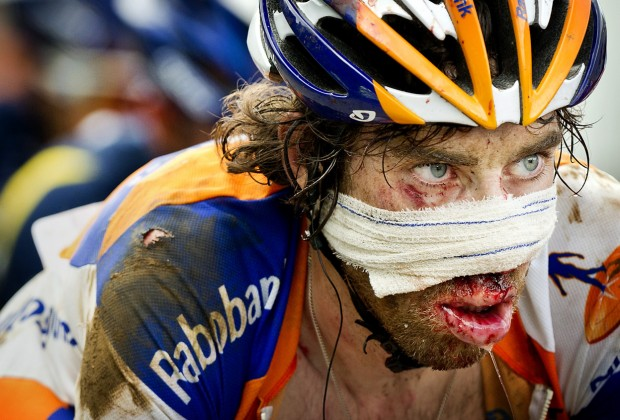
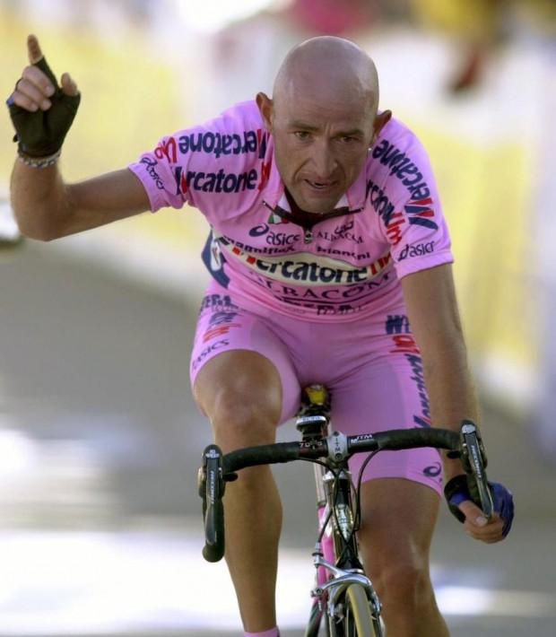
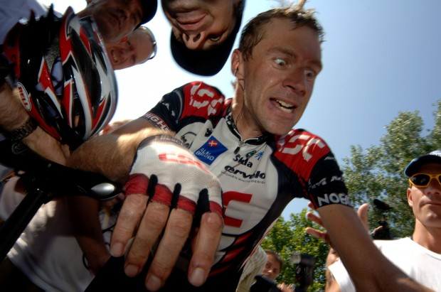
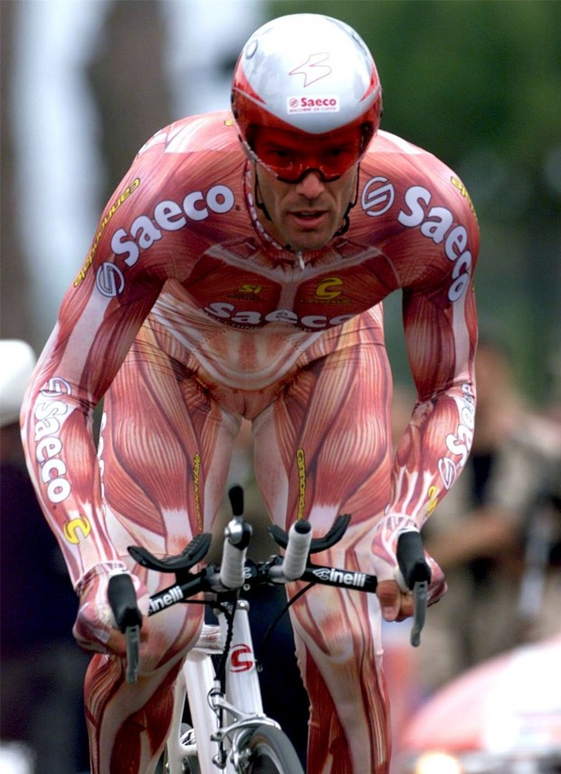
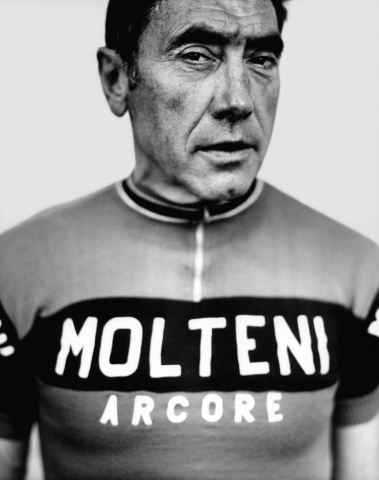
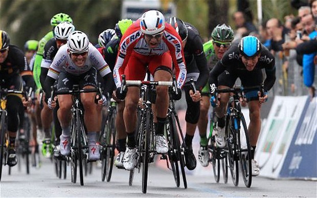
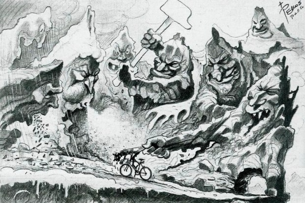

### Mitsubishi: Vida 4×4

O documentário “Vida 4×4 – 20 Anos de Paixão pelo Motorsports” celebra as duas décadas do mais tradicional rali de regularidade do Brasil.

São relatos de uma nação apaixonada, que transforma cada trilha num estilo de vida 4×4.

[Saiba mais](http://www.mitsubishimotors.com.br/wps/portal/mit/areas/mundomit/mitralis?utm_source=papodehomem_blog_contentmediabox1x1_rali_Motorsports20anos&utm_medium=MG&utm_term=papodehomem&utm_content=rali&utm_campaign=Motorsports20anos).

> “Nós continuaremos até ter sangue saindo de nossos olhos.” –Tom Danielson, da equipe Garmin-Sharp, antes do Tour de France 2013

Giro d’Italia de 1956. Na 12ª etapa, entre Grosseto e Livorno, Fiorenzo Magni, um corredor veterano em seu último ano de carreira, sofre uma queda na saída de Volterra e fratura a clavícula esquerda. Após a corrida, no hospital, disseram que ele deveria ser engessado e desistir do resto do [Giro1](#fn:giro).

Lorenzo pediu que apenas colocassem um suporte, e largou na etapa seguinte, de Livorno a Lucca. Como não tinha forças para segurar o guidão com sua mão, seu mecânico cortou um pedaço de câmara de pneu para prendê-lo. E Magni o segurou com a boca por toda a etapa.

Fiorenzo Magni na épica disputa do Giro d’Italia, de 1956. Só termina quando acaba

Três etapas depois, entre Bologna e Rapallo, Magni sofre outra queda – caindo sobre seu braço ruim e fraturando, de lambuja, o úmero. Com a dor, ele desmaiou e foi levado ao hospital. Na ambulância, retomou os sentidos e mandou que parassem imediatamente, porque precisava voltar para a corrida (quem não termina uma etapa é automaticamente eliminado das seguintes). Ele voltou e concluiu a etapa.

Na 20ª etapa, a neve caía incessantemente e 60 atletas viram-se obrigados a abandonar a prova, incluindo o então líder, detentor da *Maglia Rosa*. Magni continuou e poucos dias depois terminou seu último Giro no 2º lugar na classificação geral. Concluída a prova, engessarem-lhe o braço. E no mesmo dia ele cortou o gesso para poder voltar a treinar.

Essa história, assim como tantas outras de momentos verdadeiramente épicos e inacreditáveis, é contada e recontada incessantemente pelos amantes do esporte. O ciclismo de estrada, talvez mais do que qualquer outro, vive em permanente reverência ao passado e à historia com uma grande carga de valor colocada sobre o respeito à tradição e às lendas. Um ciclista de talento da atualidade será sempre medido pelo que conquistou em relação a seus antepassados. E as provas que importam – as Grandes Voltas, os [Monumentos2](#fn:monumentos), e poucas outras – são aquelas que acumulam décadas e décadas de feitos heroicos.

Acidentes acontecem… O circuito Paris-Roubaix é chamado Inferno do Norte. Mais de 260km de dureza, pó e lama em níveis

Um exemplo que ilustra essa reverência: todos os anos, na Toscana, malucos do mundo inteiro se reúnem para pedalar mais de 200 km em estradas de terra batida, com bicicletas anteriores a 1987 (e a maior parte usa bicicletas muito mais antigas). Os equipamentos e roupas também devem ser historicamente adequados. Agora, imagine um evento de futebol que proponha 10 ou mais horas de jogo ininterrupto num campo duro de terra com chuteiras, bola e roupas dos anos 1950 quantas pessoas apareceriam para jogar. Para L’Eroica, se faz sorteio para decidir quem pode participar. O ciclista fanático talvez seja um pouco mais fanático que os excêntricos de outros esportes.

Mas o que é, exatamente, que se venera nessas referências ao passado? E o que separa um bom ciclista de um lendário? Entre outras coisas, há dois elementos que encantam o aficionado: dureza e panache.

### Harden the Fuck Up

A frase acima, recitada como mantra por muitos, dá uma explicação da mentalidade valorizada no ciclismo. Ganha respeito quem tem mais disposição para encarar a dor e o sofrimento. Entram para o panteão dos *hardmen* aqueles que rolam barrancos e voltam para a estrada (Bernard Hinault) ou se envolvem com arame farpado e continuam na corrida, para tomar dezenas de pontos no fim do dia (Johnny Hoogerland). Valem também os inúmeros que enfrentam chuva torrencial, neve incessante, lama ou 40 graus na cabeça por horas. Por outro lado, quem desiste ao “menor sinal de dificuldade” (entre aspas, porque uma pequena dificuldade para esses caras é algo impensável para a maioria dos mortais) sai diminuído.

Lembre-se de Laurens Ten Dam, o cara que beijou o asfalto no Tour de France 2011: “Não se abandona o Tour por causa de um lábio inchado”

Essa manifestação de bruteza e de ir até o limite é tão valorizada que, muitas vezes, ela se sobrepõe até mesmo à vitória. Porque se no fim faltaram pernas ou senso tático, talvez tenha sobrado panache.

### Panache e personalidade

Melhor que vencer, é vencer bonito. E, talvez, melhor que vencer feio é perder bonito. Do [Velominati](http://rss.feedsportal.com/c/32911/f/530922/s/3a6f7dc0/sc/12/l/0Lpapodehomem0N0Bbr0Cnao0Eha0Eesporte0Ecomo0Eo0Eciclismo0C/www.velominati.com), site que venera essas tradições:

> “Panache é algo dualista: quase sem exceção, o admiramos nos outros e, quase sem exceção, somos covardes demais para o termos dentro de nós. Panache não diz respeito a caução ou à ações medidas. Diz respeito a um impulso – compulsão, talvez – de atacar, ainda que contra sua avaliação racional. É jogar a precaução no vento. Acompanha o pesado risco de explodir magnificamente e trocar as asas dos anjos pela âncora do diabo.”

Em outras palavras, vê-se panache em uma [fuga3](#fn:fuga) iniciada por um corredor contrariando o bom senso e as expectativas – por exemplo, fugindo do pelotão 130 km antes do fim da corrida, algo que dificilmente dará certo.

Mas, ainda que não dê, a ousadia e a loucura do ato capturam o torcedor, que acompanhará roendo as unhas o progressivo esgotamento de forças de quem teve ousadia e a crescente aproximação do pelotão, torcendo para que a coragem compense e o cara proporcione um momento histórico para quem pode assistir.

Claro, de vez em quando precisa dar certo, já que é a possibilidade de funcionar que cativa. Panache é estilo e beleza.

Marco Pantani, idolatrado pelo seu estilo agressivo e vistoso. Teve um fim trágico, morto por uma overdose de cocaína em 2004

Ciclistas com personalidade exuberante e estilo conquistam seguidores muito mais que aqueles que são apenas rápidos. Esse estilo se manifesta de diferentes formas. Um dos melhores exemplos hoje é o de Jens Voigt. Com 42 anos, sendo o ciclista mais velho do chamado ProTour, Voigt tem um séquito de fãs tanto por colocar fogo em corridas quanto pelo seu arsenal de frases memoráveis que usa para descrever suas longas fugas:

> “Eu sou pago para infligir pânico e terror nas outras pessoas”
>
> “Se dói em mim, deve doer o dobro nos outros”
>
> “Calem-se, pernas! Façam o que digo para fazerem”
>
> “Ter as coisas organizadas é para gente de mente pequena. O gênio controla o caos”
>
> “Eu olhava para o lado e pensava: ah, seu coitado, você não tem a menor chance, você já perdeu. Vocês todos já perderam, eu rio na cara de vocês”.

Quando perguntado por que havia iniciado uma fuga no Tour da Califórnia, a etapa que ele acabou vencendo, respondeu:

> “Para criar caos e confusão – isso não é uma razão boa o suficiente?”

Jens é gênio. E meio maluco, como a cara dele demonstra.

Se uns ganham fãs pela insanidade, outros ganham pela extravagância – e o ícone dessa *flamboyance* talvez seja Mario Cipollini. Um dos maiores [sprinters4](#fn:sprinters) de todos os tempos, dominando as chegadas de provas planas nos anos 1990 e primeira metade dos anos 2000, o italiano metido a galã exigia atenção e sempre a conseguia.

Suas roupas bizarras e contrárias ao regulamento são antológicas, assim como seu hábito de abandonar as Grandes Voltas quando começavam as etapas de montanha (como era especialista em percursos planos, achava inútil seguir até o fim). Nesses abandonos, por mais de uma vez publicou fotos relaxando na praia enquanto os demais ciclistas se matavam em etapas duríssimas nos Alpes e Pirineus.

Essas atitudes deixavam os organizadores furiosos e levaram até a seu banimento pelos organizadores do Tour de France entre 2000 e 2003. Mas, para os fãs, era um deleite.

Cipollini, um italiano que gosta de aparecer

Quando o ciclista alia força, disposição a sofrer e personalidade marcante, é provável que se converta num ídolo. Os grandes da história são vários: Coppi, [Bartali5](#fn:bartali), Gimondi, Anquetil, Hinault, Indurain e muitos outros.

Mas se o surfe tem Kelly Slater e o futebol tem Pelé, o ciclismo também tem seu rei: Eddy Merckx.

### O Canibal

Eddy Merckx é o maior ciclista de todos os tempos e dificilmente surgirá alguém para ganhar o que ele ganhou. O cara ganhou tudo. E várias vezes – 5 Tour de France, 5 Giro D’Italia, uma Vuelta a España, 3 Paris-Roubaix, 3 Liège-Bastogne-Liège, 7 Milano-San Remo, 3 vezes o campeonato mundial…  Merckx também foi detentor do recorde da hora (maior distância percorrida em uma hora em um velódromo) e levou literalmente centenas de outras corridas importantes, totalizando 525 vitórias.

O belga tinha como traço característico sempre atacar e não desprezar nem a menor vitória – é do tipo que deve competir até em campeonato de cuspe a distância –, o que lhe valeu a alcunha de “O Canibal”. Seu domínio era tão grande quem em 1973, após seu quarto título consecutivo no Tour, os organizadores pediram que ele não corresse, para trazer emoção de volta ao evento.

Merckx ainda pode te fazer chorar como uma criança abandonada

Merckx é uma quase divindade no mundo do ciclismo e o dono extra-oficial da Bélgica, uma soma de Pelé e Senna para a nação mais fanática do ciclismo. Suas vitórias se basearam em sua absurda força bruta e gana, mas muitas vezes contando com o apoio de seus membros de equipe, elemento essencial do esporte.

### Coletivo x Individual

O ciclismo de estrada é um esporte coletivo, mas com um enorme componente individual, uma espécie de ornitorrinco dos esportes. Uma equipe trabalha em conjunto pela vitória de um indivíduo. Numa Grande Volta, se o líder da equipe for um concorrente sério à classificação individual geral, todos trabalharão para protegê-lo das intempéries do pelotão e permitir que ele desfira seus ataques nos momentos certos ao longo de três semanas. Em uma corrida que termine em um sprint, a equipe formará um “trem” para carregar seu melhor sprinter para o momento exato de seu esforço final. A glória maior é de quem ganha, mas todos sabem que o mérito também é da equipe que colocou o vencedor no ponto exato.

No vídeo abaixo, temos o final da última etapa do Tour de France de 2013, com os sprinters chegando na Champs-Elysées.

Veja no vídeo abaixo a velocidade frenética, como cada equipe tenta lançar seu sprinter mais explosivo, e a batalha final entre os mais fortes.

[Link YouTube](https://www.youtube.com/watch?v=0mV6YztZwb4)

A interação entre diferentes equipes trabalhando para seus líderes leva a táticas e estratégias altamente complexas, que variam de acordo com as características da prova e seu desenrolar. Equipes rivais podem se aliar para neutralizar uma terceira, para em seguida disputar entre si a vitória final. Membros de 3, 5 ou 10 equipes diferentes isolados em uma fuga podem trabalhar em conjunto contra o resto do pelotão para tentar chegar ao final e decidir lá quem leva uma determinada etapa – e talvez um deles não queira trabalhar, já que pode estar ali para ajudar algum outro membro de sua equipe que ficou para trás e que luta pela vitória.

Pode ser meio confuso, eu sei. Muitas vezes é um verdadeiro xadrez entre os Diretores Esportivos de cada equipe, que seguem o pelotão nos carros de apoio dando orientações a seus atletas pelo rádio. Mas basta assistir a algumas provas para começar a entender que o esporte pode ser imprevisível e te deixar sem a menor ideia de como uma corrida acabará.

Independentemente do que aconteça, uma coisa é certa: os caras estão sempre no limite, dosando sua força para chegar ao final e não estourar antes.

Final da Milano-San Remo deste ano. As caras denunciam que não tinha ninguém tranquilo ali.

### Fugindo do Homem com o Martelo

Melhor não, certo?

Seja seu objetivo um mero pedal mais longo ou ganhar uma etapa no Tour de France, o medo de quebrar está sempre presente no fundo da mente. Você quer ir o mais rápido que puder, mas sem fundir o motor no meio. No entanto, se você quer fazer força de verdade, algo é inexorável: o sofrimento faz parte da experiência.

Greg LeMond, três vezes campeão do Tour de France, disse certa vez que “Não fica mais fácil, você só vai mais rápido”, e isso fornece uma pista do grau de respeito que um amador entusiasta tem pelos membros do ProTour: sabemos que eles, assim como nós em nossos modestos treinos, estão comendo o pão que o diabo amassou, mas indo duas ou três vezes mais rápido do que nós iríamos.

Independentemente da velocidade de cada um, quem pedala com frequência um dia irá se encontrar com o Homem com o Martelo.

De novo, do Velominati:

> “Ele é um homem que espreita num canto qualquer e que inesperadamente te acertará com seu martelo. Ele te levará de rodando seus pedais com suavidade para pedalando em quadrados e em marcha ré. O Homem com o Martelo ataca quando a sua mente exige mais das suas pernas do que o seu corpo pode fornecer.”

Em resumo, é uma desgraça, como quem já o encontrou sabe. Um passeio divertido se torna uma *via crucis* horrorosa até a volta para casa. A super força que você sentia há alguns minutos parece coisa de outra encarnação, suas pernas viraram spaghetti, o pulmão queima e não dá. Não é isso que queremos. Claro que vamos fazer força e sofrer, mas quando tudo se encaixa e você chega do outro lado, o esforço pode ser verdadeiramente revelador.

### La Volupté e estados de consciência

Se o ciclismo fosse só sofrimento, seríamos todos apenas um bando de masoquistas. Mas a verdade é que, de vez em quando, mesmo num esforço gigantesco, tudo se torna extremamente prazeroso e claro. Alguns chamam isso de *la volupté* (voluptuosidade em francês, o prazer intenso dos sentidos) e pode ser descrito como a sensação de integração entre o ciclista, a bicicleta, o ato de pedalar e o ambiente, o que resulta numa sensação difícil de descrever.

Para mim, essa sensação é extremamente interessante e remete ao que ensino aos meus alunos do Método DeRose a respeito da meditação, que consiste na parada das ondas mentais, na junção entre o observador, o objeto observado e o ato de observar. Estados especiais de consciência podem ser atingidos com diferentes [técnicas respiratórias](http://papodehomem.com.br/a-transformacao-do-individuo-tecnicas-respiratorias-do-metodo-derose/) ou com longas permanências em técnicas corporais que trabalham com isometria, desde que feitas com a intenção e orientação corretas.

Da mesma forma, sobre a bicicleta, totalmente concentrada no presente momento, com a respiração ritmada e o corpo físico trabalhando intensamente, a mente pode simplesmente parar de funcionar no turbilhão em que normalmente funciona e aquietar-se, abrindo espaço para o desabrochar de algo mais profundo. Quando chegamos nesse estado, tudo é feito da melhor maneira possível, com a intuição mais aguçada.

Talvez o maior mal moderno seja a falta de autoconhecimento. Poucos vão fundo na exploração do que temos em nosso interior. Mal conhecemos nossos corpos, nos confundimos com nossas emoções e pensamentos e achamos que somos nossos cargos, nossas carreiras, nossos famílias, nossos papéis na sociedade. Vivemos com a cabeça para lá e para cá, sem vivenciar o aqui e o agora. E vamos atravessando a vida sem saber bem o porquê, sem observar melhor o que está subjacente.

Quando realizo minhas práticas do Método, isso muda – e ao pedalar também. A simplicidade é reveladora. Há apenas você, a bicicleta e a estrada, e essa liberdade proporciona um profundo autoconhecimento caso você tenha capacidade de observação. Você entende melhor o seu corpo e as emoções e pensamentos que surgem. E chega ao final de um pedal transformado.

No caminho, você verá montanhas, florestas e rios. Enfrentará chuva, sol, frio e calor. Sentirá a adrenalina de quase cair e se recuperar e o alívio e orgulho de chegar ao topo de um colosso de rocha. Criará laços inquebrantáveis com seus companheiros de sofrimento e alegria. Acordará em horários absurdos para fugir dos carros, mas depois terá o sono dos justos. Perceberá seu corpo se transformando, ficando mais forte e leve. Talvez desenvolva uma obsessão por ficar mais leve, para não ter que carregar peso montanha acima. Entenderá na pele que o vento pode ser meu melhor amigo ou pior inimigo. Fingirá entender de mecânica e discutirá estratégias de corrida como se fosse autoridade no assunto. E contará quilômetros e quilômetros em que você realmente viu o mundo à sua volta.

Não há esporte como o ciclismo.

### Dicas Práticas

**Para começar:** basta comprar uma bicicleta de estrada. Não precisa ser cara nem top linha – quem faz força é o ciclista. Mesmo bicicletas antigas com boa manutenção podem ser uma boa para quem está começando. Compre também um bom capacete, e não vá nem até a esquina sem ele. Outros equipamentos importantes são luvas para proteger as mãos em caso de queda, bermuda com preenchimento, camiseta adequada e sapatilhas, caso você queira pedalar com pedais de encaixe.

**Para aprender:** há uma curva de aprendizado que deve ser observada. A sensação e a posição numa bicicleta de estrada são bem diferentes daquelas de uma mountain bike ou bicicleta de passeio. Procure em sua cidade uma assessoria esportiva ou equipe amadora de ciclismo, para que lhe ensinem algo de técnica e acompanhem sua evolução. Eu treino com a [Walter Tuche Assessoria Esportiva no Rio de Janeiro](http://www.waltertuche.com.br/site/?page_id=22) e a recomendo para quem é daqui. Caso você não tenha condições ou na sua cidade não haja um grupo assim, procure tutoriais na internet e aproveite para treinar seu inglês. O [Global Cycling Network](http://www.globalcyclingnetwork.com/) é um ótimo ponto de partida, e tem diversos vídeos didáticos na seção “[How To](http://www.globalcyclingnetwork.com/category/videos/sec-how-to/)”.

**Desafios:** estabeleça um desafio pessoal – é ele que dará o impulso para que você se supere. Seja subir um morro, uma serra, percorrer determinada distância ou participar de uma prova. Há diversas provas para amadores no Brasil e no exterior, incluindo os chamados Granfondos, provas longas de um dia que reúnem milhares de pessoas.

### Leia e veja vídeos

Material sobre ciclismo não falta – há diversos sites e revistas no Brasil e no exterior para te deixar mais familiarizado com o esporte. Em português, gosto muito do [Pedaladas](http://blogs.jovempan.uol.com.br/pedaladas/). Em inglês, o melhor é o [Inner Ring](http://inrng.com/), uma verdadeira mina de ouro para entender o ciclismo profissional.

### Assista competições

O Giro d’Italia começa em 9 de maio e vai até 31 de maio e é uma boa oportunidade para você começar a entender como funciona uma corrida. Ele terá transmissão direta pela RAI, mas pode ser acompanhado também em sites como o [steephill.tv](http://www.steephill.tv/). Isso vai te preparar para o [Tour de France](http://www.letour.fr/us/), que começa em 5 de julho.

### Glossário ciclístico

[1. As Grandes Voltas](#giro) – Giro, Tour de France e Vuelta a España – tem pouco mais de 20 etapas de esforço num nível sobre-humano. Chris Boardman, medalha de ouro no ciclismo de pista em Barcelona e que migrou para a estrada, disse sobre o Tour de France: “*É o único evento esportivo no mundo em que, na metade, você precisa cortar seu cabelo*.”

[2. Os cinco monumentos](#monumentos) são as corridas de um dia mais prestigiosas do calendário: Milano-San Remo, Tour de Flandres, Paris-Roubaix, Liège-Bastogne-Liège e Il Lombardia. Provas duríssimas com distâncias entre 250km e 300km.

[3. Uma prova normal na estrada começa com o pelotão de ciclistas junto.](#fuga) Em geral, pequemos grupos tentam acelerar o ritmo para se distanciar do grupo, por motivos estratégicos ou numa uma tentativa de manter-se longe o suficiente para conseguir de fato vencer a prova. Em boa parte das vezes, o ataque acaba sendo engolido pelo pelotão antes que possa chegar ao final. Ao pedalar num grupo pequeno ou sozinho, o ciclista se cansa muito mais do que num grupo grande, já que enfrenta a resistência do ar sem o vácuo proporcionado por um grupo maior. Por isso, estabelecer e manter uma fuga exigem grande força dos participantes.

[4. Cada ciclista tem sua especialidade.](#sprinters) Sprinters são os que tem grande poder de aceleração em um curto percurso plano, e dominam as provas com pouca elevação que terminam com o pelotão embolado. Escaladores são os magrinhos que sobem bem as montanhas, e costumam ganhar as Grandes Voltas. Rouleurs são ciclistas mais pesados, capazes de manter uma velocidade alta em longos percursos mais planos. Há ciclistas que combinam algumas dessas características, como rodar bem no plano mas conseguir uma boa aceleração em pequenas subidas, por exemplo. Cada tipo de prova é mais adequado para um ou outro tipo de ciclista.

[5. Gino Bartali](#bartali), campeão do Tour de France em 1938 e 1948, tem uma biografia que vale a leitura: “[O Leão da Toscana](http://www.livrariasaraiva.com.br/produto/4265808/o-leao-da-toscana)” conta como ele se aproveitou de seu status de ídolo nacional para, durante a guerra, transportar no quadro de sua bicicleta documentos que ajudaram a salvar milhares de judeus do jugo nazista.
