Com ou sem Copa do Mundo, existem muitos brasileiros que querem, independente dos motivos (social, financeiro, pessoal), dar o fora do Brasil. Ou, sendo bem menos dramático, muita gente quer apenas conhecer novos lugares e tentar a vida em culturas diferentes, novos ares, outros mares, sabe?

Para fazer uma nova jornada em  outras terras, importante é perceber o que outras nações podem oferecer de bom. Se a sua ideia é fazer as malas e partir de vez, tem que pensar, então, nos quesitos que contam a longo prazo. O HSBC fez, em 2013, uma pesquisa com 7.000 expatriados (pessoas que moram e trabalham fora de seus países de origem) para classificar os melhores destinos para uma nova pátria de acordo com três critérios: economia, experiência e lugar para criar os filhos.

A pesquisa, [The annual Expat Explorer Survey](http://www.expatexplorer.hsbc.com/), levou em conta uma série de itens para formar essa tríade decisiva. A nota de economia envolvia salário, rendimentos disponíveis (salário total menos os impostos locais) e o nível de satisfação com o trabalho local. Já a experiência precisou de 29 itens compostos, como chance de fazer amigos, cultura local, qualidade do transporte, oferta de cultura e entretenimento e acesso à saúde. Para fechar, a criação de filhos passou por acesso à escolas e hospitais de qualidade.

Alguns países não entraram na lista por conta de dados insuficientes, como a Suíça, que liderou de longe o quesito economia, mas não tinha informações para formar a nota de criação dos filhos, assim como Brasil, Argentina, Índia e Japão. A Tailândia, que também ficou de fora, foi a mais citada quando o assunto é gastar pouco.

No geral, parece que a melhor ideia é decidir se mudar para a Ásia, continente com mais países na lista.

### 24. Irlanda

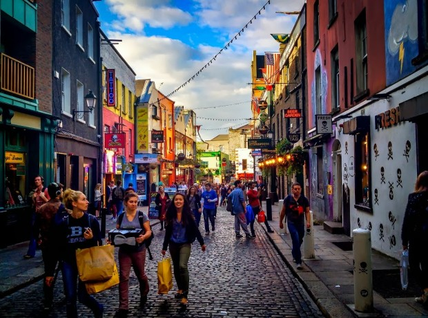

Dublin

- Economia: 36º
- Experiência: 30º
- Criação dos filhos: 24º

Um dos países europeus com crescimento mais rápido após a crise de 2008, [ganhando até o apelido de Tigre Celta](http://pt.wikipedia.org/wiki/Economias_tigre).

### 23. Itália

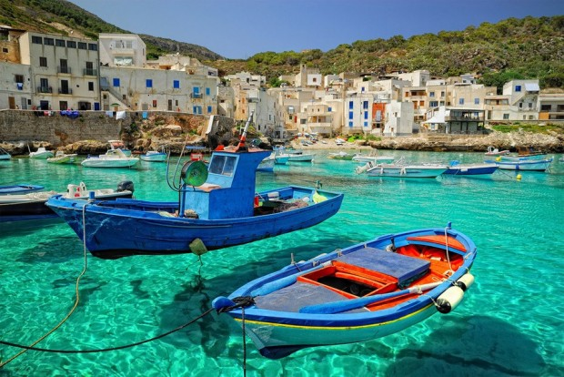

Ilha Levanzo, oeste da Sicília

- Economia: 37º
- Experiência: 28º
- Criação dos filhos: 17º

É um destino tradicional, [mas fica complicado no quesito emprego](http://economia.uol.com.br/noticias/redacao/2013/10/27/cerca-de-60-dos-jovens-italianos-dizem-que-serao-mais-pobres-que-seus-pais.htm). Quem consegue pode se considerar um sortudo.

### 22. Reino Unido

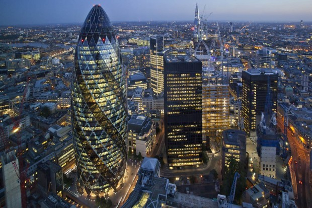

Londres

- Economia: 32º
- Experiência: 27º
- Criação dos filhos: 19º

O Reino Unido está bem melhor que a Itália e Espanha com a questão do emprego, [mas tem o custo de vida mais alto do mundo](http://super.abril.com.br/blogs/superlistas/10-cidades-mais-caras-do-mundo/), sem contar o mau tempo que, para brasileiro, pode ser tragédia ou solução.

### 21. Kuwait

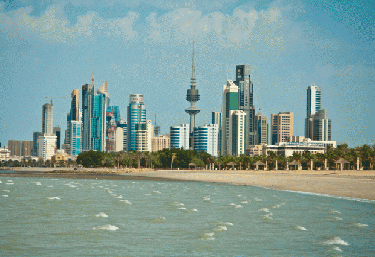

A capital do Kuwait é a Cidade do Kuwait

- Economia: 26º
- Experiência: 34º
- Criação dos filhos: 18º

O que não falta no Kuwait é estrangeiro. Mais da metade dos habitantes do país não nasceram lá e [a migração é a terceira maior do mundo](http://pt.wikipedia.org/wiki/Demografia_do_Kuwait).

### 20. Espanha

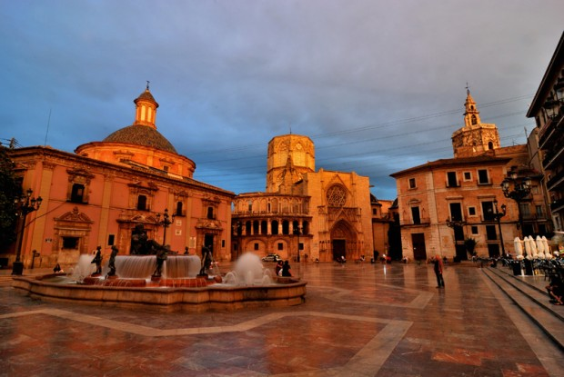

Valência

- Economia: 34º
- Experiência: 34º
- Criação dos filhos: 9º

Um dos países que mais sofreu com a crise de 2008 e que ainda tem poucas oportunidades de emprego. O custo de vida não é dos mais altos, mas conseguir trabalho é que é o difícil.

### 19. Arábia Saudita

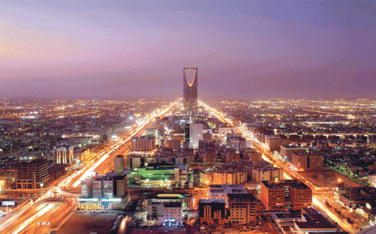

Riade

- Economia: 15º
- Experiência: 37º
- Criação dos filhos: 22

Um país que possui a segunda maior reserva de petróleo ([sendo o maior exportador mundial](http://economia.estadao.com.br/noticias/geral,arabia-saudita-aumenta-levemente-producao-de-petroleo-em-dezembro,174808e)) e a sexta de gás natural certamente vai gerar uma grande procura por emprego.

### 18. Holanda

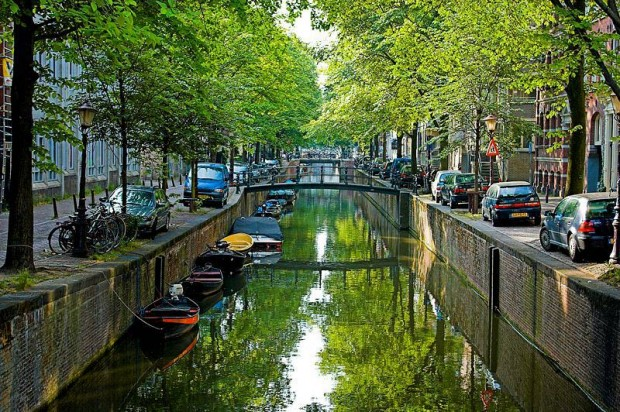

Amsterdã

- Economia: 28º
- Experiência: 33º
- Criação dos filhos: 14º

Holanda tem [a quarta melhor qualidade de vida do mundo](http://g1.globo.com/mundo/noticia/2014/04/brasil-fica-em-46-lugar-em-novo-indice-que-mede-qualidade-de-vida.html). Isso por si só explica muita coisa da procura de um outro país para se morar.

### 17. França

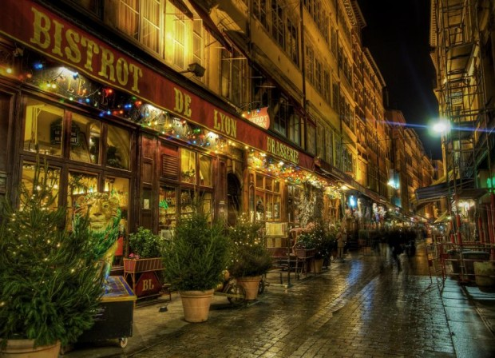

Lyon

- Economia: 33º
- Experiência: 21º
- Criação dos filhos: 3º

Falar francês é metade do caminho para conseguir emprego no país que também é destino tradicional imaginado.

### 16. México

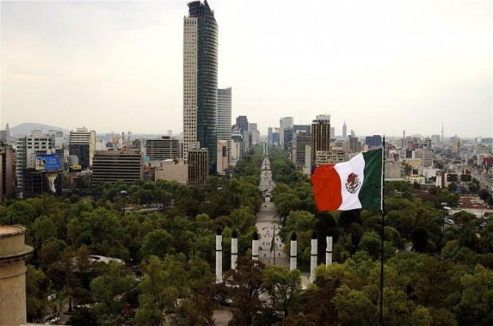

Cidade do México

- Economia: 22º
- Experiência: 17º
- Criação dos filhos: 20º

O México é um país cheio de problemas com violência, mas tem muitas qualidades que encantam. A apropriação dos espaços públicos (o que não falta por lá são praças e todas tomadas de gente) é uma delas. Estando nos lugares certos, a experiência de se viver no México pode ser bem proveitosa.

### 15. África do Sul

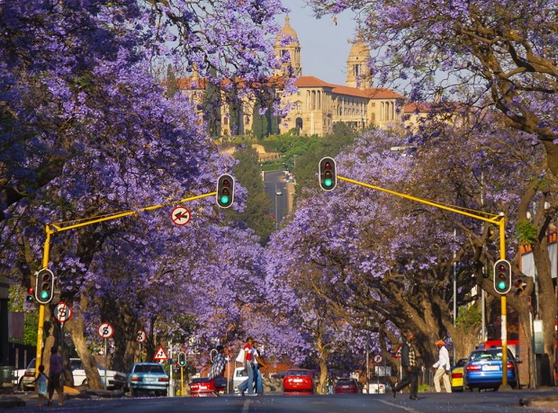

Pretória

- Economia: 30º
- Experiência: 14º
- Criação dos filhos: 5º

Baixo custo de vida, cultura diversificada e falta de mão-de-obra qualificada. Muita gente vai para a África do Sul, mesmo com a alta criminalidade conhecida, para ganhar bem e gastar pouco.

### 14. Nova Zelândia

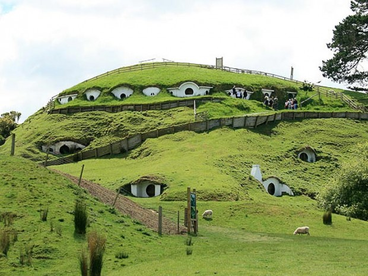

Matamata, onde foi filmado “O Senhor dos Anéis”

- Economia: 29º
- Experiência: 18º
- Criação dos filhos: 4º

Aquelas paisagens de filme, aquela promessa de surfar e esquiar no mesmo dia, fora o fato maravilhoso de estar isolado do resto do mundo. [Tirando os terremotos](http://g1.globo.com/mundo/noticia/2014/01/terremoto-de-63-graus-atinge-regiao-norte-da-nova-zelandia.html), parece que a Nova Zelândia é, sim, um bom lugar pra se viver.

### 13. Catar

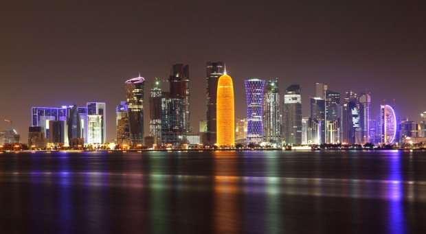

Doha

- Economia: 3º
- Experiência: 29º
- Criação dos filhos: 23º

[O país tem a maior renda per capta do mundo](http://www1.folha.uol.com.br/fsp/mundo/115947-emir-do-qatar-confirma-sucessao-em-pronunciamento-na-televisao.shtml) e não haveria como ser diferente que pessoas corram para lá atrás de um pedacinho dessa grana toda.

### 12. Estados Unidos

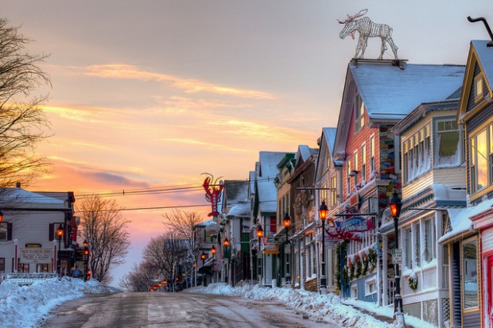

Maine

- Economia: 23º
- Experiência: 23º
- Criação dos filhos: 12º

O sonho americano, reza a lenda, ainda está lá, [junto com a maior população de imigrantes do mundo](http://operamundi.uol.com.br/conteudo/noticias/31162/eua+sao+pais+com+maior+numero+de+imigrantes+mostra+estudo+da+onu.shtml), com quase de 50 milhões de europeus, latino-americanos e asiáticos das mais diversas nacionalidades.

### 11. Turquia

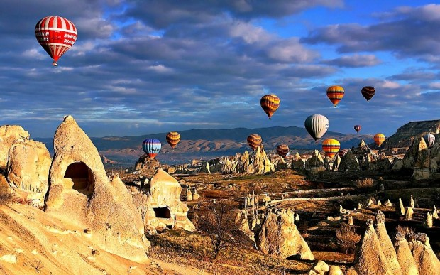

Capadócia

- Economia: 10º
- Experiência: 22º
- Criação dos filhos: 21º

Depois do sucesso da novela…

Mentira. [Ainda pleiteando seu lugar dentro da União Europeia](http://www1.folha.uol.com.br/fsp/mundo/115945-uniao-europeia-adia-a-adesao-da-turquia.shtml), a Turquia tem um custo de vida relativamente baixo na Europa.

### 10. Hong Kong

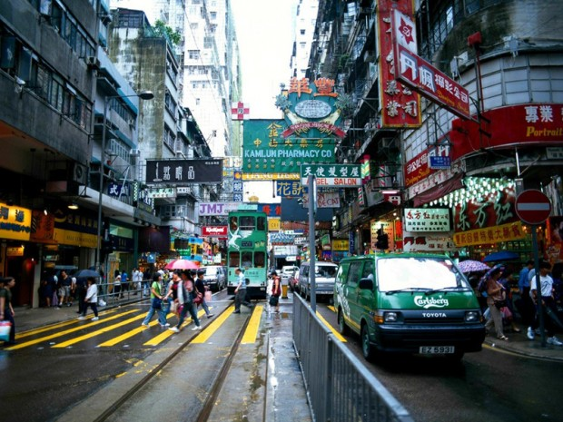

A Cidade-Estado administrada pela China

- Economia: 19º
- Experiência: 25º
- Criação dos filhos: 11º

[Hong Kong](http://pt.wikipedia.org/wiki/Hong_Kong) tem uma economia poderosa, [mas está entre os custos de vida mais caros da Ásia](http://www.360meridianos.com/2012/08/dicas-viagem-hong-kong.html). Mas sua infraestrutura (saúde e transporte, por exemplo) são ótimos.

### 09. Emirados Árabes

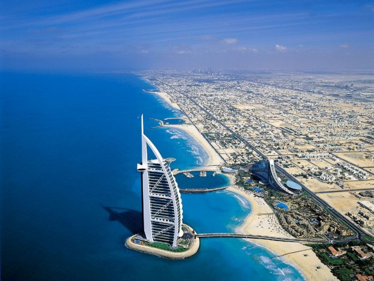

Dubai

- Economia: 16º
- Experiência: 26º
- Criação dos filhos: 13º

Além do luxo evidente e das obras faraônicas, um exemplo bom de se ouvir (no caso, ler): [em Dubai não há imposto sobre renda ou lucro](http://exame.abril.com.br/rede-de-blogs/blog-do-mark-mobius/2014/01/31/emirados-arabes-unidos-um-caldeirao-de-diferentes-culturas-dentre-os-mercados-emergentes/).

### 08. Bélgica

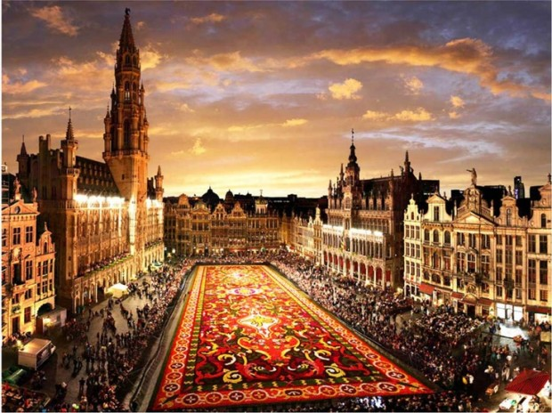

Bruxelas

- Economia: 25º
- Experiência: 19º
- Criação dos filhos: 6º

Alto padrão de vida, sede da União Europeia e da [OTAN](http://www.nato.int/), e fincada no coração da Europa. Vai atrair, sempre, pessoas que queiram viver lá.

### 07. Rússia

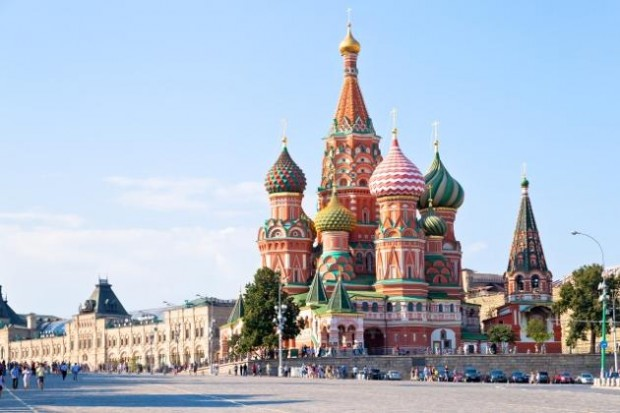

Moscou

- Economia: 20º
- Experiência: 12º
- Criação dos filhos: 10º

Quando ouvimos falar em Rússia, logo imaginamos o frio dos diabos, a barreira da língua, a máfia, o [Vladimir Putin](http://pt.wikipedia.org/wiki/Vladimir_Putin). Mas, de acordo com a pesquisa, quem vai pra lá gosta muito do que encontra.

### 6. Canadá

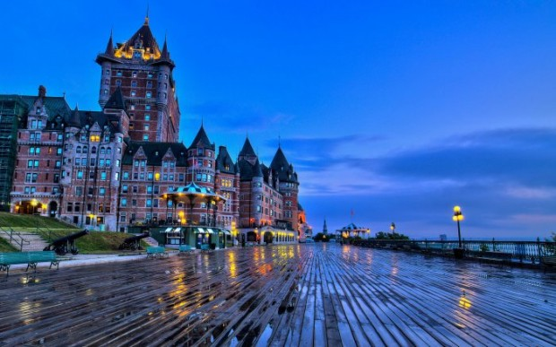

Quebec

- Economia: 18º
- Experiência: 16º
- Criação dos filhos: 8º

Em qualquer pesquisa de [qualidade de vida](http://pt.wikipedia.org/wiki/%C3%8Dndice_de_Qualidade_de_Vida) e [desenvolvimento humano](http://pt.wikipedia.org/wiki/Anexo:Lista_de_pa%C3%ADses_por_%C3%8Dndice_de_Desenvolvimento_Humano) e [bem estar](http://g1.globo.com/mundo/noticia/2014/04/brasil-fica-em-46-lugar-em-novo-indice-que-mede-qualidade-de-vida.html) você encontrará o Canadá no meio. [O que não falta é piadinha](http://www.buzzfeed.com/tanyachen/delightful-facts-about-canada) com a hospitalidade e tranquilidade e delicadeza desse país.

### 5. Austrália

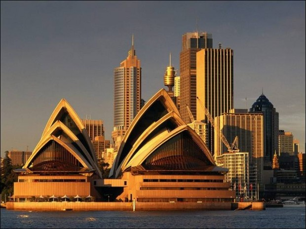

Sidney

- Economia: 17º
- Experiência: 5º
- Criação dos filhos: 7º

Dizem que [a Austrália é o “Brasil que deu certo”](http://exame.abril.com.br/revista-exame/edicoes/0705/noticias/onde-foi-que-erramos-m0048476). O clima, a posição no globo terrestre, a história de colonização. O fato é que o país dos cangurus é destino preferido dos brasileiros. Pare e pense quantas vezes você falou ou ouviu conversas que começam com “eu tenho um amigo que foi morar na Austrália e…”.

### 4. Ilhas Cayman

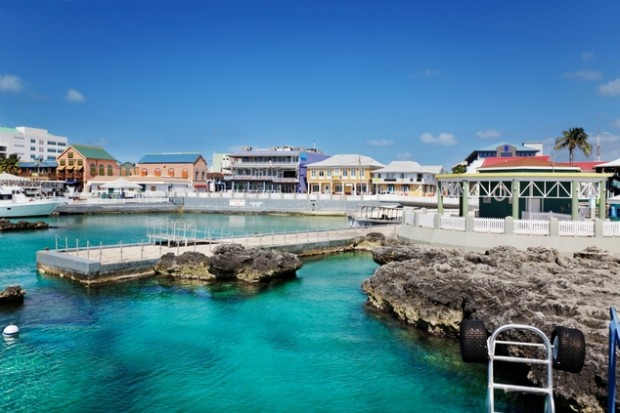

George Town

- Economia: 5º
- Experiência: 4º
- Criação dos filhos: 15º

[As Ilhas Cayman](http://pt.wikipedia.org/wiki/Ilhas_Cayman) são um território britânico no Caribe, entre Cuba e Jamaica. Só isso.

### 3. Cingapura

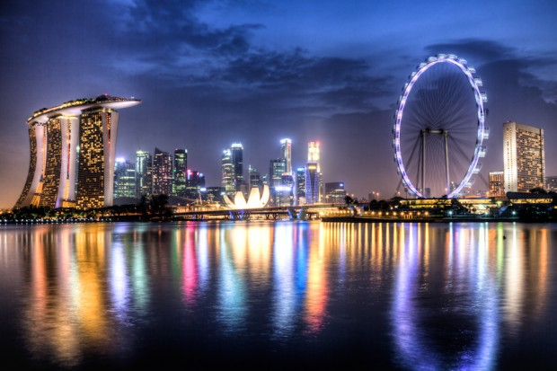

A Cidade-Estado do sudeste asiático

- Economia: 9º
- Experiência: 6º
- Criação dos filhos: 2º

Cheio de estrangeiros com a guinada econômica de lá, Cingapura pode ser uma ótima pedida. Curioso é que [o chiclete é proibido no país](http://globoreporter.globo.com/Globoreporter/0,19125,VGC0-2703-13-1-477,00.html), mas, se você não gosta do doce, então tudo ok.

### 2. Alemanha

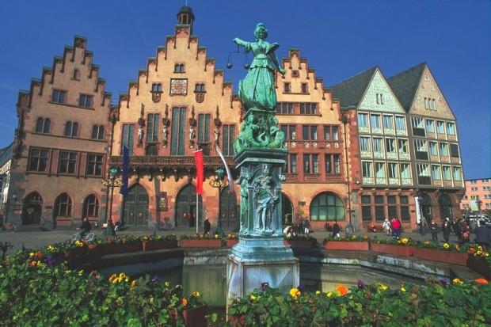

Frankfurt

- Economia: 7º
- Experiência: 11º
- Criação dos filhos: 1º

Perdeu duas guerras mundiais, perdeu para o Brasil na Copa do Mundo de 2002 e, mesmo assim, se reergueu em todas as vezes e é, mesmo depois da crise na Europa, [um país forte de economia robusta](http://economia.ig.com.br/depois-da-crise-alemanha-volta-a-ser-o-motor-da-europa/n1237776198648.html) e lugar onde qualquer pessoa desse mundo gostaria de morar.

### 1. China

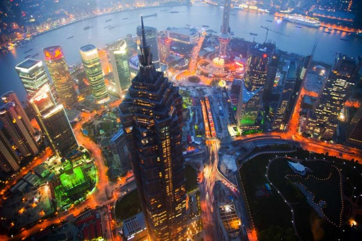

Xangai

- Economia: 2º
- Experiência: 3º
- Criação dos filhos: 16º

A bola da vez é a China [e seu crescimento econômico absurdo](http://g1.globo.com/economia/noticia/2014/04/crescimento-economico-da-china-cai-para-74-no-primeiro-trimestre.html). Na nota, o que pesa bastante é a criação dos filhos, provavelmente pelo regime maluco da republica popular.

[anexo ausente]  
  
  
  
[[anexo ausente]](http://da.feedsportal.com/r/199119506551/u/49/f/530922/c/32911/s/3b7fb8ac/sc/19/rc/2/rc.htm)  
[[anexo ausente]](http://da.feedsportal.com/r/199119506551/u/49/f/530922/c/32911/s/3b7fb8ac/sc/19/rc/3/rc.htm)  
  
[[anexo ausente]](http://da.feedsportal.com/r/199119506551/u/49/f/530922/c/32911/s/3b7fb8ac/sc/19/a2.htm)[anexo ausente]

[[anexo ausente]](http://feeds.feedburner.com/~ff/PapodehomemLifestyleMagazine?a=QDp7dByiVDQ:CXdKeNPlEgk:yIl2AUoC8zA) [[anexo ausente]](http://feeds.feedburner.com/~ff/PapodehomemLifestyleMagazine?a=QDp7dByiVDQ:CXdKeNPlEgk:D7DqB2pKExk) [[anexo ausente]](http://feeds.feedburner.com/~ff/PapodehomemLifestyleMagazine?a=QDp7dByiVDQ:CXdKeNPlEgk:qj6IDK7rITs) [[anexo ausente]](http://feeds.feedburner.com/~ff/PapodehomemLifestyleMagazine?a=QDp7dByiVDQ:CXdKeNPlEgk:-BTjWOF_DHI)

[anexo ausente]
