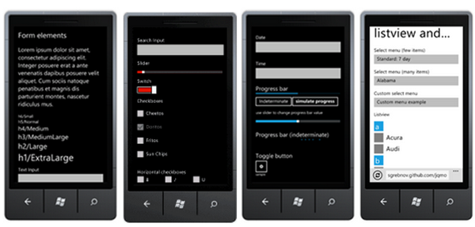
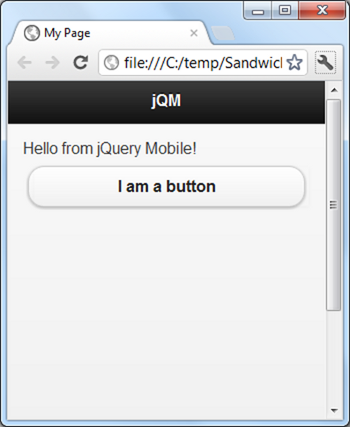
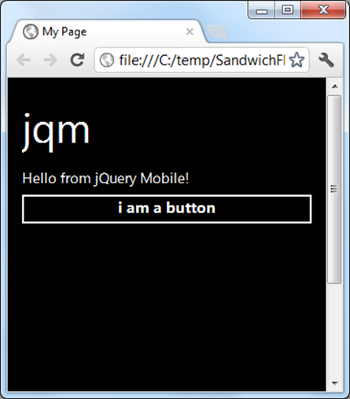
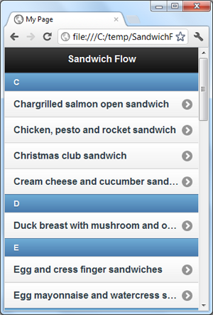
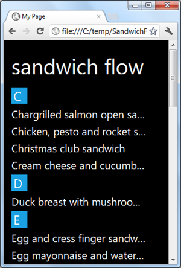
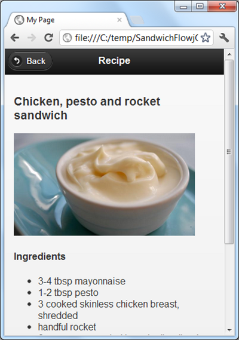
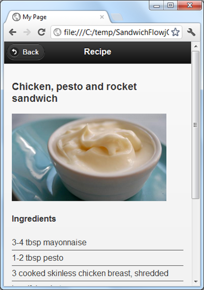
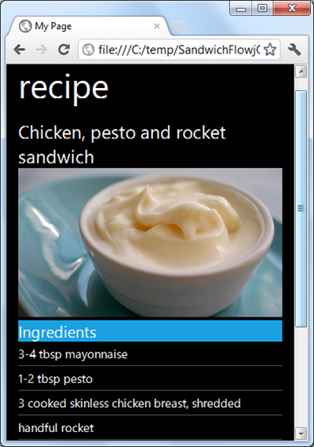

# Introducing the jQuery Mobile Metro Theme

[Colin Eberhardt](http://www.scottlogic.com/blog/ceberhardt)

A coding addict, dividing my time between iOS, C#, JavaScript and everything else. [@ColinEberhardt](https://twitter.com/ColinEberhardt) [Google+](https://plus.google.com/u/0/104181672098184856535) CTO @ [ShinobiControls](http://www.shinobicontrols.com)

**Published**

30 Apr 2012

This blog post introduces the new jQuery Mobile Metro theme and demonstrates how to create a web UI that detects the device it is being viewed on, to render a Metro UI on WP7 and iOS on other devices:

*Apologies for the terrible video quality, I really am going to have to work out how to do this properly one day!*

You can view the mobile web site shown above [on your own device from here](http://colineberhardt.github.com/jqm/index.html). Note, on a WP7 device, set your IE to render the 'mobile version' of websites to see the Metro theme.

## Introduction

A couple of weeks ago Microsoft announced the formation of [Microsoft Open Technologies Inc.](http://blogs.msdn.com/b/interoperability/archive/2012/04/12/announcing-one-more-way-microsoft-will-engage-with-the-open-source-and-standards-communities.aspx) which will contribute to open source projects, standards and interoperability. For Windows Phone 7 developers, where the mobile OS market is highly fragmented, any efforts to push standards and interoperability are a very good thing. The first project backed by the Open Tech interop team was Apache Cordova (PhoneGap) allowing you to run HTML5 applications on your WP7, as covered in [one of my previous blog posts]((http://www.scottlogic.co.uk/blog/colin/2011/09/developing-windows-phone-7-html5-apps-with-phonegap/). A few days ago, the team announced another release, jQuery Mobile (jQM) Metro. In this blog post we'll take a look at what jQM is and how it helps you build HTML5-based mobile applications.

HTML5 is becoming an increasingly popular technology for the creation of mobile applications, allowing developers to leverage their existing JavaScript and CSS skills, regardless of the native language requirements of the mobile platform being targeted (WP7, iOS, Android etc ...). One of the greatest challenges for developers of HTML5-based mobile applications is the creation of user-interfaces that mimic the native look and feel. This is where technologies like [jQuery Mobile](http://jquerymobile.com/) come in handy, this framework provides a standard set of styles and markup for creating a wide range of mobile layouts, controls and transitions.


If you look at the jQM website you will find that the interface quite closely mimics the iOS look and feel. A couple of months ago [the jQM team announced WP7 support](http://jquerymobile.com/blog/2011/03/31/jquery-mobile-alpha-4-released/), however, this release simply allowed the iOS-style interface to render on a WP7 device.

The more recent release from MS Open Tech allows you to [use jQM to produce Metro interfaces using HTML5](http://blogs.msdn.com/b/interoperability/archive/2012/04/26/more-news-from-ms-open-tech-announcing-the-open-source-metro-style-theme.aspx). This makes use of the pre-existing jQM theme support, and as a result, you can use the same markup for both iOS and Metro themed UIs, with only a change in stylesheet being required.



The jQM Metro Theme is not an official part of jQM yet and is currently [available via its own github page](http://sgrebnov.github.com/jqmobile-metro-theme/). I anticipate that it will make its way into the core jQM shortly. In the current release you will also see quite a few references to Apache Cordova (previously called PhoneGap), it is worth mentioning that Cordova and jQM are quite independent frameworks. Cordova provides a mechanism for deploying HTML5 applications within a native wrapper (see [my previous blog post](http://www.scottlogic.co.uk/blog/colin/2011/09/developing-windows-phone-7-html5-apps-with-phonegap/ "Developing Windows Phone 7 HTML5 apps with PhoneGap")), and does not require you to use jQM - in fact you can use any UI framework your please (or roll your own).

This blog post will provide a brief introduction to jQM, demonstrating how you can create a mobile website that detects the mobile browser being used, delivering a Metro UI to WP7 devices and iOS to others. I will not be using Cordova for this example, just to keep it simple!

## Introducing jQuery Mobile

The easiest way to understand jQM is via a simple example, a page with a heading and one line of text:

```
<!DOCTYPE html>
<html>
<head>
  <title>My Page</title>
  <meta name="viewport" content="width=device-width, initial-scale=1"

  <link "stylesheet" href="themes/default/jquery.mobile.css" title="default" />
  
  <script type="text/javascript" charset="utf-8" "lib/jquery.js"></script>
  <script type="text/javascript" charset="utf-8" "lib/jquery.mobile-1.0.js"></script>
</head>
<body>
  <div data-role="page"
    <div data-role="header" 
      <h1>jQM</h1>
    </div>
    <div data-role="content"
      Hello from jQuery Mobile!
     <button data-role="button"I am a button</button>
    </div>
  </div>
</body>
</html>
```

You can see in the above HTML the following elements:

- The jQM CSS file
- Two JavaScript files, jQuery and jQueryMobile
- Some HTML content that is 'annotated' using data-role attributes.

Loading this into the browser (and shrinking it to a mobile-esque size) yields the following:



Which is a pretty decent replica of a native iOS UI, complete with gradients, button states and other chrome.

Considering that jQM is all about styling, why do we have JavaScript files as well as CSS files in our project? If you look at the source of the rendered page, you will see why. The simple button in our source HTML is now the following:

```
<div data-theme"c" class="ui-btn ui-btn-corner-all ui-shadow ui-btn-up-c" aria-disabled="false"
  <span class="ui-btn-inner ui-btn-corner-all" aria-hidden="true"
    <span class="ui-btn-text"I am a button</span>
  </span>
  <button data-role="button" class="ui-btn-hidden ui-btn ui-btn-corner-all ui-shadow ui-btn-up-c"
           aria-disabled="false" data-theme=
   <span class="ui-btn-inner ui-btn-corner-all" aria-hidden="true"
     <span class="ui-btn-text"I am a button</span>
   </span>
  </button>
</div>
```

That's quite a lot of extra HTML! What's all this extra junk doing in my page?

Unfortunately CSS isn't quite powerful enough to radically transform the way which the standard HTML elements are rendered. When the page is loaded the jQM JavaScript runs through the page, looking for the various data-role attributes, adding in the structural HTML required to support the described style.

This is a bit of a shame really. The way that jQM 'enhances' your HTML can cause problems when trying to integrate with other frameworks such as KnockoutJS which dynamically insert elements into the DOM.

To be fair, the jQM JavaScript isn't only required to give CSS a helping hand. It also does clever things such as load pages that the user clicks on using AJAX (yuck - I *hate* that term!) so that it can be rendered off screen then slid into view, mimicking the slick iOS page transitions.

jQM has a wide range of built in styles covering all the common mobile controls. For creating mobile UIs, jQM is a massive time saver. I really wouldn't want to write (and test) all this CSS myself!

## Go Metro!

We've seen how to build a simple iOS style mobile UI, but what about this new Metro theme? To use it, simply change the CSS to reference the Metro theme:

```
<link "stylesheet" href="themes/metro/jquery.mobile.metro.theme.css" title="default" />
```

I've also explicitly targeted the 'dark' theme by adding the following attribute to the page:

```
<div data-role="page" data-theme=
```

(Without this, the UI doesn't quite look right, I think this is a bug ... I'll raise a ticket on github shortly).

With this simple change our UI is now Metro:



The above page uses the WP7 Segoe font, has a lower caps title, is authentically digital, favours content over chrome ... etc ... isn't it lovely?

Building UIs with jQM is really quite simple, your markup is simple and clean, annotated with the various `data-` attributes. The jQM framework is really quite expansive, providing pretty much everything you might need for a standard mobile application.

For the rest of this article we'll look at building a more complex example, that dynamically picks the theme based on the device viewing it.

## SandwichFlow

I'll re-use the data I collected for my [SandwichFlow](http://www.scottlogic.co.uk/blog/colin/2011/05/metro-in-motion-5-sandwichflow/ "Metro In Motion #5 - SandwichFlow") application to create a HTML5-based webpage where you can browse sandwich recipes. The index page is simply a list of sandwiches, sorted alphabetically:

```
<!DOCTYPE html>
<html>
<head>
  <!-- CSS and JS files included as above -->
</head>
<body>
  <div data-role="page"
    <div data-role="header" 
      <h1>Sandwich Flow</h1>
    </div>
    <div data-role="content"
      <ul data-role="listview"
        <li data-role="list-divider" class="ui-index"C</li>
        <li><a href="1.html"Chargrilled salmon open sandwich</a></li>
        <li><a href="2.html"Chicken, pesto and rocket sandwich</a></li>
        <li><a href="3.html"Christmas club sandwich</a></li>
        <li><a href="4.html"Cream cheese and cucumber sandwiches</a></li>
        <li data-role="list-divider" class="ui-index"D</li>
        <li><a href="5.html"Duck breast with mushroom and onion sandwich, puree of leeks
          and orange and balsamic sauce</a></li>
        <li data-role="list-divider" class="ui-index"E</li>
        <li><a href="6.html"Egg and cress finger sandwiches</a></li>
        ...
      </ul>
    </div>
  </div>
</body>
</html>
```

The above code uses a list-divider, which renders as follows with the iOS theme:



Whereas, with the metro theme, it gives the appearance of a jump list:



Sadly the list isn't a real jump list, those buttons aren't clickable. Perhaps the jQM Metro team might be interested in [the HTML5 jump list I wrote a while back](http://www.codeproject.com/Articles/219370/From-Silverlight-To-HTML5)?

## Automatically Choosing a Theme

What I'd like to do is deliver an interface that is appropriate for the device it is being viewed on, so this means the Metro theme on a WP7 device and the iOS theme on others (sorry Android!). We can detect a WP7 device via the user agent string:

```
 isWindowsPhone  navigatoruserAgentindexOf"Windows Phone OS 7.5"
```

The web page will include both CSS files, with the Metro theme being included as an alternate:

```
<link "stylesheet" href="themes/default/jquery.mobile.css"
      title="default" />
<link "alternate stylesheet" href="themes/metro/jquery.mobile.metro.theme.css"
      title="metro" />
```

Then if a WP7 device is detected, we use a bit of JavaScript to activate our metro theme (courtesy of [a list apart](http://www.alistapart.com/articles/alternate/)):

```
 isWindowsPhone 
  setActiveStyleSheet"metro"

function setActiveStyleSheettitle 
     
        documentgetElementsByTagName"link"  
     getAttribute"rel"indexOf"style"    getAttribute"title" 
      disabled  
       getAttribute"title"  title disabled  false
```

## The Recipes

My previous SandwichFlow application was written using Silverlight and contained an XML file with the various recipes. To re-use this within a jQM application I need to turn each recipe into an individual HTML file. Now, I am not keen on doing this sort of thing manually, so I wrote a T4 template that reads this XML file, and spits out an HTML file for each recipe:

```
<#@ template language="C#" hostSpecific="true" debug="true" #>

<#@ template language="C#v3.5" #>

<#@ include file="Util.tt" #>
<#@ include file="EnvDTE.tt" #>
<#

var project = FindProjectHost();

int lastSlash = project.FileName.LastIndexOf(@"\");
string projectPath = project.FileName.Substring(0,lastSlash);

XDocument xmlFile = XDocument.Load(projectPath + "\\CodeGen\\sandwiches.xml");

int index=1;
var sarnies = xmlFile.Descendants("sandwich")
                     .OrderBy(sarnie => sarnie.Attribute("title").Value);
foreach(var sarnie in sarnies)
{
  GenerateSandwichFile(sarnie, project,
    projectPath + "\\www\\" + index.ToString() + ".html", xmlFile);
  index++;
}
#>
<#+

private void GenerateSandwichFile(XElement sarnie, Project project, string filename, XDocument xmlFile)
{
#>
<!DOCTYPE html>
<html>
<head>
  <title>My Page</title>
  <meta name="viewport" content="width=device-width, initial-scale=1">

  <link rel="stylesheet" href="themes/default/jquery.mobile.css" title="default" />
  <link rel="stylesheet" href="style-other.css" title="default" />

  <link rel="alternate stylesheet" href="themes/metro/jquery.mobile.metro.theme.css"
    title="metro" />
  <link rel="alternate stylesheet" href="style-metro.css" title="metro" />

  <script type="text/javascript" charset="utf-8" src="lib/jquery.js"></script>
  <script type="text/javascript" charset="utf-8" src="lib/jquery.mobile-1.0.js"></script>
  <!--<script type="text/javascript" charset="utf-8" src="lib/cordova-1.5.0.js"></script>-->
  <script type="text/javascript" charset="utf-8" src="app.js"></script>
</head>
<body>
  <div data-role="page">
    <div data-role="header">
      <a href="index.html" data-icon="back" data-rel="back">Back</a>
      <h1>Recipe</h1>
    </div>
    <div data-role="content" class="recipe">
      <h3><#= sarnie.Attribute("title").Value #></h3>
      <#+
      var keyword = sarnie.Descendants("keyword").First().Value;
      var key = xmlFile.Descendants("keywordDefs")
                       .Descendants("keyword")
                       .Where(s => s.Value == keyword)
                       .SingleOrDefault();
      var img = "food/images/food_16x9_608/recipes/ovenbakedsweetmisoma_73596_16x9.jpg";
      if (key!=null) 
      {
        img = key.Attribute("url").Value;
      }
      #>
      ' />
      <h4>Ingredients</h4>
      <ul>
      <#+
      foreach(var ingredient in sarnie.Descendants("ingredient"))
      {
        #><li><#= ingredient.Value #></li>
        <#+
      }
      #>
      </ul>
      <h4>Instructions</h4>
      <ul>
      <#+
      foreach(var instruction in sarnie.Descendants("instruction"))
      {
        #><li><#= instruction.Value #></li>
        <#+
      }
      #>
      </ul>
    </div>
  </div>
</body>
</html>
<#+
  SaveOutput(filename, project);
}
#>
```

The above code uses a few T4 'tricks' [I developed in an earlier article]((http://www.codeproject.com/Articles/184031/Declarative-Codesnippet-Automation-with-T4-Templat), including code that creates multiple output files from the T4 template and also automatically adds these files to the Visual Studio project.

An example recipe is shown below:



Now there isn't really a suitable jQM UI for the ingredients list, so I styled these directly:



You'll also notice that this page has a back-button. This is required because iPhones do not have a hardware back button. However, if we re-use this same UI in our WP7 version, even with a Metro theme, it will look quite wrong. A simple bit of jQuery is all that is required to remove these buttons when viewing with a WP7:

```
"div[data-role='page']"'pagecreate' function event 
   isWindowsPhone 
    "a[data-rel='back']"remove
```

The above code isn't quite as simple as you might expect. Firstly, as mentioned previously jQM uses AJAX to load pages, so a jQuery `live()` function is used to match new DOM elements as they are added. We are handling the jQM `pagecreate` event which fires when the AJAXed page is initially added to the DOM but before the additional structure has been added, the code that is executed simply removes back linking anchor tags.

The resulting WP7 UI is as follows:



## Conclusions

It's great to see that Microsoft are not only backing HTML5 for their browsers (on the desktop and WP7) but are also working with the open source community on projects that make cross-browser and cross-platform development easier.

I am still in two minds about jQM, on the plus side, it does remove the need to write and test bucketloads of CSS and is very simple to use. However, there are some negatives ...

The jQM UI looks almost identical to the native iOS on static screenshots, but the dynamic behaviour is nowhere near the native experience. For example, the iOS slide transition is surprisingly complex, with at least five separate animation components [as described in this interesting blogpost](http://watchingapple.com/2009/11/a-closer-look-at-iphone-transition-animations/). The jQM Metro theme is also lacking in the fluid aspects of the WP7 UI, this is most likely due to the lack of touch events and 3D CSS transforms on WP7. Ironically, iOS and Android phones are actually more capable of mimicking the Metro theme as demonstrated by [Microsoft's HTML5-based Metro demo for iOS and Android owners](http://m.microsoft.com/windowsphone/en-us/demo/index.html). Also, other key controls which define the Metro UI, such as Pivot and Panorama are absent from jQM Metro. These controls do lend themselves to HTML5 implementations, as demonstrated by [jq-metro](http://www.jqmetro.com/Pages/Pivot.aspx) - hopefully this sort fo control will also find its way into jQM Metro. Finally, I couldn't finish an article on HTML5-based WP7 applications without mentioning the ['gray shading' of clicked links](http://stackoverflow.com/questions/6378008/windows-phone-7-browser-turn-off-the-gray-shading-when-links-are-clicked) which spoils jQM Metro just as much as it has all my previous HTML5 based applications ;-)

Ending on a positive note, I am sure that these issues will be resolved in time, and I do like the simplicity of jQM. If you want to rapidly create a simple mobile website or HTML5 mobile application that looks great, jQM is an excellent choice.

You can download the HTML / JS for this article here: [SandwichFlowjQM.zip](http://www.scottlogic.com/blog/archive/2012/04/SandwichFlowjQM.zip)

Regards, Colin E.
