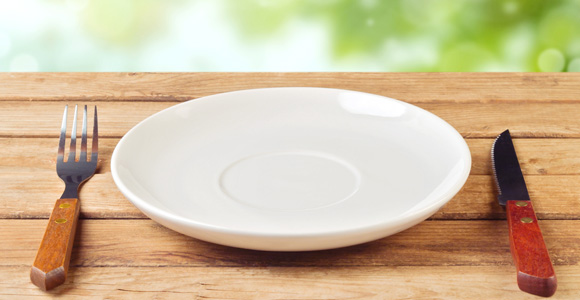
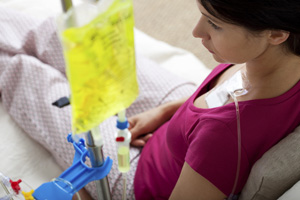

# Fasting Helps Cancer Patients Survive Chemotherapy — And It Could Help Us All Live Longer

  
You’ve probably never heard of Valter Longo, but if you’ve heard about the [purported health benefits of intermittent fasting](http://www.mensjournal.com/magazine/the-benefits-of-occasional-fasting-20121116), you’ve likely been exposed to his work. A [University of Southern California](http://singularityhub.com/2013/10/23/no-more-lying-about-your-age-tissue-test-can-tell/) gerontologist, Longo has published a series of studies on how two- to four-day fasts effect healthy cells and cancer cells in mice and humans.

In a previous study, Longo found that patients who fast before chemotherapy have a more bearable experience of its grueling side effects. His recently [published](http://www.cell.com/cell-stem-cell/abstract/S1934-5909%2814%2900151-9) work offers an account of why that might be that hints at wider benefits of periodic fasting.

The study indicates that during a fast, the immune system jettisons its cells that aren’t fully functioning. Those who fasted longer had almost 30 percent lower white blood cell counts; they later had higher preservation rates of [hematopoietic stem cells](http://singularityhub.com/2014/04/21/can-blood-produced-from-stem-cells-make-blood-shortages-a-thing-of-the-past/), or stem cells that go on to become blood or immune cells. In mice, the fasts also jump-started the manufacture of new hematopoietic stem cells.

“When you starve, the system tries to save energy, and one of the things it can do to save energy is to recycle a lot of the immune cells that are not needed, especially those that may be damaged,” Longo [said](http://news.usc.edu/63669/fasting-triggers-stem-cell-regeneration-of-damaged-old-immune-system/) in a press release. “What we started noticing in both our human work and animal work is that the white blood cell count goes down with prolonged fasting. Then when you re-feed, the blood cells come back. So we started thinking, well, where does it come from?”

During a fast, the basic body chemistry switches from burning carbohydrates to burning stored fat and [ketone bodies](http://en.wikipedia.org/wiki/Ketone_bodies) produced by the liver. Different types of cells survive this change at different rates.

Longo has found that fasting lowered levels of IGF-1, a growth-factor hormone linked to aging, tumor progression and [cancer risk](http://universityofsoutherncalifornia.cmail2.com/t/j-l-iikdhkd-iydddrfu-a/). It also reduced the enzyme PKA, which has been linked in other research to the regulation of adult stem cell caches. The shutdown of PKA sends the signal for stem cells to proliferate, according to Longo.

“The body got rid of the parts of the system that might be damaged or old, the inefficient parts, during the fasting. Now, if you start with a system heavily damaged by chemotherapy or aging, fasting cycles can generate, literally, a new immune system,” he said.

Just don’t forget to add “in mice” to the end of Longo’s claim. The immune system reboot wasn’t documented in the human patients in the Phase I trial focused on establishing basic safety. In mice, the researchers were able to monitor irradiated stem cells in unfed and fed mice; that was not part of the human protocol.

But researchers did find that people who fasted for 72 hours before their treatments experienced lower toxicity and a lighter effect on bone marrow from chemotherapy.

“While chemotherapy saves lives, it causes significant collateral damage to the immune system. The results of this study suggest that fasting may mitigate some of the harmful effects of chemotherapy,” said Longo’s co-author Tanya Dorff, assistant professor of clinical medicine at USC.

In previous mouse studies, Longo found that healthy cells fare better than cancer cells in fasting conditions. He hypothesizes that in evolving to divide so rapidly, cancer cells gave up other evolutionary adaptations, such as surviving in the absence of nutrition. In other words, fasting might [make chemotherapy more effective](http://singularityhub.com/2014/06/07/nanotech-method-boosts-conventional-cancer-treatments-in-pre-clinical-trial/) and more manageable.

If fasting kickstarts the immune system and stifles cancer, perhaps the whole [fountain of youth](http://singularityhub.com/2013/12/29/genomic-studies-sift-centenarian-dna-for-genes-protecting-against-age-related-diseases/) is an [empty bowl](http://singularityhub.com/2013/12/18/new-study-says-daily-multivitamins-supplements-a-waste-of-money/)? Many health risks that grow with age result from the immune system’s diminishing ability to fight. And renewed spurts of stem-cell repairs could improve other damaged systems as well.

“We are investigating the possibility that these effects are applicable to many different systems and organs, not just the immune system,” said Longo, whose lab is in the process of conducting further research on controlled dietary interventions and stem cell regeneration in both animal and clinical studies.

The bad news is that neither restricted-calorie diets nor 24-hour fasts had the same results that 72-hour hunger games did. But Longo will be looking for ways to stimulate these renewal pathways by tinkering with [nutrition](http://singularityhub.com/2014/04/05/fruits-and-vegetables-do-more-to-reduce-cancer-and-extend-life-than-many-prescription-drugs/http://singularityhub.com/2014/04/05/fruits-and-vegetables-do-more-to-reduce-cancer-and-extend-life-than-many-prescription-drugs/) without actually fasting or potentially by taking drugs that simulate the body chemistry fasting produces. Maybe, just maybe, it will be possible to have one’s cake and not eat it, too.

*Photos: Maglara / Shutterstock.com, Image Point Fr / Shutterstock.com*
