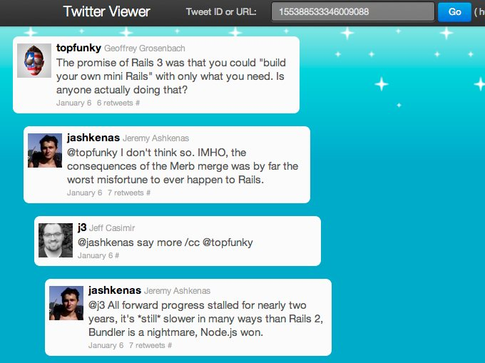
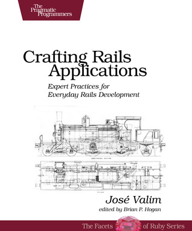
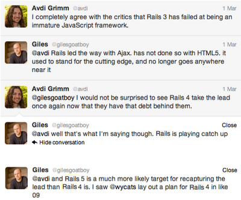

# The Rails/Merb Merge In Retrospect

This post discusses open source history critically. The post names the programmers involved using formal names — e.g., Mr. Foo or Ms. Bar — because open source has become a strange hybrid of software development and social media, and I want to balance my critique by showing respect for everybody involved.  
  
Way back in 2008, at MountainWest RubyConf, somebody high-placed at EngineYard told me that the company funded Merb development because they hoped some of that work would end up in Rails. At the time, I thought the comment made no sense; Rails and Merb were fundamentally different projects with fundamentally different philosophies. But Yehuda Katz (then of EngineYard) announced the Rails/Merb merge only a few months later:  
  
[Rails will become more modular, starting with a rails-core, and including the ability to opt in or out of specific components. We will focus on reducing coupling across Rails, and making it possible to replace parts of Rails without disturbing other parts. This is exactly what Merb means when it touts “modularity”...  
  
Rails will be retrofitted to make it easy to start with a “core” version of Rails (like Merb’s current core generator), that starts with all modules out, and makes it easy to select just the parts that are important for your app. Of course, Rails will still ship with the “stack” version as the default (just as Merb does since 1.0), but the goal is to make it easy to do with Rails what people do with Merb today.](http://yehudakatz.com/2008/12/23/rails-and-merb-merge/)  
  
This took longer than expected, but it happened, sort of. The initial site generator script is way more pleasant to use as a result, and replacing ActiveRecord with a REST or Mongo client got easier too. That's cool. But the Rails community largely didn't embrace Rails's newfound modularity the way Mr. Katz told us we should expect.

[Much of the fun, creative energy in web dev moved to JavaScript](http://gilesbowkett.blogspot.com/2012/02/rails-went-off-rails-why-im-rebuilding.html), although it would be very silly to say Ruby is dead. Ruby's still alive, and there are [very](http://nbeloglazov.com/2014/05/29/quil-intro.html) [cool](http://gigasquidsoftware.com/blog/2014/03/20/world-domination-with-hexapods-and-clojure/) [things](http://overtone.github.io/) happening in Clojure as well, and people will probably start having a lot of fun with Swift, too. There's never been a better time to be a polyglot programmer.  
  
Despite all the new options, I still write Rails apps sometimes — partly because there's a lot of Rails work out there, and partly because I love Ruby (and still kind of love Rails). However, I think the modularization of Rails failed, and in this blog post, I'm aiming for a basic post mortem.  
  
Personally, the people I've seen and worked with in Ruby haven't used Rails's breakout libraries and post-Merb-merge modularity to the extent that Mr. Katz evangelized. One way to understand that is the "Sinatra + ActiveRecord + [many other things]" problem. It's kind of a random tangent, but bear with me. When you need something tiny, Sinatra is awesome, but you can tell you've underestimated the scope of your project if you end up pulling ActiveRecord back in, and then you want migrations, or view helpers, and the bigger your little Sinatra project gets, the more you wonder if you shouldn't just have used Rails, because you're manually importing all its various features.  
  
Sinatra's great for tightly-constrained services, but not so great for projects which might grow in scope, and that makes it a judgement call, because in theory, anything *might* grow in scope. There's a "tldr: just use Rails" disincentive to actually exploiting Rails's modularity in this fairly shallow and direct way, because you add cognitive overhead and complexity which you could have avoided just by using the more "batteries included" solution. That same disincentive exists with respect to any attempt to reconfigure Rails's architecture, even though [it can definitely be worth the effort](http://www.naildrivin5.com/blog/2014/05/27/rails-does-not-define-your-application-architecture.html).  
  
[José Valim wrote a terrific book about all the amazing acrobatics you can pull off if you're familiar with the modular components of Rails](http://www.amazon.com/Crafting-Rails-Applications-Practices-Development-ebook/dp/B00I9GR0E6/), and if you compose software with these components, rather than simply building vanilla Rails apps. The only problem is that you kind of have to have José-Valim-level familiarity with Rails's internals to do it well. Mr. Valim's been on the Rails core team for years, and that's a pretty massive time investment at a pretty significant level of skill. So a lot of the modular power of Rails, a major goal which ate up a very significant amount of development time, sits untapped as remarkable power that nobody ever actually uses, because nobody has the years to spend to get on José Valim's level just so they can tackle a few edge cases in ways which will baffle every new programmer they ever onboard, going forward for the entire lifespan of their company.

I'm exaggerating here, and being completely unfair to Mr. Valim's book, but you get the idea. Speaking of shameless rhetorical self-indulgence, Rails's creator David Heinemeier Hansson often receives [extremely](http://codon.com/the-dhh-problem) [justifiable](https://www.destroyallsoftware.com/blog/2014/test-isolation-is-about-avoiding-mocks) [criticism](https://www.destroyallsoftware.com/blog/2014/tdd-straw-men-and-rhetoric) for making [overly grand statements](http://codon.com/how-testability-can-help), but once upon a time, people used to talk a lot more about the intensely beautiful design work he did with Rails at the project's inception.  
  
Paying too much attention to questionable social media shenaniagans, and/or conference talks, might be a mistake, but [it's still worthwhile to really think about Rails's design](http://railsoopbook.com/), so think for a second about flow, context switching, and productivity. Rails constrains the problems you think about, in an ideal Rails app, to questions of business logic and flow between web pages. That was a perfect summation of the real work a web developer should be doing, back in 2005, when Rails was new, and it's still a decent approximation, although we now have to tack on mobile-friendliness and JavaScript framework integration like [Ptolemaic epicycles](http://en.wikipedia.org/wiki/Deferent_and_epicycle#Epicycles). The way Rails can narrow the range of topics a programmer has to think about during their workday is great *user experience design* which results in better time management.  
  
An ideal Rails app is as rare as an ideal anything else, but without a set of APIs that carefully constrain the problem space down to a manageable subset, it's quite difficult to even start conversations about what to build next. If the overwhelming majority of your web work is about business logic and flow between web pages, what you're going to build next will very probably be either business logic or flow between web pages. But if a substantial part of your web work is reconfiguring architecture, or inventing new architecture from scratch, then "what should we build today?" is a longer conversation, and one which poses challenges to staying focused and effective.  
  
Even today, with the whole shoehorned-in aspect of mobile and JS framework stuff, having a simple canned architecture gives you phenomenal benefits in terms of concentration and peace of mind, at least at your project's outset. If you're dismantling Rails and building something new out of its parts, you're re-opening that can of worms, and that can be expensive, time-consuming, and aggravating. By programmer standards, it's very easy to estimate how long it will take to churn out some familiar chunk of business logic. Building a custom version of a very complex framework takes an unpredictable amount of time and adds a substantial amount of cognitive overhead to a project. It increases your risk of failure, delay, and burnout. If it goes well at all, it'll only be because somebody at your company takes elegant internal API design seriously, and does it well. [Dunning-Kruger effects](http://en.wikipedia.org/wiki/Dunning%E2%80%93Kruger_effect) aside, this is a very rare skill.  
  
But the Rails/Merb merge didn't give Rails any of this. In fact, it doesn't seem to have affected many Rails developers directly at all. Very probably, a few companies did take advantage of the new modularity, to solve a few very specific problems, but most people don't know how and don't have the problems which would make it worthwhile in the first place. So the basic problem here is that the Rails/Merb merge wasn't useful to a lot of people, and that it took too long. (In fact, given that many aspects of that modular rewrite still seem unfinished, even today, it might be more accurate to say that it *is* taking too long.) You have to [give the Rails team credit for tackling technical debt](http://tenderlovemaking.com/2014/06/04/yagni-methods-slow-us-down.html), but in this instance, it might not have been worth the effort.  
  
The irony is that Rails developers have formed their own, [unofficial](https://www.destroyallsoftware.com/screencasts/catalog/sucks-rocks-1-the-rails-app), [unapproved](http://www.naildrivin5.com/blog/2014/05/27/rails-does-not-define-your-application-architecture.html) hacks to supply a much more modest form of modularity in Rails, and Mr. Hansson vigorously [opposed](http://david.heinemeierhansson.com/2012/the-parley-letter.html) this practice about a year and a half ago. It's relatively rare in a Rails app to exploit post-Merb-merge modularity, but it's very common to [break your app out into services](http://www.confreaks.com/videos/1125-gogaruco2012-mega-rails), and to break [god objects](http://en.wikipedia.org/wiki/God_object) into smaller files. Many people who build a Rails app need to do this, sooner or later.  
  
(As an aside, I recently built an unusual thing, namely a Rails app with no `User` model — [the usual candidate for god object status](https://twitter.com/_solnic_/status/469502039148756992) — and was surprised to discover another object in the system creeping towards god object status instead.)  
  
Many people have noticed that the Rails culture's prone to occasional dysfunction and drama. [This is not unique to Rails](http://jsdrama.com/); it's inherent to the social media aspects of open source. But these aspects sometimes work against the end goal of delivering excellent software. This failure to achieve consensus around the topic of modularity may be a perfect example of community dysfunction. Rails developers who developed common ways to make their architecture more modular, to solve problems they all shared, met with opposition from Mr. Hansson. Yet Rails core embraced a more arcane modularity which nobody turned out to want.  
  
It's an interesting mistake, in my opinion. [Great design implies the diligent application of exquisitely careful good judgement](http://rampantinnovation.com/2014/05/13/design-is-about-intent/). Consider how Rails views squash their problem space down to an approximation of PHP, but Rails then expands back into a full OO system towards the back end. That was revolutionary when it first appeared. It suggested some very deep thinking about questions like "what kind of progamming is appropriate here?". The way the Rails project has handled questions like "what kind of modularity is appropriate here?" seems less deep to me, in comparison, and less well-balanced.  
  
Any decent post mortem needs to also consider what, if anything, Rails lost as a result of its merge with Merb. Matt Aimonetti said it well:  
  
[the lack of competition and the internal rewrites made Rails lose its headstart. Rails is very much HTML/view focused, its primarily strength is to make server side views trivial and it does an amazing job at that. But let’s be honest, that’s not the future for web dev. The future is more and more logic pushed to run on the client side (in JS) and the server side being used as an API serving data for the view layer... Rails is far from being optimized to developer web APIs in Rails. You can certainly do it, but you are basically using a tool that wasn’t designed to write APIs and you pay the overhead for that.](http://merbist.com/2012/02/29/learning-from-rails-failures/)  
  
The knee-jerk reaction to this might be that paradigms change, but the "new" evolution in the nature of web applications should not surprise you at all if you were paying attention during the browser wars of the late 90s, or if you were paying attention when Google bought Writely and turrned it into Google Docs, or if you thought about [Microsoft's claim, to the Department of Justice and the courts, that the browser was part of the operating system](http://en.wikipedia.org/wiki/United_States_v._Microsoft_Corp.), or if you read Bill Gates's essay [Content Is King](http://www.craigbailey.net/content-is-king-by-bill-gates/), ***written in 1996***.  
  
To quote some relevant commentary:  
  
[Microsoft is trying to provide web applications with the same performance as native applications...  
  
This is exactly the nightmare scenario that Bill Gates, co-founder of Microsoft, feared would happen, that the web browser could substitute for the operating system, and that's why he aggressively went after Netscape Communications in the 1990s, resulting in an anti-trust conviction against Microsoft.](http://www.siliconvalleywatcher.com/mt/archives/2010/06/microsoft_moves.php)  
  
In other words, if you've been paying attention, you've been expecting this ["new"](http://verold.com/) [landscape](http://trackingjs.com/) in web development ***for about eighteen years***. I won't pretend to have Mr. Gates's level of strategic foresight, but I can say I did a presentation in 2006 explaining why JavaScript MVC was inevitable, four years before Backbone's first release. For some reason, though, Rails appears to have missed this boat, and the conversation among programmers seems to be limited to callback functions, threading, and curly braces.  
  
I had a brief conversation on Twitter with Avdi Grimm:

This conversation took place before the release of Rails 4. Mr. Grimm's prediction proved incorrect. Although Rails 4 brought plenty of incremental improvements, as well as much-needed concurrency support, it remains a framework based on assumptions about what web programming ***is*** which simply are not true any more. Rails 4 is certainly an impressive accomplishment, but it's not the most   
[innovative](https://github.com/rails/spring) [thing](https://github.com/burke/zeus) in the world.  
  
Nor should it be, necessarily.  
  
I can't call PHP beautiful, but the basic sentiment is completely legit. But a lot of Rails developers have business models which require cutting-edge technologies. The cutting edge is also just a fun place to be. Here's what the cutting edge looks like in 2014:This is [Verold](http://verold.com/), a web app which competes with [Unity](http://en.wikipedia.org/wiki/Unity_(game_engine)), [Cinema 4D](http://en.wikipedia.org/wiki/Cinema_4D), and [Maya](http://en.wikipedia.org/wiki/Autodesk_Maya).  
  
Returning to my discussion with Avdi Grimm, I said this:  
  
I was just being nice. Rails might never recapture the lead, unless Rails core undertakes some very serious re-examination of the project's design assumptions. That's hard to do, and they're probably still tired from the Rails/Merb merge. And Mr. Hansson may not decide to do the same kind of serious, difficult, incisive thinking that he did back in 2004, when he wasn't a millionaire and he had to prove himself. He did some amazing work in his early 20s, [during a](http://en.wikipedia.org/wiki/Dot-com_bubble#Aftermath) [recession](https://twitter.com/dhh/status/6699907964), when everybody works harder than normal, but he may not want to put his [promising racing career](http://en.wikipedia.org/wiki/David_Heinemeier_Hansson#24_Hours_of_Le_Mans_results) on hold for a couple years so he can deal with new technological issues which he doesn't seem to understand or [need to care about](http://www.quora.com/37signals/What-is-37signalss-annual-revenue).  
  
And to be fair, that's not a reasonable thing to expect from him, or indeed anybody. But it does contextualize his recent keynote presentation, at RailsConf 2014, about the alleged demise of TDD.

As Mr. Hansson and his co-author put it in their book *Getting Real*:  
  
[One bonus you get from having an enemy is a very clear marketing message. People are stoked by conflict. And they also understand a product by comparing it to others. With a chosen enemy, you're feeding people a story they want to hear. Not only will they understand your product better and faster, they'll take sides. And that's a sure-fire way to get attention and ignite passion.](https://gettingreal.37signals.com/ch02_Have_an_Enemy.php)  
  
In this context, [TDD Is Dead](http://david.heinemeierhansson.com/2014/tdd-is-dead-long-live-testing.html) just looks like attention-getting fluff to me. We live in a world where [Nodecopter](http://nodecopter.com/) is old news. We have a framework which may in fact lag behind the cutting edge, and we have an unresolved tension about what the right level of modularity is in that framework. [What's the value](http://en.wikipedia.org/wiki/Cui_bono) in dredging up a mid-2000s buzzword?

With apologies for the snark, I see an important lesson here.  
  
Open source software has to balance two opposing forces: a strong, guiding vision in the service of a particular use case, vs. responding to, and respecting, the project's community. [Rails favors the first force over the second](http://david.heinemeierhansson.com/2012/rails-is-omakase.html). Quoting again from *Getting Real*:  
  
[Just because x number of people request something, doesn't mean you have to include it. Sometimes it's better to just say no and maintain your vision for the product.](http://gettingreal.37signals.com/ch05_Forget_Feature_Requests.php)  
  
Rails might be overbalanced in this direction, and [underemphasizing the value of listening to its community](http://gilesbowkett.blogspot.com/2013/02/the-lie-of-convention-over-configuration.html). But you could easily argue instead that too many people tried to use Rails for too many [inappropriate use cases](http://www.infoq.com/news/2012/11/twitter-ruby-to-java). It's a judgement call. [It will probably always be a judgement call](http://ostatic.com/blog/apples-relationship-to-open-source). Rails seems to have chosen to err on the side of saying no, and that's a completely legit choice.  
  
It could even be that the number one mistake in the Rails/Merb merge was that they didn't say no *enough*. If a company comes to you and tells you that they'll happily refactor your open source project for you, that might be a good time for saying no.  
  
Another lesson to learn might be that user experience design is a much more important part of API design than programmers have traditionally realized. For the sake of argument, let's take a position which is so extreme as to be silly, and agree (for the moment) that nobody should ever have used Rails to make any kind of app other than a Basecamp clone. Let's say Rails is appropriate for one use case and one use case only. The question then becomes, why did so many people misuse it for so many additional purposes?  
  
Maybe because it's a damn good idea to prioritize developer happiness, and treat API design the same way Apple treats user interface and product design. If your technology makes people's work *fun*, they're probably going to embrace it.  
  
If you're building the next big thing in open source, or trying to, please remember this.  
  
You might also like [*Rails As She Is Spoke*, my book about Rails's design](http://railsoopbook.com/).
