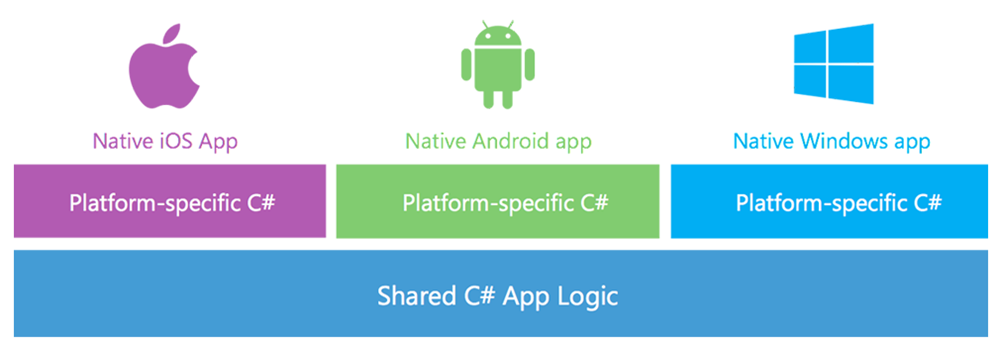
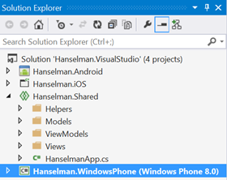
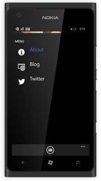
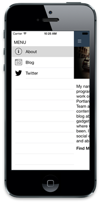
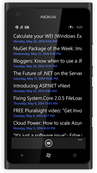
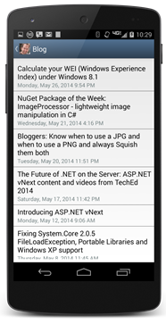
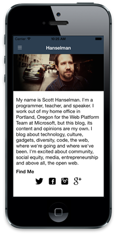

# [Xamarin.Forms - Write Once, Run Everywhere, AND Be Native?](http://www.hanselman.com/blog/XamarinFormsWriteOnceRunEverywhereANDBeNative.aspx)

Sponsored By

I worked in Java for a number of years at Nike, writing an order management application that would run on four platforms. We used to joke that we'd "write once, debug everywhere." Now, this was the early days of Java, but the thing was, every form and control was 'owner drawn.' That meant that a button looked the same everywhere because it wasn't a real button as far as the operating system was concerned. It was a *picture of a button.* We used to use Spy++ and different Windows inspector programs to explore our applications and they could never *see* a Java program's controls. This meant that the app pretty much worked everywhere, but the app always LOOKED like a Java App. They didn't integrated with the underlying platform.

With MVVM (Model, View, View-Model) patterns, and techniques like the Universal apps work on Windows Phone 8.1 and Windows 8.1, code sharing can get up into the high 90% for some kinds of apps. However, even for simple apps you've still got to create a *custom native view* for each platform. This is desirable in many cases, but for some app it's just boring, error prone, and tedious.

[Xamarin](http://www.xamarin.com) announced [Xamarin.Forms](http://www.xamarin.com/forms) today which (in my words) effectively abstracts away native controls to a higher conceptual level. This, to my old eyes, is very similar to the way I wrote code in Java back in the day - it was all done in a fluent code-behind with layouts and flows. You create a control tree.

> "Xamarin.Forms is a new library that enables you to build native UIs for iOS, Android and Windows Phone from a single, shared C# codebase. It provides more than 40 cross-platform controls and layouts which are mapped to native controls at runtime, which means that your user interfaces are fully native."

What's interesting about this, to me, is that these "control/concepts" (my term) are coded at a high level but rendered **as their native counterparts.** So a "tab" in my code is expressed in its most specific and native counterpart on the mobile device, rather than as a generic tab control as in my Java example. Let's see an example.

My buddy from Xamarin, [James Montemagno](https://twitter.com/JamesMontemagno), a fellow Chipotle lover, put together the ultimate cross-platform Hanselman application in a caffeinated late night hack to illustrate a few points for me. This little app is written in C# and runs natively on Windows Phone, Android, and iOS. It aggregates my blog and my tweets.

Here is the menu that switches between views:

And the code that creates it. I've simplified a little for clarity, but the idea is all MVVM:

|  |
| --- |
| `public` `HomeMasterView(HomeViewModel viewModel)`  `{`  `this``.Icon =` `"slideout.png"``;`  `BindingContext = viewModel;`  `var layout =` `new` `StackLayout { Spacing = 0 };`  `var label =` `new` `ContentView {`  `Padding =` `new` `Thickness(10, 36, 0, 5),`  `BackgroundColor = Color.Transparent,`  `Content =` `new` `Label {`  `Text =` `"MENU"``,`  `Font = Font.SystemFontOfSize (NamedSize.Medium)`  `}`  `};`  `layout.Children.Add(label);`  `var listView =` `new` `ListView ();`  `var cell =` `new` `DataTemplate(``typeof``(ListImageCell));`  `cell.SetBinding (TextCell.TextProperty, HomeViewModel.TitlePropertyName);`  `cell.SetBinding (ImageCell.ImageSourceProperty,` `"Icon"``);`  `listView.ItemTemplate = cell;`  `listView.ItemsSource = viewModel.MenuItems;`  `//SNIP`  `listView.SelectedItem = viewModel.MenuItems[0];`  `layout.Children.Add(listView);`  `Content = layout;`  `}` |

Note a few things here. See the ListImageCell? He's subclassed ImageCell, which is a TextCell with an Image, and setup data binding for the text and the icon. There's recognition that every platform will have text and an icon, but the resources will be different on each. That's why the blog and Twitter icons are unique to each platform. The concepts are shared and the implementation is native and looks native.

That's the UI side, on the logic side all the code that loads the RSS feed and Tweets is shared across all three platforms. It can use async and await for non-blocking I/O and in the Twitter example, it uses LinqToTwitter as a PCL (Portable Class Library) which is cool. For RSS parsing, it's using Linq to XML.

|  |
| --- |
| `private` `async Task ExecuteLoadItemsCommand()`  `{`  `if` `(IsBusy)`  `return``;`  `IsBusy =` `true``;`  `try``{`  `var httpClient =` `new` `HttpClient();`  `var feed =` `"http://feeds.hanselman.com/ScottHanselman"``;`  `var responseString = await httpClient.GetStringAsync(feed);`  `FeedItems.Clear();`  `var items = await ParseFeed(responseString);`  `foreach` `(var item` `in` `items)`  `{`  `FeedItems.Add(item);`  `}`  `}` `catch` `(Exception ex) {`  `var page =` `new` `ContentPage();`  `var result = page.DisplayAlert (``"Error"``,` `"Unable to load blog."``,` `"OK"``,` `null``);`  `}`  `IsBusy =` `false``;`  `}` |

And ParseFeed:

|  |
| --- |
| `private` `async Task<List<FeedItem>> ParseFeed(``string` `rss)`  `{`  `return` `await Task.Run(() =>`  `{`  `var xdoc = XDocument.Parse(rss);`  `var id = 0;`  `return` `(from item` `in` `xdoc.Descendants(``"item"``)`  `select` `new` `FeedItem`  `{`  `Title = (``string``)item.Element(``"title"``),`  `Description = (``string``)item.Element(``"description"``),`  `Link = (``string``)item.Element(``"link"``),`  `PublishDate = (``string``)item.Element(``"pubDate"``),`  `Category = (``string``)item.Element(``"category"``),`  `Id = id++`  `}).ToList();`  `});`  `}` |

Again, all shared. When it comes time to output the data in a List on Windows Phone, Android, and iPhone, it looks awesome (read: **native**) on every platform without  having to actually do anything platform specific. **The controls look native because they are native. Xamarin.Forms controls are a wrapper on native controls, they aren't new controls themselves.**

Here's BlogView. Things like ActivityIndicator are from Xamarin.Forms, and it expresses itself as a native control.

|  |
| --- |
| `public` `BlogView ()`  `{`  `BindingContext =` `new` `BlogFeedViewModel ();`  `var refresh =` `new` `ToolbarItem {`  `Command = ViewModel.LoadItemsCommand,`  `Icon =` `"refresh.png"``,`  `Name =` `"refresh"``,`  `Priority = 0`  `};`  `ToolbarItems.Add (refresh);`  `var stack =` `new` `StackLayout {`  `Orientation = StackOrientation.Vertical,`  `Padding =` `new` `Thickness(0, 8, 0, 8)`  `};`  `var activity =` `new` `ActivityIndicator {`  `Color = Helpers.Color.DarkBlue.ToFormsColor(),`  `IsEnabled =` `true`  `};`  `activity.SetBinding (ActivityIndicator.IsVisibleProperty,` `"IsBusy"``);`  `activity.SetBinding (ActivityIndicator.IsRunningProperty,` `"IsBusy"``);`  `stack.Children.Add (activity);`  `var listView =` `new` `ListView ();`  `listView.ItemsSource = ViewModel.FeedItems;`  `var cell =` `new` `DataTemplate(``typeof``(ListTextCell));`  `cell.SetBinding (TextCell.TextProperty,` `"Title"``);`  `cell.SetBinding (TextCell.DetailProperty,` `"PublishDate"``);`  `cell.SetValue(TextCell.StyleProperty, TextCellStyle.Vertical);`  `listView.ItemTapped +=  (sender, args) => {`  `if``(listView.SelectedItem ==` `null``)`  `return``;`  `this``.Navigation.PushAsync(``new` `BlogDetailsView(listView.SelectedItem` `as` `FeedItem));`  `listView.SelectedItem =` `null``;`  `};`  `listView.ItemTemplate = cell;`  `stack.Children.Add (listView);`  `Content = stack;`  `}` |

Xamarin Forms is a very clever and one might say, elegant, solution to the **Write Once, Run Anywhere, AND Don't Suck** problem. What's nice about this is that you can care about the underlying platform when you want to, and ignore it when you don't. A solution that HIDES the native platform isn't native then, is it? That'd be a lowest common denominator solution. This appears to be hiding the tedious and repetitive bits of cross-platform multi-device programming.

There's more on Xamarin and Xamarin Forms at [http://xamarin.com/forms](http://xamarin.com/forms "http://xamarin.com/forms") and [sample code here](http://developer.xamarin.com/guides/cross-platform/xamarin-forms/introduction-to-xamarin-forms/). Check out the code for the Hanselman App(s) at [https://github.com/jamesmontemagno/Hanselman.Forms](https://github.com/jamesmontemagno/Hanselman.Forms "https://github.com/jamesmontemagno/Hanselman.Forms").

#### About Scott

Scott Hanselman is a former professor, former Chief Architect in finance, now speaker, consultant, father, diabetic, and Microsoft employee. He is a failed stand-up comic, a cornrower, and a book author.

[About](http://hanselman.com/about)   [Newsletter](http://www.hanselman.com/newsletter)

Wednesday, May 28, 2014 8:12:36 PM UTC

Xamarin is pretty nice tool but why it's so expensive? and why there is no discount for a BizSpark members.

[Tomasz Kowalczyk](http://tomek.kownet.info)

Wednesday, May 28, 2014 8:40:30 PM UTC

Hello Tomasz, I would be very interested in learning about what your team is working on! Could you send me an email at Nick@Xamarin.com?

[Nick Lee](https://xamarin.com)

Wednesday, May 28, 2014 8:58:16 PM UTC

Looks promising, but the price has caused us to look to alternatives.

[Michael Ferry](http://www.netGolfLeague.com)

Wednesday, May 28, 2014 9:07:11 PM UTC

I would love to try xamarin especially with the other release today where you can now design an IOS GUI directly in visual studio. The issue for me is for mobile I am all about apple (iphone/ipad) but when it comes to PCs I am all microsoft. I don't own a mac and don't really plan to. All I would use the mac for is a build server and nothing else since I would plan to use VS2013 for all my coding (and now design as well). I know I could pick up a used cheap mac but in my perfect world xamarin would offer some sort of build server in the cloud (similar to what redgate does with http://vsnomad.com/).   
  
note: I know the build issue is currently an issue b/c of apple not allowing it on pcs and not xamarins doing

Wednesday, May 28, 2014 9:07:34 PM UTC

For those of you worried about the price, you must realize that sometimes you actually get what you pay for. Personally, I think Xamarin is a perfect example of that, and so is McDonalds.

Jonathan Hornberger

Wednesday, May 28, 2014 9:11:55 PM UTC

If I could purchase the Xamarin tools and use them, I'd be all over it - but their expensive annual licensing means that it just isn't on. I hate annually licensed software and will never purchase it, especially at their prices.

Wednesday, May 28, 2014 9:14:10 PM UTC

Thanks for sharing. Now if they can get Apple to get rid of needing an IMac it would be perfect. I agree that it would be nice if Xamarin could offer some kind of deal or bundle for MSDN subscribers or perhaps come up with their own BizSpark like program. My guess is as they grow their customer base will start to see prices come down. After all they have not been around for three years.  
  
Cheers,  
  
Jason Wyglendowski

[Jason Wyglendowski](http://wysnet.blogspot.com/)

Wednesday, May 28, 2014 9:14:26 PM UTC

Humm... Now i can understand whats the "honeypot offer" of Xamarin versus Phonegap, Cordova or Telerik AppBuilder. Thanks folks! =)

[Luiz Felippe](http://felippedev.net)

Wednesday, May 28, 2014 9:20:35 PM UTC

I second Tomasz's opinion. I would really love use Xamarin to work on some cross platform mobile apps, but for me as an enthusiast who loves to work with new technology (I'm basically a student) it's just too expensive.  
  
It's great that you can test the whole suit or have a free edition, but let's be honest: the app size for the free package is too small, even for semi-serious apps. You can't even use HttpClient and/or Json.Net without reaching the max. size of the app :(  
  
At the moment I'm pretty sure that Xamarin is targeting businesses and doesn't bother that much about individual (hobby) developers or enthusiasts. It'd be great if Xamarin could offer free licenses for OSS projects or allow people to get a license for a monthly subscription of 10$ (or something like that), like Epic Games did with their Unreal Engine and Crytek with their CryEngine.

Kai Eichinger

Wednesday, May 28, 2014 9:23:54 PM UTC

FYI - There is a discount for MSDN users - https://xamarin.com/msdn

[Rabi Satter](http://www.satter.org)

Wednesday, May 28, 2014 9:32:09 PM UTC

Okay, the Business Edition price might be a bit high for an individual, but $299 per platform for the Indie Edition isn't that high of a price, is it?  
  
Considering the productivity gain that you get for cross platform development, 40 bucks a month isn't expensive, that's half an hour of work.

[Jeffry van de Vuurst](http://www.cwrmobility.com)

Wednesday, May 28, 2014 9:35:05 PM UTC

I'm afraid I have to sing along with the price issue. Just not reachable for a small startup. I second the idea of coming up with a BizSpark type offering.

[Beyers Cronje](http://www.redmooncrew.com)

Wednesday, May 28, 2014 9:42:50 PM UTC

Looks great, but I agree with previous posts that Xamarin is just too expensive.  
  
Hell, the Visual Studio support costs more than Visual Studio itself.. and even more so since it's a yearly subscription. Makes me sad.

David

Wednesday, May 28, 2014 10:16:32 PM UTC

I would love it if Xamarin and MSDN cost a lot less, but there is a reason they cost as much as they do. Although, I think MSDN could come down a little bit.  
  
Now that Xamarin has abstracted the UI, the value of their product just increased; there's no way we're going to see a price drop. They're sitting on a gold mine, why should they give it away?  
  
Our only real hope is that Microsoft acquires Xamarin and rolls that into MSDN without increasing the cost of MSDN.

Brad Rem

Wednesday, May 28, 2014 10:31:39 PM UTC

I agree with Jeffry vande Vuurst: the Xamarin Indie license is COMPLETELY WORTH IT. If you can't afford $299 for each of the platforms you're targeting, then you're not serious enough. And you don't even need to pay that to start learning, just use the Starter edition. But if you want to actually publish apps, then yes, you need to pay for at least Indie. If you can't see the incredible value that Xamarin offers, then you're not looking/listening hard enough. It's this simple: if I want to target more than one platform, LARGE SWATHS of my code is shared code. Read as: most of the time I don't even need to re-compile per platform (thanks, Portable Class Libraries).  
  
As for the cost of the Enterprise licenses? Yes, they're steep. They're for ENTERPRISE. You DON'T need Visual Studio. I've been using Xamarin Studio (formerly MonoDevelop) to write apps since 2011. Visual Studio is a nice-to-have, not a necessity. If you're a startup, you can HANDILY accomplish your goals with Xamarin Studio (which is FREE).

[Joe Sauve](http://joesauve.com)

Wednesday, May 28, 2014 10:38:03 PM UTC

The pricing page looks more to me like you have to purchase the $1899 plan to get the UI controls: Prime Components. I could be / am probably wrong there though.   
  
The indy plan is also pretty cruddy - not even VS support - which is what their major value comes from. The fact that the free edition can't even support the most basic of http apps without hitting the limits is really, really frustrating (for fun I tried to make an app front-end for a freeware tournament thing I'm working on: I hit the limit before I even had it receiving all the data).  
  
I get they want to make money and clearly the product is absolutely worth a fair penny but yeah - there's no way it's even kind of justifiable without a sensible expectation of making money.  
  
Unfortunately, that's also par for the course with a lot of UI Control Libraries. Mad props to MahApp for their efforts there.

Bryan

Wednesday, May 28, 2014 10:46:20 PM UTC

From the Xamarin FAQ:  
  
**Can I continue to use Xamarin when my subscription expires?**  
  
Yes. Your Xamarin license is perpetual. If you choose not to renew your subscription, you will no longer have access to new releases and support, and we will be very sad.

George

Wednesday, May 28, 2014 10:52:18 PM UTC

@Joe I'm not enterprise, but I have Visual Studio already and I like it and I want to use it. I'd happily pay $299, but $999 or $1899 is too much for me at least.

David

Wednesday, May 28, 2014 10:53:25 PM UTC

Why Microsoft did not purchase Xamarin,Like when she did when purchase Nokia

Sinan

Wednesday, May 28, 2014 10:54:18 PM UTC

I think Xamarin Business is very reasonable if you want and need Visual Studio integration. If you're serious about cross platform native mobile development and are building applications for customers it is money well spent. The amount of time and code reuse it saves allows you to focus on customer requirements and build applications quickly.  
  
Even if I went with the Indie version as others have mentioned Xmarain Studio works very well for $299 it is very reasonably priced.  
  
The tooling keeps getting better each year and makes mobile native cross platform mobile development fun and easy. The email support and forums are excellent and it just keeps getting better.  
  
Also the annual pricing is to keep current with new releases, which is a very common practice.

[Thomas](http://tomdev.com)

Wednesday, May 28, 2014 10:55:44 PM UTC

Scott, there is no one better than you who can talk & convince Miguel / Nat on pricing issue. Almost every C# developer wants to build cross platform app using Xamarin tools and the cost has become the biggest issue.

[Prasad Honrao](http://PrasadHonrao.com)

Wednesday, May 28, 2014 10:57:54 PM UTC

How can we compare the performance of a Native Android/iPhone app with the one in Xamarin?  
Do we just consider Xamarin in cases where we have a connected application with a nice backend and just need a native shell?

[Aram Koukia](http://koukia.ca)

Wednesday, May 28, 2014 11:01:26 PM UTC

When you compare the cost of Xamarin to Visual Studio, it's reasonably priced. And let's not forget MSDN subscriptions cost twice as much in Australia as the US, so I'm glad Xamarin doesn't include a "Screw Australia Tax". Would be nice if they were a bit less restrictive on the free edition, but people will always complain regardless of how much they offer for free.  
  
As for Xamarin.Forms... It's a nice idea for marketing, but if you want your app to stand out I don't think you should use it. The iOS designer looks fantastic though.

Chris McGrath

Wednesday, May 28, 2014 11:20:09 PM UTC

I think we've become too spoilt as developers. Have you considered what Xamarin can do for you?? Exactly like Scott's previous blog post: We are abstracting on the shoulders of giants!  
  
If you're not happy then go do the following:  
- Learn Objective C  
- Learn Java  
- (C# knowledge assumed)  
- Learn the different UI methodologies for each of the above  
- Setup the different development environments for each of the above  
- Setup the different build environments for each of the above  
  
So you can waste your time doing all of the above or pony up the money. Choice is up to you. How do you value your time? Let's do the math:  
- $3,000 = 3 business licenses so you can target all 3 platforms  
- 30 hours = Time to recoup cost @ $100ph  
  
So you only need to find 30 hours of billable time per year and you've paid for it. Seems like a no brainer to me.

[Kestrel Blackmore](http://www.kestrelblackmore.com)

Wednesday, May 28, 2014 11:57:31 PM UTC

Uh-oh. We've done it: even professional software developers expect software to be free. [I know, I know, not quite professional devs, not quite free, but still...]

Thursday, May 29, 2014 12:18:01 AM UTC

@Prasad: "Almost every C# developer wants to build cross platform app using Xamarin tools"  
  
And that is why Xamarin tools are so expensive. The only way they will be less expensive is if they had comparable competition.  
  
Let's not forget, though, that the Xamarin folks have been essentially on this project for more than a decade. They've paid their dues, they've put years of work in, and they've had their bad times (when Novell jettisoned them). If anybody deserves to make some money, it's them.

Brad Rem

Thursday, May 29, 2014 12:19:47 AM UTC

Thanks to Rabbi Satter for posting the link https://xamarin.com/msdn for the MSDN pricing. The curious thing is at the one developer level it does not come with Prime Components. Are the prime components used with the new Forms and does anyone know what they are? It would be nice if you could buy them separately.  
  
Cheers,  
  
Jason Wyglendowski

[Jason Wyglendowski](http://wysnet.blogspot.com/)

Thursday, May 29, 2014 12:20:18 AM UTC

@Kestrel Blackmore I'm a dev, I work by myself and I fund all app dev expenses out of my own pocket. $300+ a year to buy a licence is a big expense for me and to recoup that amount I'd need 300+ app sales or some serious in app Ad revenue. For a lot of the apps I'm building that just isn't going to happen on a yearly basis. The apps I build are things I need that I think other people will find useful, I'm not out to make a heap of money and I'm happy to write off my time but I don't want to run it at a financial loss. This licence is also only one cost in the app dev process, add in things like hosting, other dev tools, app store licencing, etc.

Wally Wheels

Thursday, May 29, 2014 12:28:32 AM UTC

Does the UI have to be built on Xcode or can we do it  
All in code ?

Guy Provost

Thursday, May 29, 2014 12:45:55 AM UTC

Nice try Scott. I remember Java's SWT and a billion other cross platform GUI frameworks. They always demo well, but the devil is in the details and when you really start to push things they always fall down.  
  
You almost had me for a minute, but I've seen this song and dance before. I'm not going to fall for it again.

Bryan

Thursday, May 29, 2014 1:03:31 AM UTC

@Wally Wheels Yes I understand that and agree. The pricing can make it restrictive for the hobbyist. The license is perpetual though, you only need to renew it if you want the latest version/upgrades/support.   
  
For a professional developer, who has determined to enter the mobile app market, it's still a small cost that should be easily recouped if they have a serious business model. That's a topic for another day though! :)

[Kestrel Blackmore](http://www.kestrelblackmore.com)

Thursday, May 29, 2014 2:14:09 AM UTC

@GuyProvost with traditional Xamarin development where you create a shared C# business logic backend and share that with your apps and developer the user interface separate you would create the UIs in the Xamarin Designer for iOS and Android that is built into Xamarin Studio and Visual Studio.  
  
With Xamarin.Forms library and its shared user interface controls and layouts you would build out the views in the code behind or you can build it with and XAML markup. In this example I did it all from the code behind. We have tons of samples and docs on http://www.xamarin.com/forums

[James Montemagno](http://motz.codes)

Thursday, May 29, 2014 2:46:11 AM UTC

I really like the direction that Xamarin is headed. The technique they are using is similar to what was done with [SWT on Java](http://www.eclipse.org/swt/) and also similar to what Appcelerator has done with their cross platform mobile controls as well.

[Joe Brinkman](http://www.theaccidentalgeek.com)

Thursday, May 29, 2014 2:57:19 AM UTC

I used to work for a monolithic consultant company. They basically had a price threshold of around $50 (memory not perfect) for tools which did not need any kind of special approval. Meaning, we devs could get our hands on libraries really easily for around $50. After that, the request would go up the ladder for approval, bounce around for a couple of months and then usually come back with a "please explain". And on it went by which time we had finished the project and wrote our own code to get the job done.  
  
I'm not taking a position on Xamarin's pricing (as it looks like an uber sweet product). But I did want to share this anecdote about how big company's work regarding custom tools.  
  
Be well.

Thursday, May 29, 2014 3:15:05 AM UTC

Yes, Xamarin is amazing, and yes the $299 per platform is a good price for what you get. I'm looking into Cordova to continue my app development instead of renewing Xamarin for a few reasons that only become apparent once you start using Xamarin.

- using Xamarin studio after using VS is just heart breaking. It does a reasonable job but when you KNOW Xamarin works on VS if you've got an extra $1000 lying around it does make you weep.
- Xamarin studio (prior to 3) was horrible at Nuget and PCL's. I tried to do the 'smart' thing and develop my app in VS for WP8, then just open up the solution in Xamarin studio to do the UI for Android and iOS. Xamarin studio failed so hard with the PCL that it became a whitewash and I ended up abandoning the whole idea and just shadow linking the files instead. I watched a few videos on MVVM-Cross which had my hyped to get going but notice how all the videos use the VS edition, that's for a reason folks. Try to find someone that's got MVVM-Cross working well from Xamarin Studio
- Using a Mac as a purely Windows user is more challenging that you might think. Why is my screen now a clock and a calculator, why can't I maximize a Window to take up the full screen without losing the ability to quickly switch apps, why is the file picker so much harder to use. why does ctrl+c not work (It's all apple key). etc.. Not starting a Mac vs PC debate here but just recognize that the two OS's operate differently. Using VS here and just linking the Mac to do a build would save me hours of swearing at the computer at least.
- With Typescript getting released and a template for Cordova working from within Visual Studio it seems that I'll happily trade 10-20% performance for my app, for 80-90% happier me. If I was doing some blockbuster, barnstorming app I'd think differently. But for the niche apps that I write it's just not a factor.

All of the above could be solved by just letting the $299 work with VS and finding some other way to extract the higher price from enterprises.  
Full credit to Xamarin though I love that they are gung-ho in their support for F#. Are you listening Microsoft, I remember being told that F# was a first class language, try telling that to my WP8 apps

Dylan Bevan

Thursday, May 29, 2014 4:12:46 AM UTC

I use Xamarin every day for development and are licensed for Business Editions of Xamarin.Mac, Xamarin.iOS and Xamarin.Android and develop for those platforms and Windows.  
  
Take an app on multiple platforms (say 3). Take the cost and time of implementation of those 3 platforms that you will be building seperately in silos (Objective C, Java and C#). If it's one person that is doing that, great, but could be 3 different resources you need to be paying for aswell. This is for building the apps and ofcourse long term maintenance. Also there are all the logistical costs of making that all work. Now take the cost of building an app once with a shareable core, with native coded UIs in C#. Subtract the two, and well Xamarin justifies it's price. People rarely consider the cost of time and effort, just see a $299 or $999 cost. That license cost is covered extremely quickly by developer hourly rate costs. Also I do find mostly complaints about the cost of the Visual Studio version of Xamarin is by people that do not have a legal license for Visual Studio itself anyways.  
  
Points on MVVMCross. I use MvvmCross in both Visual Studio and Xamarin Studio. I'm not sure why the need for tutorials on all platforms, as they are exactly the same implementation in either IDE. It's MVVM and C#, IDE has nothing to do with it. MVVMCross is great. PCL libraries work just fine. And there are more and more PCL compatible libraries being added.  
  
Points on having to have a Mac. I'm a Windows person, and don't really like a Mac myself. However you can comfortably get away with rarely using your Mac. A Mac-mini is very cheap (and this is from somebody in South Africa with a horrible Rand dollar exchange rate) and if you use the build host you can spend your time mostly in windows and rarely have to worry about the Mac. This is even better now that there are designers in Visual Studio for iOS in Xamarin 3. OSX also runs happily in a VM so you don't have to have a physical Mac and every thing works from there including provisioning to a Device. The need for a Mac though is not Xamarin's need, it's Apple's need. And if you are building an iOS app in Objective C, you need a Mac anyways.  
  
On Cordova. Also went on a Cordova mission a while back, and I can safely say every one of those efforts is in the bin as the result was not good at all. Performance is terrible, and rendering issues were even worse across the myriad of devices all with different versions of browser engines. To enable usable experiences I found it had to be tailored for each platform anyways which defeated the purpose of the exercise. And it's lovely building an app on a platform, to discover another platform has none of those plugins.  
  
What I have now is a large library of reusable code (for client and server code). Xamarin enables me to quickly take that code, reuse it and build apps fast. In the end doing that I don't notice the price and it justifies itself easily. However if you are building only 1 free app ever to put in an app store, then yes it's expensive. But that was going to be "expensive" any way you look at it.

Allan Pead

Thursday, May 29, 2014 5:41:53 AM UTC

@Brad Rem, I don't think anyone is saying that Xamerin should give their tools away. They should be able to make money and stay in biz, etc. But look at all the sentiment here: "I'd be all over it if it was cheaper", is what I am hearing from a massive amount of C# developers. I have to believe if they reduced the price for the VS version to $300 per platform, and say the non-VS version for $100 per platform, they would sell more than 3 times as many licenses. Perhaps 100 times as many licenses. Yes, more support costs come with more sales, but it seems like they've got the infrastructure for that. It seems like a no-brainer to me. If they want to make money, they should lower the price.

John Walters

Thursday, May 29, 2014 6:36:05 AM UTC

Scott, Thanks the post. I have a love/hate relationship with Xamarin, mainly 'hate' due to the 'pricing' like others have, but from a different view, mainly the "Per platform, per developer" model. 'Love' due to the fact that I am a Windows devops that produces 'C#/WinRM content' on other OS platforms for Azure services via Mono (my life is complicated).  
  
If we are coding on Windows, we will be using VS...period... VS is the platinum standard for IDEs (IMHO) and anyone that has used it and than moved to another IDE (Eclipse, CodeBlock, NetBeans, MonoDevelop, Xamarin, vi/gdb, emacs/gdb, etc...) will be a sad camper in many ways... especially when it comes to quality of the IDE and the debugging support, even our in-house Xcode fanboys wish they had VS for debugging. (disclaimer: I am a vi/shell guy doing WinRemoting on OS-X for Linux & Windows but when on Windows I relish my coding time in VS)  
  
Long story short, $1000 (x2) entry point for the VS plugin for each Window's dev, tester, DevOp, build eng, etc.. (make sure that you understand each 'platform' part of the licensing is another $1000 for Biz.). Roll in our OS-X/Xcode users and you are talking more licenses for Xamarin.Mac for porting our Windows desktop C# front-ends to native OS-X and they still need iOS/Andriod licenses also.  
  
Since most devs work on apps for iOS and Android plus at least one desktop OS you have to almost double out the licensing ("Per platform, per developer" model). Now we were looking at a $100k+ quote assuming we do not buy the 'same' level of support that we have for VS, otherwise is it was the $190k quote and we still do not really have the same level of support and we would not even be using the MonoDevelop based IDE except to modify the project file (99% of the time; VS, Xamarin VS plugin, Xcode, Vi, Emacs, & Xamarin's build would be used, not the IDE) and each mobile platform's UI is coded to that platform's UI strengths, a lowest common denominator (LCD) UI approach does not work for product marketing or our customers (we tried with one app a while back and lost marketshare in that area), shared C# logic 'under' the UI on 5 platforms, sure... shared C# 'net/cloud services on Azure/AWS, fine... but no LCD UIs on desktop or mobile. Maybe for some quick prototyping, sure, but the licensing did not change to allow us to do that and thus it is still $190k/yr when we already have $500k just in VS and other code tooling licensing and are cranking 5 versions of each apps out the door (well not all apps are on all OSs) .... management just stared at us at the end of that meeting and we all though another 'Red Wedding' was going to happen as the ROI was not there for our business (maybe the other commentaries can get away with one $300/license for the Android app, but that does not work in our full dev team environment....) :-/   
  
For us, we would love to either see Xamarin folded into Visual Studio Ultimate... hint hint... or a major change to the current licensing model...

[RobertN](http://sushihangover.github.io)

Thursday, May 29, 2014 6:51:11 AM UTC

I normally develop apps using Unity3D and it is a lot to pay on upgrades per platform. I'm going out of my way to learn Xamarin and it would be too much for me to afford a business license for each platform. I think the indie license is a good price point and it is good enough to let me start playing with it.   
  
I would love to use VS on the indie license though :).

Francisco Hermida

Thursday, May 29, 2014 8:30:21 AM UTC

This looks very interesting but as many here mentioned the price is too high. If you want to develop games Unity3D is a great alternative that offers a lot more in free version. If you're developing 'normal' apps, Qt is an alternative.

[Bojan Devic](http://bojandevic.com)

Thursday, May 29, 2014 11:20:46 AM UTC

When you write "This little app is written in C# and runs natively on Windows Phone, Android, and iOS.", I am confused. You should include a detail about iOS that compilation is powered by LLVM so it is native. The others are not. C# apps on Windows Phone are not native app !!! C# does not mean native development.  
C++ means native development and the real tool for Windows for building native applications is Visual C++.  
I am very surprised to see that C# is native... Some folks will now believe that... Is it a new marketing directive ?

[Christophe Pichaud](http://www.christophep.com)

Thursday, May 29, 2014 11:22:17 AM UTC

That looks amazing! In most of the apps I develop I spend a lot more time on the UI than on code that can be shared since the business logic is abstracted in web services. In that case, Xamarin was a bit pointless, but if a lot of the code for the UI can be shared that sounds a lot more promising to save time.

[Cindy](http://blog.cindypotvin.com)

Thursday, May 29, 2014 1:07:56 PM UTC

When is the ability to create these UIs in a designer coming? I dont think many designers are going to be wanting to write C# to get the look and feel the way they want it.

Thursday, May 29, 2014 1:22:13 PM UTC

Beautiful but overpriced. Won't use it.

jjclockwise

Thursday, May 29, 2014 2:38:03 PM UTC

@Kestrel Blackmore - Keep in mind not everyone works/lives in the US or other strong currency countries. Your suggested $100ph equates to ~R1000 ph in South Africa. A more realistic hourly rate over here is more in the $45ph range, so all these things add up.

[Beyers Cronje](http://www.redmooncrew.com)

Thursday, May 29, 2014 2:42:41 PM UTC

Sounded interesting so tried it with a starter edition. Couldn't even build a blank form, it immediately asked me to upgrade to indie. Guess this is a pass for me.

[Seth](http://halfshutter.com)

Thursday, May 29, 2014 3:18:40 PM UTC

I just hope they offer a build server in the cloud sometime soon for IOS builds. For the price you are paying for the service you shouldn't have to go out and buy another computer (no matter how cheap you can get a mac mini) just to build your application.   
  
If the goal is to write ios apps using vs and C# I don't want to have a mac involved. Call me stubborn I don't care ;)

Thursday, May 29, 2014 4:31:06 PM UTC

I have the same issue as Seth. I couldn't even run their own demo app with the starter edition and had to start a trial.   
  
I understand this is a valuable and relatively inexpensive tool for serious developers. But it doesn't seem like there's a budget-friendly option for hobbyists and those wanting to try and see if they'd even be interested in becoming serious developers.

Shane

Thursday, May 29, 2014 4:41:30 PM UTC

$299 for an indie per platform is very fair, IMO. BUT it really needs to include the Visual Studio support at that price point. Supporting only a free IDE in a free tier is understandable, but once you start ponying up real money, artificial handicaps like this are just simply a turnoff. Especially when the target for these licenses (hobbyists and enthusiasts in the Microsoft sphere) will be entrenched in Visual Studio.  
  
Personally I think the "Business Features" and the email support are plenty to justify the extra cost for a business license. Throw in cloud builds at that price point and you'll make it even more of an obvious value for that target market. But the $299 enthusiast level really needs to include VS support.

Paul York

Thursday, May 29, 2014 5:31:01 PM UTC

@Jason Wyglendowski Xamarin.Forms is included with any subscription level of Xamarin and is distributed via NuGet.  
  
"Prime Components" represent a few components/libraries on our component store.   
  
We created a little FAQ on our forums: http://forums.xamarin.com/discussion/17241

[James Montemagno](http://motz.codes)

Thursday, May 29, 2014 5:47:37 PM UTC

I prefer the XAML approach for this, and it seems to work pretty well (if entirely underdocumented at the moment). It keeps the C# a lot cleaner, for sure.  
  
I get the pricing concerns, and I think a grand would be fair if it covered all platforms. Still, it's just too much to justify if you're a hobbyist trying to build your skill set or do something fun. Would love to do a companion app to one of my sites, like [CoasterBuzz](http://coasterbuzz.com/) or something, but I don't do enough ad revenue to cover the cost.

[Jeff Putz](http://jeffputz.com/)

Thursday, May 29, 2014 6:39:07 PM UTC

We've been using Xamarin for a year and a half now for iOS and Android, and yes it's quite impressive. However, I've been surprised at just how much time we've spent battling platform-specific issues such as iOS 7 UI bugs and Android device-specific bugs. And when you google for these issues, any existing workarounds are almost always in Objective-C and Java, reminding you again that you're paying a high price to be a second class citizen in the mobile dev world. But when you're on the happy path, it's pretty happy.  
  
Recently I decided to try Ionic Framework for a new iOS/Android app and was blown away with how nice of a dev experience it is. I was able to build a simple production-ready app in just a few hours worth of work, and it was even more fun than Xamarin! Yes you need to know Angular, and you'll eventually need to learn more about PhoneGap/Cordova which it's built on top of, but the out-of-the-box experience was a real productivity blast. A nice side benefit is that it's completely free.  
  
I'll continue to use Xamarin at work since they pay for it (but due to the cost only some devs get iOS licenses and other devs get Android licenses so I don't get the multi-platform experience I'd like), but for any side projects and personal projects I'm now totally sold on the Ionic/PhoneGap approach.

Oran Dennison

Thursday, May 29, 2014 8:48:33 PM UTC

A solution very inteligent but too expensive for hobby or learning.

[Mundo Tablet](http://www.mundotabletspain.com)

Thursday, May 29, 2014 8:53:40 PM UTC

Good tool, but way too expensive. Such a shame..

Thursday, May 29, 2014 9:27:10 PM UTC

Professional developers (even startups) complaining about the price are insane. I suppose they can live on air and good feelings, eh?  
  
This is what's wrong with the software industry. This is why we can't have nice things.  
  
More at <http://ambroselittle.svbtle.com/how-much-is-your-productivity-worth>

[Ambrose Little](http://ambroselittle.com)

Thursday, May 29, 2014 10:59:31 PM UTC

I've been using Xam for the last 2.5 years for a droid/ios app. We've implemented in a very cross platform way (most code shared) by creating our own x platform framework based on Monocross, similar to MVVMCross (MVVMCross was too immature to use at the time we started). One problem we ran into a couple of times was using a lib like Xamarin.Mobile for a cross platform solution only to find that some detail was buggy or did not support a needed feature for a certain platform. In these cases we ended up having to add our own layer of abstraction (facade) anyway and then either implement again or use the library solution depending on platform. Waiting/begging for a fix from Xamarin or whoever would take too long. If the code had been open source we could have instead just forked it and fixed/modified. I would say that something as pervasive as Xamarin.Forms (which sounds fantastic on first inspection) will have lots of "rub points" where the mapping to one platform or another is not good or has bugs. Where is the source? Open sourcing, it will allow people to have more confidence in adopting it knowing that they can easily(?) fix any issues without needing to introduce another facade and further complicate ones code base.

[Felix](http://felixcollins.com)

Friday, May 30, 2014 12:13:38 AM UTC

@Cristophe Pichaud, I think he refers more generally to "native" as in "no physical abstraction of the graphics controls". But, MDIL for WP8 is pretty close" to native:  
  
http://blogs.msdn.com/b/msgulfcommunity/archive/2013/03/16/compile-in-the-cloud-with-wp8.aspx  
  
...and w/ .NET Native (in preview), Windows Store apps will be native soon too:  
  
http://blogs.msdn.com/b/dotnet/archive/2014/04/02/announcing-net-native-preview.aspx

[David Cuccia](http://davidcuccia.wordpress.com)

Friday, May 30, 2014 8:15:01 AM UTC

@ Seth - Same here. That was a real bummer.

Alexei Vinidiktov

Friday, May 30, 2014 8:15:13 AM UTC

Scott, I think what you describe here is really about the most interesting question when it comes to Xamarin: Is it possible to write applications which really look and feel native? And I am still not convinced when looking at these screenshots. Take the first example: The one on the right shows a menu in an iOS style, but it still looks like a Windows Phone menu, not an app written exclusively for iOS. I am still unconvinced these controls are "high level" enough to allow true UI code reuse across platforms (and if that's even possible). But they were, it would save an incredible amount of boring reimplementing the same thing over and over.

Stephan

Friday, May 30, 2014 10:15:07 AM UTC

Why is ParseFeed async? Is it because its slow? I suspect its not doing any cross boundary calls. Is it just so the ui can stay responsive?  
  
With regards to form, i guess its not all or nothing, you can still opt in to create parts of your app with that and other parts using the native uikit for the platform?

Søren Trudsø Mahon

Friday, May 30, 2014 1:12:55 PM UTC

Too expensive, still requires mac hardware.  
  
For that cost, it should include a mac in cloud "like" service to eliminate the local onsite mac dependency.  
  
This is the pricing model I think would make many of us happier:  
  
One time fee's, not yearly. (pay to upgrade major revisions)  
$99 no VS (one platform)  
$199 no VS bring your own mac (all platforms)  
$299 VS support bring your own mac (one platform)  
$399 VS support bring your own mac (all platforms)  
$499 VS support mac in cloud (one platform) with 3 months in cloud  
$599 VS support mac in cloud (all platforms) with 3 months in cloud  
  
After 3 months... ($50 a month for mac in cloud, or $499 per year) Could add that to any of the bring your own mac versions.

Joe Zimmerman

Friday, May 30, 2014 2:54:18 PM UTC

Looks like a great solution but it's too expensive.   
  
I won't be able to build my skill set by building some sample apps before I really decide if I can use it for my real world use cases.   
  
Won't buy.

Friday, May 30, 2014 3:05:32 PM UTC

One approach for pinching pennies is to start out with my favorite platform (Android for example) and pay the $300 for that indie license. If an app does well, I think it would do well on another platform and I am ready to support a second platform then I'll drop an additional $300.  
  
As a lone, moonlighting, indie developer, supporting just one platform and keeping the app's in-store rating high sounds like plenty of work, at least until the code base and feature set stabilize. Focusing on one platform at a time, allows me to refine the product without having to test it over and over. What sounds nice about Xam.Forms, is that when I am ready to support another platform, even less code will need to be ported/rewritten.

[Jeremy Cook](http://cookscode.com)

Friday, May 30, 2014 3:49:44 PM UTC

Last week I renewed my Xamarin Indie sub for Android, and there's an iOS indie sub about to be purchased. I've come from a Delphi background and I think the Indie price is really good - I can see how the jump from Indie to Business is a problem for people who just want the VS integration (for me, my lustful looks at the Business level are for the SQL Server component, oh how I wish I could buy that as a component in the store) but you've got to bear in mind what you're getting for your money.   
  
It's a great tool, a group of people put a lot of work into it (it shows) and I want it to have a long and happy future. I was happy using Delphi for about 15 years and I want to be using Xamarin and C# for a long time to come. I was giving Borland/Code Gear/Embarcadero about $1000 a year to keep that 'up to date' and to be honest in recent years they'd ship something riddled with bugs then instead of fixing them just ship a new version 12 months later. So far, Xamarin have been really quick to get stuff out, and get stuff fixed (I've had first hand experience of their informal support in the forums and it was good. I bet the paid-for support at Enterprise level is awesome).  
  
If it's your day job, it's just part of what you have to pay for your tools. Even as a self-employed one-person business (around $1000 a year coming right out of my own pocket for Delphi), it's just the cost of keeping your tools up to date.  
  
The annual pricing shouldn't be an issue really - the mobile platforms are very dynamic, Apple are aggressive in getting the newest version of their OS onto people's phones as quickly as possible, and it's not like the days of Windows when a development tool could produce viable code for years and years and often there wasn't a compelling reason to keep upgrading. Someone has to do the work to keep Xamarin up to date with these mobile changes.   
  
I personally love what they're trying to do, it's got me excited about development again after a few years of 'meh, it's just a day job', and I hope enough people can get past the pricing issue to see what you really get for your money. I appreciate that if you use VS too then it can get pricey, but VS isn't exactly cheap in itself. I looked into getting VS via an Azure and VS Online subscription and I think you can get VS Pro for about $40 a month that way, which would free-up short-term capital to get the more expensive Xamarin subscription.

Rob Uttley

Saturday, May 31, 2014 3:59:07 AM UTC

@Stephan "about the most interesting question when it comes to Xamarin: Is it possible to write applications which really look and feel native?"  
  
Hey Stephan, can I assure you the answer to this question is yes, both to iOS and Android. I write both in objC and C#, and I can write two apps, one in Xcode, the other in Xamarin, and they will look no different and perform identically. Remember, monotouch is a library which binds the objc ios api to c#, there is no performance loss, (how can there be) there are many articles online which talk about this. The only difference is that your apps may be slightly larger. (and only by a couple of meg, as you need to export the binding libraries) Monodroid has actually been benchmarked to be faster then Dalvic on android, outperforming java.  
Lots of whining about cost!  
This isn't a platform for people who want to tinker and play. As AmbroseLittle mentioned, and I totally agree, some dev's expect everything for nothing, but love getting paid! Developing something as complex as Xamarin costs money, and Im not stupid enough to believe in the concept of a "free lunch". If your going to build an app, and you want it on iOS and Android, its really a no brainer. Html5 and Phonegap are great, as long as you only want to display webpages as apps, if you want serious native speed AND access to ALL the api for games (which is what I do) etc. then forget html5 for mobile, its just not up to the task...yet.   
  
If your going to dev for iOS, its simple, BUY A MAC! You have no choice even if your on windows. (This obviously isn't Xamarins fault, blame Apple!) Xamarin studio on Mac is very similar to Visual Studio, they can even share and open sln files. I dev windows mobile on VisualStudio, in a VM inside my mac, and still share I would say 70% of code between all three, iOS, Win and Android. At 598 bucks a year for ios/droid indie ($11.50 per week) its well worth the time saving!

Brett

Saturday, May 31, 2014 11:00:14 AM UTC

I picked up both iOS and Android business licenses. I got both at the student discounted price of $99 each, a phenomenal price break. But, I can't use them, because whatever I build with this system is locked in to it, and I can't afford to renew the licenses at full price.  
  
I'm not complaining about the pricing. It is what it is, and its out of reach for me at this point; I'm not the audience they're targeting. Which is unfortunate, because the system is bananas ( and bananas is good ). I'll likely move on to learning native development. Which in the long run is probably a more valuable endeavor for me anyway.   
  
I'll definitely keep my eye on Xamarin though. They're doing a lot of really cool stuff, and I hope to be able to take advantage at some point.

[Eric Lobdell](http://ericlobdell.io)

Saturday, May 31, 2014 11:23:23 AM UTC

Soren - the ParseFeed is async so the ui can stay responsive? - If you were scrolling thru a large list and refreshing the list at the same time, after it had retrieved the rows and before it had parsed the feed, you would notice a pause if the gui.  
  
Cheers  
  
Alan.

Sunday, June 01, 2014 3:11:04 PM UTC

@Dylan, I don't know, I purchased Indie licenses because of XS. I got use to working in it and really started to like it. With 3.0 it's even better now. I thought that 299 was very reasonable for what I got in return.

Derek

Sunday, June 01, 2014 3:28:25 PM UTC

@Stephan, Xamarin.Forms have the notion of a custom renderer that allows you to customize the controls however you like for the native platform.

Derek

Monday, June 02, 2014 5:32:54 AM UTC

What about make a Xamarin free version?  
  
Developers who are using free version of Xamarin will have to use Xamarin credited ads in their apps until it reaches amount of Xamarin wants (lets assume $299)  
  
After application shows $299 valued ads credited to Xamarin they can take out the ad and replace with their own user control.

teoman

Monday, June 02, 2014 1:26:58 PM UTC

At first we would like to build cross platform using Xamarin, but when we checkout the price. /platform /year /developer. we still haven't invest in the hardware, time learning & time develop. automatically drive us away to looks the alternative.  
  
After do some research Apache Cordova it's enough to meat my requirement.

Herman

Monday, June 02, 2014 3:52:32 PM UTC

The cost complaint is perfectly justifiable. Xamarin isn't at the quality level that justifies such a high cost yet. Look at the documentation - bar the tutorials, there are virtually no examples. The majority of the platform-specific API docs look as if they've been auto-generated from the SDK. For instance, look at the Android Hardware namespace entry:  
  
http://androidapi.xamarin.com/?link=N%3aAndroid.Hardware  
  
Try navigating to the IFaceDetectionListener interface from:  
  
http://androidapi.xamarin.com/?link=T%3aAndroid.Hardware.Camera%2bFace  
  
"Error: Your request has found no candidate provider [hs="(null)", id="(null)"]" ?!  
  
There's blank, placeholder or 404 stuff all over the place. It just doesn't instill confidence. (Mind you, MSDN docs seem to have gone downhill recently, too.) These were the first places I looked, btw - I hadn't been scouring the documentation looking for poor areas.  
  
Likewise, having a free tier where you can't even compile an application that has a basic UI form or includes the portable HTTP library is pretty harsh. The other pricing plans are damned expensive, especially as they're annual subs.

Dave Ray

Monday, June 02, 2014 6:22:44 PM UTC

I'd buy the $299 Android version right now if it had Visual Studio support. I'd even consider paying $100 more to add visual studio support, but $600 more is far too much. Xamarin is losing a lot of money by not have a product level for people like me.

Bradley Uffner

Monday, June 02, 2014 9:26:30 PM UTC

Working in a very big company with and resources and expertise in any field I find hard to justify the price tag for Xamarin. Why? Customers are currently only concerned (short sighted I know) about IOS / Android, if they want cross platform they prefer the option of the javascript, appcelerator route.  
  
Personally I believe the best option is the Xamarin route, Microsoft should buy them to bring the price down and at the same increase the apps for their own platform.  
  
Other option as others have said is to have a valid indie developer license model, there is no need to explain that the adoption of developers of a platform will increase the number of licenses bought by current enterprises or future enterprises.  
  
After all this years we might get the real (we all love) .net cross platform adoption which we talked 13? years ago. All the best to Miguel as I have followed the progress of Mono and other spin off projects / business and hopefully he makes it this time :)

Juan Blanco

Tuesday, June 03, 2014 6:32:19 PM UTC

hello people ...   
I think you are all crazy ... it's very expensive!!!!!   
A tool that helps us greatly increase productivity and costs a measly $24 a month "indie version", you spend it on dinners, outings or even beer with friends, all things uninteresting and you not complain. Actually I think $ 24 a month is quite reasonable for the tool in question. Rethink your priorities before you speak, even for students.  
  
greetz

Gabriel Teixeira

Tuesday, June 03, 2014 7:41:22 PM UTC

@Gabriel Valid points but I think you're forgetting the pricing is actually "per platform".

Shane

Wednesday, June 04, 2014 12:04:09 AM UTC

@Lars We offer academic pricing. Check out http://xamarin.com/faq#q32

[Val](http://www.xamarin.com)

Thursday, June 05, 2014 3:24:33 PM UTC

It is pretty disappointing that BizSpark members dont get the discount normal MSDN subscribers do.

[Matt Whetton](http://www.codenutz.com)

Thursday, June 05, 2014 5:57:12 PM UTC

Was very interested in this product until I checked out the pricing page....ouch. I could swallow $600/year per dev WITH Visual Studio support (the Indie package). But $1,998 just doesn't seem reasonable. Gonna be looking at PhoneGap instead...

Michael

Saturday, June 07, 2014 3:15:45 PM UTC

I've been using Xamarin tools for over 3 years now and they have saved me loads of time and just get better and better.  
  
The price is an issue and I thing the $1000 for all platforms would be fairer and increase their customer base by more than double (therefore offsetting the price reduction).  
  
The other issue I have is incorporating third party SDKs (e.g. facebook, adobe analytics, paypal).   
  
You either have to create a C# binding project (which often isn't trivial) or hope that someone else has done it - and is keeping it up to date.  
  
I personally would like to see Xamarin focussing their efforts on resolving this either by improving the tools to create the binding project, or preferably by maintaining all popular SDKs in their Components store.

JasonBSteele

Monday, June 09, 2014 9:07:29 PM UTC

Xamarin is excellent tool. heard from my teachers. but It's terrible that students can't afford. build your price tag even for students. but there must be special discount. cheers up for Xamarin.

Tuesday, June 10, 2014 4:50:41 PM UTC

Same issue as @Seth....No doubt this is a great tool, but it is laughable that they say Xamarin.Forms is supported in the free version when even a blank solution is 'too big' an app!

Andrew

Saturday, June 14, 2014 12:10:59 AM UTC

A little off topic of the article but on topic of the comments lol My wife actually wrote a feasibility report on Xamarin if anyone is interested at http://www.TheAppForThat.Net that might help you understand the benefits, I understand that does seem high, but then again, the xamarin team saved us all a ton of work, that is why we all fans!

[David Luper](http://www.TheAppForThat.Net)

Saturday, June 14, 2014 6:50:07 AM UTC

@Andrew Unfortunately Xamarin.Forms is only compatible with Indie or Higher. You are free to start a 30 day free trial of the business edition though. See our store details here: https://store.xamarin.com/

[James Montemagno](http://motz.codes)

Thursday, June 19, 2014 5:19:48 PM UTC

We're using Xamarin right now to quickly create an app to test in our user base. Xamarin was much easier to get up and running than PhoneGap and Xamarin lets us write C# which is far superior to Objective-C and Java for this purpose.  
  
Some truth about Xam's price:  
  
1. If you want to use Visual Studio (required for Win Phone) then you're in the $999 pricing.  
2. If you want to deploy to iOS then you must have access to a Mac, it's how debugging is possible -- for non-mac people like me that means purchasing a Mini.  
3. It's not $999 per developer, it's $999 per developer PER PLATFORM (Mac, Android, Win) so that's up to $3000 for cross-platform deployment.  
  
It's not the $999 price tag that is the problem, in fact that is probably fair. It's the ($999 + $999 + $999 + Mac Hardware) X DEVELOPER that is hard to swallow.  
  
Considering the problem Xamarin is solving, honestly, they pretty much deserve a premium price. But, it won't be long before a competitor comes along and disrupts them... especially since the tooling is all open-standards so the switching cost will be relatively low.

Aaron King

Tuesday, July 01, 2014 11:39:58 PM UTC

wow, a post on using Xamarin.Forms and every single comment is about how expensive Xamarin is! Guess it's hard to ignore that...  
  
well I'm not here to talk about that! I'm just curious to learn more about how they are using the MasterDetailPage control, specifically considering that they don't appear to be using XAML.  
  
Is the XAML support less complete than the declarative model? Because every code sample I've seen is building the UI that way, while I, attempting to use XAML am having nothing but trouble.  
  
For example, creating a plain-jane MasterDetailPage with static content (no binding of any kind, just a label) using XAML for each view, and run it, the view jumps straight to Detail view (I see the label for Details from that pane's content) and the content from the Master section is nowhere to be found.  
  
How do I show the MasterPage by default? does it have to be bound to data?  
  
I'm not looking for a specific answer to this as much as I'm trying to see if XAML is just a beta or what...  
  
It really would be great to get more documentation on XAML from the Xamarin team; at this rate it appears that XAML may have just been an experiment and will probably not be supported fully for some time, am I wrong?  
  
thanks

[Josh](http://www.selarom.net)
