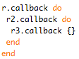

# Goliath: Non-blocking, Ruby 1.9 Web Server

By [Ilya Grigorik](https://www.igvita.com/) on **March 08, 2011**

There are easily half a dozen of factors you need to consider when picking an app server: the choice of the VM, implementation model, performance and memory usage, driver and library availability, community support, and so forth. In other words, it is a complex set of requirements, and no one solution is likely to meet all of them. Not surprisingly, the Ruby ecosystem alone offers a variety of choices where [Mongrel](http://en.wikipedia.org/wiki/Mongrel_(web_server)), [Passenger](http://www.modrails.com/), [Unicorn](http://unicorn.bogomips.org/), and [Thin](http://code.macournoyer.com/thin/) are some of the most popular - each has its own set of advantages and its own set of tradeoffs.

At PostRank, weighing our own set of requirements, we chose an event-driven architecture with MRI Ruby + [EventMachine](https://github.com/eventmachine/eventmachine) as our primary runtime. In the process, we have iterated on several versions of our own web-stack, and arrived at a model which has been a rock solid performer: a fully asynchronous server powered by Ruby 1.9, with a [Fiber context](http://www.igvita.com/2009/05/13/fibers-cooperative-scheduling-in-ruby/) for each request. **Today, we are releasing Goliath ([http://goliath.io](http://goliath.io/)) to the public!**

## Goliath: Architecture & Features

At its core Goliath is an app server like Mongrel or Thin - it is built around a [Rack API](http://rack.rubyforge.org/) - but due to its fully asynchronous nature it is also not a direct substitute. Instead Goliath is both an app server and a lightweight framework designed to meet the following goals: [fully asynchronous](https://github.com/postrank-labs/goliath/wiki/Asynchronous-Processing) [processing](https://github.com/postrank-labs/goliath/wiki/Streaming), [middleware support](https://github.com/postrank-labs/goliath/wiki/Middleware), [simple configuration](https://github.com/postrank-labs/goliath/wiki/Configuration), high-performance, and arguably most importantly, **readable and maintainable code**.

Asynchronous, or event-driven programming relies on the concept of [callbacks](http://en.wikipedia.org/wiki/Callback_(computer_programming)): blocks of code whose execution is deferred until an appropriate event (ex: socket IO) triggers it. While this is not a complicated concept on its own, in the long run, it seems to result in complicated, non-linear execution models which are hard to maintain - we have experienced this firsthand at PostRank and hence made it a primary concern for Goliath.

To solve this, Goliath runs on Ruby 1.9 and leverages [Fibers](http://www.ruby-doc.org/core-1.9/classes/Fiber.html) (coroutines) to allow us to transparently [pause and resume the execution](http://www.igvita.com/2010/03/22/untangling-evented-code-with-ruby-fibers/) of our asynchronous codebase, while **preserving the look and feel of a synchronous API!**

## Goliath: async GitHub proxy

To get started, simply **"gem install goliath"** under Ruby 1.9 and copy the following example:

```
require 'goliath'
require 'em-synchrony/em-http'

class Github  Goliath
   GoliathParams             # parse query & body params
   GoliathFormatters   # JSON output formatter
   GoliathRender             # auto-negotiate response format
   GoliathValidationError    # catch and render validation errors
   GoliathValidationRequiredParam  => 'query'

   response
      HttpRequest"http://github.com/api/v2/json/repos/search/params'query'
    logger "Received response_headerstatus from Github"

     'X-Goliath' => 'Proxy' response
  

# > gem install em-http-request --pre
# > gem install em-synchrony --pre

# > ruby github.rb -sv -p 9000
# > Starting server on 0.0.0.0:9000 in development mode. Watch out for stones.

# > curl -vv "localhost:9000/?query=ruby"
```

[goliath](http://www.github.com/postrank-labs/goliath/) - Goliath is an async Ruby web server framework

If you are familiar with the Rack API, the above example should be very straightforward: first, we tell our API to use two distinct middleware filters (*Params*, and *Validations*), and within our response method we return an array containing the response code, response headers, and the response body.

The asynchronous part, which is the [HTTP request](http://github.com/igrigorik/em-http-request) we dispatch to GitHub's search API, is automatically paused for us until the request is complete, and later resumed without any intervention on the part of the developer - **no callbacks required**! Best of all, this same pattern applies for [any kind of asynchronous IO](https://github.com/postrank-labs/goliath/wiki/Asynchronous-Processing).

## Performance: MRI, JRuby, Rubinius

Goliath is able to run on MRI Ruby, JRuby and Rubinius today. Depending on which platform you are working with, you will see different performance characteristics. At the moment, MRI Ruby is the best performer: **a roundtrip through the full Goliath stack on MRI 1.9.2p136 takes ~0.33ms (~3000 req/s)**.

JRuby performance (with --1.9 flag) is currently much worse than MRI Ruby 1.9.2 due to the fact that JRuby fibers are currently mapped to native Java threads. However, once Lukas Stadler's JVM coroutine patch ([JRUBY-5461](http://jira.codehaus.org/browse/JRUBY-5461)) gets integrated, JRuby may well take the performance crown. At the moment, without the MLVM support, a request through the full Goliath stack takes ~6ms (166 req/s).

Rubinius + Goliath performance is tough to pin down - there is a lot of room for optimization within the Rubinius VM. Currently, requests can take as little as 0.2ms and later spike to 50ms - stay tuned!

## Getting started with Goliath

Goliath has been in production at PostRank for well over a year, serving a sustained rate of 500+ requests/s for months at a time (no memory leaks, no restarts). Internally, we use it to interface with MySQL, MongoDB, Cassandra, as well as many other local and remote web-services. Goliath supports HTTP keep-alive, request pipelining, and can be used to build real-time, streaming API's - all features we use to optimize our infrastructure.

Take a look through the [readme](https://github.com/postrank-labs/goliath/), check out the [documentation](http://postrank-labs.github.com/goliath/doc/index.html), and take a look at some of the examples in the repository: [streaming API](https://github.com/postrank-labs/goliath/blob/master/examples/stream.rb), [handling large file uploads](https://github.com/postrank-labs/goliath/blob/master/examples/async_upload.rb), [building a http proxy with MongoDB logging](http://everburning.com/news/stage-left-enter-goliath/), and [others](https://github.com/postrank-labs/goliath/tree/master/examples). Install it, play with it, fork it, and let us know how it goes!

**Ilya Grigorik** is a web performance engineer and developer advocate at Google, where his focus is on making the web fast and driving adoption of performance best practices — [learn more](https://www.igvita.com/), follow on [Twitter](https://twitter.com/igrigorik) (29K), [Google+](https://plus.google.com/+IlyaGrigorik) (18K).
