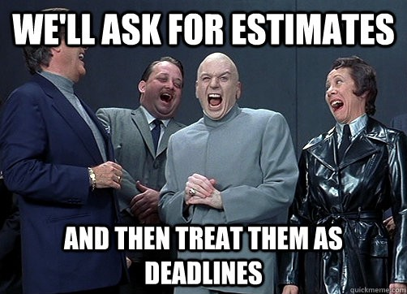

# Technical debt 101

## A primer about technical debt, legacy code, big rewrites and ancient wisdom for non technical managers

> Everything has an appointed season,  
> and there is a time for every matter under the heaven.  
> — [Ecclesiastes, chapter 3](http://www.chabad.org/library/bible_cdo/aid/16464/jewish/Chapter-3.htm)

## The problem of analogies

In software development, the dreadful consequences of sacrificing quality are widely misunderstood by non technical managers. They underestimate how detrimental it is to continued productivity and morale, and ultimately, to the overall strategy of the company.

Given non technical managers have no actual first-hand experience building software, to explain them these consequences we have to rely only on analogies. And here is where our problems start.

Analogies for sure are wonderful tools. Joseph Priestley famously praised them as the root of all scientific endeavor:

> Analogy is our best guide in all philosophical investigations;  
> and all discoveries, which were not made by mere accident,  
> have been made by the help of it — Joseph Priestley

When physicists talk about “spins” in the electrons, or about “infrared”, they are using analogies to try to make the real way the world works fit in our limited capacity of picturing it. Electrons do not literally spin, and infrared is not a “little less red”. It’s impossible to understand what exactly *spin* means, except it’s a very peculiar behavior of electrons that can be *used* to predict atomical interactions. It’s also impossible to *imagine* — in the sense of having a mental picture of — other colors, although it’s possible to *conceive*, through reason, the existence of more colors than the visible ones.

In any case, an analogy implies that the words we are using to describe a phenomenon are not univocal ([Thomas Aquinas is of big help on this subject](http://plato.stanford.edu/entries/analogy-medieval/)). This means that the word *spin* is used with two different senses, one that we know the meaning and another one that is new and foreign. These two senses, at best, can be in some way similar that they light a “spark in understanding”, making us comprehend, through this familiarity, at least a part of the nature of the phenomenon. At worst, they can misrepresent the phenomenon in ways that may drive us astray in our quest of knowledge.

## **The analogy of *technical debt***

Probably, the best analogy created to explain the consequences of not making things right in the first place is the analogy with debt.

A “debt” means that you traded acquiring something now for a long-term financial burden. This burden is not just about repaying what you got: there is an “interest”. It means that, even if you pay your debt timely, you’ll pay more than you took, and if you don’t, your debt will keep increasing even if you don’t do anything. And if you ignore a debt long enough, it will become unpayable and you’ll get “bankrupt”.

Shylock and Jessica, by [Maurycy Gottlieb](http://en.wikipedia.org/wiki/Maurycy_Gottlieb)

Despite the age-old populace feelings against the credit system, epitomized by Shakespeare’s character Shylock, the evil Jewish moneylender in The Merchant of Venice, debt is a good thing. As we learn from Niall Ferguson’s [The Ascent of Money](http://www.youtube.com/watch?v=4Xx_5PuLIzc), the possibility of credit is one of the driving forces of innovative societies. Simply put, one can buy a machine to start producing something and then pay for the machine. In societies where trust and economical institutions are not in place, no such thing can happen, and stagnation is the norm.

So the analogy is this: every time you don’t write software based on the best possible practices and understanding of the business domain, you incur in a *technical* *debt*. This debt keeps increasing in time, just like an interest, because whoever has to change something has to deal with the imperfect concepts you codified in the first occasion. If you ignore it long enough, you can go *technically bankrupt*, where the codified concepts do not reflect anymore the domain you’re working on.

## What exactly is technical debt

According to the creator of the analogy, Ward Cunningham, it’s something that you get when you delay design decisions for later, when you’ll have better information. The concept of technical debt is only useful when used consciously on every decision, and when you know precisely how and when you’re going to refactor things. Let me give you one example:

You start writing an application. In the beginning there is no need for user roles. Everyone can do anything. At some point you start having two different permissions for a specific action, like one kind of user can see a report and the others can’t. The tech team considers whether to create a full fledged permission system, using a nice set of design patterns for it. But at this point it really looks like over engineering. One method in the business logic and one in the presentation layer will do.

Some time later another thing requires the differentiation of users, and then another and another. At this point the developers realize that the code is starting to get messy and the solution is refactoring it to have a decent permission system. To make this refactoring will take way more time than just adding another method, but will simplify the code and make future permissions to be added with one line of code, or even by just adding a row in the database.

The problem is that there *really* is a business need to have the current permission live in one or two days, ‘cause this will make five potential customers to sign a contract this week, rather than next week, or maybe never, if they dislike the fact that the company haven’t done their only request.

This is the point where a decision to take debt can be made. All the relevant info for such a decision is clear. In the beginning, to add a permission took 3 story points. Now, it’s taking 4. Soon it will take 5, 6 … [who can predict?](http://ieeexplore.ieee.org/xpl/login.jsp?reload=true&tp=&arnumber=6579461&url=http%3A%2F%2Fieeexplore.ieee.org%2Fxpls%2Fabs_all.jsp%3Farnumber%3D6579461). The whole refactoring now is 21. So the decision, today, is not between 4 and 21. Is between three possible scenarios:

- 4 now (the permission), 22 later (the refactoring, that now is a bit more complicated) and something close to 0 for every new permission after that, followed by a general small increase in overall productivity; In this scenario the company has added 5 clients to the portfolio and the money comes in early;
- 21 now (the refactoring), 0 later (the permission); In this scenario the company haven’t added the 5 clients to the portfolio now, so the money comes later;
- 4 now (the permission), no refactoring at all, and then 5 for the next permissions, and then 6, 7… until the point a new refactoring is suggested, now costing 50-something; In this scenario the money comes earlier, but next time it’s required to do something specific to add clients, it will take way more time;

Given total time, it’s *always* better to go for the best design as possible. Just like the best scenario for a company is to be able to invest in new things without going to the bank. But in this state of affairs, the first scenario *is* the wise way to go. One warning: even this kind of trade-off [can’t be done constantly](http://signalvnoise.com/archives2/getting_real_take_it_slow_if_you_need_it_fast.php).

But again, this kind of negotiation isn’t the norm. Most managers do not understand precisely the concept of technical debt. Here’s Steve McConnell, the author of Code Complete, among other masterpieces, in an [interview](http://www.ontechnicaldebt.com/blog/steve-mcconnell-on-categorizing-managing-technical-debt/) to the website On Technical Debt:

> …business staff think we can load up technical debt because they  
> never truly see the consequences. But those consequences are there…  
> they are just never expressed in a way that the business staff can engage with.

## When to take debt

One point that I have been listening over and over is that “the main thing in startups is time to market” and that since you haven’t “validated your main business assumptions” yet (in regular english it means that you still don’t make money out of it) it’s ok to incur in debt that you will pay eventually when your company is successful.

This line of reasoning although appealing is not the whole story. The mantra created by LinkedIn’s founder Reid Hoffman “if you are not embarrassed by the first version of your product, you’ve launched too late” quickly became an excuse for an *anything goes* approach. Thousands of startups have launched and failed precisely for the lack of quality. Obviously there is a certain minimum quality required to make any product successful, even a small one. And this minimum, given the [big shift of the industry into design & UX](https://medium.com/@jamieskella/the-bottom-line-value-of-design-fb3b938a5255), agile and constant delivery in recent years, is raising every day.

This is precisely what the concept [Minimum Lovable Product](http://www.slideshare.net/spookstudio/the-minimum-loveable-product-31984451) (in contrast to the MVP) captures. The idea is that in order to get something fast, for it to be lovable, you should prefer sacrificing scope by ruthless prioritization.

In any event, it’s safe to say that *all* startups acquire some technical debt to be paid in the event of success. Some of this startups are aware of this trade, and they have a clear plan to deal with it. These startups, when capitalized, then invest in making their kitchens cleaner and move at a faster pace than their competitors.

## Writing bad code is not technical debt

The main misconception of this analogy is that technical debt is what you get when you write bad code. This is *completely* wrong. Technical debt is a way to make design trade-off decisions in a clear, manageable way. The kind of communication that happens in such a decision is the one presented above. Now, picture this completely different conversation:

**Manager:** When will the new permission be done?  
**Junior developer:** Mmmm, I *hope* tomorrow, in the end of the day.  
**Manager:** We need it today. Can’t you find a “creative” way to do it?  
**Junior developer:** Let me think…  
**Manager:** We have 5 clients that really need this today. Else they will probably not sign the contract.  
**Junior developer:** But the…  
**Manager:** Look, it’s important that you understand the business value of it. Isn’t it just a new condition in the code? Just put it there, and we’ll “fix it” later.  
**Junior developer:** Ok.  
**Manager:** So we’ll be able to deploy today?  
**Junior developer:** Aham.

This is not a technical debt negotiation. Real technical debt negotiations occur only with more experienced developers and managers, who both understand precisely the implication of their actions.

But isn’t this company getting debt anyway? The answer is *no*. And that’s because the analogy of debt starts to fail in this scenario. The manager’s request is not about consciously sacrificing the design now to improve later, it’s a blank check for the inexperienced developer to simply write *bad code*.

The problems of this approach are vividly presented by Chad Fowler in his article [Killing the Crunch Mode Antipattern](http://chadfowler.com/blog/2014/01/22/the-crunch-mode-antipattern/). According to Fowler, these are *some* of the consequences of working constantly with short deadlines and poor quality:

- It makes even experienced developers fall into rookie mistakes;
- It kills developers’s passion, sometimes permanently, making the best developers leave;
- It destroys accountability, since the hurry becomes a — good? – excuse for mistakes;
- It erodes trust between management and the tech team, sometimes permanently;

Here’s the author of the debt analogy, Ward Cunningham, making clear he never thought technical debt was about writing bad code.

It’s clear that non technical managers are not 100% clueless about the consequences of bad quality. They know that when they say “just ship it” they are doing something that *will* have consequences. Some of them just think the consequences are small or will take a long time to appear. Others just go for wishful thinking. Some even have a better understanding, but prefer to say this is a problem of the tech team, since *their* metrics are going fine. I’ve seen even some — let’s be honest, really junior — managers arguing that doing things right would be an *investment*, putting our analogy upside down.

At this point one might say that it’s a responsibility of the tech team to make business understand the consequences of this kind of action. And yes, it *totally* is.

The foundations of this sort of professionalism in software were laid out recently by Bob Martin, in his already classic [Clean Coder](http://www.amazon.com/The-Clean-Coder-Professional-Programmers/dp/0137081073).

The problem is that, as a rule of thumb, the type of company that is more prone to have this kind of mentality and negotiation is, prototypically, not founded by engineers and is where tech teams are either junior or considered secondary to company’s goals. This way, even if they know how things should be done, their voice is too weak to be heard.

And given their lack of experience, *if* they try to change something, once they fail, the impetus is gone. They start believing — correctly — that the disregard for quality is part of the essence of the company and either they leave or they accept reality as it is.

So, given the debt approach is not helpful anymore, what can be a good analogy for writing bad code?

## Some civil engineering analogies

Rio de Janeiro. 3am, 2 of february, 1998. In a growing area in the west of the city, Barra da Tijuca, a building called Palace II starts to crumble. The building was finished less than 3 years before that. 44 apartments were completely destroyed, and 8 people died.

Implosion of the palace II

As things usually happen in Brazil, in 2014, the builders were not properly punished and the victims were not properly compensated. The result of the investigations was questionable.

Anyway, based on the evidences at the time, many experts said that the concrete had too much water and contained beach sand. Also, they said that there wasn’t an engineer overlooking the construction, and that the there was basically no quality control.

So the analogy of a building built with sand seems to capture most of the aspects of creating bad software: there’s literally no quality control, managers either are aware of this and acting in bad faith, ignore the problem or are absent — and that doesn’t excuse them.

The main problem is that software just doesn’t suddenly fall. There is no gravity in software. The grains of sand, though not properly glued each other to create solid material, keep floating in the air. And this is a problem, because this makes the consequences of bad practices less visible than in the case of Palace II. You can always add some more sand to your software building. Some sand will fall, some will move to unexpected places and knowing where to put the new sand will become really hard, but still, the building stands.

> The programmer … works only slightly removed from pure thought-stuff.  
> He builds his castles in the air, from air, creating by exertion of the imagination.  
> — Fred Brooks

Anyway, I think this analogy captures how serious the results of poor quality can be and how managers should take more responsibility on it.

Another analogy is what is called in portuguese “puxadinho”. A puxadinho is an extension of a construction done without any expert supervision, poor materials and generally illegally.

The puxadinho is the standard pattern that builds up whole “favelas”, the brazilian slums.

The puxadinhos are not restricted to construction only. As you can see in the picture, they extend to the whole basic infrastructure, like plumbing, energy, telephone cables, internet and cable TV.

Now let’s take this analogy and see how far we can go. A new puxadinho, along with the clumsy infrastructure, is built any time a manager says “ship it”. It is clearly not just a design trade-off. It may damage previous construction, or even destroy it. It can mess with the cables in a way that puts the whole slum on fire. It’s built in such a poor way that rebuilding it in an organized fashion is virtually impossible. If you plan to take a whole slum and make it something organized, you’ll have to lay out a completely new blueprint.

After all, can you imagine how hard it would be to sort out all these cables?

## Legacy code

Technical debt can be paid by refactoring. It takes time but it’s doable. But when code is just bad, refactoring is way, way harder. This is because to refactor you need to be confident that your changes are not going to break anything. It’s pretty much like trying to organize the cables in the image above without disconnecting anyone’s phone or power. This is basically because bad code is almost universally unaccompanied by tests.

Imagine that while trying to sort out the cables you have 1) a comprehensive list of which services goes to who — like “Mr Joe has phone and cable, Ms Sue has internet” and so on — and 2) there’s an alarm that triggers every time a service is connected or disconnected wrongly. This is what tests give you in terms of code.

<http://www.amazon.com/Working-Effectively-Legacy-Michael-Feathers/dp/0131177052>

But the reality is way different. When you start sorting the cables you have no such list or alarm. You can only know that something went wrong when someone complains.

This is why some authors, like Michael Feathers, have [defined legacy code as code without tests](http://www.informit.com/store/working-effectively-with-legacy-code-9780131177055?aid=15d186bd-1678-45e9-8ad3-fe53713e811b):

> Code without tests is bad code.  
> It doesn’t matter how well written it is; it doesn’t matter  
> how pretty or object-oriented or well-encapsulated it is.  
> With tests, we can change the behavior of our code quickly and verifiably.  
> Without them, we really don’t know if our code is getting better or worse.

So you might be thinking “ok, all it takes to refactor bad code is to add tests”. The problem is that writing tests on top of bad code is also terribly hard. It is like trying to create the list and the alarm just by looking at the arrangement of the cables. In technical terms, bad code is *tightly* *coupled* — the cables are too interconnected – and it has *low cohesion* — the phone cables are not visibly distinguishable from the TV cables.

So this is the *catch 22* of fixing legacy code: to refactor, you need tests, to test, you need to refactor.

## The big rewrite

The big rewrite is the default solution when developers are fed up with the lack of quality and they finally decide to stand up to what they believe. But most big rewrites are unsuccessful.

The problem of big rewrites is that they are a technical solution to a cultural problem. Bad code wasn’t created *only* because developers don’t know how to code properly. It was created by the kind of conversation and mentality we discussed above.

When developers propose a big rewrite, and for whatever crazy reasons, business agrees, the stage is set for a new kind of failure. Business starts by asking if *all* functionality will remain in the new app. Energized by the prospect of making things right, and overconfident, developers say “yes”. It turns out that it’s virtually impossible to track all functionality in a legacy code base, and few rewrite projects take the huge necessary time to document *everything*.

The second thing business will ask is about deadlines. Estimating a big rewrite is probably one of the most unrealistic things one can try to do.

The third thing is that business will not accept all new features to be halted. Therefore there will be the need to keep track of them, and to reimplement them as well. And all relevant data should be migrated.

Fourth, in the rush to convince business, developers will promise all kinds of things, like that the refactoring will make the system faster, more robust or scalable…

Fifth, given part of the problem was developer’s inexperience in coding itself, how can they guarantee that now they know better? Will there be new, senior developers, or maybe consultants, helping them?

Sixth, generally, planning is not a particular strength of the kind of project that ends up needing a rewrite. Will the rewrite be properly planned?

All these problems, and many more are discussed in Chad Fowler’s series [The Big Rewrite](http://chadfowler.com/blog/2006/12/27/the-big-rewrite/).

So, the only realistic solution to legacy code is about *radically* improving the *current* code base in cycles. This *must* be done by introducing tests, even being really hard and time consuming. The monolithic app must be broken into uncoupled pieces. And all data migrations and more radical changes must be perfectly planned and synchronized.

The amount of time you’ll take making a legacy code fit for continuous, productive development, that good developers will want to work with, that can predictably, consistently deliver business value, will be *enormous* (I’m presuposing here that you can’t just stop developing this product). It will also require a big shift in culture.

But again, it’s just the natural consequence of a continuos stream of bad, unconscious and uninformed decisions in the past. The only question that remains is *when* you’ll take this decision.

> Yes, the medicine is harsh, but the patient requires it in order to live.  
> Should we withhold the medicine? — Denis Thatcher

## The cultural shift

Just like any literary piece has many interpretations, the lesson of Aesop’s fable, The Tortoise and The Hare is not a consensus. My take here is that it is not about speed or slowness, but about *hubris*. The hare acts with foolish over-confidence, hastes in the beginning and then slows down letting the tortoise win.

The moral of the story is that at some point, the hubris of neglecting quality will start to affect your company’s strategy, either by slowing you down or by making your company unattractive to good developers. And as [Elon Musk said last week](http://www.teslamotors.com/blog/all-our-patent-are-belong-you) when he announced open sourcing all Tesla Motor’s patents:

> Technology leadership is … defined … by the ability of a company  
> to attract and motivate the world’s most talented engineers.

The hare in a snail shell, one of the many Festina Lente symbols

The competitors *will* bring you down, when you’re sleeping.

The Roman historian Suetonius, in *De vita Caesarum*, tells us that Augustus, the first emperor of Rome, adopted the motto “Festina Lente”, literally “more haste, less speed”:

> He thought nothing less becoming in a well-trained leader than haste and rashness, and, accordingly, favorite sayings of his were: More haste, less speed.

> That is done quickly enough which is done well enough.
