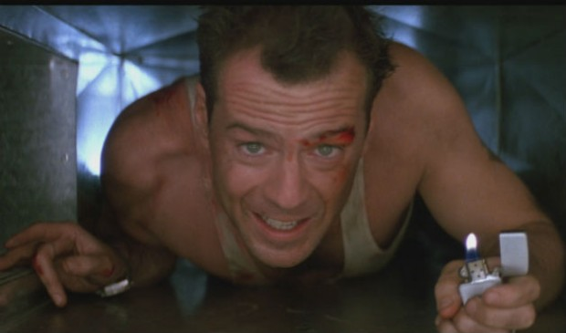

# Como estar sempre pronto

Sabe quando a data da prova do concurso é anunciada? Uma pessoa especial surge na sua vida? O chefe pede uma apresentação super importante do dia para a noite? Qualquer uma dessas coisas pode nos pegar de surpresa. Mas como estar pronto?

Como bons brasileiros, temos certo orgulho de afirmar que na hora do aperto tiramos de letra e tudo sai melhor do que uma tarefa com prazo longo. Essa fórmula só dá certo para aquelas pessoas que sem o saber já estavam treinando silenciosamente as habilidades requisitadas.

Nunca entendi porque meu professor de Muay Thai me pedia para desferir o mesmo golpe inúmeras vezes contra um saco de areia sem graça. Quando questionei a explicação, aquilo me tirou do tédio de bater com aquela sensação de falta de propósito:

> “Numa luta, se você parar para pensar em como dá um soco ou chute primário já estará no chão. Aprender o básico é pré-requisito para que os golpes mais complexos surjam sem esforço.”

Do mesmo modo, esse preparo pessoal é responsável por treinar funcionalidades psicológicas que serão requeridas na hora H.

O sexo, por exemplo, pode parecer tão natural que nem notamos a variedade de funcionalidades prévias demandadas quando a garota está fervendo em sua frente.

A capacidade de estar relaxado para que tudo fique ereto, o corpo condicionado para ofegar à vontade, a mente curiosa para descobrir cada curva com preciosidade, a generosidade para considerar a parceira como uma pessoa com vontades próprias.

Não é raro a má performance ser resultado de uma pessoa de mentalidade frágil e despreparada. O sujeito superestimou a si mesmo e pensou: *“é só uma transa, basta lavar o corpo e passar desodorante”*.

Tudo errado.

Da mesma forma, uma apresentação de PowerPoint não fará nenhuma mágica no seu lugar. Seu *blablabla* desengajado, sem brilho no olho ou sentido na vida convencerá apenas os desavisados. Não é raro muitos terem um sentimento inconfessável de embuste.

Um casamento cúmplice, uma carreira bem sucedida e uma vida satisfatória não são resultado do acaso.

A maior parte das pessoas treina ao avesso. A reclamação incessante afia a limitação, a tarefa habitual feita sem esmero reativa o desanimo de quem só age sob holofotes. Não podemos desconsiderar o efeito do mau humor nutrido com regularidade. Na hora de manifestar alegria ou entusiasmo não haverá lastro pessoal para ser evocado.

Penso que existem 4 bases fundamentais para responder prontamente a qualquer tipo de tarefa que sejamos convocados.

### 1. Criatividade

A capacidade de construir novas realidades é subestimada em tempos em que o marketing monopolizou o sentido da criatividade.

Penso na criatividade como uma não-reatividade frente aos estímulos e uma capacidade de tecer sentidos novos à medida em que as interações humanas acontecem. A pessoa incapaz de mudar uma visão pessoal ou de se desapegar de si mesma treina muito pouco essa qualidade.

É curioso notar o desespero de alguns quando participam de processos seletivos e se paralisam quando são chamados a inventarem alguma coisa.

Elas estão desabituadas a ter curiosidade ou brincar pouco de fazer associações com temas, imagens e sons aparentemente desconexos.

### 2. Compaixão

Não consigo imaginar nenhuma situação a qual alguém seja convocado que exclua a habilidade de se colocar ombro a ombro com a realidade de alguém.

Todo tipo de problema ou tarefa que você seja demandado fatalmente necessitará da capacidade de se colocar junto da dor de alguém para encontrar um caminho de alívio e solução.

No momento da morte de um ente querido já vi pessoas ficarem imobilizadas. Resultado do hábito de pensarem exclusivamente em si o tempo todo. O destreino em apoiar, emitir conforto ou simplesmente olhar com serenidade e sem pressa é fatal em casos extremos.

### 3. Sabedoria

Desenvolver bases pessoais estáveis e critérios claros para tomar decisões é matéria desconhecida para muitos.

O tipo de volubilidade a que são compelidos cotidianamente os deixa cegos para se posicionar diante de impasses complexos. Quando o tema foge do futebol, cerveja e mulheres raros são aqueles que se articularam internamente em algum tipo de legislação interna razoável para diferenciar questões éticas e até práticas.

Quando são evocados percebem o abismo moral por onde caminham e apelam para a crítica rasa e preconceituosa ou filosofia de boteco.

Tudo para tirar de sua frente o espelho que revela a invisibilidade moral autoimposta.

### 4. Relaxamento

Mesmo com todos os recursos ativos do coração e da mente, se uma pessoa não for capaz de repousar sobre si mesma e segurar seus ímpetos corriqueiros, fatalmente será impelida a cair no mesmo buraco pela décima vez.

Saber respirar, retirar-se dos próprios interesses, contemporizar urgências e aplacar ansiedades controladoras são virtudes ignoradas.

Aquele que passa à frente, se mete em todas as discussões, palpita impensadamente ou que fala sem parar, provavelmente acha que relaxar é atributo dos fracassados.

Treinar o relaxamento começa no momento de acordar, mastigar os alimentos e até diminuir a checagem constante de aplicativos em celulares.

Se você puder preparar sua personalidade com essas ferramentas básicas, outras complementares serão habilitadas naturalmente.

Quando a vida cutucar e pressionar até o limite, você não terá que tirar um coelho da cartola. Tudo aquilo que treinou sem pressão e com riso no rosto garantirá que atravesse qualquer crise de cabeça erguida, serena, ativa e bem acompanhado de pessoas queridas.

Por isso, treine antes de precisar.

### Mecenas: [Nivea Men](http://pdh.co/niveamen)

*Todos os dias, ao acordarem, homens fazem o que precisa ser feito. A insatisfação existe, é verdade, mas  aprendemos, trabalhamos, caímos e nos levantamos. Suamos a camisa, em contínuo aperfeiçoamento.*

*Neste canal especial do PapodeHomem, teremos diálogos e debates sobre diversas questões do homem. A conversa também acontece [no Facebook oficial de Nivea Men](http://pdh.co/niveamen), eles tem dito coisas bem interessantes por lá.*
