# 15 fatos sobre programação que você provavelmente não sabia

[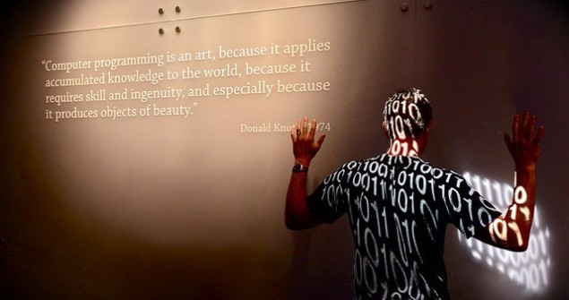](http://pichiliani.com.br/wp-content/uploads/2014/06/0_Capa.jpg)

A tarefa de programar está se tornando cada vez mais comum, porém ainda existem muitos fatos que as pessoas não conhecem sobre programadores e a programação em si. Acompanhe comigo o conteúdo deste post que apresenta 15 fatos pouco conhecidos sobre a programação.

Assim como outras atividades intelectuais, a tarefa de programar e de como as pessoas aprendem a programar computadores é muito estudada. De fato, com cada vez mais pessoas aprendendo a programar, independente da linguagem, ferramenta ou plataforma utilizada, é natural que poucas pessoas realmente saibam de certos fatos importantes já bem conhecidos sobre programação e desenvolvimento de software.

Do ponto de vista acadêmico, as áreas de engenharia de software e educação apresentam diversos estudos muito interessantes obtidos por meio de experimentos cujos resultados são apresentados em teses de mestrado e doutorado ou papers da área. E com base nestes resultados que escolhi os fatos a serem citados neste post junto com as devidas referências. A propósito, se você leitor ficou com vontade de saber mais sobre cada um dos pontos discutidos aqui recomendo fortemente procurar a referência completa para mais informações.

Com base neste contexto, vou apresentar 15 fatos importantes e que, infelizmente, são pouco conhecidos por quem programa. Mas antes faço um aviso: estes fatos apresentam resultados de pesquisas experimentais e empíricas que possuem contextos específicos. O que quero dizer é que existe certa margem para discussão da aplicabilidade e generalização, porém conhecer o que já foi estudado e descoberto é importante e, no mínimo, pode instigar a discussão e o quão perto da realidade do leitor são estas informações.

**1) Programadores demoram para pedir ajuda quando tem problemas**

[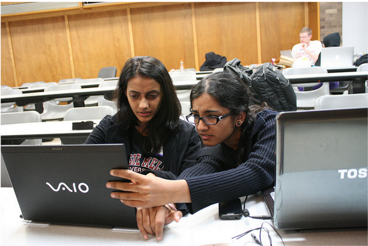](http://pichiliani.com.br/wp-content/uploads/2014/06/1_PedirAjuda.png)

Este é um fato relacionado à maneira como as pessoas aprendem a programar, pois basicamente o ensino segue a linha de aprendizado da matemática: um pouco de teoria, um ou dois exemplos e muitos exercícios. Este formato leva os aprendizes a tentar muito nos exercícios e, muitas vezes, resolver tudo sozinhos sem pedir ajuda.

Esta atitude não é ruim e é até recomendada, porém é preciso saber até que ponto deve-se deixar de tentar e pedir alguma forma de ajuda.

Referência: [Andrew Begel e Beth Simon. Novice software developers, all over again.  ICER ’08 Proceedings of the 4thinternational Workshop on Computing Education Research, 2008.](http://dl.acm.org/citation.cfm?id=1404522)

**2) Programadores possuem uma tendência a reportar de forma incompleta seus problemas**

[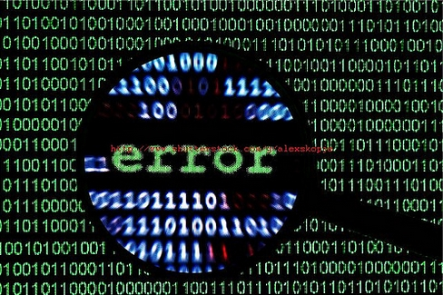](http://pichiliani.com.br/wp-content/uploads/2014/06/2_Erro.jpg)

Este fato é relacionado com pesquisas da área da psicologia. Os resultados indicam que quando uma pessoa tem algum problema ela não comunica todas as informações completas sobre os problemas, especialmente quando ela é o responsável de forma direta ou indireta.

Este resultado já foi comprovado experimentalmente com programadores e uma das principais justificativas é a seguinte: reportar de forma completa um problema é visto como sinal de fraqueza que pode levar a algum tipo de julgamento da habilidade e proficiência por quem está ouvindo o relato. Esta situação é muito mais comum quando se trata de um erro básico de principiante.

Referência: [Shrauger, J.S. and T.M. Osberg. The Relative Accuracy of Self-Predictions and Judgments by Others in Psychological Assessment. Psychological Bulletin, 1981. 90(2): p. 322-351.](http://psycnet.apa.org/index.cfm?fa=buy.optionToBuy&id=1981-29308-001)

**3) Programadores procuram outras formas de ajuda antes de falar com colegas de trabalho**

[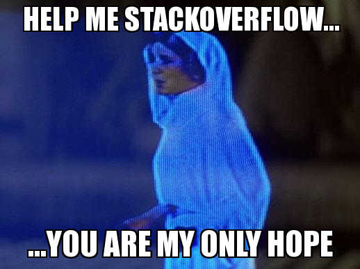](http://pichiliani.com.br/wp-content/uploads/2014/06/3_StatckOverflow2.png)

O fato da comunicação com outras pessoas não assumir a prioridade quando um programador precisa de ajuda está relacionado novamente à sensação de julgamento que outras pessoas fazem ao saber da dificuldade.

Não obstante, sites como o [StackOverflow](http://stackoverflow.com.br) e outros floresceram explorando este tipo de comportamento através da agregação da ajuda com diversos aspectos de comunidades para desenvolvedores.

Referência: [LaToza, T.D., Venolia, G., and Deline. R. Maintaining Mental Models: A Study of Developer Work Habits. in Proc. ICSE. 2006: IEEE.](http://dl.acm.org/citation.cfm?id=1134355)

**4) O progresso na programação pode ser classificado em quatro fases**

  
A classificação do progresso de um programador é importante para auxiliar diversas métricas envolvidas no desenvolvimento de software, além de ajudar gerentes de projeto e outras pessoas a avaliar como anda o projeto como um todo.

Além disso, também é importante saber em qual fase de progresso o desenvolvedor está para, entre outras atitudes, oferecer algum tipo de ajuda para que ele não fique muito tempo emperrado em um local específico ao ponto de atrasar alguma entrega. Uma classificação interessante identificou (de forma automática) quatro possíveis estados de progresso:

a)    Programação complexa  
b)    Fazendo progresso  
c)    Progresso lento  
d)    Emperrado (stuck)

Referência: [Jason Carter,  Prasun Dewan. Design, Implementation, and Evaluation of an Approach for Determining When Programmers are Having Difficulty. ACM Group 2010.](http://dl.acm.org/citation.cfm?id=1880109)

**5) Programadores encontram barreiras superáveis e insuperáveis**

[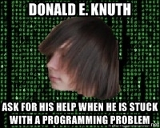](http://pichiliani.com.br/wp-content/uploads/2014/06/5_BArreira2.jpg)

Este fato pode parecer óbvio, mas ele é muito importante de ser detectado, uma vez que uma barreira de programação pode levar a sérios problemas de prazo, moral da equipe e confiança.

Uma das principais dificuldades de se detectar barreiras e classifica-las está no fato que esta informação pode ser subjetiva. Ou seja, perguntar diretamente para o programador se ele está com alguma barreira superável ou insuperável já afeta o resultado, pois ele nem sempre pode ser sincero. Há também algumas implicações em termos de ego e moral apenas pelo fato de identificar este tipo de barreira na programação,

Referência: [Andrew J. Ko et al. Six Learning Barriers in End-User Programming Systems. 2004 IEEE Symposium on Visual Languages – Human Centric Computing.](http://dl.acm.org/citation.cfm?id=1034570)

**6) São 6 os tipos de barreiras relacionadas à programação**

[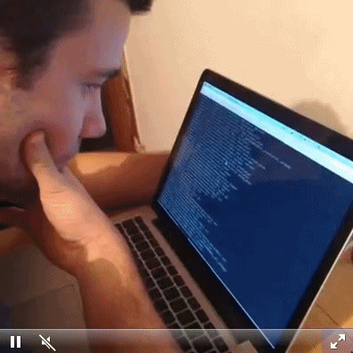](http://pichiliani.com.br/wp-content/uploads/2014/06/6_Barreira.gif)

Além da classificação de barreiras de programação em superáveis e insuperáveis há um estudo muito interessante que caracterizou cada uma das possíveis barreiras de programação.

Para ajudar a entender as barreiras os pesquisadores evidenciaram frases comuns em cada uma das classificações abaixo:

a) Design: “Eu não sei o que o computador deve fazer”.  
b) Seleção: “Eu sei o que fazer, mas não sei o que usar”.  
c) Coordenação: “Sei o que usar, mas não sei como combinar o que preciso”.  
d) Uso: “Eu sei o que usar, mas não sei como usar”.  
e) Compreensão: “Pensei que sabia usar X, mas ele não faz o que eu esperava”.  
f) Informação: “Compreendo o que aconteceu, mas não consigo checar”.

Referência: [Andrew J. Ko et al. Six Learning Barriers in End-User Programming Systems. 2004 IEEE Symposium on Visual Languages – Human Centric Computing.](http://dl.acm.org/citation.cfm?id=1034570)

**7)  Programadores passam aproximadamente 30% do tempo navegando no código fonte**

[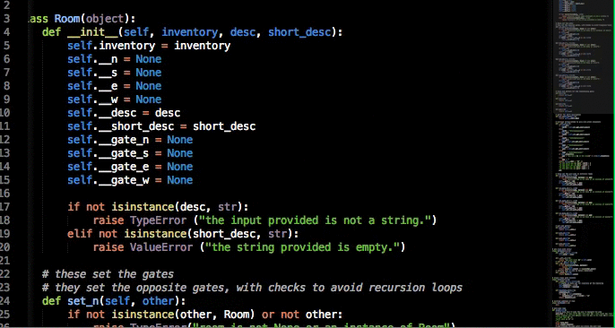](http://pichiliani.com.br/wp-content/uploads/2014/06/7_Navegando.gif)

Quem programa sabe que a maior parte do tempo é gasta dentro de uma ferramenta de edição de código fonte. Contudo, como o tempo é divido entre as tarefas de edição do texto representado pelo código fonte ainda não está claro do ponto de vista científico.

De acordo com um estudo muito importante, descobriu-se que aproximadamente 30% do tempo de trabalho de um programador não é gasto editando o texto (incluindo, alterando o excluindo), mas sim navegando entre diversos arquivos com códigos fontes. Esta navegação envolve pesquisa, observação, coleta de informações, memorização e outras atividades. Ou seja, dá para dizer que a programação é uma atividade cuja terça parte é apenas contemplativa.

Referência: [Andrew J. Ko et al. An Exploratory Study of How Developers Seek, Relate, and Collect Relevant Information during Software Maintenance Tasks. Journal IEEE Transactions on Software Engineering archive Volume 32 Issue 12, December 2006 pp. 971-987.](http://ieeexplore.ieee.org/xpl/login.jsp?tp=&arnumber=4016573&url=http%3A%2F%2Fieeexplore.ieee.org%2Fxpls%2Fabs_all.jsp%3Farnumber%3D4016573)

**8) Produtividade de programadores remotos é menor que a produtividade de programadores locais**

Esta afirmação sobre produtividade é polêmica, especialmente quando se fala cada vez mais em home office, trabalho remoto e projetos globais de desenvolvimento de software. De qualquer maneira, existem evidências concretas baseadas em diversas métricas de software que, de fato, programadores remotos não produzem tanto quanto programadores que estão no mesmo local.

Faz sentido pensar desta maneira se analisarmos os outros fatos desta lista como, por exemplo, a preferência pela falta de comunicação com outras pessoas. De fato, a comunicação informal é um dos principais fatores que influenciaram o resultado desta pesquisa, pois pedir aquela dica no encontro durante uma pausa para o café é muito importante de acordo com que foi apurado.

Referência: [Herbsleb, J.D., et al. Distance, dependencies, and delay in a global collaboration. In: Proceedings of the 2000 ACM Computer-Supported Cooperative Work conference.](http://dl.acm.org/citation.cfm?id=359003)

**9) A maioria dos programadores é masculina, branca e jovem**

Esta afirmação sobre a diversidade de programadores não veio exatamente de uma pesquisa acadêmica, mais sim de Adda Birnir que é a fundadora do site de recrutamento e seleção [Skillcrush](http://skillcrush.com/). Esta declaração foi apresentada no vídeo “Is CODE the most important language in the world?”.

Atualmente é muito comum destacar minorias na programação, espacialmente a baixa quantidade de mulheres. Contudo, como certos dados mostram este não é o único perfil que possui baixa representatividade na programação e isso pode ter uma implicação séria quando falamos em código de aplicações que precisam lidar de forma adequada com certos grupos de usuários.

Referência: declaração da Adda Birnir sobre diversidade de codificadores no vídeo “Is CODE the most important language in the world?”.

**10) As principais mensagens de erro, erro em tempos de execução e erros de compilação e o tempo médio para resolvê-los**

[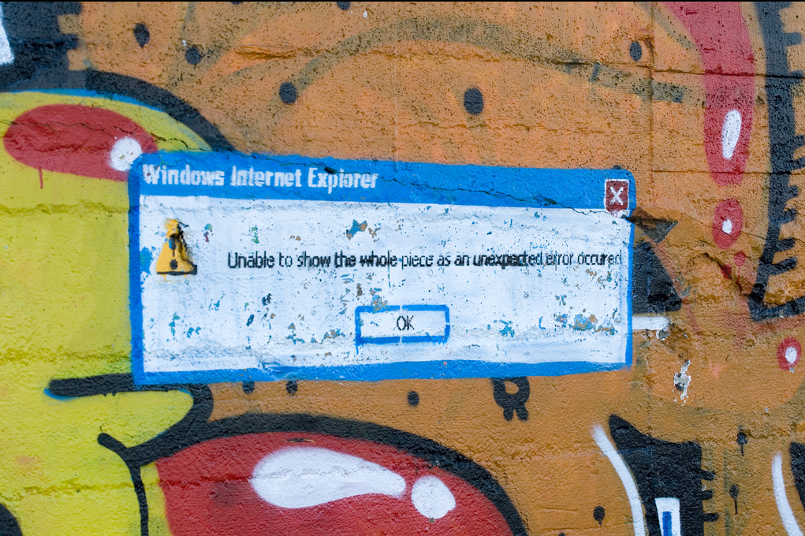](http://pichiliani.com.br/wp-content/uploads/2014/06/10_compile-time-error2.png)

Mensagens de erro, problemas de tempo de execução e erros de compilação são muito específicos para cada linguagem. Para destacar alguns casos cito a tese de mestrado da pesquisadora Suzanne Marie Thompson, pois ela analisou uma grande quantidade de programadores Java em diversos cenários e coletou muitos dados interessantes sobre isso. As tabelas abaixo contam um pouco da história sobre erros e tempo médio para corrigi-los.

Apesar do estudo se concentrar em um contexto muito específico (aprendizado da linguagem Java) é possível fazer um paralelo com outros cenários e situações e comprovar que realmente boa parte dos erros mais comuns acontece em diferentes contextos.

[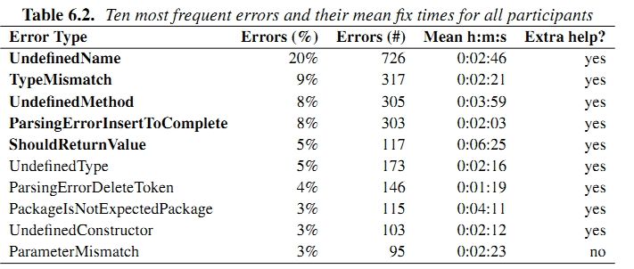](http://pichiliani.com.br/wp-content/uploads/2014/06/TempoMedioResolverProblemas.jpg)

Tabela 6.2. Erros mais frequentes (Java) e tempo médio de execução

[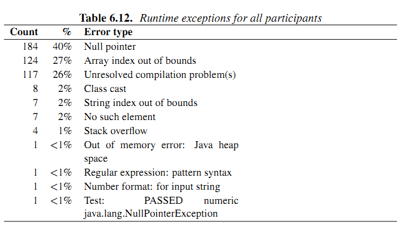](http://pichiliani.com.br/wp-content/uploads/2014/06/TabelaErrosDeExecucao.png)

Tabela 6.12. Frequência de erros de execução em Java (runtime)

[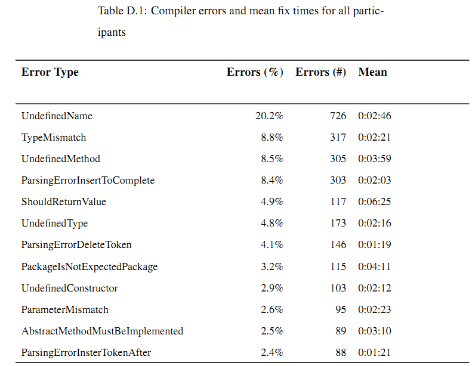](http://pichiliani.com.br/wp-content/uploads/2014/06/TabelaErrosCompilacao.png)

Tabela D.1 Principais erros de compilação (Java) e tempo médio para resolvê-los

Referência: [Thompson, Suzanne Marie. An exploratory Study of Novice Programming Experiences and Erros. Tese de mestrado defendida em 2004 na inversidade de Victoria, Canadá.](http://www.researchgate.net/publication/240762269_An_Exploratory_Study_of_Novice_Programming_Experiences_and_Errors)

**11) A manutenção de software consome mais de 50% do esforço**

[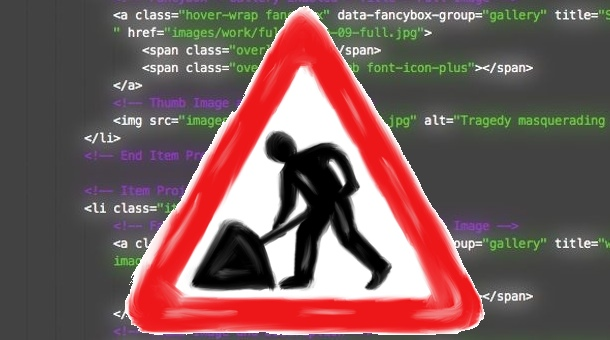](http://pichiliani.com.br/wp-content/uploads/2014/06/11_legacy-code.jpg)

A manutenção de um software envolve a manipulação de código legado, [assunto que já abordei antes](http://imasters.com.br/artigo/25067/desenvolvimento/manutencao-em-codigo-legado-por-onde-comecar/). Porém desta vez cito um estudo que fala sobre esforço e que mostra como resultado que a divisão não é igual entre a criação e manutenção.

No estudo que citou este valor de mais de 50% de esforço há uma ótima discussão sobre evolução do software no sentido da sua manutenção e das tarefas necessárias para tanto. Com certeza vale a pena dar uma olhada nesta referência antes de tomar aquela decisão sobre começar a desenvolver a solução do zero ou trabalhar com uma base de código existente.

Referência: [Kemerer C.F. and Slaughter S. An Empirical Approach to Studying Software Evolution, IEEE Transactions on Software Engineering, 25(4), pp. 493-509, 1999.](http://ieeexplore.ieee.org/xpl/login.jsp?tp=&arnumber=799945&url=http%3A%2F%2Fieeexplore.ieee.org%2Fxpls%2Fabs_all.jsp%3Farnumber%3D799945)

**12) A manutenção de software consome entre 40 e 90% dos custos**

Uma das principais regras de quem trabalha com negócios diz que é muito mais caro conseguir um cliente novo do que manter um cliente já existente. Contudo, de acordo com pesquisas da área de engenharia de software a realidade é um pouco diferente quando se fala de código: manter um código em funcionamento através de tarefas de manutenção pode chegar a custar até 90% de todos os custos do projeto.

Estas estatísticas são bem genéricas e foram obtidas em um contexto muito particular das 487 organizações estudadas nesta pesquisa, sem contar que a data do estudo é de 1980. Certamente existem diversos fatores a serem considerados, mas ao menos existe um ponto de partida para analisar cursos e discutir sobre este aspecto quando se fala de manutenção de software.

Referência: [Lientz, B.; Swanson, E.B. Software maintenance management: a study of the maintenance of computer application software in 487 data processing organizations. Addison Wesley, 1980.](http://www.amazon.com/Software-Maintenance-Management-Application-Organizations/dp/0201042053)

**13) O trabalho de manutenção de software é dividido em 4 tarefas básicas**

[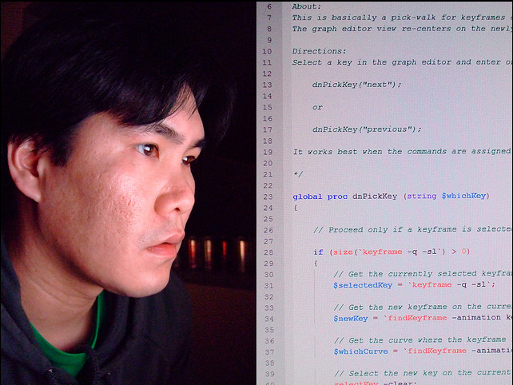](http://pichiliani.com.br/wp-content/uploads/2014/06/13_Sem-título.png)

Ainda falando sobre manutenção de código fonte, um estudo que influenciou muito a comunidade de engenharia de software classificou por meio da análise de resultados de questionários as principais práticas da manutenção de software. Quatro práticas foram identificadas:

a)    Melhoria: envolvem mudanças de funcionalidades  
b)    Adaptativa: são mudanças no ambiente para adaptação a requisitos  
c)    Corretiva: atividades para a correção de erros  
d)    Preventiva: melhorias para evitar problemas futuros

A classificação das práticas de manutenção é muito importante para auxiliar medições, organizar e rastrear bugs, agrupar funcionalidades em novas versões e gerenciar o trabalho de programadores.

Referências: [Lientz, B.; Swanson, E.B. Software maintenance management: a study of the maintenance of computer application software in 487 data processing organisations. Addison Wesley, 1980.](http://www.amazon.com/Software-Maintenance-Management-Application-Organizations/dp/0201042053)

[Lientz, B.; Swanson, E.B.; Tompkins, G.E. Characteristics of applications software maintenance, Communications of the ACM, Vol. 21, pp.466-471, 1978.](http://dl.acm.org/citation.cfm?id=359522)

**14) Custos da correção de defeitos após a implantação são 10x maiores do que na fase de construção e 100x maiores do que na fase de design**

Este fato é um clássico da área e motivou a evolução dos processos tradicionais de desenvolvimento de software até chegarmos ao que temos hoje. O principal ponto aqui é a identificação de custos elevados quando não se dá a devida atenção à construção e design do software.

Referências: [Barry W. Boehm: Software Process Management: Lessons Learned from History. ICSE 1987: 296-298.](http://dl.acm.org/citation.cfm?id=41798)

**15) Revisão de código pelos pares consegue descobrir até 60% dos defeitos**

A revisão de código feita por outas pessoas, seja na modalidade de *pair programming* ou não, é realmente efetiva. Existem diversos estudos sobre isso, mas um dos principais indica que até 60% dos defeitos podem ser descobertos (mas não necessariamente corrigidos) quando mais de uma pessoa revisa o código fonte.

Este estudo é relativamente antigo e pode-se dizer que ele é um dos principais influenciadores de técnicas envolvendo processos ágeis (Agile) e outras formas de desenvolver software cujo principal foco é nas atividades, etapas, organização e outras habilidades não tão técnicas quanto a programação.

Referência: [Barry W. Boehm: Improving Software Productivity. IEEE Computer 20(9): 43-57, 1987.](http://ieeexplore.ieee.org/xpl/login.jsp?tp=&arnumber=1663694&url=http%3A%2F%2Fieeexplore.ieee.org%2Fxpls%2Fabs_all.jsp%3Farnumber%3D1663694)

Esta entrada foi publicada em [Programação](http://pichiliani.com.br/category/programacao/ "Ver todos os posts em Programação"). Adicione o [link permanente](http://pichiliani.com.br/2014/06/15-fatos-sobre-programacao-que-voce-provavelmente-nao-sabia/ "Link permanente para 15 fatos sobre programação que você provavelmente não sabia") aos seus favoritos.
