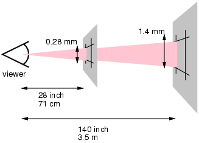

# Tudo que você precisa saber sobre resoluções, telas retina, devicePixelRatio, DPI, CSS pixels e etc

Uma versão mais atual, revisada e expandida desse assunto está disponível no meu [livro "A Web Mobile"](http://sergiolopes.org/livro-web-mobile/).

Há **muita confusão** rondando as discussões sobre resoluções de tela, densidade de pixels, usabilidade das telas, áreas útil e coisas relacionadas. *Confusão inclusive na mídia especializada*.

Um artigo que me despertou para escrever esse post saiu no [Gizmodo americano](http://gizmodo.com/5954863/the-ipad-mini-screen-sucks-compared-to-the-competition) no lançamento do iPad Mini, comparando-o aos concorrentes. O argumento era que a tela de 1024x768 do iPad Mini era pior que a de um Nexus 7 de 1280x800 pois tinha *menor área útil* disponível para o usuário. **Errado!**

O Nexus 7 tem resolução **tvdpi** com **devicePixelRatio** de ~1.3, o que dá um **viewport** de 966x603 pixels, equanto o iPad mini tem **devicePixelRatio** 1, com viewport igual sua resolução, em 1024x768.

Pixel ratio, viewport, CSS pixels, dpi - *parece grego?* Leia mais.

iPad Mini vs. Nexus 7 vs. Kindle Fire HD

## Resoluções e DPIs

Duas medidas são importantes numa tela: o **tamanho físico** da tela em centímetros – ou polegadas, como é mais comum – e sua **resolução em pixels**. Da divisão desses dois números, temos o **DPI** – *dots per inch* – que diz quantos pixels existem por polegada de tela.

Conseguimos saber a resolução em pixels da tela em JavaScript com as propriedades `window.screen.width` e `window.screen.height`. Mas, com JavaScript, **não é possível saber o tamanho físico da tela e nem seu DPI**.

O curioso é que o CSS tem algumas unidades para tamanho físico – você pode criar um div com width *1cm* ou *1in*. Mas isso não faz o que realmente queremos (um elemento de 1 centímetro ou 1 polegada *física*). Os navegadores em geral concordaram em um [dpi base de 96](https://www.webkit.org/blog/57/css-units/) e todas as contas são relativas a esse número. Então, se fizer um div de 1 polegada, na verdade você leva um de 96px, não interessando o tamanho físico real da tela ou seu dpi verdadeiro.

## Pixel ratio, CSS pixels e telas retina

Telas retina são telas de alta resolução com tantos pixels que eles acabam sendo pequenos fisicamente, tornando difícil o olho identificar um individualmente. Com isso, o conteúdo mostrado ficaria muito pequeno na tela, então a grande novidade é que **um pixel de conteúdo é renderizado com mais de um pixel físico**. *Ãhn?*

A ideia é simples: se você desenhar uma linha de 1px na tela (com CSS ou mesmo uma app nativa), ela será renderizada como uma linha de 2px físicos. Isso melhora, e muito, a definição dos elementos na tela. Existe, então, uma *razão de multiplicação* entre pixels lógicos e pixels físicos. Essa razão é o **device pixel ratio**, acessível em JS pela propriedade `devicePixelRatio` e nas [media queries CSS de alta resolução](http://sergiolopes.org/media-queries-retina/).

No mundo Apple, as telas retina têm *device pixel ratio* 2, o que facilita as contas. [No mundo Android](http://developer.android.com/guide/practices/screens_support.html), essas mesmas telas são chamadas de xhdpi – como num Galaxy S3 ou num Nexus 4. Mas, no Android, temos mais possibilidades:

- xhdpi (extra high dpi) - **pixel ratio 2** - ex. Galaxy S3, Galaxy Note 2, Nexus 4.
- hdpi (high dpi) - **pixel ratio 1.5** - ex. Galaxy S2, Motorola Atrix, Nexus One.
- tvdpi - **pixel ratio 1.33** - usado só no tablet Nexus 7.
- mdpi (medium dpi) - **pixel ratio 1** - telas normais, comuns em smartphones simples.
- ldpi (low dpi) - **pixel ratio 0.75** - aparelhos low-end como o Galaxy 5.
- dpi altíssimo (ainda sem nome) - **pixel ratio 3** - aparelhos Full HD com tela 1920x1080 como o [HTC Droid DNA](http://www.gsmarena.com/htc_droid_dna-5113.php) e o Galaxy S4.

*(Curioso notar o ldpi com pixel ratio menor que 1. Nesse caso, o conteúdo é desenhado com menos pixels na tela. Uma linha de 4px no CSS vai ser desenhada com 3 pixels físicos. Esse downscale deixa a renderização visualmente pior, claro.)*

É muito comum também falar em **CSS pixels** ou **device independent pixels** pra significar as medidas que usamos no código e **device pixels** pra indicar quantos pixels físicos serão usados na tela. E, claro, **número de css pixels × devicePixelRatio = número de device pixels**.

## O que importa é o tamanho do viewport

**O *viewport* é o quanto de conteúdo cabe na tela, em CSS pixels, não device pixels.** Todos os iPhones mostram 320px de conteúdo, não importando se é retina (com 640px físicos) ou não. Precisa ser assim, pois os pixels físicos são muito pequenos na tela retina. Seria péssimo pro usuário mostrar 640px de conteúdo, tudo ficaria muito pequeno.

No fim, pra usabilidade, **conta mais o tamanho do viewport que o tamanho físico da tela**.

Por isso o [artigo do Gizmodo](http://gizmodo.com/5954863/the-ipad-mini-screen-sucks-compared-to-the-competition) que citei antes sobre o iPad mini vs. Nexus 7 estava errado. Embora com resolução física mais alta, o Nexus 7 tem um viewport menor (966x603px contra 1024x768px do iPad Mini). Um usuário que queira ver mais conteúdo na tela, vai preferir o iPad Mini.

Não quer dizer claro, que ter uma tela com alta resolução e com alto *pixel ratio* seja ruim. Embora o conteúdo fique igual de tamanho nos dois tipos de iPhone, ele fica **mais bem definido** no retina, claro. Textos e gráficos ficam ótimos. Conteúdos grandes e com *zoom out* ficam mais definidos – como uma foto grande ou um vídeo HD ou mesmo um site Desktop visto no celular.

Diferença de viewport em tablets do mesmo tamanho físico ([A List Apart](http://www.alistapart.com/articles/a-pixel-identity-crisis/))

## Devíamos falar de 'DPI de conteúdo'

A confusão maior nisso é que as especificações dos aparelhos e matérias nos sites de tecnologia costumam falar apenas da resolução física do aparelho e não de viewports e pixel ratios. Claro, esses conceitos confundem muita gente, principalmente o usuário final. Mas a contradição é que **o viewport é justamente o número mais útil pro usuário, muito mais que saber a resolução física**.

Quando lemos comparativos sobre aparelhos, é comum ver as pessoas citando DPIs físicos. Por exemplo:

- iPhone não-retina tem **163 dpi** com largura de **320px**
- iPhone retina tem **326 dpi** com largura de **640px**
- Galaxy S tem **233 dpi** com largura de **480px**
- Galaxy Y tem só **133 dpi** com largura de **240px**

Só vendo esses poucos exemplos, a ideia é que temos telas com resoluções bem diferentes e DPIs diversos.

Mas isso não é verdade se levarmos em conta o **viewport**, a área real pro conteúdo. Por isso, acho que deveria existir uma métrica de **dpi de conteúdo**, que mostra a densidade da tela com base na quantidade de conteúdo que ela mostra, em CSS pixels.

Olhando novamente pra lista de aparelhos vemos que todos têm a mesma largura de viewport e a variação na densidade de CSS pixels é bem menor:

- iPhone não-retina tem **163 dpi de conteúdo** com viewport de **320px** de largura
- iPhone retina tem **163 dpi de conteúdo** com viewport de **320px** de largura
- Galaxy S tem **155 dpi de conteúdo** com viewport de **320px** de largura
- Galaxy Y tem **177 dpi de conteúdo** com viewport de **320px** de largura

Pro usuário final, essa medidade de *dpi de conteúdo* é mais importante que o *dpi físico*.

## Porque um iPad mini tem o mesmo viewport que um iPad normal?

O lançamento do iPad mini trouxe muita discussão sobre sua usabilidade. O [Jakob Nielsen](http://www.useit.com/alertbox/specifications-vs-ux.html) declarou que a tela é pequena demais e com problemas de UX. [Outros reviews](http://br-mac.org/2012/11/ipad-mini-brasil/) chegaram na mesma conclusão, e até nomes como [Luke Wroblewski e Brad Frost](http://storify.com/lukew/targeting-devices-that-don-t-account-for-physical) entraram nessa discussão.

**O problema do iPad Mini é que ele tem a mesma resolução de 1024x768 do iPad normal mas em uma tela 27% menor fisicamente**. Pior, seu device pixel ratio é 1, o que faz com que o viewport final seja também de 1024x768. Na prática, todas as coisas do iPad abrem 27% menores em tamanho, tornando os botões mais difíceis de clicar, os textos menores pra ler e etc.

Muita gente se pergunta em como a Apple chegou no tamanho de 7.9 polegadas do iPad Mini. [Esse número não é aleatório](http://storify.com/lukew/viewport-on-the-ipad "Viewport on the iPad Mini: The Numbers & Beyond..."). Com 7.9, **o iPad mini tem o mesmo dpi de conteúdo dos iPhones**. Ou seja, vai renderizar tudo do mesmo tamanho físico que um iPhone faz. Veja as contas:

- iPhone não-retina (320x480) tem **[162.98](https://www.google.com.br/search?q=1%2Fsqrt(4%5E2%2F(640%5E2%2B1136%5E2))%2F2) dpi de conteúdo** numa tela de 3.5'' com pixel ratio 1
- iPhone retina (640x960) tem **[162.98](https://www.google.com.br/search?q=1%2Fsqrt(4%5E2%2F(640%5E2%2B1136%5E2))%2F2) dpi de conteúdo** numa tela de 3.5'' com pixel ratio 2
- iPad mini (1024x768) tem **[162.02](https://www.google.com.br/search?q=1%2Fsqrt(7.9%5E2%2F(768%5E2%2B1024%5E2))) dpi de conteúdo** numa tela de 7.9'' com pixel ratio 1
- iPad 4 retina (2048x1536) tem **132 dpi de conteúdo** numa tela de 9.7'' com pixel ratio 2

Olhando essa lista, percebemos que o estranho é o iPad normal, com um dpi bem mais baixo. As coisas ficam maiores fisicamente no iPad normal, o que é bom já que um tablet grande costuma ser usado a uma distância maior do usuário (apoiado na mesa, no colo etc).

Na prática, o que a Apple está dizendo é que o **iPad mini foi feito para ser usado na mesma distância que você usa o iPhone**, e não como você usa o iPad normal.

iPad Mini vs. iPad

## Quantos pixels minha tela deveria ter?

A questão aqui é de **usabilidade**. Pixels pequenos demais tornam a leitura do usuário mais difícil, que é grande crítica dos analistas ao iPad mini. Você precisa usar o aparelho mais perto do rosto, o que pode não ser muito natural.

O W3C tem uma medida oficial pra determinar o tamanho de um pixel de conteúdo na tela, o que eles chama de [pixel de referência](http://www.w3.org/TR/css3-values/#reference-pixel). Ele é medido em ângulos, claro. Um pixel num celular que usamos perto do olho tem comprimento menor que um pixel numa televisão que vemos a metros de distância. Para analisar se um pixel está do “tamanho certo”, é preciso saber a **distância do usuário em relação à tela**.

Tamanho de um pixel de referência ([W3C](http://www.w3.org/TR/css3-values/#reference-pixel))

O tamanho oficial do pixel de referência é de *0.0213 graus*. Deixando a matemática um pouco de lado, isso quer dizer que:

- Um **iPhone** foi projetado para ser visto a uma distância de [41.9cm](https://www.google.com.br/search?q=(180+%2F+(162.98+*+0.0213+*+PI))+inches) do olho.
- O **iPad**, é melhor visto a uma distância de [51.7cm](https://www.google.com.br/search?q=(180+%2F+(132+*+0.0213+*+PI))+inches).
- Já o **iPad Mini**, é pra ser usado como um iPhone, a [42.1cm](https://www.google.com.br/search?q=(180+%2F+(162.02+*+0.0213+*+PI))+inches) de distância.

Celulares Android são os que trazem a maior variação nos DPIs. Muitos trazem telas grandes fisicamente mas com *dpis de conteúdo* dos mais variados.

- Um **Galaxy S3** tem 360x640 de viewport numa tela de 4.8''. É melhor usado a [44.6cm](https://www.google.com.br/search?q=(180+%2F+(153+*+0.0213+*+PI))+inches) de distância.
- Já um **Galaxy Note 2** tem uma tela de 5.5'' com a mesma resolução física e mesmo viewport – 360x640 – do S3. Ou seja, é um aparelho pensado para ser usado a uma distância maior, de [51.17cm](https://www.google.com.br/search?q=(180+%2F+(133.5+*+0.0213+*+PI))+inches), como um iPad, apoiado na mesa por exemplo.

E, claro, toda essa usabilidade depende de usuário para usuário. **Depende de como você pretende usar aparelho e da qualidade da sua visão.** O tamanho do *pixel de referência* é calculado pensando na resolução média do olho humano. E existe toda uma [matemática interessantíssima](http://blogs.discovermagazine.com/badastronomy/2010/06/10/resolving-the-iphone-resolution/) sobre a ótica do olho humano pra se calcular isso.

Por exemplo: a 30cm de distância, a percepção máxima do nosso olho é, em média, de 286dpi. Qualquer coisa acima disso, e a maioria das pessoas não conseguirá distinguir os pixels individualmente. Por isso, a tela de 326dpi do iPhone retina é bastante definida pra gente. Mas o olho humano consegue atingir resolução máxima de 477dpi em quem tem visão perfeita; nesse caso, um celular FullHD de 441dpi como [Droid DNA](http://www.gsmarena.com/htc_droid_dna-5113.php) pode ser melhor.

## Mais sobre pixels, DPIs e cia
