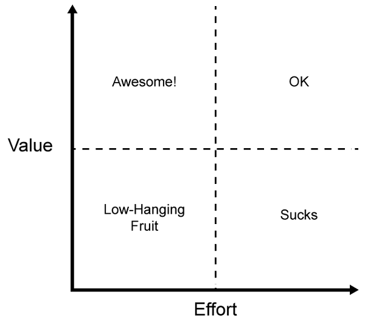
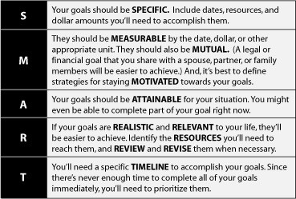

# Why the future of work is already here

*[Sean Kim](http://twitter.com/sseankim) is an entrepreneur, new-born writer, and striving life-hacker. This post originally appeared on the [Sketchfab blog](http://blog.sketchfab.com/post/91763526774/the-future-of-work-is-already-here).*

---

It’s a beautiful afternoon as I write this post at the [Dineen](http://dineencoffee.com/) coffee shop in Toronto.

I’m also instant messaging a co-worker in New York City, about to get on a Skype call with our Community Manager in the Netherlands, and sending an email to our development team in Paris.

Some may think this isn’t an organized and efficient way to operate a growing company. To [us](https://sketchfab.com/), this is the future of work.

Many of the greatest companies in the 21st century, including [Virgin](https://www.virgin.com/richard-branson/give-people-the-freedom-of-where-to-work), [37signals](http://37signals.com/remote/), and IBM have built successful businesses by providing people the freedom to work where they want, when they want and how they want.

Here’s why.

### You get SH#T done

Shorter commutes, private office, flexible work hours.

This all leads to: less time wasted, more productive work hours and [increased happiness](http://www.samfak.umu.se/english/about-the-faculty/news/newsdetailpage/long-distance-commuters-get-divorced-more-often.cid160978) amongst employees.

In 2013, Stanford University conducted [a study](https://web.stanford.edu/~nbloom/WFH.pdf) by randomly assigning employees at a call center to work from home and others to work in the office for nine months. The result was a 13 percent performance increase by those working from home, of which 9 percent was from working more hours.

People criticize working remotely because they find it difficult to measure the number of hours their employees are working. What they forget is that going into the office does not equal productive work.

> “Office workers are interrupted—or self-interrupted—roughly every three minutes.” — The Wall Street Journal

In fact, once thrown off, it can take over [23 minutes](http://online.wsj.com/news/articles/SB10001424127887324339204578173252223022388?) for a worker to retrieve focus on their original task.

Give people the freedom to work where they want, and begin to [re-think](http://thenextweb.com/entrepreneur/2013/10/17/traditional-work-hours-myth-companies-ditch-9-5-standard/) the [9-5 working](http://thegrowthlist.com/why-you-shouldnt-work-9-5) style. By adopting a culture of [trust and respect](http://thenextweb.com/entrepreneur/2014/03/21/startup-might-baby-employees-arent/), you’re empowering individuals to not just show up, but to show results.

### Work and retain the best people

We hear it over and over again: Always hire the best people.

The company’s that embrace telecommuting have a significant advantage over those that haven’t figured it out. For each candidate that is available to work in your city, there are hundreds more around the world that can do it better and cheaper.

Hiring top talent is already hard enough as it is, why limit the single most important ingredient for the success of your business?

It’s inevitable that more and more skilled workers will adapt to a remote working lifestyle, and it’s the companies that can accommodate the lifestyles of these talents that will become the market leaders in the future.

### Remote has never been easier

The good news is, it’s now easier than ever to coordinate the work of individuals from around the world. As long as we have access to a laptop and the internet, there are hundreds of tools that have been created to make the process seamless.

Now I’m not suggesting that it’s a walk in the park. There are setbacks to working remotely that is simply easier with in-person interactions, such as training, instant feedback, and relationship building. So here’s how to make that all work.

**1. Think output**

Focusing on a results-orientated system is the initial step to take when going remote. At the end of the day, the output that we produce is the only tangible result we can present that brings the business forward.

I’m a huge fan of focusing on output because it forces me to prioritize my focus to tasks that will have the biggest impact, and helps me stay productive.

Too often we see this in today’s working environment:

- Person A takes 5 hours to complete a project, and Person B takes 30 minutes to complete the same project.
- Person A comes in early and stays late at the office, while Person B can leave the office earlier to recharge or plan new projects that will bring value for the company. Yet Person A is rewarded for their “hard work” and dedication, when Person B has accomplished the same outputs, if not more from being productive.

Systems such as [ROWE](http://www.gorowe.com/main/what-is-rowe) (Results Only Work Environment) are being introduced to promote output work cultures, where employees are evaluated on performance, not presence. It has been implemented in companies such as Best Buy and Gap, where they’ve seen: 20 percent improvement in productivity, 90 percent decrease in turnover rates, and increased customer satisfaction.

**2. Get SMART**

Now that we’re focused on results, we need to set the right [goals and metrics for ourselves](http://thenextweb.com/lifehacks/2014/03/25/measure-progress-toward-personal-goals).

Creating goals that are specific, measurable, attainable, realistic, and timely are the five most important factors to consider. Investing the time to plan and write down your [smart goals](http://thenextweb.com/lifehacks/2014/07/10/use-self-doubt-advantage/) will do wonders for your output.

If you’re a coder, you could set a goal to release a certain feature in the next week. If you’re in sales, it could be calling 50 people a day with a target to close 10 per week.

I encourage you to set your own goals, as you’re the best person that knows your working style.

There’s no better feeling than waking up each morning and having a clear target for exactly what you’re going to accomplish that day, week, or month.

**3. Communicate, communicate, communicate**

I can’t stress this enough.

The caveat to working remotely is that we miss out on [70 percent of nonverbal communication](http://www3.aaos.org/education/csmp/NonVerbalCommunication.cfm) such as facial expressions, voice tones and eye contact. Working from other sides of the world, communicating the smallest things are a must.

This is why we use [HipChat](https://hipchat.com/) at Sketchfab as our instant messaging tool to keep in regular contact in an informal manner. It allows me to be myself and have more natural flowing conversations with my  
co-workers.

The beauty of working online is that it has forced me to articulate everything I communicate. 750 word long emails have to be shortened to 300 word emails, while getting the same message across. This has helped me keep my writing short and concise, which has transferred over to my speaking skills as well.

**4. Create a company bulletin board**

All this means is have a project management system or a “bulletin board” that allows each team member to see what everyone else is working on.  
Sometimes we get so ingrained about our own tasks, that we forget what’s happening with the rest of our team members.

We use [Pivotal Tracker,](https://pivotaltracker.com/) but there are several others that just as effective, such as [Basecamp](http://basecamp.com/), [Asana,](https://asana.com/) and [Trello](http://trello.com/). This helps me understand what the high-level priorities are for the company, and allows me to assign tasks to any team member without having to bug them about it.

**5. Have regular feedback**

It’s difficult to know if your work is producing the impact that your team members expect when working . You can never have too much feedback, because we can always improve our work, become better team members, and have greater impact.

Design a structure for individual regular feedback, whether it’s bi-weekly or monthly. Creating a culture for continuous improvement will allow members to feel that they’re personally improving, which leads to increased work engagement, and greater loyalty for the business.

Avoid using email and take feedback to video chats as much as you can. You can’t risk leaving out 70 percent of your nonverbal communication for something as personal as individual feedback.

In order to build a successful business in a talent shortage economy, we have to hire the best people — period. The opportunity to tap into a global talent market has never been more possible in the world that we live in.

The future of work is already here, it’s up to you to take advantage of it.

Show 1 comment
