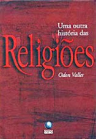
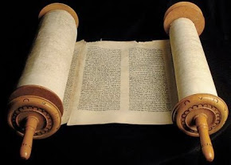
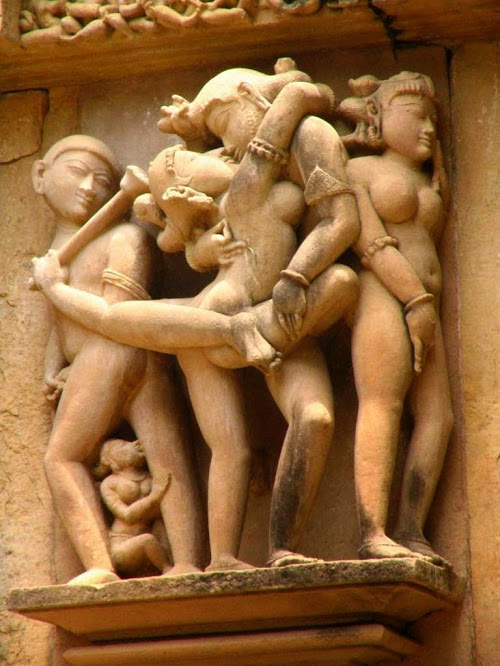

## Uma Outra História das Religiões

### Este é um livro pequeno e que faz um belo apanhado histórico das principais religiões originárias da Ásia e Europa e ainda existentes. Judaísmo, Cristianismo, Bramanismo, Budismo, Xintoísmo, entre outras, são as religiões que Odon Vallet se propõe a nos apresentar.

<h3style="text-align: justify;">Apesar de haver referências a religiões antigas, principalmente na descrição da origem das religiões, elas não são diretamente tratadas, bem como não trata das religiões africanas ou dos povos ameríndios. Isso não empobrece o livro, pois este recorte permite que o autor apresente melhor estas religiões.

### Sendo um livro que prioriza a história, Vallet escreveu de forma a interligar uma religião a outra. O leitor não fica com a impressão de que são coisas totalmente separadas: os muçulmanos aqui, os hindus lá, os judeus acolá. Todas as religiões são todos interligados e essa forma de narrar ajuda a dar uma noção de coesão. Coesão esta que é necessária para se entender melhor o como e o porque das religiões tomaram este ou aquele caminho.

### **O Oriente Médio**

### O livro começa nos apresentando as religiões surgidas no chamado Crescente Fértil: judaísmo, cristianismo e islamismo. Apresentando o judaísmo como uma religião baseada na Lei e que tem um deus único, o que a diferenciou das diversas religiões da época, o autor dá um panorama geral destes povos, o que o leva falar do cristianismo, uma religião surgida do seio do judaísmo, que mas que adquire características própria. Na história do cristianismo nos são apresentadas as influências sofridas dentro da Judéia e as influências recebidas de outros povos, as seitas criadas com o tempo e a questão do dogma e do dogmatismo. Ao fim do capítulo menciona o avanço do islamismo como uma ameaça à sua existência. E seguindo o estilo proposto, o o próximo capítulo é sobre a religião de Maomé, onde além e sua história e seus principais preceitos, somos apresentados às várias facetas desta religião que não é tão una como pode parecer ao primeiro olhar, bem como sua expansão para o ocidente e oriente.

### **Rumo ao Oriente**

### Aqui o livro nos leva até a Índia, esta terra onde há toda uma gama de religiões e uma religiosidade que nos parece estranha.

### Ao tratar destas o autor faz muitas comparações entre elas e o cristianismo, entre seus conceitos e os conceitos cristãos e, às vezes, com os conceitos gregos. Isso me incomodou um pouco ao começar a ler estes capítulos, mas logo compreendi qual o objetivo destas comparações: são religiões que soam tão estranhas para os ocidentais que este artifício ajuda a mostrar que não são tão estranhas como parecem.

### Muitas destas religiões se confundem, pois tem uma mesma base mitológica e cultural. Em alguns casos, ao se dar preferência a um ou outro deus, a uma ou outra linha de interpretação da tradição religiosa dão origem a religiões completamente diferentes, mas que tem a mesma base comum. O que não é um processo tão diferente do que aconteceu com as religiões abraâmicas.

### Isso não significa que estas religiões sejam tão simples de entender. Elas são intricadas, há uma grande amálgama cultural, uma grande junção de várias religiões que se sobrepõe e interagem num mesmo espaço.

### Sem falar no fato da relação destas religiões com o corpo físico ser muito diferente do que acontece com as religiões abraâmicas: exercícios físicos, meditação, sexo e artes marciais se integram às religiões, recebendo uma abordagem que inclui o conhecimento do próprio corpo como forma não apenas de dominá-lo, mas também como instrumento para elevação espiritual.

### Extremo Oriente

### O extremo oriente tem todo um tratamento especial. Porque, ao contrário do que aconteceu com a Índia, não houve uma expansão das religiões destes países para o ocidente. Pelo menos não até a segunda metade do século XX.

### Apesar de ter sido influenciada até certo ponto por conceitos e religiões da Índia, esta influência não foi de mão dupla. Por ser muito ligada ao estado, a religiosidade chinesa não se expandiu rumo ao oeste,  e sim para o leste asiático.

### Tanto as religiões como as correntes filosóficas mais influentes, taoismo e confucionismo, são tratadas pelo autor, pois há uma influênciaa muito forte destes conceitos filosóficos com as práticas religiosas.

### A aceitação maior de uma ou outra destas correntes explica muito dos rumos históricos tomados por estes países.

### O Xintoísmo, como uma das últimas grandes religiões animistas, refletiu bem estes conflitos. Durante vários períodos da história do Japão, e até hoje, teve maior ou menor influência, principalmente após a introdução do budismo no país. Ao fim do livro há todo um tratamento especial às artes marciais, um elemento presente em todo oriente e que acabou se amalgamando não apenas à vida cotidiana, mas também às religiões ali presentes.

### Uma introdução

### Porque indicar um livro que trata se intitula Uma Outra História das Religiões, se ele apresenta não apresenta realmente todas as religiões?

### Bem, como expliquei logo na introdução, o livro não se propõe a falar de todas as religiões.

### Mas o considerei um bom livro introdutório à história das religiões apresentadas. Conceitos fundamentais são tratados de forma consistente. E muitos destes conceitos são desconhecidos de quem está começando estudar e compreender esta face tão importante da cultura da humanidade.

### E, como não poderia deixar de ser, o livro também conta com muitas ilustrações e anotações laterais com explicações que ajudam a entender algum conceitos apresentados no livro. Algo que considero importante num livro.

### Vallet, Odon: Uma outra história das religiões. São Paulo. Globo, 2002

[Escritos Lendários: A História de Algumas Religiões](http://www.mitografias.com.br/2014/08/escritos-lendarios-a-historia-de-algumas-religioes/) is a post from: [Mitografias](http://www.mitografias.com.br)
