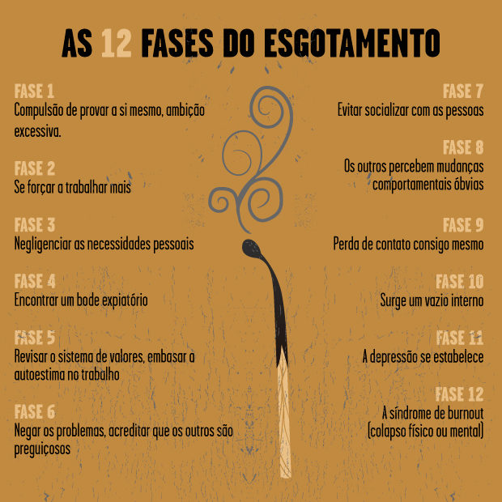
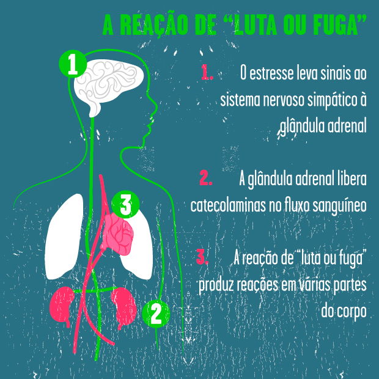
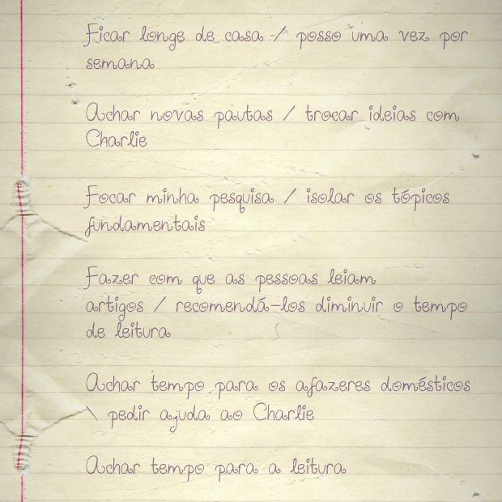

Verão de 2013, Gaslight Coffee Roasters, Chicago, Illinois:

De novo sentada em frente a tela do computador. De novo exausta. Me sentindo o cocô do cavalo do bandido.

Passei o ano passado ouvindo esse tipo de perguntas:

> *“Como vai aquele seu projeto de escrever mais?”*
>
> *“Já pensou trabalhar só meio turno?”*
>
> *“A mensalidade da faculdade está em dia?”*

Chego a esboçar o tipo de resposta que acredito que estas perguntas mereçam, mas então lembro que é importante manter um bom relacionamento com as pessoas.

Fazem semanas que não consigo escrever, ou fazer qualquer coisa ligada a minhas ambições pessoais. Como entender isso? Como levantar do fundo do poço quando não se tem mais para onde ir? Não há ponto de apoio, nada onde firmar a mão para se erguer e seguir adiante.

Como nos recuperamos depois do *burnout*, do profundo esgotamento?

Como recomeçamos depois dele?

### O que significa *burnout*

Não há definição clara sobre o *burnout*, mas o termo apareceu pela primeira vez nos anos 70, nos escritos do [psicólogo Freudgenberger](http://www.ncbi.nlm.nih.gov/pubmedhealth/PMH0050545/%20Herbert%20Freudenberger) e seu colega Gail North identificaram 12 fases que levam ao *burnout*:

Os sintomas fisiológicos do *burnout* são causados pelas reações de “luta ou fuga”. Queiramos ou não, esta resposta acaba sendo [provocada](http://www.scientificamerican.com/magazine/mind/2006/06-01/) por elementos comuns causadores de estresse no trabalho (como respeitar prazos ou levar projetos até o final).

- A glândula adrenal secreta o hormônio cortisol
- O batimento cardíaco se acelera
- A pressão sanguínea sobe

O *burnout* ocorre [quando as exigências e o estresse colocados sobre nós excedem nossas capacidades físicas e mentais](http://www.forbes.com/sites/learnvest/2013/04/01/10-signs-youre-burning-out-and-what-to-do-about-it/). Nos enganamos quanto ao que é necessário porque assumimos poder empurrar tudo e simplesmente ignorar os limites. A má notícia é que isto está acontecendo [cada vez com mais frequência](http://www.forbes.com/sites/learnvest/2013/04/01/10-signs-youre-burning-out-and-what-to-do-about-it/).

A [Forbes relata](http://www.forbes.com/sites/learnvest/2013/04/01/10-signs-youre-burning-out-and-what-to-do-about-it/) que desde a crise econômica muitos empregadores cortaram despesas – e nem era preciso alguém nos dizer isso. A redução das despesas e o arrocho salarial coincidiram com um aumento no número de tarefas e responsabilidades. Os empregados se sentem intensamente na [obrigação de nunca dizer não](http://www.motherjones.com/politics/2011/06/speedup-americans-working-harder-charts).

Antes do meu *burnout* eu dizia sim para tudo. Não havia nada que eu considerasse não poder fazer, nada que eu não faria por meu trabalho. Para ser honesta comigo mesma, isso se resumia a eu não querer ver outra pessoa dizendo sim.

### O ponto sem retorno

Quando consegui admitir que me encontrava em *burnout*, já era tarde demais. Evitava o convívio social e não dormia mais. Descobri-me chorando em pleno dia e sem razão alguma. Eu só queria fazer as coisas melhor, trabalhar o máximo que pudesse, fazer pelo menos tanto quanto eu via as pessoas ao meu redor fazendo. Era mais fácil, para mim, me convencer a trabalhar mais do que encarar a verdade – a verdade de que eu precisava uma folga.

[Todo mundo precisa de uma folga de tempos em tempos](http://www.npr.org/templates/story/story.php?storyId=111887591). De acordo com a [Scientific American](http://www.scientificamerican.com/article/want-clear-thinking-relax/), a exposição a estresse contínuo libera no corpo os hormônios epinefrina, noraepinefrina e cortisol. Estes hormônios bloqueiam nossa capacidade de processar bem a informação – além de causar vários outros problemas de saúde.

Quando eu digo folga não estou falando de uma caminhada de quinze minutos ao redor da quadra. Estou falando de [alguns dias consecutivos](http://www.forbes.com/sites/learnvest/2013/04/01/10-signs-youre-burning-out-and-what-to-do-about-it/). O corpo precisa tempo para se desconectar do estresse. Isso pode levar alguns dias, ou até uma semana inteira. Os seus recursos físicos e emocionais [precisam de tempo para se regenerar](http://www.nationalgeographic.com/adventure/news/how-to-get-more-vacation-time.html). Esses recursos não se esgotaram da noite para o dia, e portanto não é certo esperar que sejam recuperados da noite para o dia.

Aqui listo alguns dos [benefícios que uma folguinha trazem para a saúde](http://www.usnews.com/science/articles/2011/08/17/the-benefits-of-taking-time-off):

- Interrompe o ciclo do estresse
- Melhora os relacionamentos
- Possibilita que novas perspectivas se abram
- [Ajuda o coração e limpa a mente](http://www.eurekalert.org/pub_releases/2005-11/mc-tav110905.php)

Por [várias razões](http://www.motherjones.com/politics/2011/06/speedup-americans-working-harder-charts), muitos de nós se recusam a (ou não conseguem) usar o tempo de férias. Então como lidar com o *burnout* quando não se pode parar de trabalhar?

### Caindo na real

É aqui que a maioria de nós fracassa completamente. Não olhamos para nós mesmos o suficiente porque pensamos que estamos ocupados demais, ou não temos poder para consertar qualquer coisa. Nenhuma dessas pressuposições é verdadeira.

### 1. Fazendo um inventário

Escreva tudo que está causando estresse em sua vida, e seja honesto. Ao lado de cada fonte de estresse, anote uma estratégia para lidar com aquele estresse particular. Tendo em vista que somos especialistas em nos convencer a ignorar o estresse, colocá-lo no papel é nossa primeira chance de realmente [permitir que nosso cérebro](http://www.health.harvard.edu/web_premiums/your-portable-guide-to-stress-relief.htm) comece a processar essa informação.

Aqui está um exemplo em meu diário, desculpem a caligrafia:

Nota do editor: a imagem é uma adaptação da original, que era manuscrita pela autora

Também ajuda [reconhecer os temas e fontes comuns do estresse](http://www.unf.edu/healthpromotion/Stress_Management_Plan.aspx). [Localizar a fonte principal](http://www.mayoclinic.org/healthy-living/stress-management/in-depth/stress-management/art-20044151) é o primeiro passo na direção de descobrir formas saudáveis de lidar com o próprio estresse e aprender a gerenciá-lo.

### 2. Pedir ajuda

Aprender a pedir ajuda não é fácil, a maioria de nós [nunca aprendeu a fazer isso](http://www.nytimes.com/2007/07/07/business/07shortcuts.html?pagewanted=all&_r=0). Pedir ajuda não significa que se é incapaz, não significa que se é burro, e não diminui nem um pouco nosso valor.

O que se pode fazer:

- ser direto e honesto sobre o que se precisa e porque
- descobrir quem estaria melhor capacitado a ajudá-lo (amigo, família, médico, fórum anônimo na internet?)
- ajudar alguém quando, no futuro, estiver em posição de fazer isto

O medo de ser rejeitado muitas vezes obstaculiza a disposição a pedir ajuda, mas [estudos](http://hbr.org/2013/12/need-someones-help-ask-the-person-who-just-turned-you-down/ar/1) mostram que não se deve ficar apreensivo. As pessoas rejeitam dar ajuda muito menos frequentemente do que imaginamos. E não só isso, mas elas gostam de ajudar. Elas gostam de se sentir necessárias, e isso até mesmo [faz com que se sintam bem consigo mesmas](http://www.apa.org/monitor/dec06/helping.aspx). Todo mundo ganha com isso.

### 3. Tire o seu da reta

Quando atinge a fase de *burnout* a pessoa geralmente se descobre sem escolha alguma, a não ser recomeçar. Alguns [abandonam o trabalho](http://nymag.com/news/features/24757/), tiram uma licença, ou simplesmente se negam a iniciar novos projetos de trabalho até que tenham se recuperado. Não sei dizer o que é melhor para você, mas posso dar alguns conselhos sobre como minimizar ao máximo os níveis de estresse:

- Delegue o máximo que puder sempre que puder. Se você é como eu, você provavelmente [acumula trabalho](http://blogs.hbr.org/2012/07/why-arent-you-delegating/) como um esquilo faz com as nozes, porque acha que isso o sobressai perante os outros. Não sobressai. Se você trabalha com uma equipe, repasse algumas tarefas menos críticas para outros no grupo.
- [Diga não e seja firme quanto a isso](http://www.fastcocreate.com/1683359/the-hardest-word-why-saying-no-is-key-to-your-long-term-success). Isto o ajuda a não exagerar ainda mais. Você pode se descobrir dizendo sim sem refletir sobre o impacto daquilo sobre você mesmo. Fique ciente das consequências de dizer sim e de exatamente o que está sendo pedido.
- [Durma mais](https://medium.com/who-what-why/79f3495c80b7). Seis horas de sono não vão ser suficientes, é realmente necessário tentar dormir pelo menos oito horas, para prover o corpo e a mente com o que eles precisam para se renovarem.
- Encontre tempo para si mesmo. Repito mais uma vez, isso nem se discute. É necessário encontrar tempo durante o dia para si próprio. [Faça exercícios](http://www.mayoclinic.org/healthy-living/fitness/in-depth/exercise/art-20048389), [leia](http://abcnews.go.com/Technology/reading-improve-brain/story?id=21501657), e [pratique o relaxamento ativo](http://www.workhappynow.com/2008/09/active-relaxation/).

Uma vez que você tenha seguido esses passos, tente reintegrar o trabalho na vida, mas vá DEVAGAR. Reavalie constantemente o tipo de trabalho que está fazendo e se está alinhado com seus objetivos.

Persiste uma voz chata na minha cabeça dizendo “podia ser pior” o tempo todo.

Acredito que muitos ouçam essa voz.

Pensamos em todas as pessoas próximas que trabalham mais do que nós trabalhamos, e com menos folgas. Nos convencemos, *“se eles conseguem, eu também consigo”*. Mas há momentos em que simplesmente não dá, e não há problema algum nisso.

Uma das [reclamações mais frequentes do *burnout*](http://nymag.com/news/features/24757/) é o sentimento de que perdemos a nós mesmos. Se você já passou pelo *burnout*, ou se não quer passar por ele, é preciso investir em si próprio. Dê um jeito de se conectar consigo mesmo e com as próprias paixões, diariamente.

*Este artigo foi publicado originalmente no [Crew Blog](https://medium.com/@missafayres/how-to-bounce-back-after-burning-out-e3c6cffa18dc) e traduzido por [Eduardo Pinheiro](http://papodehomem.com.br/author/eduardopinheiro/).*

  
 por Andrea Ayres-Deets  
  
  [[anexo ausente]](http://pubads.g.doubleclick.net/gampad/jump?iu=1051165/PdH_Feed_superbanner/leaderboard&sz=728x90&c=1960456920) [anexo ausente]  
  
  
[[anexo ausente]](http://da.feedsportal.com/r/206157031670/u/49/f/530922/c/32911/s/3dc931cf/sc/19/rc/1/rc.htm)  
[[anexo ausente]](http://da.feedsportal.com/r/206157031670/u/49/f/530922/c/32911/s/3dc931cf/sc/19/rc/2/rc.htm)  
[[anexo ausente]](http://da.feedsportal.com/r/206157031670/u/49/f/530922/c/32911/s/3dc931cf/sc/19/rc/3/rc.htm)  
  
[[anexo ausente]](http://da.feedsportal.com/r/206157031670/u/49/f/530922/c/32911/s/3dc931cf/sc/19/a2.htm)[anexo ausente]

[[anexo ausente]](http://feeds.feedburner.com/~ff/PapodehomemLifestyleMagazine?a=VmaPCxg-wBw:5Eb-trdLCww:yIl2AUoC8zA)  [[anexo ausente]](http://feeds.feedburner.com/~ff/PapodehomemLifestyleMagazine?a=VmaPCxg-wBw:5Eb-trdLCww:qj6IDK7rITs) [[anexo ausente]](http://feeds.feedburner.com/~ff/PapodehomemLifestyleMagazine?a=VmaPCxg-wBw:5Eb-trdLCww:-BTjWOF_DHI)

[anexo ausente]
