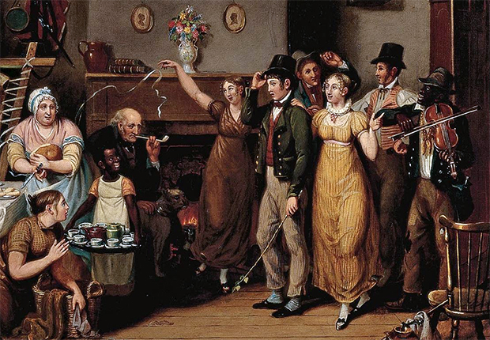
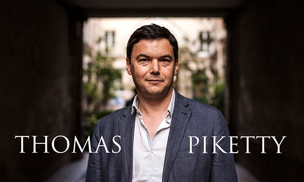
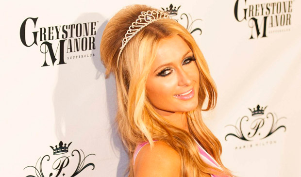
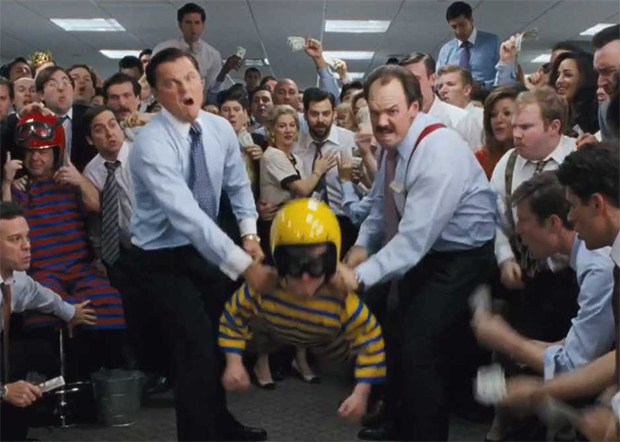
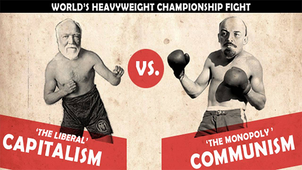
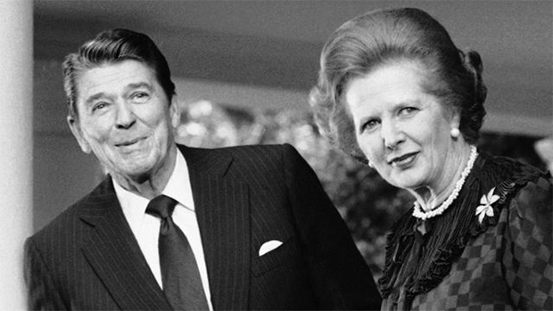

Vou contar uma história rápida sobre seu futuro. Ela se passa no século dezenove.

Rastinac é um francês interiorano que se apaixona por uma mulher da alta sociedade parisiense, em tudo superior a ele, em tudo inacessível. Quando o desespero surge, Rastinac conhece um “mecânico” chamado Vautrin.

Vautrin é um malandro, e logo explica a [Rastinac](http://pt.wikipedia.org/wiki/Rastignac) como as coisas funcionam naquela sociedade.

Para começar, a mulher inatingível na verdade é filha de um comerciante que acabou na miséria gastando todas as suas economias para casá-la com um bom partido. Porque, como Vautrin esclarece, na Paris do século dezenove você só chega à alta sociedade de duas maneiras: herdando uma grande fortuna ou casando com alguém da elite.

Caso contário, **não interessa o quanto você seja um excelente trabalhador ou mesmo um competente empreendedor** — no final, continuará na classe mais baixa e estará subordinado aos caprichos da elite durante toda a vida. Sim, porque a elite tem poder o suficiente para mandar e desmandar no destino de todos os outros, condenados apenas às migalhas.

Seu futuro tem nome: XIX

Dito isso, Vautrin propõe a Rastinac um plano para realizar seu objetivo: ele deve seduzir a filha de certo ricaço, e em seguida Vautrin matará o irmão dela, único empecilho para que a filha herde a fortuna do pai. Essa estratégia, segundo Vautrin, seria a única forma de seu amigo ascender à alta sociedade e tornar-se amante daquela outra mulher.

Rastinac inicialmente recusa, mas uma série de desgraças e injustiças o convence de que aquela sociedade é podre até os ossos, e a única forma de não morrer feito um cão sarnento mas como um cachorrinho de madame é jogar sujo, sem piedade, contra tudo e todos.

Esse é o resumo do romance *[Le Père Goriot](http://pt.wikipedia.org/wiki/Le_P%C3%A8re_Goriot)*, de [Balzac](http://pt.wikipedia.org/wiki/Honor%C3%A9_de_Balzac). E, segundo o economista francês [Thomas Pikkerty](http://pt.wikipedia.org/wiki/Thomas_Piketty), essa é a descrição de como será nosso mundo, dentro de alguns anos.

Se isso for verdade, estamos fodidos.

### 1. O capitalismo no século 21

Desde que foi publicada, em 2013 na Europa, a obra de Thomas Piketty, *[O Capitalismo no Século 21](https://en.wikipedia.org/wiki/Capital_in_the_Twenty-First_Century)*, incomodou o suficiente para que eu decidisse ler a versão em inglês, lançada em abril de 2014 nos EUA (a edição brasileira será lançada em setembro deste ano). E tenho de admitir: o que Piketty demonstra em seu livro é um bocado perturbador.

Piketty apresenta uma teoria geral do capitalismo na qual combina a análise do crescimento econômico com a da distribuição da riqueza pelo mundo. Com sua equipe de economistas e municiado de [dados inquestionáveis](http://www.quandl.com/PIKETTY), colhidos e analisados durante quinze anos, ele oferece um inédito e assombroso retrato da desigualdade social no mundo moderno.

O economista e seus colaboradores contrapõem e superam, com sua pesquisa, duas visões sobre o capitalismo, a da esquerda e a da direita, representadas respectivamente por [Karl Marx](http://pt.wikipedia.org/wiki/Karl_Marx) e [Simon Kuznets](http://pt.wikipedia.org/wiki/Simon_Kuznets):

- Para Marx, o capitalismo destruiria a si mesmo como decorrência de sua própria lógica interna;
- Para Simon Kuznets, o capitalismo não só persistiria, mas solucionaria, graças a sua própria lógica interna, o problema da desigualidade social.

Piketty demonstra que ambos estavam errados. Utilizando um vasto acervo de dados econômicos que abrange do século 18 aos nossos dias, ele prova que nada sustenta nenhuma dessas duas teorias. Não, ao contrário do que escreveu Marx, o capitalismo não vai colapsar devido à sua própria lógica interna. Não, ao contrário do que dizia Simon Kuznets, o capitalismo jamais vai resolver o problema da distribuição de renda.

Em outras palavras, o capitalismo pode prosseguir indefinidamente, sem ruptura interna, e sua tendência natural é produzir desigualdade social também indefinidamente, até o ponto de criar um abismo entre uma minoria enriquecida e a maioria da população mundial, **com graves consequências políticas e ameaçando a própria democracia**.

Entre 1930 e 1975, por causa das duas Guerras Mundiais, essa tendência de ampliar a desigualdade social foi refreada, em parte por políticas públicas de distribuição de renda que tentaram compensar, nos países do hemisfério norte, as enormes perdas resultantes desses dois conflitos.

Porém, no final do século vinte e principalmente a partir do século vinte e um, a desigualdade social retomou seu ritmo. Na verdade, essa desigualdade está acelerando [feito o Marcos descendo o morro da vó Salvelina](https://www.youtube.com/watch?v=m4Ixr1aVCc0).

### 2. O Capitalismo Patrimonial

Vou poupar o leitor dos detalhes matemáticos da teoria de Piketty, embora ele se aprofunde o suficiente em sua obra. A conclusão é a de que, durante períodos de pequeno crescimento econômico como o atual, a economia deixa de prestigiar o trabalho em favor do capital, e disso resulta uma absurda acumulação de riqueza nas mãos de uma ridícula minoria de pessoas.

Portanto, a desigualdade aumentará de uma forma sem precedentes nos próximos anos.

Essa é uma situação já reconhecida e suficientemente comprovada: atualmente, [85 pessoas detém 46% da riqueza mundial](http://www.bbc.co.uk/portuguese/noticias/2014/01/140120_riqueza_relatorio_oxfam_fn.shtml). Entenda bem: oitenta e cinco indivíduos, o suficiente apenas para encher um ônibus articulado, possuem quase a metade do patrimônio que os restantes sete bilhões de pessoas do planeta detêm.

No meio do século vinte, alguém viveria melhor ao ocupar o cargo de alguém que está entre os 10% mais ricos do que herdando o patrimônio dessa pessoa, pois a tributação estimulava o trabalho. Em meados de 1970, essa situação passou a igualar-se. A partir de então, economicamente é cada vez mais vantajoso herdar de alguém abastado do que trabalhar no cargo ocupado por essa pessoa.

Nos próximos anos, a tendência é que cheguemos a uma situação na qual **a única forma de possuir uma grande riqueza será por meio da herança**, pois os grandes patrimônios não terão a mesma mobilidade do passado — e disso resultará o nascimento de uma nova forma de “nobreza”.

Paris Hilton pode governar o mundo e você estará nele

Não haverá mais histórias como a de Bill Gates, um nerd esperto de classe média que se deu bem num ramo inovador e tornou-se um dos homens mais ricos do mundo graças a sua engenhosidade e excelentes oportunidades. Haverá apenas histórias como a de Paris Hilton — herdeiros desocupados que estarão por cima da carne seca apenas devido à sua origem. O resultado desse aprofundamento da desigualdade social será o surgimento de um novo tipo de capitalismo, que Piketty batizou de “Capitalismo Patrimonial”.

E que sociedade emergirá desse “capitalismo patrimonial”? Piketty acredita ter encontrado um exemplo dela no passado, e isso graças à literatura do século dezenove, que descreve uma sociedade muito parecida com aquela que emergirá em breve. Sim, em alguns anos todos seremos Rastinac.

### 3. Você, o neoplebeu

[Jane Austen](http://pt.wikipedia.org/wiki/Jane_Austen) e Honoré de Balzac descrevem em seus romances a “sociedade patrimonial” da antiga Europa, na qual um pequeno número de ricaços viviam de um modo extravagante graças à riqueza que herdavam de seus antepassados, enquanto as outras pessoas lutavam diariamente para poder sobreviver com um mínimo de decência.

Naquele período, as pessoas não valorizavam o trabalho e o empreendedorismo privado como forma de enriquecimento. Antes, preferiam casar com alguém rico ou então herdar uma propriedade. A educação era considerada uma forma de aumentar a possibilidade de conseguir um bom casamento, e trabalhar não era tido como uma atividade respeitável.

Pikkety e sua equipe oferecem uma obscena quantidade de dados para demonstrar que, no século 21, a sociedade ocidental retornará o à mesma estrutura social do século 19, mas em proporções mais absurdas.

Hoje, um típico trabalhador do Walmart ganha nos EUA menos do que 25 mil dólares por ano, enquanto [Michael Duke](http://en.wikipedia.org/wiki/Mike_Duke),  principal executivo da rede de supermercados, recebeu mais de 23 milhões de dólares em 2012. Em 2011, [Tim Cook](http://pt.wikipedia.org/wiki/Tim_Cook), executivo da Apple, recebeu 378 milhões de dólares — o correspondente a 6.258 vezes o que recebe um empregado padrão (**veja bem, não é o menor salário**) da sua empresa.

Como demonstra Piketty, no capitalismo patrimonialista, o talento desses executivos não guarda nenhuma correspondência com o salário e outros benefícios financeiros que recebem. Seus ganhos não tem relação alguma com a qualidade de sua gestão, pois sua remuneração não é estabelecida segundo a sua competência, mas resulta de acordos realizados entre eles próprios, na mesa dos diretores das grandes empresas.

Você, o neoplebeu, no centro

O problema, claro, não é a impossibilidade de ficarmos ricos feito o Bill Gates. Afinal, nem todo mundo sonha em ser biliardário. O problema é a formação de **uma super-elite que terá mais dinheiro do que o PIB de diversas nações, mandando e desmandando no mundo** e assegurando para seus descendentes uma estrutura de dominação cada vez maior e mais consolidada.

No capitalismo patrimonial, os herdeiros daqueles 85 indivíduos e talvez uma centena de outros logo abaixo deles terão tal poder econômico que surgirá uma nova oligarquia mundial, uma linhagem de “nobres” que herdam seu poder pela [consanguinidade](http://pt.wikipedia.org/wiki/Consanguinidade). Você, eu, e todos os outros abaixo dessa super-elite não seremos apenas pobres (desprovidos de dinheiro), seremos também um novo tipo de “[plebeu](https://pt.wikipedia.org/wiki/Plebe)” (desprovido de “nobreza”) – os “neoplebeus” do século vinte e um.

Conforme alerta Piketty, um único indivíduo que possui tanto capital quanto um país inteiro pode facilmente afetar o futuro de toda uma nação. E é natural que as pessoas mais ricas tentem assegurar seu poder e seu status, soltando milionárias migalhas para asseclas que, submissos, acatam os desmandos de seus donos e fazem prevalecer sua vontade em todos os continentes. E numa época em que as campanhas políticas dependem cada vez mais de vultosos financiamentos, já podemos imaginar onde isso vai dar.

### 4. A solução para o capitalismo patrimonial é o capitalismo 2.0

Neste exato momento, você provavelmente está imaginando que Thomas Piketty é de esquerda e que escreveu seu livro na forma de um grande panfleto contra o capitalismo, com a intenção de comprovar que Fidel Castro, os Black Blocs e aquele seu tio chato que ainda mora com a mãe e chora ao ouvir o [hino da Internacional Comunista](https://www.youtube.com/watch?v=LOHLCmivnBo) na vitrola em seu quarto abarrotado de livros estão absolutamente certos: o capitalismo é um grande vilão, um enorme dragão maligno a ser derrotado pelas forças do bem.

Nada mais errado. E muita gente por aí [tem dito bobagens precipitadas](http://outraspalavras.net/outrasmidias/destaque-outras-midias/boff-piketty-esta-certo-democracia-e-capitalismo-nao-convivem/) sem ter lido o livro.

A solução proposta por Piketty passa longe daqueles que, lendo apressadamente as resenhas de sua obra, sonham com uma revolução que acabe com o capitalismo. O economista francês é um sujeito prático, e [em recente entrevista](http://www.administradores.com.br/artigos/economia-e-financas/e-absurdo-chamarem-me-de-marxista-diz-thomas-piketty-autor-de-capital-no-seculo-xxi/77947/) deixou claro que jamais teve simpatia pelo comunismo e tampouco sonha em questionar a importância fundamental do livre mercado e da propriedade privada para nossa sociedade.

Segundo ele, **o capitalismo deve prosseguir, mas devemos retomar seu controle**, pois a questão é colocar o mercado ao serviço do bem comum e da democracia, e não a democracia ao serviço do mercado. Em suma, o problema não é econômico, e sim político.

Tenho um grande amigo que é liberal, um sujeito que está muito além dos [Olavos de Carvalho](http://pt.wikipedia.org/wiki/Olavo_de_Carvalho) e outras anedotas da direita conservadora nacional. Ele defende o capitalismo com a mesma convicção com que defende o feminismo, o ambientalismo, o Estado laico, a luta contra o racismo, a luta contra a homofobia e outras pautas progressistas — que, ele nunca me cansa de lembrar, sempre tiveram melhor sorte nos países liberais do que nos países socialistas.

E esse meu amigo certo dia me disse algo curioso, vindo de um liberal: o capitalismo ideal é aquele que atingiu 80% de seu potencial de realização. Acima desse potencial, o capitalismo realmente se torna algo nocivo para a sociedade e a democracia. Ele precisa, em suma, de um policiamento constante para que não ultrapasse esse patamar de desenvolvimento. Mas isso não significa que ele deva ser combatido — tem é de ser controlado.

É como se fosse uma máquina eficiente, inventada e aperfeiçoada aos poucos, colocada a prova no ringue junto ao comunismo e o totalitarismo durante o século vinte, período em que derrotou seus rivais. Essa máquina faz bem seu serviço, corresponde à certas características da natureza humana e historicamente mostrou conviver bem com a democracia — ao menos melhor do que seus rivais e desde que certos limites sejam impostos a seu funcionamento.

Sabemos muito bem quem venceu essa luta

Por outro lado, se deixarmos tal máquina sem qualquer controle, ultrapassando o marco de 80% do seu potencial de realização, ela não fica parada nesse ponto de equilíbrio. Naturalmente, pelo seu próprio funcionamento interno, ela passa se aproximar dos seus 100%. A partir de então, cada passo na direção dessa plenitude tal máquina começa a escravizar seu próprio criador, o ser humano.

Como qualquer tentativa de trocar essa máquina por outra, jamais testada na prática e só supostamente eficiente “em teoria”, não poderia ser feita sem um grande trauma para todo o sistema na qual ela funciona, o mais razoável será criarmos instituições capazes de policiar seu funcionamento, aperfeiçoando suas características e evitando que a criatura se volte contra o criador.

Por isso, o que Piketty propõe não é a destruição do capitalismo. O que ele prega não é a substituição de um sistema efetivo por outro, até agora meramente teórico (um socialismo que conviva bem com as liberdades individuais). Ele é prático e propõe o ajustamento do sistema por meio de medidas pontuais como a taxação mundial das grandes fortunas combinada com um aumento dos tributos incidentes sobre as rendas mais elevadas.

Segundo a avaliação da equipe de Piketty, nos países desenvolvidos esses tributos deveriam ser de até 80% sobre a renda e a riqueza, em um percentual progressivo, como é o nosso imposto de renda.

Está parecendo algo de país socialista? Sabe de nada, inocente. Isso já ocorreu no passado em nações rigorosamente capitalistas como os EUA, sem qualquer problema. De 1945 a 1975, a economia dos países desenvolvidos progrediu de forma sem precedentes, enquanto a taxa de retorno do capital era baixa, pois sua tributação era alta, de modo que a distribuição de riqueza favorecia o trabalho, e não o capital. Para Piketty, essa foi a Era de Ouro do capitalismo, um evento isolado em sua longa história.

Nesse período, os EUA foi o primeiro país a aumentar a tributação acima de 70%, a fim de reduzir a concentração de riqueza. De 1932 a 1980, a tributação média sobre as rendas mais elevadas (acima de 500 mil dólares mensais) nos EUA foi de 81%. Isso não quebrou a economia americana — ao contrário, durante essas décadas o país se tornou uma das maiores potências mundiais.

Mas a Era de Ouro do capitalismo acabou no final da década de 1970, quando a tributação despencou para 30%, fazendo com que o número de executivos com salários astronômicos crescesse. E tudo desmoronou de vez quando [Margaret Thatcher](http://pt.wikipedia.org/wiki/Margaret_Thatcher) e [Ronald Reagan](http://pt.wikipedia.org/wiki/Ronald_Reagan) viraram a mesa e, no início da década de 1980, derrubaram a tributação do capital, abrindo caminho para o nascimento do capitalismo patrimonialista. Mesmo o exagerado e rocambolesco [Michael Moore](http://pt.wikipedia.org/wiki/Michael_Moore), em seu documentário *[Capitalismo: uma história de armor](https://pt.wikipedia.org/wiki/Capitalism:_A_Love_Story)*, reconhece que o problema começou foi nessa época.

Reagan e Tatcher: o seu futuro começou com eles

E a tributação sobre as grandes fortunas e os altíssimos rendimentos só não é elevada novamente hoje em dia devido a falta de integridade moral de todos os que estão envolvidos com a política econômica. Em suma: todos foram comprados por aqueles que se situam no topo da pirâmide.

No documentário *[Inside Job](https://pt.wikipedia.org/wiki/Trabalho_Interno)*, o diretor Charles Fergunson demonstra como os grandes executivos americanos compram  economistas acadêmicos a fim de que elaborem justificativas teóricas para a ausência de tributação em operações financeiras. Em seguida, esses mesmos executivos compram autoridades com poder decisório para que impeçam qualquer mudança no atual estado das coisas.

Segundo Piketty, nosso futuro depende de intervenção estatal coordenada mundialmente, para que todas as nações consigam reduzir gigantescos patrimônios individuais em níveis que não ameacem a democracia. Na verdade, a solução é fazer com que a democracia avance sobre a riqueza.

Seria necessário uma total transparência no registro de todas as operações financeiras e da situação patrimonial dos indivíduos — seria preciso limitar o sigilo bancário e fiscal, ao menos no que diz respeito aos valores totais, pois esses sigilos não tem nada de democráticos e interessam apenas a uma minoria.

Isso, claro, exige que os Estados sejam fortes — e a palavra é “fortes”, e não “grandes”. O tamanho do Estado não tem necessária correspondência com sua força. Na verdade, um Estado inchado desperdiça recursos e não concentra sua atuação naqueles pontos em que sua presença deve ser firme e inflexível.

Um Estado burocratizado torna-se mais suscetível à influências escusas de quem detém poder econômico.

Isso tudo diz respeito diretamente a todos nós e a nossas vidas. Isso definirá se o futuro concretizará ou não aquilo que até hoje foi apenas delírio de paranóicos e adeptos de teorias conspiratórias. Afinal, as fábulas sobre [Illuminatis](http://www.youtube.com/watch?v=K35wzq3h4es), Maçons e outros grupos que controlariam secretamente os desígnios do planeta são apenas contos-de-fadas para ninar crianças, se comparadas com o cenário de um mundo no qual uma centena de famílias deterá mais da metade da riqueza de todo o globo e sete bilhões de indivíduos se tornarão meros fantoches, manipulados e controlados através de mecanismos tecnológicos cada vez mais sofisticados.

O livro de Thomas Pikkerty faz um alerta. Ao invés de nos mobilizarmos por quimeras, deveríamos mexer para reverter esse futuro indesejável. Porém, é fácil e falsamente heróico sair nas ruas protestando por coisas genéricas como “Não Vai Ter Copa” ou “contra tudo isso que está aí”. Dificil, e necessário, é nos coordenarmos para impedir que em breve sejamos a nova plebe, submissos a uma oligarquia mundial para a qual a democracia será só um faz-de conta.

Como diz Balzac no início de Le Père Goriot:

> “Depois de ler tudo isso, você terá um bom jantar e sentirá indiferença pelo autor, considerando-o exagerado. Ah, mas deixe-me dizer isso a você: esse drama não é ficcional, não é um romance. Tudo isso é verdadeiro — tão verdadeiro que você será capaz de reconhecer nisso todas as coisas que estão ocorrendo em sua vida.”

Reconhece, leitor?

  
 por Victor Lisboa  
  
  [[anexo ausente]](http://pubads.g.doubleclick.net/gampad/jump?iu=1051165/PdH_Feed_superbanner/leaderboard&sz=728x90&c=1807568798) [anexo ausente]  
  
  
[[anexo ausente]](http://da.feedsportal.com/r/204366684173/u/49/f/530922/c/32911/s/3da1cb00/sc/19/rc/1/rc.htm)  
[[anexo ausente]](http://da.feedsportal.com/r/204366684173/u/49/f/530922/c/32911/s/3da1cb00/sc/19/rc/2/rc.htm)  
[[anexo ausente]](http://da.feedsportal.com/r/204366684173/u/49/f/530922/c/32911/s/3da1cb00/sc/19/rc/3/rc.htm)  
  
[[anexo ausente]](http://da.feedsportal.com/r/204366684173/u/49/f/530922/c/32911/s/3da1cb00/sc/19/a2.htm)[anexo ausente]

[[anexo ausente]](http://feeds.feedburner.com/~ff/PapodehomemLifestyleMagazine?a=kxgCRswP8b4:Vkt0ADMpy8A:yIl2AUoC8zA) [[anexo ausente]](http://feeds.feedburner.com/~ff/PapodehomemLifestyleMagazine?a=kxgCRswP8b4:Vkt0ADMpy8A:D7DqB2pKExk) [[anexo ausente]](http://feeds.feedburner.com/~ff/PapodehomemLifestyleMagazine?a=kxgCRswP8b4:Vkt0ADMpy8A:qj6IDK7rITs) [[anexo ausente]](http://feeds.feedburner.com/~ff/PapodehomemLifestyleMagazine?a=kxgCRswP8b4:Vkt0ADMpy8A:-BTjWOF_DHI)

[anexo ausente]
