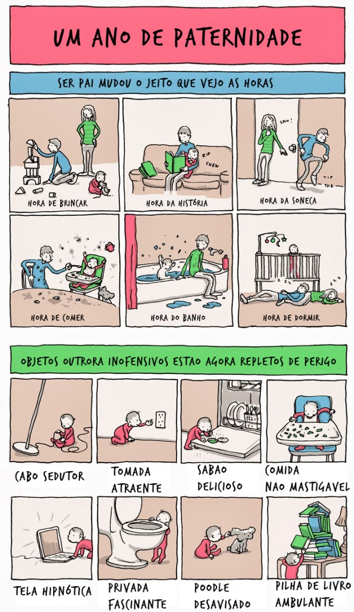
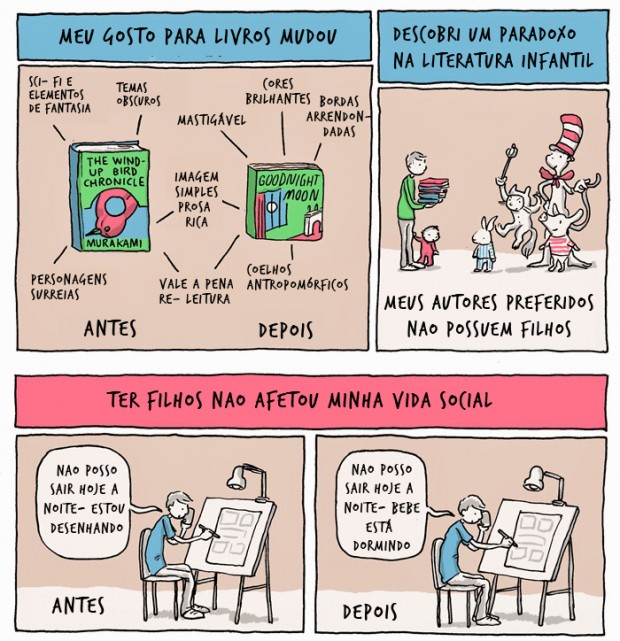
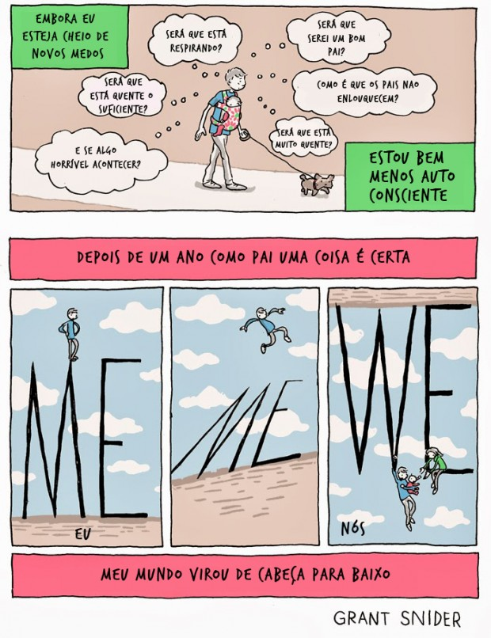

# 3 lições que a paternidade me ensinou em apenas um ano

Estou longe de poder definir o que é paternidade e nem tenho tamanha pretensão.

Porém, sei o que ela significa para mim, todos os dias: criar e me recriar, ensinar e aprender, tentar e me frustrar, rir e fazer rir, chorar e fazer sorrir, testemunhar, participar do desenvolvimento de um ser humano e me descobrir muito mais capaz, física e mentalmente, do que eu imaginava.

Não acho que o homem precisa ser pai para ser, ou ao menos sentir-se pleno. Assim como acho difícil alguém me convencer de que necessito pular de paraquedas para me sentir vivo. Mas tal qual o paraquedismo, você só vai realmente compreender o significado do papel de pai quando estiver em plena queda livre – e é preciso humildade sobre-humana para cogitar, sempre, a possibilidade de se esborrachar no chão.

Nunca havia encontrado uma ilustração tão fiel ao que foi meu primeiro ano como pai.

Os excelentes quadrinhos do cartunista [Grant Snider](http://www.incidentalcomics.com/2013/11/a-year-of-parenting.html), traduzidos pelo blog [Potencial Gestante](http://potencialgestante.com.br/o-que-muda-com-a-paternidade), mostram com simplicidade e ternura as mudanças que acontecem na noção de tempo, na rotina, na percepção dos outros e de si mesmo que vêm com a paternidade.

Tomei a liberdade de, nesse texto, acrescentar uma virtude que aos meus olhos surge implícita no processo: a humildade. Acredito que isso vá para muito além do primeiro ano.

Ser pai é uma experiência que, se cultivada com amor e responsabilidade, pode transformar a vida de um homem, como aconteceu e acontece comigo.

Ensinou-me lições que dificilmente receberia de outras fontes, e me levou a um estado sem precedentes. Resolvi, por isso, compartilhar com vocês algumas delas.

### 1. Seu papel não é o mais importante

A primeira das lições está em admitir que a mãe – no caso de criarem a pessoinha juntos – manja muito mais da coisa toda que você. Ela esteve e estará em contato próximo, íntimo, orgânico com a cria, um vínculo que o pai nunca experimentará.

Se servir de consolo, esse distanciamento físico, nas primeiras semanas depois do nascimento do bebê, dá ao pai uma visão diferente dos acontecimentos e uma frieza por vezes necessária para tomar decisões importantes sobre horários, sono, comida, saúde etc.

### 2. Suas preferências não importam

Gosto de tocar violão e jogar videogame. E daí?

Quando tem uma criança pequena em casa, tudo pode ficar para amanhã, para a semana seguinte, mês que vem. Não vai dar para ensaiar com a banda com tanta frequência ou ela vai entrar em recesso por tempo indeterminado.

Futebol, cerveja com os amigos? Shows, cinema, jantar fora? Luxos que, dependendo da rede de apoio que você tiver, serão raros.

Mas, tem coisa mais importante que estar ali, à disposição para um ser que não pode se alimentar, limpar, se locomover sozinho? Tem que ser humilde para responder “não” à pergunta e nobre para doar a última gotinha de energia em seu corpo para cuidar da criança.

Essa regra tem macetes: você vai aprender a valorizar tremendamente quaisquer 20 ou 40 minutos que tiver livres para uma jogadinha (compre um console portátil ou jogue no celular!) e, aí vai um truque – fazer comida para o bebê e para a família é uma ótima brecha para tomar aquela cervejinha numa boa.

### 3. Você não é nada… mas é tudo

Há um belo paradoxo escondido aqui. Anular suas vontades e até algumas necessidades para suprir as da criança é como tornar-se um nada. Mas a verdade é que isso é ser tudo para ele.

Ser pai pegou meu ego pelos pés, arrastou-o, chacoalhou-o, bateu-o com força no chão repetidamente, de um lado para o outro e chutou sua bunda para muito, muito longe.

Quando moleque, eu pensava ser tão importante quanto o Sol: via tudo e todos orbitavam ao meu redor, satisfazendo minhas necessidades e vontades.

Na adolescência, virei, ao mesmo tempo, o olho de um furacão e me achava o núcleo da galáxia – um soberano atormentado, por assim dizer.

Minha vida adulta começou caminhando para que eu me tornasse um deus aos meus olhos! Com potencialidades infinitas, era o centro do universo e o tinha inteiramente ao meu dispor.

Nos mundos que conheço, quando você é homem, desde cedo se alimenta a ilusão de que pode tudo, de que todos estejam a seu serviço. Os parentes, o trabalho, a propaganda e a mídia o colocam num pedestal tão alto que, quando a derrocada do seu egoísmo começa, não dá nem para ver o chão que o espera.

O casamento pode ser o primeiro empurrãozinho para mudar isso. Cuidar da esposa, da casa, de você mesmo e, eventualmente, de um animal de estimação, já pode fazer você balançar o suficiente para tirar os olhos do próprio umbigo.

Porém, tem algo que dá o golpe de misericórdia nesse homenzinho mimado que nos habita.

Essa coisa é ser pai.
