## Os variados modelos de dados

22 de agosto de 2014 |
Postado em [Jogos](http://www.teatrodemesa.com/categoria/todos-os-temas/jogos/) |
[Sem comentários](http://www.teatrodemesa.com/2014/08/os-variados-modelos-de-dados/#respond "Comentário para Os variados modelos de dados")

[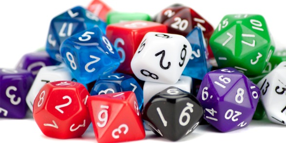](http://www.teatrodemesa.com/wp-content/uploads/2014/08/rpg_dice.jpg)“Tens dado?” Para quem quer responder de forma completa aqui vai uma pequena amostra de tipos de dados existentes…

[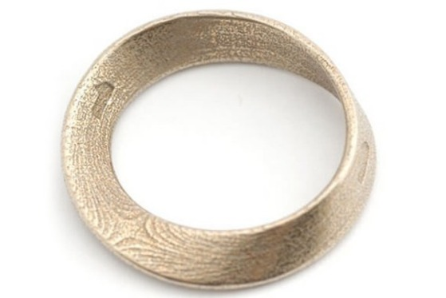](http://www.teatrodemesa.com/wp-content/uploads/2014/08/d01.jpg)

O d1, uma fita Mobius. Ideal para rolar o dano causado por uma única abelha, um acerto crítico com um cotonete ou um palavrão bem falado.

[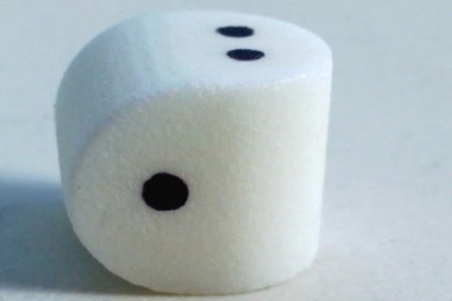](http://www.teatrodemesa.com/wp-content/uploads/2014/08/d02.jpg)

O d2, para o caso de seu grupo jogar em linguagem binária.

[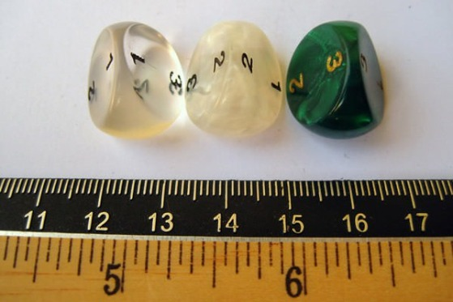](http://www.teatrodemesa.com/wp-content/uploads/2014/08/d03.jpg)

O d3: pois atualmente parece que tudo tem de ser feito de três maneiras.

[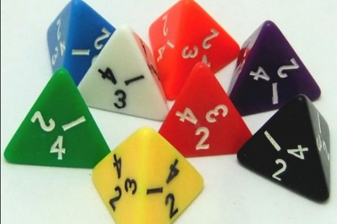](http://www.teatrodemesa.com/wp-content/uploads/2014/08/d04.jpg)

O d4: o formato clássico de estrepe não deixa ele rolar muito. Uma mini pirâmide assim por dizer.

[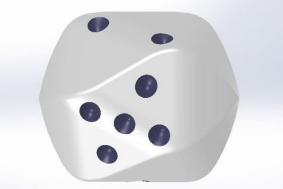](http://www.teatrodemesa.com/wp-content/uploads/2014/08/d05.jpg)

O d5: que uma forma suave ele tem. Se você sempre quis uma chance de 20 por cento para rolar o seu número ideal sem arredondar um d10, este é para você.

[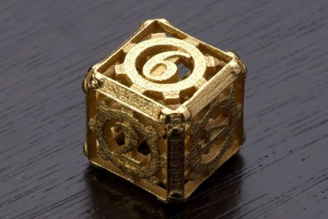](http://www.teatrodemesa.com/wp-content/uploads/2014/08/d06.jpg)

Chegamos ao dado de 6 lados, aquele encontrado em todo jogo de tabuleiro.

[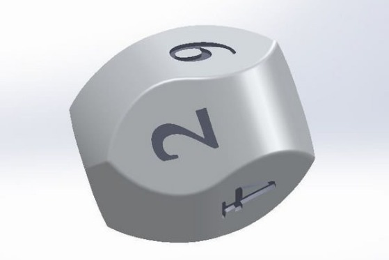](http://www.teatrodemesa.com/wp-content/uploads/2014/08/d06b.jpg)

Mas é claro que todo clássico pode vir a ser repaginado.

[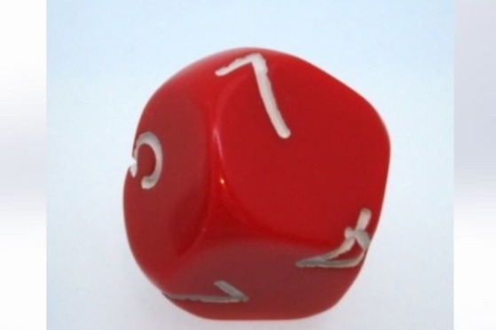](http://www.teatrodemesa.com/wp-content/uploads/2014/08/d07.jpg)

O dado de 7 lados, agora as coisas estão ficando estranhas por aqui.

[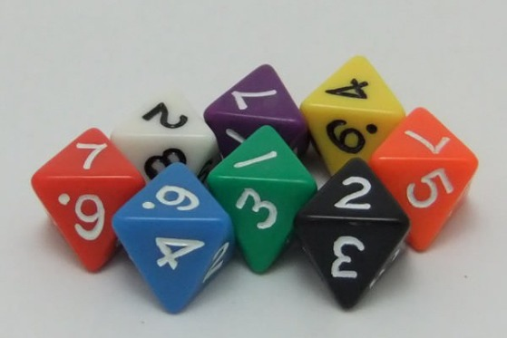](http://www.teatrodemesa.com/wp-content/uploads/2014/08/d08.jpg)

O d8, parece um diamante perfeitamente lapiDADO. Tá, desculpe a piada ruim.

[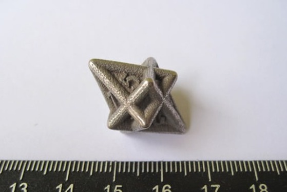](http://www.teatrodemesa.com/wp-content/uploads/2014/08/d08b.jpg)

Também disponível no formato “abominação profana”.

[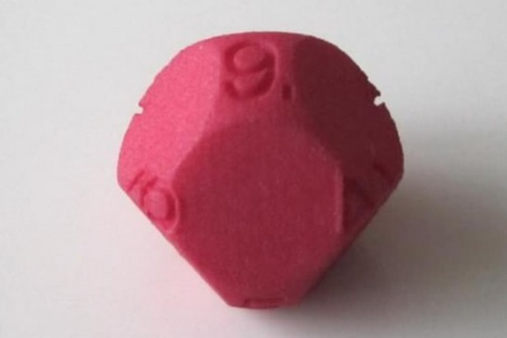](http://www.teatrodemesa.com/wp-content/uploads/2014/08/d09.jpg)

O dado de 9 lados, realmente não tem como explicar por que ele existe, mas ele está aí, né…

[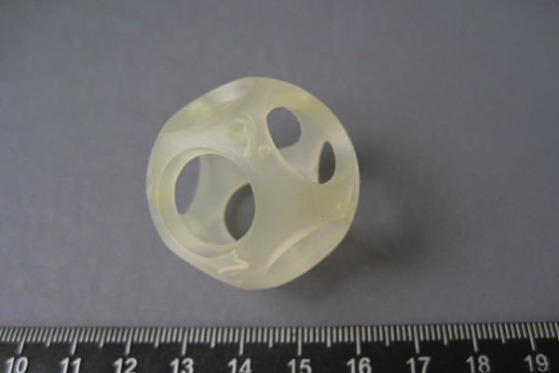](http://www.teatrodemesa.com/wp-content/uploads/2014/08/d09b.jpg)

Este d9 particularmente chama a atenção e pode ser usado como uma casa por um pequeno animal, com um minúsculo hamster-de-nove-lados.

[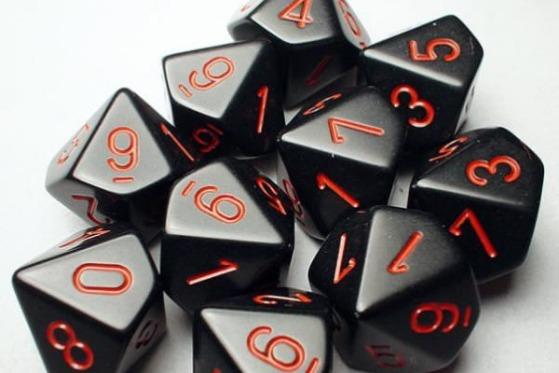](http://www.teatrodemesa.com/wp-content/uploads/2014/08/d10.jpg)

O d10 é o melhor amigo das espadas de duas mãos do AD&D e amantes de porcentagens em todo lugar.

[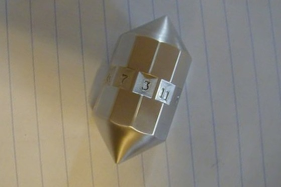](http://www.teatrodemesa.com/wp-content/uploads/2014/08/d11.jpg)

D11 Este abriu mão de ter uma forma “quase” esférica. A razão de sua existência é cercada de mistério…

[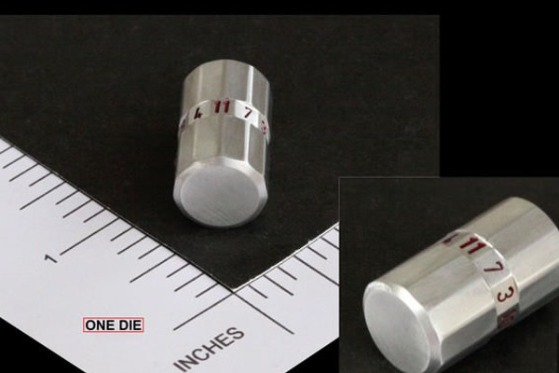](http://www.teatrodemesa.com/wp-content/uploads/2014/08/d11b.jpg)

… mas estudiosos afirmam que sua origem vem de um dialeto antigo para baleias… quem sabe élfico ou vulcano.

[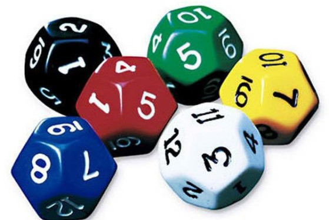](http://www.teatrodemesa.com/wp-content/uploads/2014/08/d12.jpg)

Quando seus pais e irmãos menores ficam confusos com o D20 por serem psicologicamente incapazes de fazer uma mínima identificação de dados.

[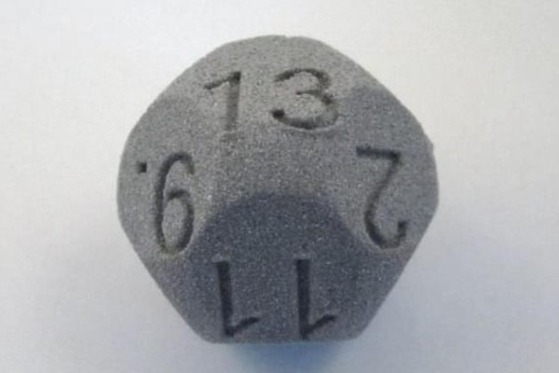](http://www.teatrodemesa.com/wp-content/uploads/2014/08/d13.jpg)

Ele existe só porque as pessoas supersticiosas disseram que tal dado não deveria ser feito.

[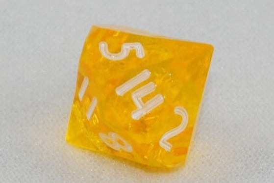](http://www.teatrodemesa.com/wp-content/uploads/2014/08/d14.jpg)

Não se esqueça dele.

[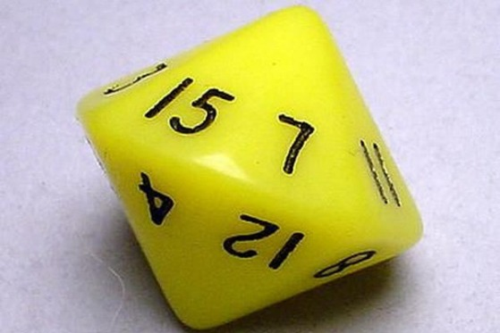](http://www.teatrodemesa.com/wp-content/uploads/2014/08/d15.jpg)

Por que se você rolar 3d5, nunca poderá ter o resultado 1.

[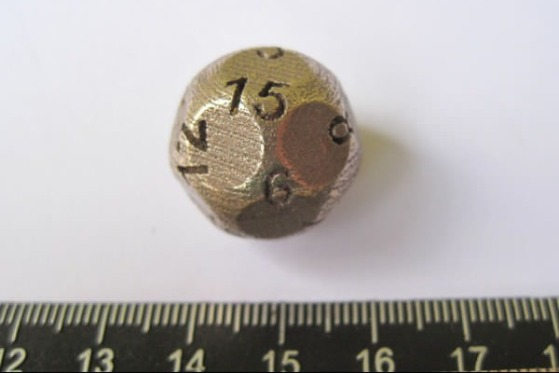](http://www.teatrodemesa.com/wp-content/uploads/2014/08/d15b.jpg)

Sinceramente, o anterior é mais prático…

[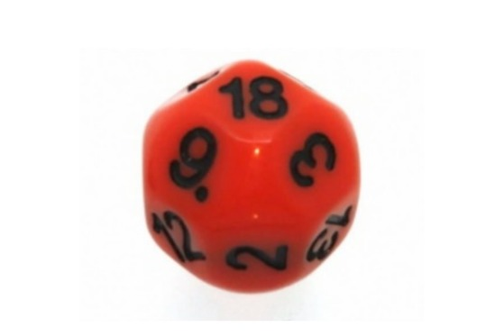](http://www.teatrodemesa.com/wp-content/uploads/2014/08/d18.jpg)

Peraí, o que aconteceu com o 16 e 17? Eles se parecem exatamente com os d15 só que com mais lados; chato isso não?

[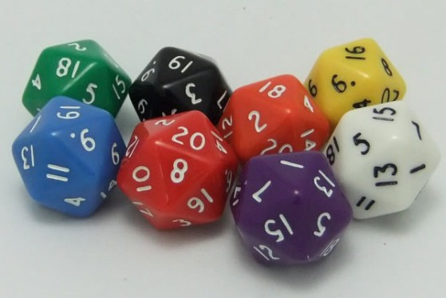](http://www.teatrodemesa.com/wp-content/uploads/2014/08/d20.jpg)

Universalmente reconhecido por RPGistas de todo mundo – menos por sistemas que não usam (não é verdade Daemon, GURPS e Shadowrun?)

[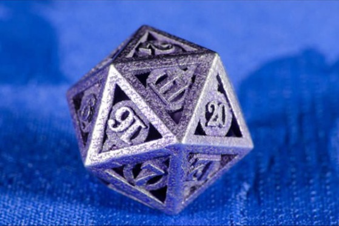](http://www.teatrodemesa.com/wp-content/uploads/2014/08/d20b.jpg)

Disponível também na versão “metálica”…

[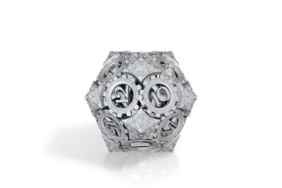](http://www.teatrodemesa.com/wp-content/uploads/2014/08/d20c.jpg)

Fato engraçado: Foi oferecido ao D20 uma oferta lucrativa para se tornar o porta-voz oficial para nerds, mas recusou porque ele não está nisso pelo dinheiro.

[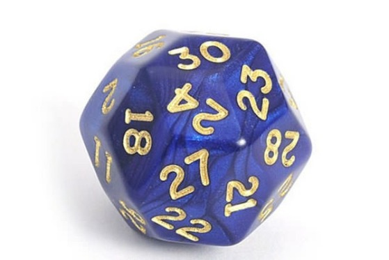](http://www.teatrodemesa.com/wp-content/uploads/2014/08/d30.jpg)

Este parece nunca querer parar de rolar até chegar no escudo do Mestre. Ele é legal, mesmo que ninguém nunca tenha pedido um teste de d30; ao menos você pode ficar rolando ele para passar o tempo enquanto aguarda sua vez na rodada.

[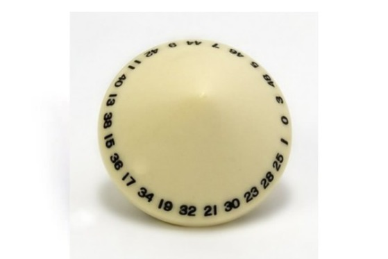](http://www.teatrodemesa.com/wp-content/uploads/2014/08/d50.jpg)

D50. Só pode ser pra f\*\*\*r a gente com a gente isso…

[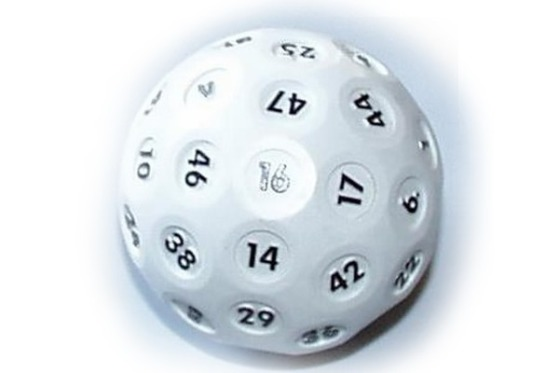](http://www.teatrodemesa.com/wp-content/uploads/2014/08/d50b.jpg)

Também disponível na versão bola d golfe.

[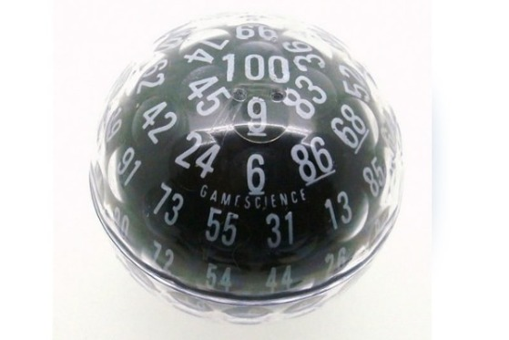](http://www.teatrodemesa.com/wp-content/uploads/2014/08/d100.jpg)

Só disponível na versão bola de golfe. Se você quer rolar uma porcentagem, o procure muito longe, porque essa bagaça vai continuar rolando até: (tamanho da mesa em polegadas) +1+ (distância de encontrá-lo sob a pia da cozinha, onde você nunca será capaz de obtê-lo sem como um cabo de vassoura ou algo assim).
