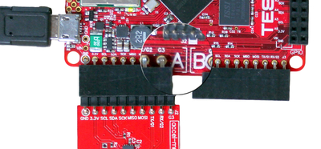
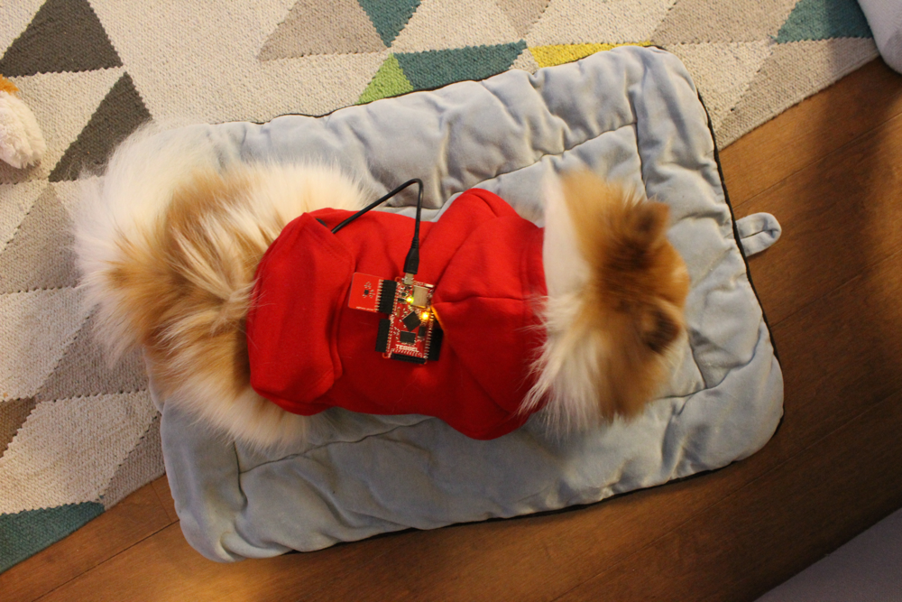
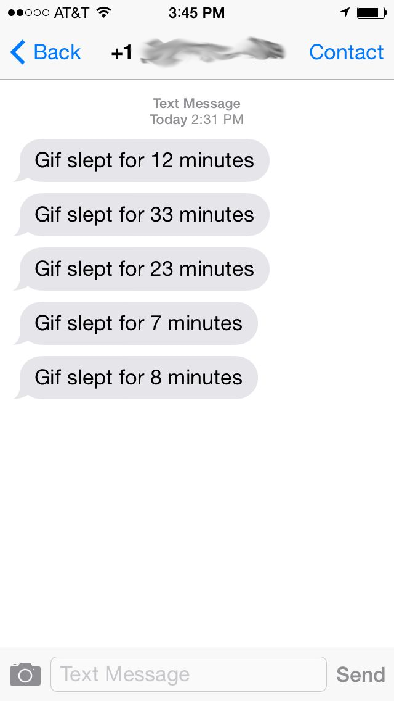

# Building a Sleep Tracker for Your Dog Using Tessel and Twilio

Have you ever wondered how long your dog sleeps while you’re away at work? I have. As a hacker this seemed like the perfect excuse to strap a microcontroller to my dog, Gif, and see if I could find out. To make it a little more fun I thought I could have it text me when Gif wakes up to let me know how long he slept for. In this post I’ll show how to build your very own sleep tracker for your dog using [Tessel](https://tessel.io/) and Twilio.

Pre-reqs:

### Getting Started With Tessel

Tessel is a Node.js-compatible microcontroller with built-in Wi-Fi. As a JavaScript lover I fell in love with this device as soon as I started using it. If this is your first time working with a Tessel I’d recommend working through their [quick start](http://start.tessel.io/install). Before you start make sure your Tessel is running the most recent firmware and connected to a [Wi-Fi network](http://start.tessel.io/wifi). The first thing thing we’ll do is setup your Tessel to send an SMS via Twilio.

### Sending an SMS from your Tessel

We’ll start by setting some default values and requiring the libraries we need:

JavaScript

|  |  |
| --- | --- |
|  | // your Twilio AccountSid and AuthToken  account\_sid"ACXXXXXXXXXXXXXXXXXXXXXXXXXXXXXXXX"  auth\_token"YYYYYYYYYYYYYYYYYYYYYYYYYYYYYYYY"  twilio\_num"5558675309"  number"55555555555"// The number you want to text the information to  clientrequire'twilio'account\_sidauth\_token |

We set our twilio AccountSid and AuthToken and use them to initialize our [Twilio Node module](https://twilio.github.io/twilio-node/) so we can send a text message. We then set some variables we’ll want to use when we send our message – the twilio number we texting from and the phone number you want to text to. We also need to install the Twilio library. Even though we’re doing this locally the library will get synced to the device when we push our code to the Tessel.

Shell

|  |  |
| --- | --- |
|  | install twilio |

We’ll be using the Twilio library to send our message but to make things a bit easier later on we’re going to be wrapping this code in a function called sendText().

JavaScript

|  |  |
| --- | --- |
|  | sendTextnumbertwilio\_num"This text message was sent by Tessel. Cool, right?!"  functionsendText  clientmessagescreate  functionerrormessage  error  console'Success! The SID for this SMS message is:'  consolemessage  console'Message sent on:'  consolemessagedateCreated  console'Oops! There was an error.'error |

If you’ve worked with the Twilio node library before the rest of this code should look very familiar. We’re using the library to POST to the [Messages resource](https://www.twilio.com/docs/api/rest/sending-messages) to create a new SMS message. We do some basic error checking so we can make sure nothing went wrong.

Once you’re done, your code should look like [this gist](https://gist.github.com/rickyrobinett/5bc3631464684dc855fa). Run this app on your tessel and send yourself a text message.

Shell

|  |  |
| --- | --- |
|  | tessel twilio |

### Your Lazy Dog

Now that we’ve built the functionality to send a text message from our Tessel we need to write the code to detect just how lazy your dog is being while you’re away. We’ll use the accelerometer to do this. First, plug in your accelerometer module to port A.

Since the accelerometer module isn’t included on the Tessel by default we need to install it. Specifically we’ll be using the [accel-mma84 library](https://github.com/tessel/accel-mma84) to interact with the accelerometer:

Shell

|  |  |
| --- | --- |
|  | install accelmma84 |

Then initialize it in your code:

JavaScript

|  |  |
| --- | --- |
|  | accelrequire'accel-mma84'tessel |

Let’s write some basic code to make sure our accelerometer is functioning correctly:

JavaScript

|  |  |
| --- | --- |
|  | // Initialize the accelerometer  accel'ready'function  // Stream accelerometer data  accel'data'function  console  accel'error'function  console'Error:' |

In this code we’re waiting until our accelerometer is ready and then we’re streaming the data as it comes in. The data we get back is an array of floats representing the acceleration on the X, Y and Z axes. If there’s an error, we’re logging that. If you’re getting an error try updating your firmware or resetting the Tessel by pressing the reset button right next to the microusb port.

Once we know our accelerometer is working we can start writing the code that detects if your dog is sleeping. We’ll be using a very basic algorithm to determine if our dog is asleep or awake. We’ll compare the last x-axis changed position to the current value of the x-axis on our accelerometer. If these values differ we know there’s been movement and determine how much time has passed . A movement after any period greater than 5 minutes we’ll consider sleep and send out a message about how long the dog slept.

Let’s set up a couple variables we’ll be using to track the movement intervals:

JavaScript

|  |  |
| --- | --- |
|  | last\_movement  last\_movement\_time |

We’ll be using the last\_movement and last\_movement\_time variables to track movement from the accelerometer and see how much time has passed between movements.

Let’s dive into the code we’ll use to detect when there’s movement with our accelerometer:

JavaScript

|  |  |
| --- | --- |
|  | // Initialize the accelerometer  accel'ready'function  // Stream accelerometer data  accelsetOutputRatefunctionrateSet  accelsetScaleRangefunctionscaleSet  accel'data'function  last\_movementtoFixed  last\_movementtoFixed  minutes last\_movement\_time  last\_movement\_time  minutes  // send text  sendTextnumbertwilio\_num"Your dog slept for "roundminutes" minutes" |

We want to update a couple ways our accelerometer is tracking data to optimize for our use case. Output rate determines how often we’re sampling data from the accelerometer. Since we’re interested in larger trends we’ll change the output rate to 1.56 [Hz](http://www.wikiwand.com/en/Hertz) (the lowest available for the accelerometer) to sample less often. Similarly, we aren’t concerned with a super precise reading so we can set our scale to 8 Gs of acceleration. [This may vary based on the dog you are using](https://www.youtube.com/watch?v=9CdVTCDdEwI).

After the data starts streaming we compare our last movement to the current position of the x-axis on our accelerometer. We’re trimming this position to 1 decimal point because we’re not interested in very small movements. If there’s been a movement we’ll see how long it’s been since the last movement. This information is in milliseconds so we convert it to minutes. We probably only want to know if our dog has been sleeping for an extended amount of time, so we’re only triggering a text message if it’s been more than 5 minutes since the last movement.

If it’s been more than 5 minutes we call the sendText function we wrote earlier to notify you how long your dog has been sleeping.

Your final code should look like [this](https://gist.github.com/rickyrobinett/04165da47bc8f60190c5). Let’s test it out by running it:

Shell

|  |  |
| --- | --- |
|  | tessel twilio |

### Deploy to Your Dog

Once we’ve tested our app let’s use the tessel push command to push our app into Tessel’s flash memory. This will auto-run the app whenever the Tessel powers up.

Shell

|  |  |
| --- | --- |
|  | tessel twilio |

Now strap this puppy on to your puppy (pun intended). I put mine on Gif’s Twilio hoodie so it would be more comfortable:

Now you should be notified how much your puppy sleeps.  Here’s a peek into Gif’s sleeping patterns:

We successfully used the Tessel to enter the world of #DogHacking. What’s next? Maybe you could use the Tessel GPS [module](https://www.trycelery.com/shop/TEC) to find out your dog is somewhere they shouldn’t be or use the camera module to get updates of what your dog is seeing in real-time. Have any questions or want to show me how cute your dog is? Reach out on [twitter](http://twitter.com/rickyrobinett) or via [e-mail](mailto:ricky@twilio.com).
