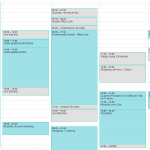

Sempre que cito esse assunto, muitos leitores me pedem ajuda para descobrir como conseguir renda extra. Já que são muitos pedidos e a resposta é complexa demais para escrever em comentários, resolvi então escrever um post relatando a minha experiência pessoal, de forma que talvez ela possa inspirá-los de alguma maneira.

A primeira vez que pensei em buscar uma renda extra para mim, eu já tinha um emprego convencional como publicitária. Porém, em início de carreira, a gente sempre acha que pode ganhar um pouco mais do que ganha na folha de pagamento (e é verdade), então passei a ir atrás de alternativas.

A primeira coisa que me perguntei foi: o que eu sei fazer? Na época, eu trabalhava como webdesigner e estava começando a trabalhar com conteúdo para web. Eu já tinha o blog, mas ele era um hobby. Então comecei a divulgar para amigos que eu estava fazendo trabalhos freelancers de webdesign e textos para terceiros. Não foi imediato, mas deu certo e alguns trabalhos começaram a aparecer. Eu acho, então, que **a primeira coisa que deve ser vista é o que você sabe fazer, pois seu conhecimento pode valer alguma coisa para alguém**.

Esse trabalho freelancer deu tão certo que me permitiu pagar as contas enquanto estava grávida do nosso filho, e pude trabalhar somente em casa durante toda a gravidez (o que foi ótimo). Eu pedi demissão do meu trabalho logo no início da gravidez, para fazer isso.  Se não estivesse grávida, poderia continuar levando meu trabalho freelancer em paralelo ao meu emprego convencional e isso seria uma renda extra. Tenho diversos amigos publicitários que fazem trabalhos do tipo e, muitas vezes, ganham mais com esse tipo de trabalho que em seus empregos de carteira assinada.

Em segundo lugar, eu acho que **a pessoa precisa ter algum tipo de veia empreendedora**, no sentido de não esperar sentada as coisas acontecerem. Se for para vender refrigerante na porta de um estádio de futebol, que seja. Se for para fazer bicos como faxineiro(a), também. Serviços nunca faltarão, pois as pessoas estão ocupadas demais e pagando outras para que façam alguns trabalhos por elas. Isso é uma realidade que dificilmente mudará, por maior que seja a crise que o país enfrente.

Existem aquelas alternativas de “ganhe dinheiro pela Internet”, mas não conheço ninguém que tenha dado certo com isso. Não significa que não dê, também, mas eu, **se fosse optar hoje, começaria com algo que apenas tivesse a ver comigo, pois isso pode direcionar o que vai acontecer na minha vida profissionalmente dali em diante**. Muita gente se descobre nesse plano B – eu mesma sou um desses casos.

O blog era o meu hobby. Ele pegou aquele boom de blogs dos anos 2010 para cá e, desde então, venho sido contatada por marcas e empresas para anunciar no blog, fazer sorteios, publieditoriais etc. Eu gostava tanto de ajudar as pessoas a se organizarem com o meu blog que passei a investir no meu conhecimento, fazendo cursos, sempre lendo os lançamentos da área, revistas etc. Até que, com o tempo, virou minha ocupação principal. Eu planejava isso? Não, foi fruto de algo que eu fazia por amor, de graça, e fiz durante muitos anos. O blog tem oito anos, levou tempo para chegar onde está, além de eu já ter blogs anteriores desde 2000. Há muitos blogs novos que são muito bacanas e acabam virando meio de trabalho também. Mas não é regra. Nada é regra.

O que eu acho que pode ser regra: **encontrar algo que você goste de fazer e se perguntar como pode gerar renda através dessa atividade**. Se você é bom em matemática, pode dar aulas particulares. Se gosta de tricotar, pode fazer toucas e cachecóis para os colegas de trabalho. Não tem como eu escrever um post dando ideias porque essas ideias são extremamente pessoais – devem partir de quem você é e do que gosta de fazer, não de mim, que não te conheço. [anexo ausente]

Faça uma reflexão sobre o que você gosta de fazer na vida (ou faz bem) e desenvolva meios para gerar renda através disso. Hoje, com a Internet, ninguém precisa depender de uma rede pequena de amigos para vender ou prestar serviços. Basta ter um bom conhecimento e saber se divulgar com um blog, site, vídeos no YouTube, redes sociais. Você pode até mesmo prestar alguns serviços de graça para amigos e conhecidos para tirar fotos e usar como portfolio do seu trabalho.

Acho que pode ser uma boa falar sobre empreendedorismo aqui no blog porque, afinal, estou vivenciando isso também. Com certeza alguns leitores terão experiências para compartilhar nos comentários. Se for seu caso, por favor, compartilhe!

### Textos relacionados:

- [Organizando projetos no Evernote – o processo](http://vidaorganizada.com/produtividade/organizando-projetos-no-evernote-o-processo/)
- [Quer criar um blog legal? Veja como fazer o planejamento](http://vidaorganizada.com/produtividade/quer-criar-um-blog-legal-veja-como-fazer-o-planejamento/)
- [Hack para agenda: duas cores](http://vidaorganizada.com/produtividade/agenda/hack-para-agenda-duas-cores/)
- [Acessórios de limpeza que eu recomendo](http://vidaorganizada.com/produtividade/acessorios-de-limpeza-que-eu-recomendo/)
- [Faça você mesma(o): moldura de espelho com papel contact](http://vidaorganizada.com/produtividade/faca-voce-mesmao-moldura-de-espelho-com-papel-contact/)
