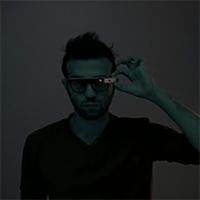
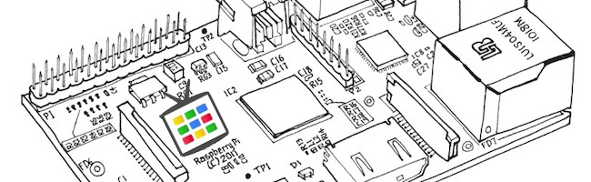
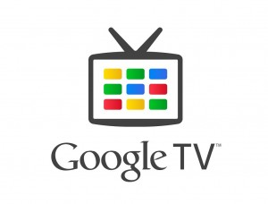
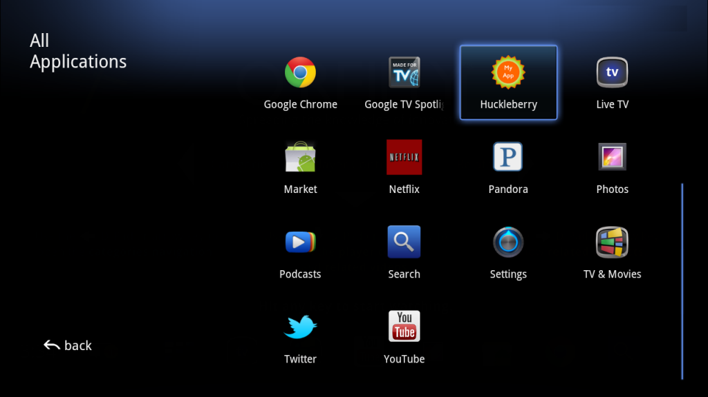
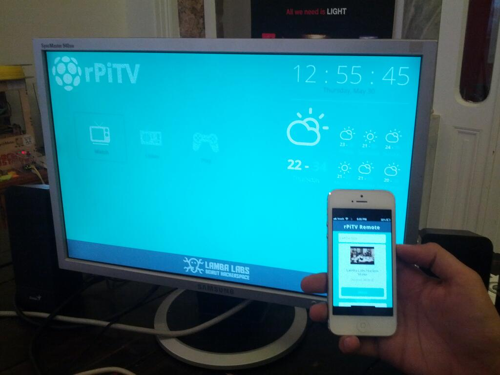
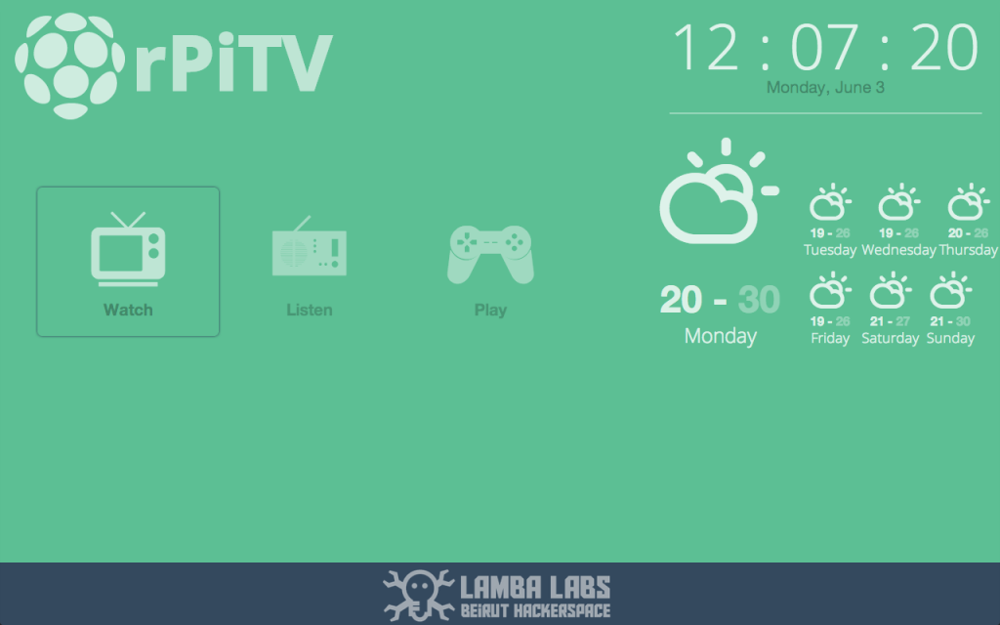
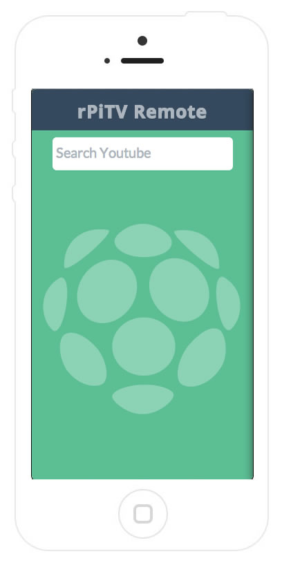

# Tutorial: Build your own Google TV Using RaspberryPi, NodeJS and Socket.io

*Oct 13, 2014*

*[Codementor Donald Derek](https://www.codementor.io/donald) is a conference speaker, an open-source advocate, a maker and an activist. He organizes, facilitates, and mentors startup events, and has also personally won several awards for his projects, including [n!mp](https://github.com/DonaldDerek/nimp-2.0), a SoundCloud + Jamendo Music player with a web mobile remote app, and [meeneeme](https://github.com/DonaldDerek/meeneeme), a Tamagotchi game based on your Foursquare checkins. He is currently a researcher at the [MIT Media Lab](http://www.media.mit.edu/) – Responsive Environments.*

*Donald has also created the [RaspberryPi-Tv](https://github.com/DonaldDerek/RaspberryPiTV), in which he shares with us a tutorial on how to build your own Google TV with it. This article was originally posted [at his blog](http://blog.donaldderek.com/2013/06/build-your-own-google-tv-using-raspberrypi-nodejs-and-socket-io/).*

---



Please note that this project is not intended to replicate an actual GoogleTV, but it’s simply a proof of concept using modern web technologies.

Watch the full workshop [here](http://www.menaversity.com/view_page.php?id=18 "menaversity") hosted by [Menaversity](http://www.menaversity.com/view_page.php?id=18 "Menaveristy")

```
This workshop was given at Lamba Labs Beirut First Hackerspace 
after a series of lightning talks check out the presentation here
If you'd like to bypass the tutorial and jump into the fun stuff, you can always  fork the code on Github
```



# What’s Google TV ?

Turned out that Google is also doing its own thing for the 10-foot screen. Google announced 2 versions of their famous new TV, the first is called the Buddy Box which is currently an expensive box manufactured by [Sony](http://www.google.com/tv/get.html) and the second is an Integrated TV built right into the TV set that will be announced soon.

The Google TV looks something like that:



**Developers:** you can start building your own Web Apps for the Google TV or renovate any android app to fit the 10′ experience, all the resources can be found at Google’s Developers [Site](https://developers.google.com/tv/)

# Build your own Google TV

In this tutorial you’re going to **build your own version of the Google TV** using the following open source technologies:

**Hardware:**

- The [RaspberryPi](http://www.raspberrypi.org/)

**Software Stack:**

- [Raspbian](http://www.raspbian.org/) OS – a Debian distro specially made for the rPi
- [NodeJs](http://nodejs.org/)
  - [Socket.io](http://socket.io/) – to handle the connection between our remote and our TV via websockets
  - [Express](http://expressjs.com/) – to handle some basic http requests
  - [Omxcontrol](https://npmjs.org/package/omxcontrol) – a simple module to control the OMXPlayer which is the best video player on the rPi
- [Chromium](http://www.chromium.org/Home) Browser
- [OMXPlayer](http://omxplayer.sconde.net/)
- [Youtube-dl](http://rg3.github.io/youtube-dl/) – a script that let you download youtube videos
- [QuoJS](http://quojs.tapquo.com/) – to handle swipe gestures on the mobile web app
- HTML5, CSS3 transitions, Javascript, and [Moustache](http://mustache.github.io/) as a template engine
- Youtube API

## The end result



# Walkthrough

The project is divided into 4 main categories:

1. Installing the software stack
2. Basic shell commands & scripts
3. Building the back-end: NodeJS + Express + Socket.io
4. Building the front-end: Dashboard and Remote App

## 1.Installing the software stack:

#### Install Raspbian & NodeJS

Follow this [tutorial](http://blog.rueedlinger.ch/2013/03/raspberry-pi-and-nodejs-basic-setup/) to install Raspbian and Node Js on your Raspberry Pi

#### Install Chromium & Youtube-dl

Install Chromium Browser for the Raspberry Pi [Source](http://elinux.org/RPi_Chromium)

```
sudo apt-get install chromium-browser
```

In order to have a better display you can also install MC core fonts using

```
sudo apt-get install ttf-mscorefonts-installer
```

Install and Update Youtube Downloader

```
sudo apt-get install youtube-dl 

sudo youtube-dl -U
```

Note-1: There’s a problem when you want to stream videos on the RaspberryPi from youtube in Chromium, they’re extremely slow because the videos are not being rendered on the GPU. Youtube-dl comes as a quick alternative, the video is downloaded instead then played by the OMXPlayer which will render our videos on the GPU giving us a good quality of HD videos.
Note-2: The OMXPlayer is installed by default on the Raspbian.

### 2.Basic shell commands & scripts

If you’re using SSH to connect to your RaspberryPi you should first add “DISPLAY=:0.0″ to your env variables, by simply executing

```
export DISPLAY=:0.0
```

To check all your environment variables

```
env
```

Test Chromium in Kiosk Mode:

```
chromium --kiosk http://www.google.com
```

Test Youtube-dl

```
youtube-dl youtube_video_url
```

I’ve added few arguments to the youtube-dl command to change the name of the downloaded file to be just the “-o youtube ID [dot] the extension” and with the “-f /22/18 ” I can force this script to download for me a 720p version of the video. Check out the full list of supported youtube formats [here](http://en.wikipedia.org/wiki/YouTube#Quality_and_codecs)

```
youtube-dl  -o "%(id)s.%(ext)s" -f /22/18 youtube_video_url
```

After downloading the video, try playing it using OMXPLayer

```
omxplayer youtube_video_file
```

Have fun trying the keyboard shortcuts to pause/resume your video and a lot [more](http://omxplayer.sconde.net/)

Fancy! Let’s automate this process using Node JS

## Building the backend: NodeJS + Express + Socket.io

The source code is intended to be simple for the sake of the workshop. Here’s the project’s hierarchy:

- public
  - js
  - css
  - images
  - fonts
  - index.html
  - remote.html
- app.js
- package.json

**Package.json** – A JSON file needed by npm to auto-install dependencies and save some basic info about your project

```
{
    "name": "RasPi.TV",
    "version": "0.0.1",
    "private": false,
    "scripts": {
        "start": "node app.js"
    },
    "dependencies": {
    "express": "3.1.1",
    "socket.io":"0.9.14",
    "omxcontrol":"*"
    }
}
```

after creating this file, go to your app directory and run the following to install the dependencies.

```
npm install
```

Note-3: Notice that a folder called ***node\_modules***will be created prior to this action, if you like to use git, don’t forget to create a **.gitignore** file and simply write into it “**node\_modules**” this will ignore the folder node\_modules from being added to your git project

Create the app.js file and lets start by creating our basic HTTP Express Server

```
var express = require('express')
  , app = express()  
  , server = require('http').createServer(app)
  , path = require('path')

// all environments
app.set('port', process.env.TEST_PORT || 8080);
app.use(express.favicon());
app.use(express.logger('dev'));
app.use(express.bodyParser());
app.use(express.methodOverride());
app.use(express.static(path.join(__dirname, 'public')));

//Routes
app.get('/', function (req, res) {
  res.sendfile(__dirname + '/public/index.html');
});

app.get('/remote', function (req, res) {
  res.sendfile(__dirname + '/public/remote.html');
});

server.listen(app.get('port'), function(){
  console.log('Express server listening on port ' + app.get('port'));
});
```

This is our basic Express HTTP server configuration with our routes. To test what’ve done so far, you should first create the index.html and remote.html files inside the public/ directory, write your favorite “Hello, World” messages into them, then go back to your terminal and execute

```
node app.js
```

or

```
npm start
```

Note-4: That will only work if you have added the following piece of code to your package.json

```
...
"scripts": {
        "start": "node app.js"
    },
...
```

Once your server starts it will output that **Express server listening on port 8080**  
To test your “Hello, World” pages you should run this application in the background by simply doing

```
node app.js &
```

Now this is the most primitive way to launch a Node application in the background, while learning node you might bump into some modules that automates this simple task, just like [Forever.js](https://github.com/nodejitsu/forever)

Now we have our Node Application up and running in the background, let’s open chromium in kiosk mode and test our Hello, World pages.

```
chromium --kiosk http://localhost:8080
```

## Adding the Socket.io Magic

I strongly believe that WebSockets are the foundation of the modern web, I always like to point out the following analogy that helped me understand Socket.io

When AJAX first popped out, old skool developers felt its magic, but they’ve encountered many problems due to how different browsers handle Asynchronous JavaScript and XML requests. jQuery came with the solution by providing a nice and minimal set of functions to deal with the browsers nightmare. Socket.io did the same but for WebSockets and even more!

In order to provide realtime connectivity on every browser, Socket.IO selects the most capable transport at runtime, without it affecting the API.

1. WebSocket
2. Adobe® Flash® Socket
3. AJAX long polling
4. AJAX multipart streaming
5. Forever Iframe
6. JSONP Polling

In order to integrate Socket.io we should add the following to our **app.js** file:

```
var express = require('express')
  , app = express()  
  , server = require('http').createServer(app)
  , path = require('path')
  , io = require('socket.io').listen(server)
  , spawn = require('child_process').spawn
```

and to minify the logs add this:

```
//Socket.io Config
io.set('log level', 1);
```

When developing with Socket.io always think like you’re creating a Hello, World Chat Application. I’ve added a simple Chat Application done with Node & Socket.io on [a github repo](https://github.com/DonaldDerek/Chat-Node) for the sake of this tutorial!

Our Socket.io Server is ready, but it doesn’t do anything, we should implement how we process messages and events sent from the client to the server.

Here’s how you implement this on the server’s side, note that you should also implement how you handle messages on the client’s side, we will see that as we progress throughout this tutorial.

```
io.sockets.on('connection', function (socket) {
    socket.emit('message', { message: 'welcome to the chat' });
    socket.on('send', function (data) {
        //Emit to all
        io.sockets.emit('message', data);
    });
});
```

Now our server Emits the message “message” whenever a new client is connected, and waits for an event name “send” to process the data and emit it back to all connected clients

In our case We have two types of clients: The RaspberryPi Display (Screen) and the Mobile Web Application (Remote)

```
var ss;
//Socket.io Server
io.sockets.on('connection', function (socket) {

 socket.on("screen", function(data){
   socket.type = "screen";
   //Save the screen socket
   ss = socket;
   console.log("Screen ready...");
 });

 socket.on("remote", function(data){
   socket.type = "remote";
   console.log("Remote ready...");
   if(ss != undefined){
      console.log("Synced...");
   }
 });
)};
```

### Client Side Sockets Handeling

inside remote.html we should have the following:

```
	<script src="/socket.io/socket.io.js"> </script>
	<script>
	  //use http://raspberryPi.local if your using Avahi Service 
          //or use your RasperryPi IP instead
          var socket = io.connect('http://raspberrypi.local:8080');
	  socket.on('connect', function(data){
		socket.emit('screen');
	  });
	</script>
```

On our index.html

```
	<script src="/socket.io/socket.io.js"> </script>
	<script>
	  //use http://raspberryPi.local if your using Avahi Service 
          //or use your RasperryPi IP instead
          var socket = io.connect('http://raspberrypi.local:8080');
	  socket.on('connect', function(data){
		socket.emit('screen');
	  });
	</script>
```

### Execute Shell Commands from Node Server

Node enables us to run a system command within a new child process, and listen in on its input/output. This includes being able to pass arguments to the command, and even pipe the results of one command to another. 

The basic way of executing shell commands from NodeJS is very simple

```
spawn('echo',['foobar']);
```

But if you want to pipe in the output, you should add the following function to your app.js file:

```
//Run and pipe shell script output 
function run_shell(cmd, args, cb, end) {
    var spawn = require('child_process').spawn,
        child = spawn(cmd, args),
        me = this;
    child.stdout.on('data', function (buffer) { cb(me, buffer) });
    child.stdout.on('end', end);
}
```

### Adding OMXControl – the OMXPlayer controller Node Module

Luckily I found a node module on [npmjs.org](https://npmjs.org/package/omxcontrol) that let you control your OMXPlayer using Express!  
just add the following to your app.js file to use it.

```
var omx = require('omxcontrol');

//use it with express
app.use(omx());
```

This will create for us the following routes, that we can use to control and play our videos:

```
http://localhost:8080/omx/start/:filename

http://localhost:8080/omx/pause

http://localhost:8080/omx/quit
```

Pretty Awesome!

### Putting it all together

Our evolved app.js file

```
/**
 * Module dependencies.
 */

var express = require('express')
  , app = express()  
  , server = require('http').createServer(app)
  , path = require('path')
  , io = require('socket.io').listen(server)
  , spawn = require('child_process').spawn
  , omx = require('omxcontrol');

// all environments
app.set('port', process.env.TEST_PORT || 8080);
app.use(express.favicon());
app.use(express.logger('dev'));
app.use(express.bodyParser());
app.use(express.methodOverride());
app.use(express.static(path.join(__dirname, 'public')));
app.use(omx());

//Routes
app.get('/', function (req, res) {
  res.sendfile(__dirname + '/public/index.html');
});

app.get('/remote', function (req, res) {
  res.sendfile(__dirname + '/public/remote.html');
});

//Socket.io Congfig
io.set('log level', 1);

server.listen(app.get('port'), function(){
  console.log('Express server listening on port ' + app.get('port'));
});

//Run and pipe shell script output 
function run_shell(cmd, args, cb, end) {
    var spawn = require('child_process').spawn,
        child = spawn(cmd, args),
        me = this;
    child.stdout.on('data', function (buffer) { cb(me, buffer) });
    child.stdout.on('end', end);
}

//Save the Screen Socket in this variable
var ss;
//Socket.io Server
io.sockets.on('connection', function (socket) {

 socket.on("screen", function(data){
   socket.type = "screen";
   ss = socket;
   console.log("Screen ready...");
 });
 socket.on("remote", function(data){
   socket.type = "remote";
   console.log("Remote ready...");
 });

 socket.on("controll", function(data){
	console.log(data);
   if(socket.type === "remote"){

     if(data.action === "tap"){
         if(ss != undefined){
            ss.emit("controlling", {action:"enter"}); 
            }
     }
     else if(data.action === "swipeLeft"){
      if(ss != undefined){
          ss.emit("controlling", {action:"goLeft"}); 
          }
     }
     else if(data.action === "swipeRight"){
       if(ss != undefined){
           ss.emit("controlling", {action:"goRight"}); 
           }
     }
   }
 });

 socket.on("video", function(data){

    if( data.action === "play"){
    var id = data.video_id,
         url = "http://www.youtube.com/watch?v="+id;

    var runShell = new run_shell('youtube-dl',['-o','%(id)s.%(ext)s','-f','/18/22',url],
        function (me, buffer) { 
            me.stdout += buffer.toString();
            socket.emit("loading",{output: me.stdout});
            console.log(me.stdout)
         },
        function () { 
            //child = spawn('omxplayer',[id+'.mp4']);
            omx.start(id+'.mp4');
        });
    }    

 });
});
```

## Building the front-end



Describing in details how I built the front-end is outside the scope of this tutorial, however I would like to point out few tips that I discovered while doing this project over the weekend.

When designing for the 10′ Screen there’s some design considerations that you should follow, Google assembled a nice set of these standards on their [Developers Site](https://developers.google.com/tv/web/docs/design_for_tv)



raspberry pi remote

Instead of creating a typical remote, full of fake buttons, I decided to give [QuoJS](http://quojs.tapquo.com/) a try, it’s really fantastic and easy to use!

```
$$(".r-container").swipeLeft(function(){
socket.emit('control',{action:"swipeLeft"}); 
});
```

Here’s an example of how I send the message “Control” back to the server with the data action:”swipeLeft”  
the server will handle that message by sending it to the screen, the screen client will handle this message by moving the selected square to the next app (Watch, Listen, Play)

I’ve also stumbled upon few trick that will let your iPhone mobile web app look like a native one with a nice icon and a splash screen.  
Just add the following to your HTML <head></head> blocks

```
<link rel="apple-touch-icon" href="images/custom_icon.png"/>
<link rel="apple-touch-startup-image" href="images/startup.png">
<meta name="viewport" content="width=device-width initial-scale=1, maximum-scale=1, user-scalable=no" />
<meta name="apple-mobile-web-app-title" content="Remote">
<meta name="apple-mobile-web-app-capable" content="yes">
```

## Wrap-up

This project is still a work in progress, updates coming soon. If you liked this tutorial please don’t forget to check the source code on [Github](https://github.com/DonaldDerek/googleTV) and show some love by starring it .

---

[](https://www.codementor.io/donald)**Need Donald’s help? Book a 1-on-1 session!**

or [join us as an expert mentor](http://www.codementor.io/mentor/apply)!

### Codementor Helps You Build Projects Faster

Codementor is your instant 1:1 expert mentor helping you in real time.
